<h1 align="center">Motion Effects 325</h1>

<p align="center">
<b>325 motion effects and design techniques (137 motion effects, 102 3D graphics techniques and 86 more techniques), one code file each, rendered to 5-second vertical videos, with a ready-to-paste prompt for every one.</b><br>
<b>모션 효과와 디자인 기법 325가지(모션 효과 137, 3D 그래픽 기법 102, 그 밖의 기법 86). 하나마다 코드 파일 하나, 5초 세로 영상, 바로 붙여 넣는 프롬프트.</b>
</p>

<p align="center">
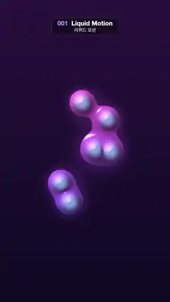 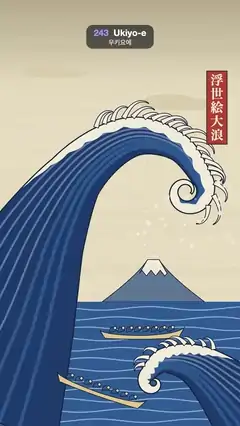 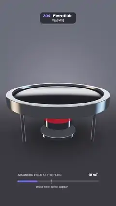 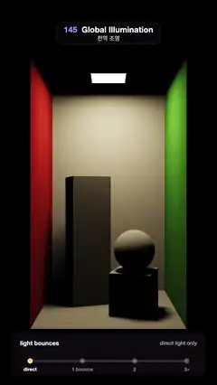 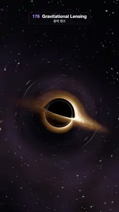 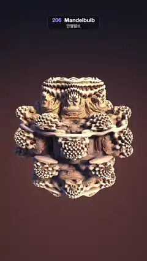
</p>

<p align="center">
<a href="https://sueun-dev.github.io/motion-effects/"><b>▶ Watch all 325 · 325개 영상 보기</b></a><br>
<a href="#english">English</a> · <a href="#한국어">한국어</a> · <a href="#gallery--갤러리">Gallery · 갤러리</a> · <a href="prompts/README.md">Prompts · 프롬프트</a> · <a href="EFFECTS.md">List · 목록</a>
</p>

---

## English

### What's here

- **325 effects in 34 categories**. Categories 1–9 are 137 motion effects: design styles, print & retro, typography, shaders & generative, particles, 3D, animation principles, UI & interaction, and transitions. Categories 10–20 are 102 3D graphics techniques (138–239): lighting & shadows, materials & surface detail, reflection, refraction & ray tracing, atmosphere & volumes, geometry & modeling, simulation & physics, nature & procedural worlds, raymarching & fractals, animation & characters, camera & lens, and rendering & stylization. Categories 21–26 are 39 more techniques (240–278): art movements & styles, generative math, film & animation craft, physics & characters, spatial illusions, and AI-era techniques. Categories 27–34 are 47 more techniques (279–325): retro 3D, rendering internals, shading tricks, modeling craft, physical phenomena, capture & camera rigs, classic optical illusions, and art & craft. ★ marks the 20 effects from a popular Instagram reel by [@aewon.studio](https://www.instagram.com/aewon.studio/); the other 117 motion effects extend it to the motion styles people actually use, the 3D set covers the techniques of real-time and offline 3D graphics, the third set adds art movements, generative math, film craft, physics, spatial illusions and AI-era looks, and the fourth adds retro 3D, how a renderer works, modeling, physical phenomena, classic illusions and art & craft, each shown so you can see the technique at work. An effect known under several names is one entry, with the other names in the list.
- **A video for every effect**: `videos/NNN-slug.mp4`, 1080 × 1920, 30 fps, exactly 5 seconds, H.264, looping seamlessly. Watch them all playing on the [gallery page](https://sueun-dev.github.io/motion-effects/).
- **The code for every effect**: `effects/NNN-slug.js`, one small file each (Canvas 2D, a WebGL2 fragment shader, or three.js).
- **A prompt for every effect**: `prompts/NNN-slug.md`, in English and Korean. Paste it into an AI coding assistant and you get a standalone HTML version of that effect.
- `contact-sheet.jpg`: all 325 on one page.

### Quick start

```bash
git clone https://github.com/sueun-dev/motion-effects.git
cd motion-effects
npm install                    # three.js and an ffmpeg build (ffmpeg-static)
npm run render -- 010          # one effect -> videos/010-grainy-gradient.mp4
npm run render -- 031-046      # a range of numbers
npm run render -- --jobs 4     # all 325
npm run sheet                  # contact-sheet.jpg
```

You need Node 18+ and Google Chrome (or Chromium: point the `CHROME` environment variable at it). Built and tested on macOS with Chrome; Linux should work with Chrome or Chromium. The 137 motion effects take about 7–8 minutes with `--jobs 4` on an Apple silicon Mac; the 3D set takes longer, because some of its effects ray-march every pixel or average several renders per frame for motion blur.

### How it works

1. `render.mjs` serves this folder on a local port and opens headless Chrome at `render.html?fx=NNN-slug`.
2. `runner.js` loads the effect, draws frame *i* at time *t = i / 30* (150 frames), adds the small number-and-name label at the top, and posts each frame back as a PNG.
3. `render.mjs` pipes the PNGs into ffmpeg (libx264, CRF 16, yuv420p, BT.709) to make `videos/NNN-slug.mp4`, then makes the 240 px animated preview `previews/NNN-slug.webp`.
4. It also writes `check/NNN-slug.png` (five frames side by side) and `check/NNN-slug.json`, and prints a warning for blank frames, sudden jumps and flicker.

Every frame is a pure function of *t*, so rendering again gives the same frames.

### Write an effect

One file, `effects/NNN-slug.js`, exporting `{ name, ko, ... }` with one of these three:

```js
// 1) Canvas 2D: the canvas is not cleared between frames, so paint the whole frame.
export default { name: 'Squash and Stretch', ko: '스쿼시 앤 스트레치', draw(ctx, t, W, H) { /* ... */ } };

// 2) A full-screen fragment shader. lib/glsl.js is put in front (uTime, uPhase, uRes, uTex, outColor, noise).
//    tex(ctx, t, W, H) draws a canvas the shader reads as uTex; uniforms(t) returns extra uniforms.
export default { name: 'Grainy Gradient', ko: '그레이니 그라디언트', frag: `void main() { /* ... */ outColor = vec4(col, 1.0); }` };

// 3) three.js: three(renderer, W, H) returns { scene, camera, update(t) } (or render(t) to draw it yourself).
import * as THREE from 'three';
export default { name: 'Isometric', ko: '아이소메트릭', three(renderer, W, H) { /* ... */ return { scene, camera, update(t) {} }; } };
```

Any of them can add `overlay(ctx, t, W, H)` to draw 2D on top. Shared helpers: `lib/util.js` (size, loop phase, easing, seeded random numbers, noise, fonts), `lib/glsl.js` (simplex noise, fbm, fixed grain, palettes) and `lib/scenes.js` (a sunset landscape and a night city for effects that need a picture). Then run `npm run render -- NNN`.

### Rules every effect follows

- **Deterministic**: the picture depends only on *t* and fixed seeds. No `Math.random()`, `Date` or `performance.now()`. (060 Reaction-Diffusion steps a simulation a fixed number of times per frame from a fixed seed, which is just as repeatable. The physics and growth effects in the 3D set run their whole simulation once at load, with a fixed time step and fixed seeds, and play it back by *t*.)
- **A 5-second loop**: motion is built from sines and cosines with whole-number frequencies, and noise is read along a circle, so frame 150 meets frame 0. One-off effects (transitions, growth) go A → B → A.
- **No flicker**: no noise or grain that changes every frame, no strobing or blinking, no z-fighting and no shimmering 1 px lines. Grain is a fixed texture. Glitch, CRT and neon effects move or light up smoothly instead of at random.
- The flicker check counts the pixels whose brightness reverses direction from one frame to the next, at full resolution. Per-frame noise scores 62 %, per-frame grain 48 %, the fixed grain in 010 scores 0 %, and smooth motion stays around 0–3 %. Effects packed with fine moving detail score higher: particles or lines (077, 078, 079, 083, 086) 3–7 %, and in the 3D set grass blades, city windows, a turning planet and fluid particles (199, 201, 202, 193) 4–5 %. Their full-resolution frames were checked by eye, frame against frame, and move smoothly.

### Prompts

Each `prompts/NNN-slug.md` has the preview, a one-line description in English and Korean, links to the video and code, and the prompt in English and in Korean. A prompt describes the look, the timeline and the technique in concrete numbers (colours, sizes, timings) and ends with the same output rules: one self-contained HTML file, a 1080 × 1920 canvas, a `renderFrame(t)` function, a seamless 5-second loop and no flicker. [prompts/README.md](prompts/README.md) lists them all and explains how to turn a result into an effect file for this repo.

### Folders

| Path | What |
|---|---|
| `effects/` | the 325 effect files |
| `videos/` | the 325 videos (mp4) |
| `previews/` | 240 px animated previews (WebP) for this page |
| `prompts/` | the 325 prompts and their index |
| `lib/` | shared helpers |
| `render.mjs`, `runner.js`, `render.html` | the renderer |
| `index.html` | the gallery page ([sueun-dev.github.io/motion-effects](https://sueun-dev.github.io/motion-effects/)) |
| `sheet.mjs` | the contact sheet |
| `EFFECTS.md` | the text-only list |

### License

MIT, for the code, the videos and the prompts. three.js (MIT) and ffmpeg-static (ffmpeg is GPL) are installed from npm.

---

## 한국어

### 들어 있는 것

- **34개 분야, 325가지 효과**. 1~9 분야는 모션 효과 137가지: 디자인 스타일, 인쇄·레트로, 타이포그래피, 셰이더·제너러티브, 파티클, 3D, 애니메이션 원리, UI·인터랙션, 트랜지션. 10~20 분야는 3D 그래픽 기법 102가지(138~239): 조명·그림자, 재질·표면, 반사·굴절·레이 트레이싱, 대기·볼륨, 지오메트리·모델링, 시뮬레이션·물리, 자연·절차적 세계, 레이마칭·프랙털, 애니메이션·캐릭터, 카메라·렌즈, 렌더링·스타일화. 21~26 분야는 기법 39가지 더(240~278): 예술 사조·스타일, 제너러티브 수학, 영상·애니메이션 기법, 물리·캐릭터, 공간 착시, AI 시대 기법. 27~34 분야는 기법 47가지 더(279~325): 레트로 3D, 렌더링 내부, 셰이딩 기법, 모델링 기법, 물리 현상, 캡처·촬영 장비, 고전 착시, 예술·공예. ★는 [@aewon.studio](https://www.instagram.com/aewon.studio/)의 인스타 릴스에 나온 20가지이고, 나머지 모션 효과 117가지는 실제로 많이 쓰이는 모션 스타일로 넓힌 것이고, 3D 기법은 실시간·오프라인 3D 그래픽의 기법들을, 세 번째 세트는 예술 사조·제너러티브 수학·영상 기법·물리·공간 착시·AI 시대 룩을, 네 번째 세트는 레트로 3D·렌더링 내부·모델링·물리 현상·고전 착시·예술·공예를 그 기법이 눈에 보이도록 하나씩 보여 준다. 이름만 다르고 같은 효과는 한 항목으로 합치고 다른 이름은 목록에 적었다.
- **효과마다 영상**: `videos/NNN-slug.mp4`, 1080 × 1920, 30fps, 정확히 5초, H.264, 끊김 없이 반복. [갤러리 페이지](https://sueun-dev.github.io/motion-effects/)에서 전부 재생해 볼 수 있다.
- **효과마다 코드**: `effects/NNN-slug.js`, 작은 파일 하나씩(Canvas 2D, WebGL2 프래그먼트 셰이더, three.js 중 하나).
- **효과마다 프롬프트**: `prompts/NNN-slug.md`, 영어와 한국어. AI 코딩 도구에 붙여 넣으면 그 효과를 HTML 파일 하나로 만들어 준다.
- `contact-sheet.jpg`: 325개를 한 장에.

### 바로 시작

```bash
git clone https://github.com/sueun-dev/motion-effects.git
cd motion-effects
npm install                    # three.js와 ffmpeg(ffmpeg-static)
npm run render -- 010          # 효과 하나 -> videos/010-grainy-gradient.mp4
npm run render -- 031-046      # 번호 범위
npm run render -- --jobs 4     # 325개 전부
npm run sheet                  # contact-sheet.jpg
```

Node 18 이상과 Google Chrome(또는 Chromium, 경로는 `CHROME` 환경변수로 지정)이 필요하다. macOS + Chrome에서 만들고 확인했고, 리눅스도 Chrome이나 Chromium이면 동작할 것이다. Apple 실리콘 Mac에서 `--jobs 4`로 모션 효과 137개는 7~8분 걸리고, 3D 분야는 픽셀마다 레이마칭하거나 모션 블러를 위해 한 프레임에 여러 번 렌더하는 효과가 있어 더 오래 걸린다.

### 동작 방식

1. `render.mjs`가 이 폴더를 로컬 포트로 열고 헤드리스 Chrome으로 `render.html?fx=NNN-slug`를 띄운다.
2. `runner.js`가 효과를 불러와 프레임 *i*를 시간 *t = i / 30*에 그리고(150프레임), 위쪽에 번호·이름 라벨을 얹어 프레임마다 PNG로 돌려보낸다.
3. `render.mjs`가 PNG를 ffmpeg(libx264, CRF 16, yuv420p, BT.709)로 넘겨 `videos/NNN-slug.mp4`를 만들고, 240px 움직이는 미리보기 `previews/NNN-slug.webp`도 만든다.
4. `check/NNN-slug.png`(다섯 프레임을 옆으로 붙인 띠)와 `check/NNN-slug.json`도 쓰고, 빈 화면·갑작스러운 점프·깜빡임이 있으면 경고한다.

모든 프레임이 *t*만으로 정해지므로 다시 렌더해도 같은 프레임이 나온다.

### 효과 만들기

`effects/NNN-slug.js` 파일 하나에서 `{ name, ko, ... }`를 내보내고 아래 셋 중 하나를 넣는다.

```js
// 1) Canvas 2D: 캔버스는 프레임 사이에 지워지지 않으니 매 프레임 화면 전체를 칠한다.
export default { name: 'Squash and Stretch', ko: '스쿼시 앤 스트레치', draw(ctx, t, W, H) { /* ... */ } };

// 2) 전체 화면 프래그먼트 셰이더. lib/glsl.js(uTime, uPhase, uRes, uTex, outColor, 노이즈)가 앞에 붙는다.
//    tex(ctx, t, W, H)로 그린 캔버스를 셰이더가 uTex로 읽고, uniforms(t)로 유니폼을 더 넘긴다.
export default { name: 'Grainy Gradient', ko: '그레이니 그라디언트', frag: `void main() { /* ... */ outColor = vec4(col, 1.0); }` };

// 3) three.js: three(renderer, W, H)가 { scene, camera, update(t) }(직접 그리려면 render(t))를 돌려준다.
import * as THREE from 'three';
export default { name: 'Isometric', ko: '아이소메트릭', three(renderer, W, H) { /* ... */ return { scene, camera, update(t) {} }; } };
```

셋 다 `overlay(ctx, t, W, H)`로 위에 2D를 덧그릴 수 있다. 공통 도우미: `lib/util.js`(크기, 루프 위상, 이징, 시드 난수, 노이즈, 글꼴), `lib/glsl.js`(심플렉스 노이즈, fbm, 고정 그레인, 팔레트), `lib/scenes.js`(그림이 필요한 효과용 노을 풍경과 밤 도시). 그다음 `npm run render -- NNN`.

### 모든 효과가 지키는 규칙

- **결정론**: 그림은 *t*와 고정 시드로만 정해진다. `Math.random()`, `Date`, `performance.now()` 금지. (060 반응 확산은 고정 시드에서 프레임마다 정해진 횟수만큼 시뮬레이션을 돌리므로 똑같이 재현된다. 3D 분야의 물리·성장 효과는 불러올 때 고정 시간 간격과 고정 시드로 시뮬레이션을 한 번 다 돌려 두고 *t*에 따라 재생한다.)
- **5초 루프**: 정수 배 주파수의 sin/cos로 움직이고 노이즈는 원을 따라 읽어서 150번째 프레임이 0번째와 이어진다. 한 번 일어나는 효과(트랜지션·성장)는 A → B → A로 돌아온다.
- **깜빡임 금지**: 프레임마다 바뀌는 노이즈·그레인, 번쩍임·깜빡임, z-fighting, 반짝이며 떨리는 1px 선 모두 없다. 그레인은 고정 질감이고, 글리치·CRT·네온은 무작위 대신 매끄럽게 움직이거나 켜진다.
- 깜빡임 검사는 원본 해상도에서 바로 앞 프레임과 반대 방향으로 밝기가 뒤집힌 픽셀을 센다. 프레임마다 바뀌는 노이즈는 62 %, 프레임마다 바뀌는 그레인은 48 %, 010의 고정 그레인은 0 %, 부드러운 움직임은 0~3 % 안팎이다. 움직이는 잔 디테일이 빽빽하면 더 높게 나온다: 작은 입자나 가는 선(077, 078, 079, 083, 086)은 3~7 %, 3D 분야의 풀잎·도시 창문·도는 행성·유체 입자(199, 201, 202, 193)는 4~5 %. 원본 해상도 프레임을 앞뒤 프레임끼리 눈으로 비교해 매끄럽게 움직이는 것을 확인했다.

### 프롬프트

`prompts/NNN-slug.md`마다 미리보기, 영어·한국어 한 줄 설명, 영상·코드 링크, 영어 프롬프트와 한국어 프롬프트가 있다. 프롬프트는 모양·시간표·기법을 구체적인 숫자(색, 크기, 타이밍)로 적고, 끝에 같은 출력 규칙(외부 파일 없는 HTML 하나, 1080 × 1920 캔버스, `renderFrame(t)` 함수, 끊김 없는 5초 루프, 깜빡임 금지)을 붙였다. [prompts/README.md](prompts/README.md)에 전체 목록과, 만든 결과를 이 repo의 효과 파일로 옮기는 방법이 있다.

### 폴더

| 경로 | 내용 |
|---|---|
| `effects/` | 효과 파일 325개 |
| `videos/` | 영상 325개(mp4) |
| `previews/` | 이 페이지용 240px 움직이는 미리보기(WebP) |
| `prompts/` | 프롬프트 325개와 목록 |
| `lib/` | 공통 도우미 |
| `render.mjs`, `runner.js`, `render.html` | 렌더러 |
| `index.html` | 갤러리 페이지([sueun-dev.github.io/motion-effects](https://sueun-dev.github.io/motion-effects/)) |
| `sheet.mjs` | contact sheet |
| `EFFECTS.md` | 글로만 된 목록 |

### 라이선스

MIT(코드, 영상, 프롬프트 모두). three.js(MIT)와 ffmpeg-static(ffmpeg는 GPL)은 npm에서 설치된다.

---

## Gallery · 갤러리

All 325 at a glance · 325개 한눈에 보기: [contact-sheet.jpg](contact-sheet.jpg)

Each row: preview, number and name (English · 한국어), description in English then Korean, and links to the video, the prompt and the code.
행마다 미리보기, 번호와 이름(영어 · 한국어), 영어 설명과 한국어 설명, 영상·프롬프트·코드 링크.

### 1. Design styles · 디자인 스타일 (001–020)

| Preview | Effect · 효과 |
|:---:|---|
|  | **001 · Liquid Motion** · 리퀴드 모션 <sub>★ reel #1</sub><br>Six glossy violet-pink liquid blobs drift on looping paths over a dark purple backdrop, melting together and pinching apart.<br>윤기 나는 보라·분홍 액체 덩어리 여섯 개가 어두운 보라 배경 위를 돌며 녹아 붙었다가 떨어진다.<br><sub>Also known as · 다른 이름: Gooey, Metaballs, Lava Lamp</sub><br>[Video](https://sueun-dev.github.io/motion-effects/videos/001-liquid-motion.mp4) · [Prompt](prompts/001-liquid-motion.md) · [Code](effects/001-liquid-motion.js) |
| 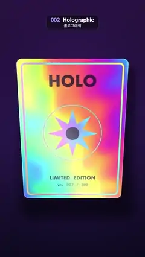 | **002 · Holographic** · 홀로그래픽 <sub>★ reel #2</sub><br>A holographic foil trading card tilts in a slow circle as rainbow thin-film colours, glitter and a glare band slide across it.<br>홀로그램 포일 카드가 천천히 원을 그리며 기울고, 무지갯빛 박막 색·글리터·반사광 띠가 표면을 따라 흐른다.<br><sub>Also known as · 다른 이름: Iridescent Foil</sub><br>[Video](https://sueun-dev.github.io/motion-effects/videos/002-holographic.mp4) · [Prompt](prompts/002-holographic.md) · [Code](effects/002-holographic.js) |
| 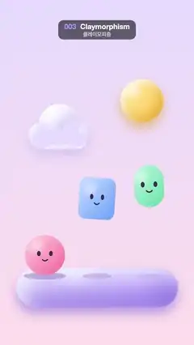 | **003 · Claymorphism** · 클레이모피즘 <sub>★ reel #3</sub><br>Three puffy clay toys with smiley faces bounce with squash and stretch on a soft lilac platform under a clay sun and cloud.<br>웃는 얼굴의 말랑한 점토 장난감 셋이 연보라 받침 위에서 찌그러졌다 늘어나며 통통 튀고, 위에는 점토 해와 구름이 떠 있다.<br>[Video](https://sueun-dev.github.io/motion-effects/videos/003-claymorphism.mp4) · [Prompt](prompts/003-claymorphism.md) · [Code](effects/003-claymorphism.js) |
| 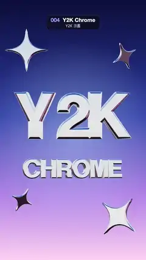 | **004 · Y2K Chrome** · Y2K 크롬 <sub>★ reel #7</sub><br>Mirror-chrome 3D letters "Y2K" and "CHROME" sway as sky and horizon reflections stream across them, with chrome sparkles orbiting.<br>거울 같은 크롬 3D 글자 "Y2K"·"CHROME"이 흔들리며 하늘·지평선 반사가 표면을 흐르고, 크롬 반짝이 별들이 주위를 돈다.<br><sub>Also known as · 다른 이름: Liquid Chrome</sub><br>[Video](https://sueun-dev.github.io/motion-effects/videos/004-y2k-chrome.mp4) · [Prompt](prompts/004-y2k-chrome.md) · [Code](effects/004-y2k-chrome.js) |
| 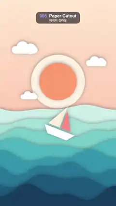 | **005 · Paper Cutout** · 페이퍼 컷아웃 <sub>★ reel #8</sub><br>Eight layers of cut-paper waves roll and cast soft shadows under a paper sun and clouds, with a paper sailboat riding the swell.<br>종이 해와 구름 아래 여덟 겹의 종이 파도가 부드러운 그림자를 드리우며 출렁이고, 종이 돛단배가 물결을 탄다.<br><sub>Also known as · 다른 이름: Papercraft</sub><br>[Video](https://sueun-dev.github.io/motion-effects/videos/005-paper-cutout.mp4) · [Prompt](prompts/005-paper-cutout.md) · [Code](effects/005-paper-cutout.js) |
| 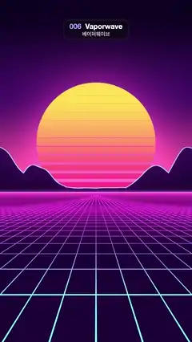 | **006 · Vaporwave** · 베이퍼웨이브 <sub>★ reel #10</sub><br>A striped synthwave sun sits behind neon-rimmed mountains while a magenta-to-cyan neon grid floor scrolls endlessly toward the viewer.<br>줄무늬 신스웨이브 태양이 네온 테두리 산 뒤에 걸려 있고, 자홍에서 청록으로 빛나는 격자 바닥이 끝없이 다가온다.<br><sub>Also known as · 다른 이름: Synthwave, Outrun, Retrowave</sub><br>[Video](https://sueun-dev.github.io/motion-effects/videos/006-vaporwave.mp4) · [Prompt](prompts/006-vaporwave.md) · [Code](effects/006-vaporwave.js) |
| 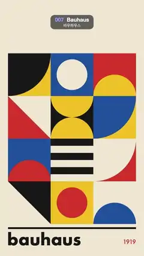 | **007 · Bauhaus** · 바우하우스 <sub>★ reel #12</sub><br>A 3 × 4 grid of primary-colour Bauhaus tiles; on every beat each tile's shape turns a quarter turn in place, rippling diagonally.<br>원색 바우하우스 타일 3 × 4 격자에서 박자마다 각 타일의 도형이 제자리에서 90도씩 돌고, 그 회전이 대각선으로 물결처럼 번진다.<br>[Video](https://sueun-dev.github.io/motion-effects/videos/007-bauhaus.mp4) · [Prompt](prompts/007-bauhaus.md) · [Code](effects/007-bauhaus.js) |
| 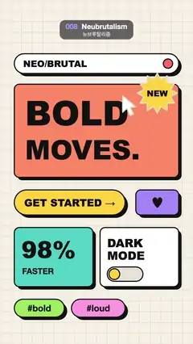 | **008 · Neubrutalism** · 뉴브루탈리즘 <sub>★ reel #13</sub><br>Loud flat UI cards with thick black borders and hard shadows get clicked one by one by a cursor, sinking flat and popping back up.<br>굵은 검은 테두리와 딱딱한 그림자의 원색 UI 카드들을 커서가 하나씩 누르면, 그림자 위로 꺼졌다가 툭 튀어 오른다.<br>[Video](https://sueun-dev.github.io/motion-effects/videos/008-neubrutalism.mp4) · [Prompt](prompts/008-neubrutalism.md) · [Code](effects/008-neubrutalism.js) |
| 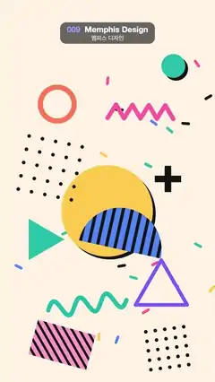 | **009 · Memphis Design** · 멤피스 디자인 <sub>★ reel #15</sub><br>Pastel Memphis shapes, dot grids, zigzags, a squiggle and confetti float on small loops and turn on a cream background.<br>크림색 배경 위에서 멤피스풍 파스텔 도형·도트 격자·지그재그·스퀴글·색종이 조각이 작은 원을 그리며 떠다니고 돈다.<br>[Video](https://sueun-dev.github.io/motion-effects/videos/009-memphis-design.mp4) · [Prompt](prompts/009-memphis-design.md) · [Code](effects/009-memphis-design.js) |
| 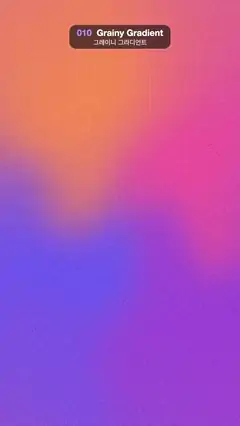 | **010 · Grainy Gradient** · 그레이니 그라디언트 <sub>★ reel #19</sub><br>Four soft colour fields drift and melt into each other under a film grain that never moves.<br>움직이지 않는 필름 그레인 아래로 네 가지 색이 천천히 흐르며 섞인다.<br><sub>Also known as · 다른 이름: Mesh Gradient</sub><br>[Video](https://sueun-dev.github.io/motion-effects/videos/010-grainy-gradient.mp4) · [Prompt](prompts/010-grainy-gradient.md) · [Code](effects/010-grainy-gradient.js) |
|  | **011 · Glassmorphism** · 글래스모피즘<br>Bright colour blobs drift behind three frosted-glass UI panels (notification, payment card, button) and turn soft and milky beneath them.<br>알림·결제 카드·버튼 세 개의 젖빛 유리 패널 뒤로 밝은 색 블롭이 지나가며, 유리 아래에서는 뿌옇게 흐려 보인다.<br><sub>Also known as · 다른 이름: Frosted Glass</sub><br>[Video](https://sueun-dev.github.io/motion-effects/videos/011-glassmorphism.mp4) · [Prompt](prompts/011-glassmorphism.md) · [Code](effects/011-glassmorphism.js) |
| 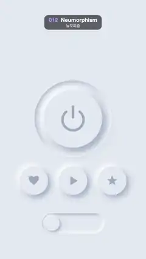 | **012 · Neumorphism** · 뉴모피즘<br>Background-coloured soft-UI controls (a power button, three icon buttons, a toggle) press in and pop back out using only light and shadow.<br>배경과 같은 색의 소프트 UI 컨트롤(전원 버튼, 아이콘 버튼 셋, 토글)이 빛과 그림자만으로 오목하게 눌렸다가 볼록하게 돌아온다.<br><sub>Also known as · 다른 이름: Soft UI</sub><br>[Video](https://sueun-dev.github.io/motion-effects/videos/012-neumorphism.mp4) · [Prompt](prompts/012-neumorphism.md) · [Code](effects/012-neumorphism.js) |
| 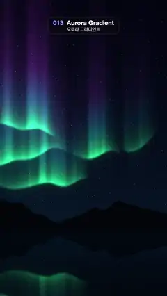 | **013 · Aurora Gradient** · 오로라 그라디언트<br>Three green-to-violet aurora curtains ripple across a starry night sky above a dark mountain ridge, mirrored in a still lake.<br>별이 뜬 밤하늘에 초록에서 보라로 물드는 오로라 커튼 세 겹이 일렁이고, 검은 산 능선 아래 잔잔한 호수에 비친다.<br>[Video](https://sueun-dev.github.io/motion-effects/videos/013-aurora-gradient.mp4) · [Prompt](prompts/013-aurora-gradient.md) · [Code](effects/013-aurora-gradient.js) |
| 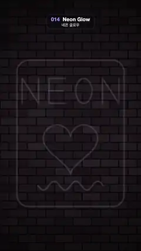 | **014 · Neon Glow** · 네온 글로우<br>A neon sign on a dark brick wall lights up tube by tube (frame, NEON, heart, wavy line), glows steadily, then fades out smoothly.<br>어두운 벽돌 벽의 네온사인이 관 하나씩 그려지며 켜지고(테두리, NEON, 하트, 물결선), 깜빡임 없이 빛나다가 부드럽게 꺼진다.<br>[Video](https://sueun-dev.github.io/motion-effects/videos/014-neon-glow.mp4) · [Prompt](prompts/014-neon-glow.md) · [Code](effects/014-neon-glow.js) |
|  | **015 · Long Shadow** · 롱 섀도<br>Flat icon badges (camera, heart, star, bolt) cast long fading shadows that swing all the way round as the light circles once.<br>카메라·하트·별·번개 플랫 아이콘 배지의 길게 옅어지는 그림자가, 빛이 한 바퀴 도는 동안 함께 한 바퀴 돈다.<br><sub>Also known as · 다른 이름: Flat Design</sub><br>[Video](https://sueun-dev.github.io/motion-effects/videos/015-long-shadow.mp4) · [Prompt](prompts/015-long-shadow.md) · [Code](effects/015-long-shadow.js) |
| 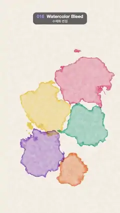 | **016 · Watercolor Bleed** · 수채화 번짐<br>Six watercolour drops land one after another on textured paper, bloom outward with ragged darker rims, overlap, then fade away.<br>질감 있는 종이에 수채 물감 여섯 방울이 차례로 떨어져 들쭉날쭉한 짙은 가장자리로 번져 퍼지고, 서로 겹쳤다가 옅어진다.<br>[Video](https://sueun-dev.github.io/motion-effects/videos/016-watercolor-bleed.mp4) · [Prompt](prompts/016-watercolor-bleed.md) · [Code](effects/016-watercolor-bleed.js) |
| 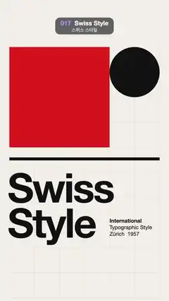 | **017 · Swiss Style** · 스위스 스타일<br>A red block, black circle, rule and huge "Swiss Style" type slide cell to cell on a faint grid through four poster layouts.<br>옅은 격자 위에서 빨간 블록·검은 원·막대·큰 "Swiss Style" 글자가 칸 단위로 미끄러지며 네 가지 포스터 배치를 오간다.<br><sub>Also known as · 다른 이름: International Typographic Style</sub><br>[Video](https://sueun-dev.github.io/motion-effects/videos/017-swiss-style.mp4) · [Prompt](prompts/017-swiss-style.md) · [Code](effects/017-swiss-style.js) |
| 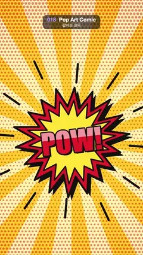 | **018 · Pop Art Comic** · 팝아트 코믹<br>Comic burst balloons "POW!" and "BAM!" take turns springing out over Ben-Day dots and slowly turning sunburst rays.<br>벤데이 도트와 천천히 도는 햇살 집중선 위로 "POW!"와 "BAM!" 폭발 말풍선이 번갈아 튀어나온다.<br><sub>Also known as · 다른 이름: Ben-Day Dots, Speed Lines</sub><br>[Video](https://sueun-dev.github.io/motion-effects/videos/018-pop-art-comic.mp4) · [Prompt](prompts/018-pop-art-comic.md) · [Code](effects/018-pop-art-comic.js) |
| 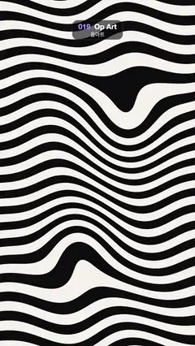 | **019 · Op Art** · 옵아트<br>Black and white stripes bend around drifting bulges and travelling waves, so the whole field seems to swell and squirm.<br>흑백 줄무늬가 떠다니는 불룩한 부분과 지나가는 물결에 휘어, 화면 전체가 부풀고 꿈틀거리는 착시를 만든다.<br>[Video](https://sueun-dev.github.io/motion-effects/videos/019-op-art.mp4) · [Prompt](prompts/019-op-art.md) · [Code](effects/019-op-art.js) |
| 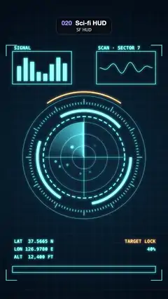 | **020 · Sci-fi HUD** · SF HUD<br>A glowing cyan sci-fi HUD: counter-rotating rings and ticks around a radar sweep that lights blips, with bar and wave panels and readouts.<br>빛나는 청록 SF HUD: 서로 반대로 도는 링·눈금 안에서 레이더 스윕이 점들을 밝히고, 막대·파형 패널과 수치가 바뀐다.<br><sub>Also known as · 다른 이름: FUI</sub><br>[Video](https://sueun-dev.github.io/motion-effects/videos/020-sci-fi-hud.mp4) · [Prompt](prompts/020-sci-fi-hud.md) · [Code](effects/020-sci-fi-hud.js) |

### 2. Print, retro & glitch · 인쇄·레트로·글리치 (021–030)

| Preview | Effect · 효과 |
|:---:|---|
| 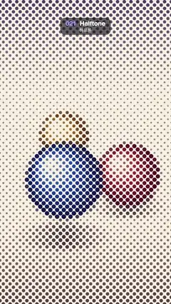 | **021 · Halftone** · 하프톤 <sub>★ reel #4</sub><br>Three shaded balls circle and hop on a cream floor, printed only as a fixed 45° dot screen whose dots swell and shrink.<br>음영 진 공 세 개가 크림색 바닥 위를 돌며 튀어 오르고, 45도로 고정된 망점으로만 찍혀 점 크기가 명암을 따라 커졌다 작아진다.<br>[Video](https://sueun-dev.github.io/motion-effects/videos/021-halftone.mp4) · [Prompt](prompts/021-halftone.md) · [Code](effects/021-halftone.js) |
| 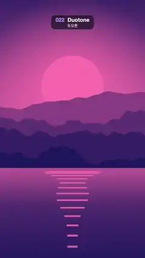 | **022 · Duotone** · 듀오톤<br>A drifting sunset landscape is printed in just two inks, and the pair melts from navy/pink to green/lime, plum/orange and wine/cream.<br>천천히 움직이는 노을 풍경이 잉크 두 가지로만 표현되고, 색 쌍이 남색·분홍 → 초록·라임 → 자주·주황 → 와인·크림으로 녹아들듯 바뀐다.<br>[Video](https://sueun-dev.github.io/motion-effects/videos/022-duotone.mp4) · [Prompt](prompts/022-duotone.md) · [Code](effects/022-duotone.js) |
| 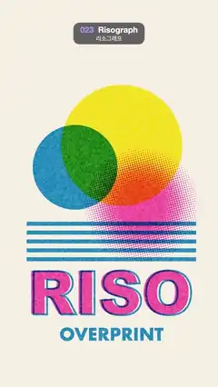 | **023 · Risograph** · 리소그래프<br>Fluorescent pink, blue and yellow plates overprint a sun, circles, stripes and "RISO" slightly off register, the offsets drifting slowly.<br>형광 분홍·파랑·노랑 잉크 판 세 장이 해, 원, 줄무늬, "RISO" 글자를 살짝 어긋나게 겹쳐 찍고, 그 어긋남이 천천히 움직인다.<br><sub>Also known as · 다른 이름: Overprint, Misregistration</sub><br>[Video](https://sueun-dev.github.io/motion-effects/videos/023-risograph.mp4) · [Prompt](prompts/023-risograph.md) · [Code](effects/023-risograph.js) |
| 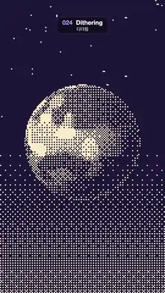 | **024 · Dithering** · 디더링<br>A banded, lit planet spins under fixed stars, drawn in only two colours with an 8 × 8 Bayer dither on chunky 8 px pixels.<br>띠무늬 행성이 고정된 별 아래에서 돌고, 8 × 8 베이어 디더로 8px 큰 픽셀 두 가지 색만으로 그려진다.<br><sub>Also known as · 다른 이름: Ordered Dither, 1-bit</sub><br>[Video](https://sueun-dev.github.io/motion-effects/videos/024-dithering.mp4) · [Prompt](prompts/024-dithering.md) · [Code](effects/024-dithering.js) |
| 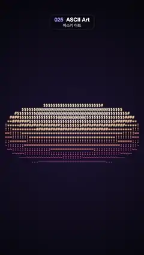 | **025 · ASCII Art** · 아스키 아트<br>The classic spinning ASCII donut: a torus built from ".,-~:;=!*#$@" in bold monospace, its light shading violet to cream.<br>고전 아스키 도넛: 굵은 고정폭 문자 ".,-~:;=!*#$@"로 만든 토러스가 돌고, 빛에 따라 보라에서 크림색으로 물든다.<br>[Video](https://sueun-dev.github.io/motion-effects/videos/025-ascii-art.mp4) · [Prompt](prompts/025-ascii-art.md) · [Code](effects/025-ascii-art.js) |
| 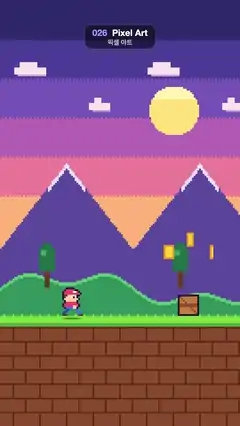 | **026 · Pixel Art** · 픽셀 아트<br>An 8-bit runner in a red cap dashes through a parallax sunset world, hopping over crates and collecting spinning coins.<br>빨간 모자를 쓴 8비트 캐릭터가 시차 스크롤되는 노을 세계를 달리며 나무 상자를 뛰어넘고 도는 동전을 모은다.<br><sub>Also known as · 다른 이름: 8-bit, Sprite Animation</sub><br>[Video](https://sueun-dev.github.io/motion-effects/videos/026-pixel-art.mp4) · [Prompt](prompts/026-pixel-art.md) · [Code](effects/026-pixel-art.js) |
| 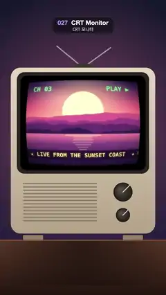 | **027 · CRT Monitor** · CRT 모니터<br>A retro TV plays a sunset show through a bulging tube with fixed scanlines, RGB phosphor stripes, soft glow and a slow rolling band.<br>레트로 TV가 볼록한 브라운관으로 노을 방송을 틀고, 고정된 주사선·RGB 형광 줄무늬·은은한 번짐 위로 밝은 띠가 천천히 굴러간다.<br><sub>Also known as · 다른 이름: Scanlines</sub><br>[Video](https://sueun-dev.github.io/motion-effects/videos/027-crt-monitor.mp4) · [Prompt](prompts/027-crt-monitor.md) · [Code](effects/027-crt-monitor.js) |
| 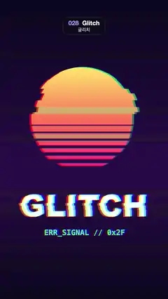 | **028 · Glitch** · 글리치 <sub>★ reel #20</sub><br>A retro striped-sun "GLITCH" poster tears into sliding horizontal bands with RGB split, swelling in two smooth bursts per loop.<br>줄무늬 해와 "GLITCH" 글자가 있는 레트로 포스터가 가로 띠로 밀리고 RGB 채널이 갈라지며, 루프마다 두 번 부드럽게 심해졌다 잦아든다.<br><sub>Also known as · 다른 이름: RGB Split, Chromatic Aberration</sub><br>[Video](https://sueun-dev.github.io/motion-effects/videos/028-glitch.mp4) · [Prompt](prompts/028-glitch.md) · [Code](effects/028-glitch.js) |
| 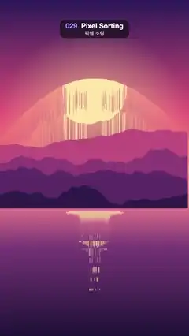 | **029 · Pixel Sorting** · 픽셀 소팅<br>A sunset landscape melts downward as each column's bright runs are sorted bright-to-dark, the drips swelling and shrinking each loop.<br>노을 풍경의 세로줄마다 밝은 구간이 밝은 순서로 정렬되어 아래로 녹아내리고, 흘러내리는 길이가 루프에 맞춰 늘었다 줄어든다.<br>[Video](https://sueun-dev.github.io/motion-effects/videos/029-pixel-sorting.mp4) · [Prompt](prompts/029-pixel-sorting.md) · [Code](effects/029-pixel-sorting.js) |
| 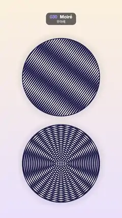 | **030 · Moiré** · 무아레<br>Two navy line discs: gratings 4° apart and two offset ring sets slide over each other, sweeping big moiré bands across them.<br>남색 선 원판 두 개: 4도 어긋난 두 선 패턴과 중심이 어긋난 두 동심원 패턴이 서로 미끄러지며 큰 무아레 띠가 흐른다.<br>[Video](https://sueun-dev.github.io/motion-effects/videos/030-moire.mp4) · [Prompt](prompts/030-moire.md) · [Code](effects/030-moire.js) |

### 3. Typography · 타이포그래피 (031–046)

| Preview | Effect · 효과 |
|:---:|---|
| 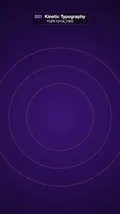 | **031 · Kinetic Typography** · 키네틱 타이포그래피 <sub>★ reel #6</sub><br>"MAKE EVERY WORD MOVE" lands word by word (drop, slide, spin, slam), pulses at 120 BPM, then each word flies off in turn.<br>"MAKE EVERY WORD MOVE"가 떨어지고, 밀려오고, 돌고, 쾅 내려앉으며 한 단어씩 들어와 120BPM으로 들썩이다가 차례로 날아간다.<br>[Video](https://sueun-dev.github.io/motion-effects/videos/031-kinetic-typography.mp4) · [Prompt](prompts/031-kinetic-typography.md) · [Code](effects/031-kinetic-typography.js) |
| 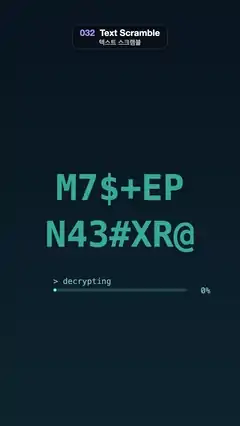 | **032 · Text Scramble** · 텍스트 스크램블 <sub>★ reel #11</sub><br>"SIGNAL / DECODED" cycles through random glyphs, locks in letter by letter with a cyan glow and a progress bar, then scrambles away.<br>"SIGNAL / DECODED"가 무작위 문자로 돌다가 청록 빛과 진행 막대와 함께 한 글자씩 제 글자로 맞춰지고, 다시 뒤섞여 사라진다.<br><sub>Also known as · 다른 이름: Decode Text</sub><br>[Video](https://sueun-dev.github.io/motion-effects/videos/032-text-scramble.mp4) · [Prompt](prompts/032-text-scramble.md) · [Code](effects/032-text-scramble.js) |
| 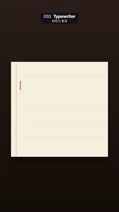 | **033 · Typewriter** · 타자기 효과<br>Four lines are typed letter by letter onto lined paper with slight human jitter while a red cursor follows, then breathes and the page clears.<br>줄 친 종이에 네 줄이 사람처럼 살짝 불규칙하게 한 자씩 찍히고, 빨간 커서가 따라가다 숨 쉬듯 흐려졌다 밝아진 뒤 종이가 비워진다.<br>[Video](https://sueun-dev.github.io/motion-effects/videos/033-typewriter.mp4) · [Prompt](prompts/033-typewriter.md) · [Code](effects/033-typewriter.js) |
|  | **034 · Mask Reveal** · 마스크 리빌<br>Four lines of bold type, "EVERY / LINE / RISES / IN TURN", rise one by one out of invisible slots, hold, then slide up and out.<br>"EVERY / LINE / RISES / IN TURN" 네 줄의 굵은 글자가 보이지 않는 틈에서 한 줄씩 솟아올라 머문 뒤 위로 빠져나간다.<br><sub>Also known as · 다른 이름: Line Reveal</sub><br>[Video](https://sueun-dev.github.io/motion-effects/videos/034-mask-reveal.mp4) · [Prompt](prompts/034-mask-reveal.md) · [Code](effects/034-mask-reveal.js) |
| 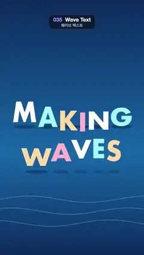 | **035 · Wave Text** · 웨이브 텍스트<br>The pastel letters of "MAKING WAVES" bob up and down one after another, so a wave runs through the words above swaying sea lines.<br>"MAKING WAVES"의 파스텔 글자들이 차례로 시간차를 두고 오르내려 단어 속으로 파도가 지나가고, 아래에서는 물결 선이 일렁인다.<br><sub>Also known as · 다른 이름: Per-letter Stagger</sub><br>[Video](https://sueun-dev.github.io/motion-effects/videos/035-wave-text.mp4) · [Prompt](prompts/035-wave-text.md) · [Code](effects/035-wave-text.js) |
| 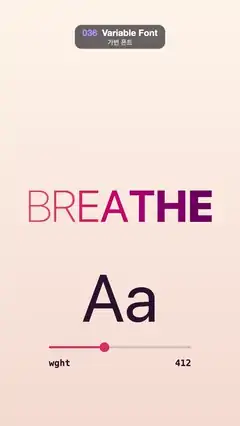 | **036 · Variable Font** · 가변 폰트<br>Each letter of "BREATHE" swells from thin to black weight just after its neighbour, so the word widens and narrows; a slider reads the weight.<br>"BREATHE"의 글자들이 이웃보다 조금씩 늦게 가장 가는 굵기에서 가장 두꺼운 굵기로 숨 쉬듯 변해 단어가 넓어졌다 좁아지고, 슬라이더가 굵기 값을 보여 준다.<br><sub>Also known as · 다른 이름: Font Weight Animation</sub><br>[Video](https://sueun-dev.github.io/motion-effects/videos/036-variable-font.mp4) · [Prompt](prompts/036-variable-font.md) · [Code](effects/036-variable-font.js) |
| 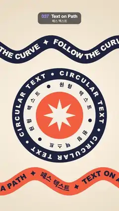 | **037 · Text on Path** · 패스 텍스트<br>Words stream along two rolling wavy ribbons while a badge of two counter-rotating circular texts turns around a spinning star.<br>물결치는 리본 두 개 위로 글자가 흘러가고, 가운데 배지에서는 원형 텍스트 두 줄이 서로 반대로 돌고 별이 회전한다.<br><sub>Also known as · 다른 이름: Circular Text</sub><br>[Video](https://sueun-dev.github.io/motion-effects/videos/037-text-on-path.mp4) · [Prompt](prompts/037-text-on-path.md) · [Code](effects/037-text-on-path.js) |
| 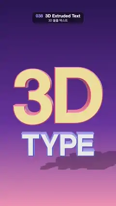 | **038 · 3D Extruded Text** · 3D 돌출 텍스트<br>Glossy extruded "3D TYPE" letters with coloured sides swing side to side and nod, casting a soft shadow under a purple-pink sky.<br>옆면 색이 다른 광택 입체 글자 "3D TYPE"이 좌우로 흔들리며 고개를 끄덕이고, 보라·분홍 하늘 아래 부드러운 그림자를 드리운다.<br>[Video](https://sueun-dev.github.io/motion-effects/videos/038-extruded-3d-text.mp4) · [Prompt](prompts/038-extruded-3d-text.md) · [Code](effects/038-extruded-3d-text.js) |
|  | **039 · Liquid Fill Text** · 리퀴드 필 텍스트<br>Blue liquid with sloshing waves and rising bubbles fills the outlined words FILL UP to the brim and drains again, with a % meter.<br>외곽선만 있는 FILL UP 글자 안에 물결과 기포가 있는 파란 액체가 가득 차올랐다 다시 빠지고, 아래 퍼센트 게이지가 따라 움직인다.<br>[Video](https://sueun-dev.github.io/motion-effects/videos/039-liquid-fill-text.mp4) · [Prompt](prompts/039-liquid-fill-text.md) · [Code](effects/039-liquid-fill-text.js) |
|  | **040 · Marquee** · 마퀴 띠<br>Six tilted ribbons of bold type, two pairs crossing in an X, scroll endlessly in alternating directions over a dark background.<br>기울어진 굵은 글자 띠 여섯 개(두 쌍은 X자로 교차)가 어두운 배경 위에서 번갈아 반대 방향으로 끝없이 흘러간다.<br><sub>Also known as · 다른 이름: Ticker, Infinite Text Loop</sub><br>[Video](https://sueun-dev.github.io/motion-effects/videos/040-marquee.mp4) · [Prompt](prompts/040-marquee.md) · [Code](effects/040-marquee.js) |
| 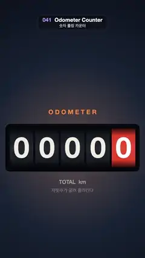 | **041 · Odometer Counter** · 숫자 롤링 카운터<br>Five motion-blurred odometer wheels roll upward from 00000 to 25713, 68259 and 99999, then roll over back to 00000.<br>모션 블러가 걸린 주행거리계 다섯 자리가 위로 굴러 00000 → 25713 → 68259 → 99999로 오른 뒤 00000으로 넘어간다.<br><sub>Also known as · 다른 이름: Number Roll</sub><br>[Video](https://sueun-dev.github.io/motion-effects/videos/041-odometer-counter.mp4) · [Prompt](prompts/041-odometer-counter.md) · [Code](effects/041-odometer-counter.js) |
| 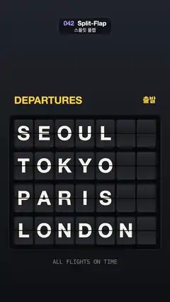 | **042 · Split-Flap** · 스플릿 플랩<br>A departures board flips its tiles in a diagonal wave through random letters, from SEOUL, TOKYO, PARIS, LONDON to four new cities and back.<br>출발 안내판의 글자판이 대각선 물결처럼 차례로 접히며 무작위 글자를 거쳐 SEOUL·TOKYO·PARIS·LONDON에서 새 도시 네 곳으로, 다시 처음으로 바뀐다.<br><sub>Also known as · 다른 이름: Solari Board</sub><br>[Video](https://sueun-dev.github.io/motion-effects/videos/042-split-flap.mp4) · [Prompt](prompts/042-split-flap.md) · [Code](effects/042-split-flap.js) |
| 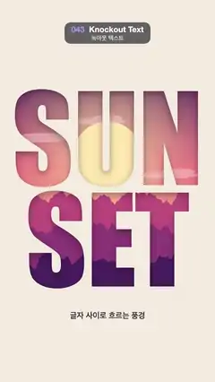 | **043 · Knockout Text** · 녹아웃 텍스트<br>A sunset with a bobbing sun, drifting clouds and parallax mountain ridges moves behind the words SUN SET cut out of a cream panel.<br>크림색 판에 뚫린 SUN SET 글자 구멍 뒤로, 살짝 오르내리는 해와 흘러가는 구름, 시차를 두고 미끄러지는 산 능선의 노을 풍경이 지나간다.<br><sub>Also known as · 다른 이름: Image Mask Text</sub><br>[Video](https://sueun-dev.github.io/motion-effects/videos/043-knockout-text.mp4) · [Prompt](prompts/043-knockout-text.md) · [Code](effects/043-knockout-text.js) |
| 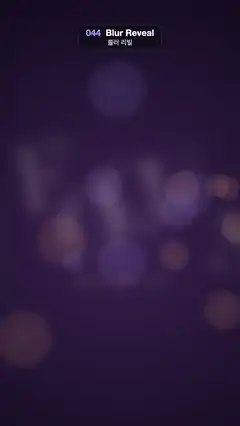 | **044 · Blur Reveal** · 블러 리빌<br>Scattered, blurred letters of FOCUS slide home one by one and snap into sharp focus over soft bokeh, then drift out of focus again.<br>흩어져 흐릿한 FOCUS 글자가 은은한 보케 위에서 하나씩 제자리로 오며 또렷해졌다가, 끝에서 다시 초점이 풀린다.<br><sub>Also known as · 다른 이름: Focus Pull Text</sub><br>[Video](https://sueun-dev.github.io/motion-effects/videos/044-blur-reveal.mp4) · [Prompt](prompts/044-blur-reveal.md) · [Code](effects/044-blur-reveal.js) |
| 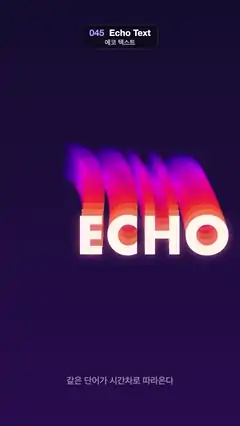 | **045 · Echo Text** · 에코 텍스트<br>The word ECHO glides around an oval while fourteen time-delayed copies trail behind it, fading from orange through pink to violet.<br>ECHO 단어가 타원을 그리며 움직이고, 시간차를 둔 복사본 열네 개가 주황에서 분홍, 보라로 옅어지며 뒤따른다.<br><sub>Also known as · 다른 이름: Repeat, Stacked Type</sub><br>[Video](https://sueun-dev.github.io/motion-effects/videos/045-echo-text.mp4) · [Prompt](prompts/045-echo-text.md) · [Code](effects/045-echo-text.js) |
| 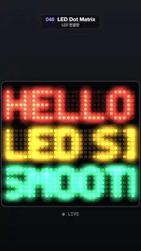 | **046 · LED Dot Matrix** · LED 전광판<br>Three glowing messages in red, amber and green scroll smoothly across a panel of round LEDs that fade in and out softly.<br>둥근 LED 점 판 위로 빨강·주황·초록으로 빛나는 세 줄 문구가 부드럽게 흐르고, LED는 툭 켜지지 않고 서서히 밝아지고 어두워진다.<br>[Video](https://sueun-dev.github.io/motion-effects/videos/046-led-dot-matrix.mp4) · [Prompt](prompts/046-led-dot-matrix.md) · [Code](effects/046-led-dot-matrix.js) |

### 4. Shaders & generative · 셰이더·제너러티브 (047–072)

| Preview | Effect · 효과 |
|:---:|---|
| 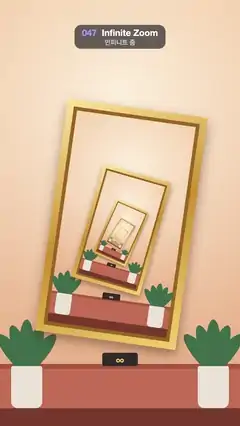 | **047 · Infinite Zoom** · 인피니트 줌 <sub>★ reel #9</sub><br>The view zooms and turns endlessly into a framed painting on a gallery wall that holds the same wall and painting again.<br>갤러리 벽의 액자 속에 같은 벽과 액자가 또 들어 있고, 화면이 천천히 돌며 그 속으로 끝없이 확대해 들어간다.<br><sub>Also known as · 다른 이름: Droste Effect</sub><br>[Video](https://sueun-dev.github.io/motion-effects/videos/047-infinite-zoom.mp4) · [Prompt](prompts/047-infinite-zoom.md) · [Code](effects/047-infinite-zoom.js) |
| 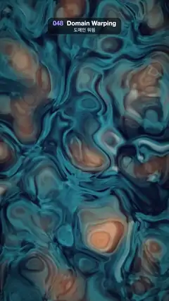 | **048 · Domain Warping** · 도메인 워핑<br>Layers of noise bend each other's coordinates into slowly churning marble swirls of ink blue, teal, amber and cream.<br>노이즈가 겹겹이 서로의 좌표를 비틀어, 남색·청록·주황·크림빛 대리석 무늬가 천천히 소용돌이친다.<br><sub>Also known as · 다른 이름: Fluid Noise</sub><br>[Video](https://sueun-dev.github.io/motion-effects/videos/048-domain-warping.mp4) · [Prompt](prompts/048-domain-warping.md) · [Code](effects/048-domain-warping.js) |
| 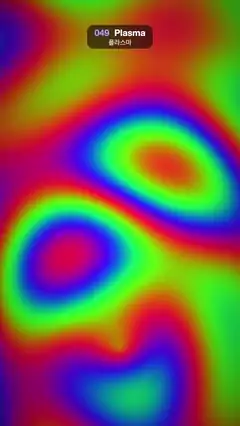 | **049 · Plasma** · 플라스마<br>Four summed sine fields run through a cycling rainbow palette, so psychedelic colour bands and rings flow across the screen.<br>사인파 네 개를 더한 값을 계속 도는 무지개 팔레트에 넣어, 사이키델릭한 색 띠와 고리가 화면 가득 흐른다.<br>[Video](https://sueun-dev.github.io/motion-effects/videos/049-plasma.mp4) · [Prompt](prompts/049-plasma.md) · [Code](effects/049-plasma.js) |
| 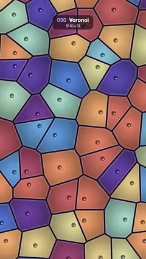 | **050 · Voronoi** · 보로노이<br>Dusty-coloured Voronoi cells with dark membranes and a glossy nucleus each reshape as their centre points wander on small loops.<br>어두운 막과 반짝이는 핵을 가진 차분한 색의 보로노이 세포들이, 중심점이 작은 고리를 그리며 떠돌 때마다 모양을 바꾼다.<br><sub>Also known as · 다른 이름: Cellular, Worley</sub><br>[Video](https://sueun-dev.github.io/motion-effects/videos/050-voronoi.mp4) · [Prompt](prompts/050-voronoi.md) · [Code](effects/050-voronoi.js) |
|  | **051 · Raymarching SDF** · 레이마칭 SDF<br>A coral torus, a pulsing core and three blue spheres melt into each other as the group spins above a softly shadowed floor.<br>산호색 도넛, 맥동하는 핵, 파란 구 세 개가 부드럽게 녹아 붙으며 회전하고, 아래 바닥에 부드러운 그림자가 진다.<br>[Video](https://sueun-dev.github.io/motion-effects/videos/051-raymarching-sdf.mp4) · [Prompt](prompts/051-raymarching-sdf.md) · [Code](effects/051-raymarching-sdf.js) |
|  | **052 · Julia Fractal** · 줄리아 프랙털<br>A glowing Julia set morphs from cauliflower to rabbit to basilica and back as its parameter circles the Mandelbrot cardioid.<br>매개변수 c가 만델브로 집합의 카디오이드를 따라 돌면서, 빛나는 줄리아 집합이 콜리플라워에서 토끼, 바실리카 모양으로 변했다가 돌아온다.<br>[Video](https://sueun-dev.github.io/motion-effects/videos/052-julia-fractal.mp4) · [Prompt](prompts/052-julia-fractal.md) · [Code](effects/052-julia-fractal.js) |
|  | **053 · Kaleidoscope** · 만화경<br>Jewel-like dots and cream rings fold into an 8-fold mirrored mandala that slowly turns and keeps changing shape.<br>보석 같은 점과 크림색 고리가 8방향 거울 대칭 만다라로 접혀 천천히 돌며 계속 모양을 바꾼다.<br>[Video](https://sueun-dev.github.io/motion-effects/videos/053-kaleidoscope.mp4) · [Prompt](prompts/053-kaleidoscope.md) · [Code](effects/053-kaleidoscope.js) |
|  | **054 · Tunnel** · 터널<br>An endless flight down a tiled tunnel lined with cyan and magenta neon, slowly spinning toward a white glow.<br>청록·자홍 네온 선이 그어진 타일 터널 속으로 끝없이 날아가고, 터널은 천천히 돌며 끝이 하얗게 빛난다.<br><sub>Also known as · 다른 이름: Demoscene Tunnel</sub><br>[Video](https://sueun-dev.github.io/motion-effects/videos/054-tunnel.mp4) · [Prompt](prompts/054-tunnel.md) · [Code](effects/054-tunnel.js) |
|  | **055 · Water Ripple** · 물결 파문<br>Drop rings spread across a sunset-over-the-lake picture, bending it like water and catching bright glints on their crests.<br>물방울 파문이 노을 진 호수 그림 위로 퍼지며 그림을 물처럼 휘게 하고, 물결 마루에 반짝이는 빛이 맺힌다.<br>[Video](https://sueun-dev.github.io/motion-effects/videos/055-water-ripple.mp4) · [Prompt](prompts/055-water-ripple.md) · [Code](effects/055-water-ripple.js) |
|  | **056 · Caustics** · 커스틱<br>A net of bright, softly rainbow-fringed light lines wavers over a tiled blue pool floor.<br>파란 타일 수영장 바닥 위로 가장자리에 옅은 무지개가 번진 밝은 빛 그물 무늬가 일렁인다.<br>[Video](https://sueun-dev.github.io/motion-effects/videos/056-caustics.mp4) · [Prompt](prompts/056-caustics.md) · [Code](effects/056-caustics.js) |
|  | **057 · Heat Haze** · 아지랑이 왜곡<br>A desert road shimmers in rising heat: the picture wobbles sideways in waves that climb the screen, strongest at the horizon.<br>사막 도로 그림이 올라오는 열기에 일렁인다. 옆으로 흔들리는 물결이 화면 위로 흐르고 지평선에서 가장 세다.<br><sub>Also known as · 다른 이름: Displacement</sub><br>[Video](https://sueun-dev.github.io/motion-effects/videos/057-heat-haze.mp4) · [Prompt](prompts/057-heat-haze.md) · [Code](effects/057-heat-haze.js) |
|  | **058 · Fire** · 불꽃<br>A campfire on two crossed logs: noise flames lick upward in a tapering column while glowing sparks drift up and fade.<br>엇갈린 통나무 두 개 위의 모닥불. 노이즈 불길이 가늘어지며 위로 넘실대고 불티가 떠올라 사라진다.<br>[Video](https://sueun-dev.github.io/motion-effects/videos/058-fire.mp4) · [Prompt](prompts/058-fire.md) · [Code](effects/058-fire.js) |
|  | **059 · Smoke** · 연기<br>A thin ribbon of smoke rises from a glowing incense tip, curling and widening into soft wisps lit from the upper left.<br>빛나는 향 끝에서 가는 연기 줄기가 피어올라, 말리고 넓어지며 왼쪽 위에서 빛을 받은 부드러운 연기로 흩어진다.<br>[Video](https://sueun-dev.github.io/motion-effects/videos/059-smoke.mp4) · [Prompt](prompts/059-smoke.md) · [Code](effects/059-smoke.js) |
|  | **060 · Reaction-Diffusion** · 반응 확산<br>A small coral blob grows into a frame-filling maze of fingerprint stripes and spots, then shrinks back to its seed shape.<br>작은 산호 덩어리가 지문 같은 줄무늬·점 미로로 자라 화면을 채운 뒤, 처음의 씨앗 모양으로 다시 줄어든다.<br><sub>Also known as · 다른 이름: Gray-Scott, Turing Pattern</sub><br>[Video](https://sueun-dev.github.io/motion-effects/videos/060-reaction-diffusion.mp4) · [Prompt](prompts/060-reaction-diffusion.md) · [Code](effects/060-reaction-diffusion.js) |
|  | **061 · Slit-Scan** · 슬릿 스캔<br>Each row shows a different moment, so a spinning, swaying rainbow flower smears into twisted shapes over wavy stripes.<br>줄마다 다른 순간을 보여 줘서, 돌며 흔들리는 무지개 꽃이 비틀린 모양으로 늘어지고 배경 줄무늬는 물결이 된다.<br><sub>Also known as · 다른 이름: Time Displacement</sub><br>[Video](https://sueun-dev.github.io/motion-effects/videos/061-slit-scan.mp4) · [Prompt](prompts/061-slit-scan.md) · [Code](effects/061-slit-scan.js) |
|  | **062 · Topographic Contours** · 등고선<br>A pastel relief map whose contour lines flow and reshape as the lakes, hills and peaks underneath slowly morph.<br>파스텔 지형도의 등고선이 아래의 호수·언덕·봉우리가 천천히 모양을 바꾸면서 흐르듯 움직인다.<br>[Video](https://sueun-dev.github.io/motion-effects/videos/062-topographic-contours.mp4) · [Prompt](prompts/062-topographic-contours.md) · [Code](effects/062-topographic-contours.js) |
|  | **063 · Ridgeline** · 리지라인<br>Forty-two stacked line profiles, cyan to magenta, form a mountain range while a wave rolls down lifting each line's peaks in turn.<br>청록에서 자홍으로 물드는 선 42개가 겹쳐 산맥을 이루고, 파동이 아래로 굴러가며 선마다 봉우리를 차례로 들어 올린다.<br><sub>Also known as · 다른 이름: Joy Division Lines</sub><br>[Video](https://sueun-dev.github.io/motion-effects/videos/063-ridgeline.mp4) · [Prompt](prompts/063-ridgeline.md) · [Code](effects/063-ridgeline.js) |
|  | **064 · Flow Field** · 플로우 필드<br>Thousands of short glowing strands in teal, amber and pink stream along an invisible swirling flow, like combed hair.<br>청록·호박·분홍빛의 짧은 빛 가닥 수천 개가 보이지 않는 소용돌이 흐름을 따라 빗질한 머리카락처럼 흐른다.<br>[Video](https://sueun-dev.github.io/motion-effects/videos/064-flow-field.mp4) · [Prompt](prompts/064-flow-field.md) · [Code](effects/064-flow-field.js) |
|  | **065 · Truchet Tiles** · 트루셰 타일<br>A neon tube maze of quarter-circle tiles; diagonal waves of tiles flip a quarter turn, rewiring the winding paths.<br>사분원 타일로 된 네온 튜브 미로. 타일들이 대각선 물결처럼 4분의 1씩 돌며 구불구불한 길을 다시 잇는다.<br>[Video](https://sueun-dev.github.io/motion-effects/videos/065-truchet-tiles.mp4) · [Prompt](prompts/065-truchet-tiles.md) · [Code](effects/065-truchet-tiles.js) |
|  | **066 · Spirograph** · 스피로그래프<br>A toothed wheel rolls inside a ring while three pens trace nested eight-pointed star curves in pink, cyan and orange.<br>톱니바퀴가 링 안을 구르며, 펜 세 개가 분홍·청록·주황의 여덟 꼭짓점 별 곡선을 겹겹이 그린다.<br><sub>Also known as · 다른 이름: Hypotrochoid</sub><br>[Video](https://sueun-dev.github.io/motion-effects/videos/066-spirograph.mp4) · [Prompt](prompts/066-spirograph.md) · [Code](effects/066-spirograph.js) |
|  | **067 · Fourier Epicycles** · 푸리에 원<br>A chain of nine spinning circles, tip to tail, draws a glowing pink heart whose trail fades behind the pen.<br>꼬리를 문 회전 원 아홉 개가 분홍빛 하트를 그리고, 그 선은 펜 뒤로 갈수록 희미해진다.<br>[Video](https://sueun-dev.github.io/motion-effects/videos/067-fourier-epicycles.mp4) · [Prompt](prompts/067-fourier-epicycles.md) · [Code](effects/067-fourier-epicycles.js) |
|  | **068 · God Rays** · 빛내림<br>Warm shafts of light pour down through gaps in a drifting dark cloud layer over dusky rolling hills.<br>천천히 흐르는 어두운 구름층 틈으로 따뜻한 빛줄기가 쏟아져 내려 해 질 녘 언덕을 비춘다.<br><sub>Also known as · 다른 이름: Light Shafts, Volumetric Light</sub><br>[Video](https://sueun-dev.github.io/motion-effects/videos/068-god-rays.mp4) · [Prompt](prompts/068-god-rays.md) · [Code](effects/068-god-rays.js) |
|  | **069 · Lens Flare** · 렌즈 플레어<br>A bright starburst light circles a starry dusk sky while hexagonal lens ghosts and a rainbow halo swing to the opposite side.<br>별이 뜬 저녁 하늘을 밝은 별 모양 광원이 돌고, 육각형 렌즈 고스트와 무지개 헤일로가 반대편으로 따라 움직인다.<br>[Video](https://sueun-dev.github.io/motion-effects/videos/069-lens-flare.mp4) · [Prompt](prompts/069-lens-flare.md) · [Code](effects/069-lens-flare.js) |
|  | **070 · Audio Visualizer** · 오디오 비주얼라이저<br>A made-up 120 BPM beat pumps a neon radial spectrum around a "120 BPM" disc and a bar spectrum with a reflection below.<br>가상의 120 BPM 비트에 맞춰 "120 BPM" 원판 둘레의 네온 원형 스펙트럼과 아래의 반사된 막대 스펙트럼이 튄다.<br><sub>Also known as · 다른 이름: Spectrum Bars</sub><br>[Video](https://sueun-dev.github.io/motion-effects/videos/070-audio-visualizer.mp4) · [Prompt](prompts/070-audio-visualizer.md) · [Code](effects/070-audio-visualizer.js) |
|  | **071 · L-System Growth** · L-시스템 성장<br>A fractal plant grows from its trunk out to its twigs, pops pink blossoms at the branch tips, sways in the wind, then fades away.<br>프랙털 식물이 줄기에서 잔가지 끝까지 자라나 가지 끝마다 분홍 꽃을 피우고, 바람에 흔들리다가 사라진다.<br><sub>Also known as · 다른 이름: Generative Growth</sub><br>[Video](https://sueun-dev.github.io/motion-effects/videos/071-l-system-growth.mp4) · [Prompt](prompts/071-l-system-growth.md) · [Code](effects/071-l-system-growth.js) |
|  | **072 · Circle Packing** · 원 패킹<br>Colourful circles drop in and grow until they touch, packing the frame, then shrink away from the middle out as the next round grows.<br>알록달록한 원들이 떨어져 서로 닿을 때까지 자라 화면을 빈틈없이 채우고, 가운데부터 줄어들며 다음 판이 다시 자란다.<br>[Video](https://sueun-dev.github.io/motion-effects/videos/072-circle-packing.mp4) · [Prompt](prompts/072-circle-packing.md) · [Code](effects/072-circle-packing.js) |

### 5. Particles · 파티클 (073–083)

| Preview | Effect · 효과 |
|:---:|---|
|  | **073 · Fireworks** · 불꽃놀이<br>Six rockets climb over a night skyline and burst into coloured spheres of sparks that slow, droop and fade with glowing trails.<br>밤 도시 실루엣 위로 로켓 여섯 발이 차례로 솟아 색색의 불꽃으로 터지고, 불티는 느려지며 꼬리를 남기고 떨어져 사라진다.<br><sub>Also known as · 다른 이름: Particle Burst</sub><br>[Video](https://sueun-dev.github.io/motion-effects/videos/073-fireworks.mp4) · [Prompt](prompts/073-fireworks.md) · [Code](effects/073-fireworks.js) |
|  | **074 · Confetti** · 컨페티<br>Two striped party poppers in the bottom corners fire bursts of colourful paper that fly up, then spin, flip and flutter down.<br>아래 양쪽 모서리의 줄무늬 파티 폭죽 두 개가 색종이를 쏘아 올리고, 색종이는 돌고 뒤집히며 팔랑팔랑 떨어진다.<br>[Video](https://sueun-dev.github.io/motion-effects/videos/074-confetti.mp4) · [Prompt](prompts/074-confetti.md) · [Code](effects/074-confetti.js) |
|  | **075 · Particle Text** · 파티클 텍스트<br>A swirling cloud of glowing cyan-to-magenta particles spirals in to spell MAKE MAGIC, holds, then twists back out into a cloud.<br>청록에서 자홍으로 빛나는 입자 구름이 소용돌이치며 모여 MAKE MAGIC 글자가 되고, 잠시 머문 뒤 다시 비틀리며 구름으로 흩어진다.<br>[Video](https://sueun-dev.github.io/motion-effects/videos/075-particle-text.mp4) · [Prompt](prompts/075-particle-text.md) · [Code](effects/075-particle-text.js) |
|  | **076 · Warp Starfield** · 워프 스타필드<br>Blue-white star streaks rush out from a glowing violet core, growing longer and brighter as they pass, like a jump to hyperspace.<br>빛나는 보랏빛 중심에서 푸르고 흰 별빛 줄기가 사방으로 쏟아져 나오며 가까워질수록 길고 밝아지는, 초공간 점프 같은 장면.<br><sub>Also known as · 다른 이름: Hyperspace</sub><br>[Video](https://sueun-dev.github.io/motion-effects/videos/076-warp-starfield.mp4) · [Prompt](prompts/076-warp-starfield.md) · [Code](effects/076-warp-starfield.js) |
|  | **077 · Particle Morph** · 파티클 모핑<br>A cloud of 5,000 glowing magenta and cyan points slowly turns while morphing from a sphere into a cube, a torus and back.<br>자홍·청록으로 빛나는 점 5,000개의 구름이 천천히 돌며 구 → 정육면체 → 토러스 → 다시 구로 모양을 바꾼다.<br>[Video](https://sueun-dev.github.io/motion-effects/videos/077-particle-morph.mp4) · [Prompt](prompts/077-particle-morph.md) · [Code](effects/077-particle-morph.js) |
|  | **078 · Galaxy Spiral** · 은하 소용돌이<br>A three-armed spiral galaxy of 60,000 stars, warm gold at the core and blue at the rim, turns slowly in a tilted view from above.<br>중심은 금빛, 가장자리는 푸른 별 6만 개로 된 세 팔 나선 은하가 비스듬히 내려다본 시점에서 천천히 돈다.<br>[Video](https://sueun-dev.github.io/motion-effects/videos/078-galaxy-spiral.mp4) · [Prompt](prompts/078-galaxy-spiral.md) · [Code](effects/078-galaxy-spiral.js) |
|  | **079 · Plexus** · 플렉서스<br>About 110 glowing dots drift gently; nearby pairs join with fading lines and faint triangle facets, forming a shifting blue-violet web.<br>빛나는 점 110여 개가 천천히 떠다니고, 가까운 점끼리 서서히 나타나는 선과 옅은 삼각형 면으로 이어져 파랑·보라 그물이 계속 바뀐다.<br><sub>Also known as · 다른 이름: Constellation Network</sub><br>[Video](https://sueun-dev.github.io/motion-effects/videos/079-plexus.mp4) · [Prompt](prompts/079-plexus.md) · [Code](effects/079-plexus.js) |
|  | **080 · Bokeh** · 보케<br>Soft out-of-focus discs of gold, rose, cyan and violet light drift and overlap while a slow rack focus swaps which layer is sharp.<br>금빛·분홍·청록·보라 빛망울이 겹치며 떠다니고, 천천히 초점이 옮겨 가며 선명한 층과 흐린 층이 서로 바뀐다.<br>[Video](https://sueun-dev.github.io/motion-effects/videos/080-bokeh.mp4) · [Prompt](prompts/080-bokeh.md) · [Code](effects/080-bokeh.js) |
|  | **081 · Embers** · 불씨<br>Glowing sparks stream up from a flickering campfire, swaying as they rise and cooling from yellow to red before they fade.<br>일렁이는 모닥불에서 빛나는 불티가 흔들리며 솟아오르고, 노랑에서 빨강으로 식어 가다 사그라든다.<br><sub>Also known as · 다른 이름: Sparks</sub><br>[Video](https://sueun-dev.github.io/motion-effects/videos/081-embers.mp4) · [Prompt](prompts/081-embers.md) · [Code](effects/081-embers.js) |
|  | **082 · Boids Swarm** · 군집 비행<br>A flock of 650 dark birds sweeps across a sunset sky in a figure-eight, stretching, bunching and banking together.<br>새 650마리 떼가 노을 하늘을 8자로 휘저으며 늘어났다 뭉쳤다 하고 함께 방향을 튼다.<br><sub>Also known as · 다른 이름: Flocking, Murmuration</sub><br>[Video](https://sueun-dev.github.io/motion-effects/videos/082-boids-swarm.mp4) · [Prompt](prompts/082-boids-swarm.md) · [Code](effects/082-boids-swarm.js) |
|  | **083 · Disintegration** · 디스인티그레이션<br>A polaroid of a sunset lake crumbles from the right into coloured dust that blows away, then rewinds and reassembles.<br>노을 진 호수 폴라로이드 사진이 오른쪽부터 색색의 먼지로 부서져 바람에 날아갔다가, 되감기듯 다시 모여 원래대로 돌아온다.<br><sub>Also known as · 다른 이름: Dust Dissolve, Thanos Snap</sub><br>[Video](https://sueun-dev.github.io/motion-effects/videos/083-disintegration.mp4) · [Prompt](prompts/083-disintegration.md) · [Code](effects/083-disintegration.js) |

### 6. 3D · 3D (084–098)

| Preview | Effect · 효과 |
|:---:|---|
|  | **084 · Isometric** · 아이소메트릭 <sub>★ reel #5</sub><br>A 7 × 7 grid of coloured blocks in true isometric view rises and falls in a ripple spreading out from the centre.<br>등각 투영으로 본 7 × 7 색 블록 격자가 가운데에서 퍼져 나가는 파문처럼 솟았다 꺼진다.<br>[Video](https://sueun-dev.github.io/motion-effects/videos/084-isometric.mp4) · [Prompt](prompts/084-isometric.md) · [Code](effects/084-isometric.js) |
|  | **085 · Low Poly** · 로우 폴리 <sub>★ reel #17</sub><br>A faceted island with a snowy peak and pine trees sits in a rippling faceted sea under a pastel sky with polygon clouds.<br>눈 덮인 봉우리와 소나무가 있는 각진 섬이 일렁이는 각진 바다 위에 있고, 파스텔 하늘에 다면체 구름이 떠다닌다.<br><sub>Also known as · 다른 이름: Faceted</sub><br>[Video](https://sueun-dev.github.io/motion-effects/videos/085-low-poly.mp4) · [Prompt](prompts/085-low-poly.md) · [Code](effects/085-low-poly.js) |
|  | **086 · Wireframe** · 와이어프레임<br>A glowing cyan geodesic shell turns around a magenta wireframe torus knot and a rocking orbit ring, above a grid fading into fog.<br>빛나는 청록 측지 구 껍질이 자홍 와이어프레임 토러스 매듭과 흔들리는 궤도 고리를 감싸고 돌며, 아래 격자는 안개 속으로 사라진다.<br>[Video](https://sueun-dev.github.io/motion-effects/videos/086-wireframe.mp4) · [Prompt](prompts/086-wireframe.md) · [Code](effects/086-wireframe.js) |
|  | **087 · Toon Shading** · 툰 셰이딩<br>A red cartoon teapot with hard light bands and ink outlines spins and bobs, three toy shapes orbiting above it, on a comic sunburst.<br>딱 끊어지는 명암과 잉크 외곽선의 빨간 만화풍 주전자가 돌며 둥실거리고, 그 위로 장난감 도형 셋이 만화 햇살 배경 앞에서 돈다.<br><sub>Also known as · 다른 이름: Cel Shading</sub><br>[Video](https://sueun-dev.github.io/motion-effects/videos/087-toon-shading.mp4) · [Prompt](prompts/087-toon-shading.md) · [Code](effects/087-toon-shading.js) |
|  | **088 · Glass Refraction** · 유리 굴절<br>A glass torus knot, rounded cube and ball turn over bold stripes and a GLASS banner, bending them with rainbow-fringed refraction.<br>유리로 된 토러스 매듭, 둥근 큐브, 구슬이 굵은 줄무늬와 GLASS 띠 앞에서 돌며 뒤 배경을 무지갯빛 테두리와 함께 휘어 보이게 한다.<br>[Video](https://sueun-dev.github.io/motion-effects/videos/088-glass-refraction.mp4) · [Prompt](prompts/088-glass-refraction.md) · [Code](effects/088-glass-refraction.js) |
|  | **089 · Voxel Build** · 복셀 빌드<br>Cubes drop one by one onto a stone pedestal, building a grass patch, a trunk and a leafy apple tree layer by layer, then pop away.<br>정육면체가 하나씩 돌 받침 위로 떨어져 잔디, 줄기, 사과 달린 잎사귀를 층층이 쌓아 나무를 완성한 뒤 톡톡 사라진다.<br>[Video](https://sueun-dev.github.io/motion-effects/videos/089-voxel-build.mp4) · [Prompt](prompts/089-voxel-build.md) · [Code](effects/089-voxel-build.js) |
|  | **090 · Exploded View** · 분해도<br>A smartphone floats apart into its layers (glass, screen, frame, board, battery and back), holds, then slides back together.<br>스마트폰이 유리·화면·프레임·기판·배터리·뒷판 층으로 위아래로 벌어졌다가 잠시 머문 뒤 다시 하나로 조립된다.<br>[Video](https://sueun-dev.github.io/motion-effects/videos/090-exploded-view.mp4) · [Prompt](prompts/090-exploded-view.md) · [Code](effects/090-exploded-view.js) |
|  | **091 · Dolly Zoom** · 돌리 줌<br>A small figure keeps the same size in a tunnel of red torii gates while the dolly zoom stretches the gates and swells the sun behind.<br>붉은 도리이 터널 속 작은 인형은 크기가 그대로인데, 돌리 줌으로 기둥들이 늘어났다 줄고 뒤의 해가 커졌다 작아진다.<br><sub>Also known as · 다른 이름: Vertigo Effect</sub><br>[Video](https://sueun-dev.github.io/motion-effects/videos/091-dolly-zoom.mp4) · [Prompt](prompts/091-dolly-zoom.md) · [Code](effects/091-dolly-zoom.js) |
|  | **092 · Cloth Wave** · 깃발 물결<br>A coral polka-dot flag on a silver pole ripples in the wind against a blue sky, its waves rolling out toward the free edge.<br>파란 하늘 아래 은색 깃대에 달린 산호색 물방울무늬 깃발이 바람에 물결치고, 물결이 끝자락 쪽으로 굴러간다.<br><sub>Also known as · 다른 이름: Flag</sub><br>[Video](https://sueun-dev.github.io/motion-effects/videos/092-cloth-wave.mp4) · [Prompt](prompts/092-cloth-wave.md) · [Code](effects/092-cloth-wave.js) |
|  | **093 · Origami Fold** · 오리가미 폴딩<br>A flat cross of six coloured paper squares folds up panel by panel into a cube, spins once, then unfolds flat again.<br>색종이 여섯 장으로 된 십자 전개도가 한 장씩 접혀 정육면체가 되고, 한 바퀴 돈 뒤 다시 평평하게 펼쳐진다.<br>[Video](https://sueun-dev.github.io/motion-effects/videos/093-origami-fold.mp4) · [Prompt](prompts/093-origami-fold.md) · [Code](effects/093-origami-fold.js) |
|  | **094 · Ribbon Trail** · 리본 트레일<br>Three glossy gradient ribbons chase their own heads around twisting 3D loops in dark violet space, tapering into thin fading tails.<br>어두운 보라 공간에서 광택 나는 그라디언트 리본 세 개가 비틀린 3D 고리를 따라 제 머리를 쫓고, 꼬리는 가늘어지며 사라진다.<br>[Video](https://sueun-dev.github.io/motion-effects/videos/094-ribbon-trail.mp4) · [Prompt](prompts/094-ribbon-trail.md) · [Code](effects/094-ribbon-trail.js) |
|  | **095 · Parallax Layers** · 패럴랙스<br>A red car holds the centre of a dusk road while clouds, mountains, pine hills, road dashes and bushes slide past at different speeds.<br>해 질 녘 도로 한가운데 빨간 자동차는 제자리에 있고, 구름·산·소나무 언덕·차선·덤불이 서로 다른 속도로 지나간다.<br><sub>Also known as · 다른 이름: Parallax Scrolling, 2.5D</sub><br>[Video](https://sueun-dev.github.io/motion-effects/videos/095-parallax-layers.mp4) · [Prompt](prompts/095-parallax-layers.md) · [Code](effects/095-parallax-layers.js) |
|  | **096 · Dissolve** · 디졸브 번<br>A turning pale-blue teapot burns away from the top along a glowing noisy edge, shedding embers, then rebuilds itself from the bottom up.<br>돌고 있는 하늘색 찻주전자가 빛나는 노이즈 가장자리를 따라 위에서부터 타 사라지며 불씨를 날리고, 다시 아래부터 되살아난다.<br><sub>Also known as · 다른 이름: Burn Dissolve</sub><br>[Video](https://sueun-dev.github.io/motion-effects/videos/096-dissolve.mp4) · [Prompt](prompts/096-dissolve.md) · [Code](effects/096-dissolve.js) |
|  | **097 · Domino Chain** · 도미노<br>28 rainbow dominoes on an S-curve topple in a chain, each coming to rest on the next, then the whole run stands back up in reverse.<br>S자 곡선 위 무지개색 도미노 28개가 연쇄로 넘어져 서로 기대어 멈추고, 이어서 거꾸로 감기듯 전부 다시 일어선다.<br><sub>Also known as · 다른 이름: Chain Reaction</sub><br>[Video](https://sueun-dev.github.io/motion-effects/videos/097-domino-chain.mp4) · [Prompt](prompts/097-domino-chain.md) · [Code](effects/097-domino-chain.js) |
|  | **098 · Pin Art** · 핀 아트<br>1,200 metal pins rise through a dark board in ripples spreading from the centre, then push up a warm glowing heart and sink back to ripples.<br>어두운 판을 뚫고 올라온 금속 핀 1,200개가 가운데서 퍼지는 물결을 만들다가 따뜻한 빛의 하트로 솟고, 다시 물결로 돌아간다.<br><sub>Also known as · 다른 이름: Pin Screen</sub><br>[Video](https://sueun-dev.github.io/motion-effects/videos/098-pin-art.mp4) · [Prompt](prompts/098-pin-art.md) · [Code](effects/098-pin-art.js) |

### 7. Animation principles · 애니메이션 원리 (099–111)

| Preview | Effect · 효과 |
|:---:|---|
|  | **099 · Squash and Stretch** · 스쿼시 앤 스트레치 <sub>★ reel #18</sub><br>A big glossy red ball bounces four times: it stretches tall as it rises and falls, and squashes flat for an instant on the floor.<br>커다란 광택 빨간 공이 네 번 튄다: 오르내릴 때는 길쭉하게 늘어나고, 바닥에 닿는 순간 납작하게 찌그러진다.<br><sub>Also known as · 다른 이름: Bounce</sub><br>[Video](https://sueun-dev.github.io/motion-effects/videos/099-squash-and-stretch.mp4) · [Prompt](prompts/099-squash-and-stretch.md) · [Code](effects/099-squash-and-stretch.js) |
|  | **100 · Shape Morph** · 셰이프 모프 <sub>★ reel #14</sub><br>A glossy shape morphs circle → square → star → heart and back to a circle, its colour shifting along, while a row below marks the step.<br>광택 있는 도형이 원 → 사각형 → 별 → 하트 → 원으로 매끄럽게 바뀌며 색도 함께 변하고, 아래 줄에 지금 단계가 표시된다.<br><sub>Also known as · 다른 이름: Morphing</sub><br>[Video](https://sueun-dev.github.io/motion-effects/videos/100-shape-morph.mp4) · [Prompt](prompts/100-shape-morph.md) · [Code](effects/100-shape-morph.js) |
|  | **101 · Line Animation** · 라인 애니메이션 <sub>★ reel #16</sub><br>Strokes draw on one by one, a round mountain badge with sun, lake and birds, then a handwritten "hello", before trailing tails erase it all.<br>선이 하나씩 그려지며 해·호수·새가 있는 원형 산 그림과 손글씨 "hello"가 나타나고, 뒤따르는 꼬리가 전부 지운 뒤 다시 시작한다.<br><sub>Also known as · 다른 이름: Stroke Draw-on, Handwriting</sub><br>[Video](https://sueun-dev.github.io/motion-effects/videos/101-line-animation.mp4) · [Prompt](prompts/101-line-animation.md) · [Code](effects/101-line-animation.js) |
|  | **102 · Easing Curves** · 이징<br>Six balls cross the same track in the same time with linear, ease-in, ease-out, ease-in-out, back and bounce easing, then go back.<br>공 여섯 개가 같은 거리를 같은 시간에 linear·ease-in·ease-out·ease-in-out·back·bounce 이징으로 갔다가 다시 돌아온다.<br><sub>Also known as · 다른 이름: Slow In, Slow Out</sub><br>[Video](https://sueun-dev.github.io/motion-effects/videos/102-easing-curves.mp4) · [Prompt](prompts/102-easing-curves.md) · [Code](effects/102-easing-curves.js) |
|  | **103 · Anticipation** · 예비 동작<br>An orange blob crouches, leans back and squints before each hop, springs over, lands with a squash; a second hop brings it back.<br>주황 젤리 캐릭터가 뛰기 전 몸을 움츠리고 뒤로 기울며 눈을 찡그렸다가 튀어 넘어가 납작하게 착지하고, 두 번째 점프로 돌아온다.<br>[Video](https://sueun-dev.github.io/motion-effects/videos/103-anticipation.mp4) · [Prompt](prompts/103-anticipation.md) · [Code](effects/103-anticipation.js) |
|  | **104 · Follow Through** · 팔로우 스루<br>A round white bunny slides across and stops; its long ears keep swinging on a damped spring, the tips lagging most, before they settle.<br>둥근 흰 토끼가 옆으로 미끄러지다 멈춰도 긴 귀는 감쇠 스프링처럼 계속 흔들리고, 끝이 가장 늦게 따라오다 가라앉는다.<br><sub>Also known as · 다른 이름: Overlapping Action</sub><br>[Video](https://sueun-dev.github.io/motion-effects/videos/104-follow-through.mp4) · [Prompt](prompts/104-follow-through.md) · [Code](effects/104-follow-through.js) |
|  | **105 · Arc Motion** · 아크 모션<br>A dolphin leaps out of a sunset sea on a tall arc and swims back under water on a shallow one, dots marking equal time steps.<br>돌고래가 노을 진 바다에서 높은 호를 그리며 뛰어올랐다가 물속에서 얕은 호로 돌아오고, 점들이 같은 시간 간격을 표시한다.<br><sub>Also known as · 다른 이름: Motion Path</sub><br>[Video](https://sueun-dev.github.io/motion-effects/videos/105-arc-motion.mp4) · [Prompt](prompts/105-arc-motion.md) · [Code](effects/105-arc-motion.js) |
|  | **106 · Spring Jelly** · 스프링 젤리<br>A spoon presses a pink jelly down and lets go; it bounces with overshoot and settles, its top swaying, while a graph plots the spring.<br>숟가락이 분홍 젤리를 눌렀다 놓으면 젤리가 오버슈트하며 출렁이다 가라앉고 윗부분이 흔들리며, 아래 그래프가 그 스프링 곡선을 그린다.<br><sub>Also known as · 다른 이름: Elastic, Wobble</sub><br>[Video](https://sueun-dev.github.io/motion-effects/videos/106-spring-jelly.mp4) · [Prompt](prompts/106-spring-jelly.md) · [Code](effects/106-spring-jelly.js) |
|  | **107 · Stagger** · 스태거<br>A 4 × 6 grid of coloured icon tiles shrinks away in a diagonal wave, leaving empty slots, then pops back in the same order.<br>색색의 아이콘 타일 4 × 6 격자가 대각선 물결처럼 차례로 작아지며 사라져 빈칸만 남았다가, 같은 순서로 통통 튀어나오며 돌아온다.<br><sub>Also known as · 다른 이름: Cascade</sub><br>[Video](https://sueun-dev.github.io/motion-effects/videos/107-stagger.mp4) · [Prompt](prompts/107-stagger.md) · [Code](effects/107-stagger.js) |
|  | **108 · Smear Frame** · 스미어 프레임<br>A hand whips a red mallet from side to side; during each fast swing the head is drawn as one long smeared arc with speed lines.<br>손이 빨간 망치를 좌우로 휘두르고, 빠르게 휘두르는 순간마다 망치 머리가 속도선과 함께 길게 번진 호 하나로 그려진다.<br><sub>Also known as · 다른 이름: Motion Blur</sub><br>[Video](https://sueun-dev.github.io/motion-effects/videos/108-smear-frame.mp4) · [Prompt](prompts/108-smear-frame.md) · [Code](effects/108-smear-frame.js) |
|  | **109 · Pendulum Wave** · 진자 파동<br>Ten pendulums seen from above swing 1 to 10 times per loop, so the row snakes, splits into several lines and lines up again.<br>위에서 내려다본 진자 10개가 한 루프에 1번부터 10번까지 흔들려, 줄이 뱀처럼 꿈틀대다 여러 줄로 갈라지고 다시 한 줄로 선다.<br>[Video](https://sueun-dev.github.io/motion-effects/videos/109-pendulum-wave.mp4) · [Prompt](prompts/109-pendulum-wave.md) · [Code](effects/109-pendulum-wave.js) |
|  | **110 · Walk Cycle** · 걷기 사이클<br>A cartoon walker strides in place with IK-bent knees and swinging arms while the ground and hills slide past under its feet.<br>만화 캐릭터가 IK로 굽는 무릎과 반대로 흔드는 팔로 제자리걸음을 하고, 발밑의 땅과 언덕이 뒤로 흘러간다.<br>[Video](https://sueun-dev.github.io/motion-effects/videos/110-walk-cycle.mp4) · [Prompt](prompts/110-walk-cycle.md) · [Code](effects/110-walk-cycle.js) |
|  | **111 · IK Tentacle** · IK 촉수<br>Three tentacles rise from dark seabed rocks and reach for a glowing target on a looping path; the middle one shows its IK joints.<br>어두운 해저 바위에서 자란 촉수 세 개가 고리 경로를 도는 빛나는 목표점을 향해 뻗고, 가운데 촉수에는 IK 관절이 보인다.<br><sub>Also known as · 다른 이름: Inverse Kinematics, Procedural Animation</sub><br>[Video](https://sueun-dev.github.io/motion-effects/videos/111-ik-tentacle.mp4) · [Prompt](prompts/111-ik-tentacle.md) · [Code](effects/111-ik-tentacle.js) |

### 8. UI & interaction · UI·인터랙션 (112–126)

| Preview | Effect · 효과 |
|:---:|---|
|  | **112 · Skeleton Shimmer** · 스켈레톤 시머<br>A light band sweeps over grey skeleton cards, the real posts (photo, name, text) fade in piece by piece, then fold back.<br>회색 스켈레톤 카드 위로 빛줄기가 훑고, 사진·이름·글이 하나씩 나타났다가 다시 스켈레톤으로 돌아간다.<br><sub>Also known as · 다른 이름: Skeleton Loading</sub><br>[Video](https://sueun-dev.github.io/motion-effects/videos/112-skeleton-shimmer.mp4) · [Prompt](prompts/112-skeleton-shimmer.md) · [Code](effects/112-skeleton-shimmer.js) |
|  | **113 · Loading Indicators** · 로딩 인디케이터<br>Five loaders on dark cards: an arc spinner, bouncing dots, a progress ring that fills to a tick, an activity wheel and an upload bar.<br>어두운 카드 위 로딩 다섯 가지: 호 스피너, 튀는 점 세 개, 체크로 끝나는 진행 링, 액티비티 휠, 업로드 막대.<br><sub>Also known as · 다른 이름: Spinner, Progress Ring</sub><br>[Video](https://sueun-dev.github.io/motion-effects/videos/113-loading-indicators.mp4) · [Prompt](prompts/113-loading-indicators.md) · [Code](effects/113-loading-indicators.js) |
|  | **114 · Ripple Button** · 리플 버튼<br>A finger taps two pill buttons on a tour card; from each touch point a ripple circle spreads to fill the button, then fades.<br>투어 카드의 알약 버튼 두 개를 손가락이 누르면, 닿은 지점에서 물결 원이 퍼져 버튼을 채운 뒤 사라진다.<br><sub>Also known as · 다른 이름: Material Ripple</sub><br>[Video](https://sueun-dev.github.io/motion-effects/videos/114-ripple-button.mp4) · [Prompt](prompts/114-ripple-button.md) · [Code](effects/114-ripple-button.js) |
|  | **115 · Toggle Morph** · 토글·아이콘 모프<br>A finger taps three controls in turn: a switch slides and turns green, a hamburger morphs into an X, play morphs into pause.<br>손가락이 컨트롤 세 개를 차례로 누르면 스위치가 초록으로 넘어가고, 햄버거가 X로, 재생이 일시정지로 바뀐다.<br><sub>Also known as · 다른 이름: Micro-interaction</sub><br>[Video](https://sueun-dev.github.io/motion-effects/videos/115-toggle-morph.mp4) · [Prompt](prompts/115-toggle-morph.md) · [Code](effects/115-toggle-morph.js) |
|  | **116 · Like Burst** · 좋아요 버스트<br>A tapped outline heart pops back filled red inside a bursting ring and a spray of coloured dots; the like counter rolls up, then down.<br>탭한 빈 하트가 터지는 고리와 색 점들 속에서 빨갛게 채워져 튀어나오고, 좋아요 수가 올라갔다 내려간다.<br>[Video](https://sueun-dev.github.io/motion-effects/videos/116-like-burst.mp4) · [Prompt](prompts/116-like-burst.md) · [Code](effects/116-like-burst.js) |
|  | **117 · Cursor Trail** · 커서 트레일<br>An arrow cursor loops over a dark landing page, trailing a glowing cyan-to-magenta line that breaks into shrinking dots.<br>어두운 랜딩 페이지 위를 도는 화살표 커서 뒤로, 하늘색에서 자홍색으로 빛나는 선이 따라오다 작아지는 점으로 끊어진다.<br>[Video](https://sueun-dev.github.io/motion-effects/videos/117-cursor-trail.mp4) · [Prompt](prompts/117-cursor-trail.md) · [Code](effects/117-cursor-trail.js) |
|  | **118 · Spotlight Reveal** · 스포트라이트<br>A soft circle of light drifts over a darkened screen, revealing a night city skyline, its moon and a glowing "SEOUL" neon sign.<br>어두워진 화면 위를 부드러운 빛의 원이 떠다니며 밤 도시 스카이라인과 달, 빛나는 "SEOUL" 네온사인을 드러낸다.<br><sub>Also known as · 다른 이름: Flashlight Mask</sub><br>[Video](https://sueun-dev.github.io/motion-effects/videos/118-spotlight-reveal.mp4) · [Prompt](prompts/118-spotlight-reveal.md) · [Code](effects/118-spotlight-reveal.js) |
|  | **119 · Scroll Reveal** · 스크롤 리빌<br>A finger flicks a travel app page up twice; each card fades up as it enters, then the page refreshes and its top rises back in.<br>손가락이 여행 앱 페이지를 두 번 밀어 올리면 카드가 들어올 때마다 아래에서 떠오르고, 새로 고침 뒤 맨 위 내용이 다시 올라온다.<br><sub>Also known as · 다른 이름: Scroll-triggered</sub><br>[Video](https://sueun-dev.github.io/motion-effects/videos/119-scroll-reveal.mp4) · [Prompt](prompts/119-scroll-reveal.md) · [Code](effects/119-scroll-reveal.js) |
|  | **120 · Card Swipe** · 카드 스와이프<br>A finger drags the top profile card off a stack, right with a LIKE stamp, then left with NOPE, while the cards behind move up.<br>손가락이 더미의 맨 위 프로필 카드를 오른쪽(LIKE), 다음엔 왼쪽(NOPE)으로 던지고 뒤 카드들이 한 칸씩 올라온다.<br><sub>Also known as · 다른 이름: Card Stack</sub><br>[Video](https://sueun-dev.github.io/motion-effects/videos/120-card-swipe.mp4) · [Prompt](prompts/120-card-swipe.md) · [Code](effects/120-card-swipe.js) |
|  | **121 · Card Flip** · 카드 플립<br>A glossy 3D credit card turns over in perspective to show its back with the card details, lifting toward the camera, then flips back.<br>광택 있는 3D 신용카드가 카메라 쪽으로 들리며 원근감 있게 뒤집혀 카드 정보가 있는 뒷면을 보였다가 다시 돌아온다.<br>[Video](https://sueun-dev.github.io/motion-effects/videos/121-card-flip.mp4) · [Prompt](prompts/121-card-flip.md) · [Code](effects/121-card-flip.js) |
|  | **122 · Bento Grid** · 벤토 그리드<br>Six dashboard tiles on a dark bento grid glide between three layouts; photos re-crop and text re-flows as each tile resizes.<br>어두운 벤토 그리드의 대시보드 타일 여섯 개가 세 가지 배치를 오가고, 크기가 바뀔 때마다 사진은 다시 잘리고 글자는 다시 배치된다.<br><sub>Also known as · 다른 이름: FLIP Layout Animation</sub><br>[Video](https://sueun-dev.github.io/motion-effects/videos/122-bento-grid.mp4) · [Prompt](prompts/122-bento-grid.md) · [Code](effects/122-bento-grid.js) |
|  | **123 · Dynamic Island** · 다이내믹 아일랜드<br>On a phone lock screen the black pill at the top springs open into a message notification, shrinks, then opens into a music player.<br>폰 잠금 화면 위쪽의 검은 알약이 튕기듯 커져 메시지 알림이 되고, 줄어든 뒤 다시 음악 플레이어로 펼쳐진다.<br><sub>Also known as · 다른 이름: Pill Morph</sub><br>[Video](https://sueun-dev.github.io/motion-effects/videos/123-dynamic-island.mp4) · [Prompt](prompts/123-dynamic-island.md) · [Code](effects/123-dynamic-island.js) |
|  | **124 · Border Beam** · 보더 빔<br>Two glowing beams, orange-pink and cyan-violet, chase each other round the rounded border of a dark pricing card, lighting it as they pass.<br>주황·분홍 빛과 하늘·보라 빛 두 줄기가 어두운 요금제 카드의 둥근 테두리를 따라 돌며 지나가는 자리를 밝힌다.<br><sub>Also known as · 다른 이름: Animated Gradient Border</sub><br>[Video](https://sueun-dev.github.io/motion-effects/videos/124-border-beam.mp4) · [Prompt](prompts/124-border-beam.md) · [Code](effects/124-border-beam.js) |
|  | **125 · Chart Animation** · 차트 애니메이션<br>A sales dashboard builds up: bars spring up one by one, a line chart draws itself, a donut sweeps its segments and numbers count up.<br>매출 대시보드가 채워진다: 막대가 하나씩 솟고, 꺾은선이 그려지고, 도넛이 조각별로 돌며 숫자가 올라간다.<br>[Video](https://sueun-dev.github.io/motion-effects/videos/125-chart-animation.mp4) · [Prompt](prompts/125-chart-animation.md) · [Code](effects/125-chart-animation.js) |
|  | **126 · Page Curl** · 페이지 넘김<br>A finger lifts the bottom corner of a book page and peels it over to the left, revealing a picture page, then turns back to the text.<br>손가락이 책장 아래 모서리를 들어 왼쪽으로 넘기면 그림이 있는 다음 장이 나오고, 다시 글 페이지로 넘어온다.<br><sub>Also known as · 다른 이름: Page Flip</sub><br>[Video](https://sueun-dev.github.io/motion-effects/videos/126-page-curl.mp4) · [Prompt](prompts/126-page-curl.md) · [Code](effects/126-page-curl.js) |

### 9. Transitions · 트랜지션 (127–137)

| Preview | Effect · 효과 |
|:---:|---|
|  | **127 · Wipe** · 와이프<br>A glowing slanted line sweeps across a sunset lake to reveal a night city behind it, then sweeps again to bring the sunset back.<br>빛나는 비스듬한 선이 노을 호수를 쓸고 지나가며 뒤의 밤 도시를 드러내고, 다시 쓸어 노을로 되돌린다.<br>[Video](https://sueun-dev.github.io/motion-effects/videos/127-wipe.mp4) · [Prompt](prompts/127-wipe.md) · [Code](effects/127-wipe.js) |
|  | **128 · Iris** · 아이리스<br>A glowing iris closes on the sun, pauses, shuts, then opens on the moon over a night city; the reverse brings the sunset back.<br>빛나는 원이 해 위로 오므라들어 잠깐 멈췄다 닫히고, 밤 도시의 달에서 다시 열린다. 반대로 하면 노을로 돌아온다.<br><sub>Also known as · 다른 이름: Circle Reveal</sub><br>[Video](https://sueun-dev.github.io/motion-effects/videos/128-iris.mp4) · [Prompt](prompts/128-iris.md) · [Code](effects/128-iris.js) |
|  | **129 · Clock Wipe** · 시계 와이프<br>A glowing clock hand sweeps once around from 12 o'clock, turning a sunset lake into a night city, then sweeps again to turn it back.<br>빛나는 시곗바늘이 12시부터 한 바퀴 돌며 노을 호수를 밤 도시로 바꾸고, 다시 한 바퀴 돌아 노을로 되돌린다.<br><sub>Also known as · 다른 이름: Radial Wipe</sub><br>[Video](https://sueun-dev.github.io/motion-effects/videos/129-clock-wipe.mp4) · [Prompt](prompts/129-clock-wipe.md) · [Code](effects/129-clock-wipe.js) |
|  | **130 · Whip Pan** · 휩 팬<br>The view whips sideways in a heavy horizontal motion blur from a sunset lake to a night city, holds, then whips on to the sunset.<br>화면이 강한 가로 모션 블러와 함께 노을 호수에서 밤 도시로 휙 넘어가 머물다가, 다시 휙 노을로 넘어간다.<br>[Video](https://sueun-dev.github.io/motion-effects/videos/130-whip-pan.mp4) · [Prompt](prompts/130-whip-pan.md) · [Code](effects/130-whip-pan.js) |
|  | **131 · Ink Transition** · 잉크 트랜지션<br>Nine wobbly ink blots with coral and navy rims spread over a sunset lake and fill it with a night city, then spread again back.<br>산호색·남색 테두리의 울퉁불퉁한 잉크 얼룩 아홉 개가 번지며 노을 호수를 밤 도시로 채우고, 다시 번져 노을로 돌아온다.<br><sub>Also known as · 다른 이름: Liquid Transition</sub><br>[Video](https://sueun-dev.github.io/motion-effects/videos/131-ink-transition.mp4) · [Prompt](prompts/131-ink-transition.md) · [Code](effects/131-ink-transition.js) |
|  | **132 · Shape Transition** · 도형 트랜지션<br>Yellow, coral and violet bands with zigzag and scalloped edges rise up the screen, wiping a sunset lake to a night city and back.<br>지그재그와 반원 물결 경계를 가진 노랑·산호·보라 색 띠가 아래에서 위로 올라가며 노을 호수를 밤 도시로, 다시 노을로 바꾼다.<br><sub>Also known as · 다른 이름: Geometric Transition</sub><br>[Video](https://sueun-dev.github.io/motion-effects/videos/132-shape-transition.mp4) · [Prompt](prompts/132-shape-transition.md) · [Code](effects/132-shape-transition.js) |
|  | **133 · Pixelate** · 픽셀레이트<br>A sunset lake breaks into ever bigger square blocks, blends into a night city at the coarsest mosaic, sharpens, then goes back.<br>노을 호수가 점점 커지는 네모 블록으로 깨지고, 가장 거친 모자이크에서 밤 도시로 섞인 뒤 선명해진다. 그리고 거꾸로 돌아온다.<br><sub>Also known as · 다른 이름: Mosaic</sub><br>[Video](https://sueun-dev.github.io/motion-effects/videos/133-pixelate.mp4) · [Prompt](prompts/133-pixelate.md) · [Code](effects/133-pixelate.js) |
|  | **134 · Venetian Blinds** · 블라인드<br>Twelve horizontal slats turn over one after another from the top, flipping a sunset lake into a night city, then turning back.<br>가로 띠 열두 개가 위에서부터 차례로 뒤집히며 노을 호수를 밤 도시로 바꾸고, 한 번 더 돌아 노을로 되돌린다.<br>[Video](https://sueun-dev.github.io/motion-effects/videos/134-venetian-blinds.mp4) · [Prompt](prompts/134-venetian-blinds.md) · [Code](effects/134-venetian-blinds.js) |
|  | **135 · Tile Flip** · 타일 플립<br>A 6 × 10 grid of tiles flips in a slanted wave down the screen, lifting toward the camera, turning a sunset into a night city and back.<br>6 × 10 격자 타일이 비스듬한 물결을 따라 위에서 아래로 뒤집히며 카메라 쪽으로 들리고, 노을을 밤 도시로, 다시 노을로 바꾼다.<br>[Video](https://sueun-dev.github.io/motion-effects/videos/135-tile-flip.mp4) · [Prompt](prompts/135-tile-flip.md) · [Code](effects/135-tile-flip.js) |
|  | **136 · Light Leak** · 라이트 리크<br>Warm light leaks sweep diagonally and flare to a near-white burn while a sunset lake crossfades to a night city, then back again.<br>따뜻한 빛 번짐이 대각선으로 쓸고 지나가며 거의 흰빛으로 타오르는 사이 노을 호수가 밤 도시로 바뀌고, 다시 노을로 돌아온다.<br><sub>Also known as · 다른 이름: Film Burn</sub><br>[Video](https://sueun-dev.github.io/motion-effects/videos/136-light-leak.mp4) · [Prompt](prompts/136-light-leak.md) · [Code](effects/136-light-leak.js) |
|  | **137 · Luma Fade** · 루마 페이드<br>A sunset lake melts into a night city brightest parts first, along a warm glowing edge; then the city melts back the same way.<br>노을 호수가 가장 밝은 곳부터 따뜻하게 빛나는 경계를 따라 밤 도시로 녹아들고, 도시도 같은 방식으로 다시 노을로 녹아든다.<br><sub>Also known as · 다른 이름: Luma Matte, Gradient Wipe</sub><br>[Video](https://sueun-dev.github.io/motion-effects/videos/137-luma-fade.mp4) · [Prompt](prompts/137-luma-fade.md) · [Code](effects/137-luma-fade.js) |

### 10. Lighting & shadows · 조명·그림자 (138–148)

| Preview | Effect · 효과 |
|:---:|---|
|  | **138 · Three-Point Lighting** · 3점 조명<br>A plaster head on a dark plinth goes dark, then a warm key, a cool fill and a back rim light, each a glowing card, switch on one by one.<br>어두운 받침 위 석고 두상이 꺼졌다가, 빛나는 카드로 보이는 따뜻한 키·차가운 필·뒤쪽 림 조명이 하나씩 켜지며 형태를 빚는다.<br><sub>Also known as · 다른 이름: Key, Fill & Rim Lighting</sub><br>[Video](https://sueun-dev.github.io/motion-effects/videos/138-three-point-lighting.mp4) · [Prompt](prompts/138-three-point-lighting.md) · [Code](effects/138-three-point-lighting.js) |
|  | **139 · Flat, Gouraud & Phong** · 플랫·고러드·퐁 셰이딩<br>One low-poly coral torus is shaded three ways, per face, per vertex and per pixel, as a light circles it: faceted, blotchy, then smooth highlights.<br>같은 저폴리 산호색 토러스를 면마다·꼭짓점마다·픽셀마다 세 방식으로 칠하고, 빛이 그 둘레를 돌면 각진·얼룩진·매끈한 하이라이트가 비교된다.<br><sub>Also known as · 다른 이름: Per-face, Per-vertex & Per-pixel Shading</sub><br>[Video](https://sueun-dev.github.io/motion-effects/videos/139-shading-models.mp4) · [Prompt](prompts/139-shading-models.md) · [Code](effects/139-shading-models.js) |
|  | **140 · PBR Materials** · PBR 재질<br>A 5 × 6 chart of gold spheres, rougher to the right and more metallic downwards, catches one orbiting light and a turning studio environment.<br>오른쪽으로 갈수록 거칠고 아래로 갈수록 금속성이 커지는 5 × 6 금색 구슬 표가, 도는 조명 하나와 회전하는 스튜디오 환경을 받아 반짝인다.<br><sub>Also known as · 다른 이름: Metal/Rough, Physically Based Shading</sub><br>[Video](https://sueun-dev.github.io/motion-effects/videos/140-pbr-materials.mp4) · [Prompt](prompts/140-pbr-materials.md) · [Code](effects/140-pbr-materials.js) |
|  | **141 · Image-Based Lighting** · 이미지 기반 조명<br>A chrome ball, a pearl knot, a gold ring and a clay ball are lit only by a turning 360° HDR picture that changes from sunset to studio to night city.<br>크롬 공, 진주빛 매듭, 금반지, 점토 공이 오직 도는 360° HDR 사진 한 장으로만 빛나고, 그 사진이 노을에서 스튜디오, 밤 도시로 바뀐다.<br><sub>Also known as · 다른 이름: IBL, HDRI Lighting, Environment Lighting</sub><br>[Video](https://sueun-dev.github.io/motion-effects/videos/141-image-based-lighting.mp4) · [Prompt](prompts/141-image-based-lighting.md) · [Code](effects/141-image-based-lighting.js) |
|  | **142 · Shadow Mapping** · 그림자 매핑<br>A toy sun swings over a round toy town from noon to sunset and sunrise; crisp shadows sweep round a sundial while an inset shows the sun's depth map.<br>장난감 해가 둥근 장난감 마을 위를 정오에서 해 질 녘, 해 뜰 녘으로 오가고, 해시계를 도는 선명한 그림자 옆에 해가 본 깊이 맵이 보인다.<br><sub>Also known as · 다른 이름: Depth-Map Shadows</sub><br>[Video](https://sueun-dev.github.io/motion-effects/videos/142-shadow-mapping.mp4) · [Prompt](prompts/142-shadow-mapping.md) · [Code](effects/142-shadow-mapping.js) |
|  | **143 · Soft Shadows** · 소프트 섀도<br>A glowing lamp over a ball, a ring, a pole and a block swells from a pinpoint to a big globe, and their hard shadows melt into wide, soft penumbrae.<br>공·고리·막대·블록 위의 빛나는 전등이 점에서 큰 구로 부풀면, 날카롭던 그림자가 넓고 부드러운 반그림자로 녹아내린다.<br><sub>Also known as · 다른 이름: Penumbra, PCSS</sub><br>[Video](https://sueun-dev.github.io/motion-effects/videos/143-soft-shadows.mp4) · [Prompt](prompts/143-soft-shadows.md) · [Code](effects/143-soft-shadows.js) |
|  | **144 · Ambient Occlusion** · 앰비언트 오클루전<br>A wipe slides across a white clay still life in a room corner: without AO the shapes look pasted on; with AO every contact, gap and corner darkens softly.<br>방 구석의 흰 점토 정물 위로 와이프가 오가며, AO가 없으면 붕 떠 보이던 모양이 AO를 켜면 닿는 곳·틈·구석마다 부드럽게 어두워진다.<br><sub>Also known as · 다른 이름: AO, Contact Shadows</sub><br>[Video](https://sueun-dev.github.io/motion-effects/videos/144-ambient-occlusion.mp4) · [Prompt](prompts/144-ambient-occlusion.md) · [Code](effects/144-ambient-occlusion.js) |
|  | **145 · Global Illumination** · 전역 조명<br>A path-traced Cornell box adds its light bounces one by one: black shadows and ceiling fill with soft light, and red and green bleed onto the white blocks.<br>패스 트레이싱한 코넬 박스에 빛의 반사가 하나씩 더해지며, 검던 그림자와 천장이 부드럽게 밝아지고 빨강·초록이 흰 블록에 번진다.<br><sub>Also known as · 다른 이름: GI, Path Tracing, Colour Bleeding</sub><br>[Video](https://sueun-dev.github.io/motion-effects/videos/145-global-illumination.mp4) · [Prompt](prompts/145-global-illumination.md) · [Code](effects/145-global-illumination.js) |
|  | **146 · Many Lights** · 다수 광원<br>336 coloured point lights swirl in six spiral arms over a black lacquer floor inside a ring of pillars, each casting its own small pool and reflection.<br>색색의 점광원 336개가 기둥 고리 안 검은 옻칠 바닥 위를 여섯 갈래 나선으로 소용돌이치며, 저마다 작은 빛 웅덩이와 반사를 만든다.<br><sub>Also known as · 다른 이름: Deferred Lighting, Clustered Lighting</sub><br>[Video](https://sueun-dev.github.io/motion-effects/videos/146-many-lights.mp4) · [Prompt](prompts/146-many-lights.md) · [Code](effects/146-many-lights.js) |
|  | **147 · Area Lights** · 면 광원<br>Three tall neon panels, pink, cyan and amber, sweep round a white ball, a steel ring and a dark block, laying long soft streaks across a black lacquer floor.<br>분홍·청록·호박색의 길쭉한 네온 패널 셋이 흰 공, 강철 고리, 검은 블록 둘레를 쓸고 지나가며, 검은 옻칠 바닥에 길고 부드러운 빛줄기를 남긴다.<br><sub>Also known as · 다른 이름: RectAreaLight, LTC</sub><br>[Video](https://sueun-dev.github.io/motion-effects/videos/147-area-lights.mp4) · [Prompt](prompts/147-area-lights.md) · [Code](effects/147-area-lights.js) |
|  | **148 · Projected Texture** · 투사 텍스처<br>A circling spotlight casts a stained-glass rose window onto a stone floor, its coloured glass sliding and wrapping over a white sphere, column, cube and cone.<br>천천히 도는 스포트라이트가 어두운 돌바닥에 스테인드글라스 장미창을 비추고, 색유리 무늬가 흰 구·기둥·상자·원뿔·고리 위를 미끄러지며 감싼다.<br><sub>Also known as · 다른 이름: Light Cookie, Gobo</sub><br>[Video](https://sueun-dev.github.io/motion-effects/videos/148-projector-gobo.mp4) · [Prompt](prompts/148-projector-gobo.md) · [Code](effects/148-projector-gobo.js) |

### 11. Materials & surface detail · 재질·표면 (149–162)

| Preview | Effect · 효과 |
|:---:|---|
|  | **149 · Subsurface Scattering** · 서브서피스 스캐터링<br>A milky wax rabbit sits in the dark as a warm lamp swings behind it; its thin ears and edges glow amber through, while the thick body stays creamy and dim.<br>어둠 속 우윳빛 밀랍 토끼 뒤로 따뜻한 램프가 흔들리며 지나가고, 얇은 귀와 가장자리는 호박색으로 비쳐 빛나며 두꺼운 몸통은 크림색으로 어둑하게 남는다.<br><sub>Also known as · 다른 이름: SSS, Translucency</sub><br>[Video](https://sueun-dev.github.io/motion-effects/videos/149-subsurface-scattering.mp4) · [Prompt](prompts/149-subsurface-scattering.md) · [Code](effects/149-subsurface-scattering.js) |
|  | **150 · Thin-Film Iridescence** · 박막 간섭<br>Soap bubbles drift over deep navy; swirling bands of magenta, green and gold flow across their skins, thinning to dark at the top, with softbox glints.<br>짙은 남색 위로 비눗방울이 떠다니고, 자홍·초록·금색 띠가 표면을 소용돌이치며 흐른다. 꼭대기는 얇아져 어둡고 소프트박스 반사가 반짝인다.<br><sub>Also known as · 다른 이름: Soap-Film Interference</sub><br>[Video](https://sueun-dev.github.io/motion-effects/videos/150-thin-film-iridescence.mp4) · [Prompt](prompts/150-thin-film-iridescence.md) · [Code](effects/150-thin-film-iridescence.js) |
|  | **151 · Car Paint** · 카 페인트<br>A red concept car glitters with metal flake under a mirror clearcoat as long studio light strips roll over its flanks and roof, mirrored in a black floor.<br>빨간 콘셉트카가 거울 같은 클리어코트 아래 금속 플레이크로 반짝이고, 긴 스튜디오 조명 띠가 옆면과 지붕을 타고 넘어가며 검은 바닥에 비친다.<br><sub>Also known as · 다른 이름: Metallic Flake, Clearcoat</sub><br>[Video](https://sueun-dev.github.io/motion-effects/videos/151-car-paint.mp4) · [Prompt](prompts/151-car-paint.md) · [Code](effects/151-car-paint.js) |
|  | **152 · Anisotropic Metal** · 이방성 금속<br>Spun-aluminium discs and knobs sit on brushed steel; three circling lamps draw radial light bars that turn like clock hands and long streaks on the plate.<br>브러시드 강판 위에 스핀 가공 알루미늄 원반과 노브가 놓이고, 둘레를 도는 램프 셋이 시곗바늘처럼 도는 방사형 빛줄기와 판 위의 긴 줄무늬를 그린다.<br><sub>Also known as · 다른 이름: Brushed Metal, Spun Metal</sub><br>[Video](https://sueun-dev.github.io/motion-effects/videos/152-anisotropic-metal.mp4) · [Prompt](prompts/152-anisotropic-metal.md) · [Code](effects/152-anisotropic-metal.js) |
|  | **153 · Velvet Sheen** · 벨벳 광택<br>An emerald velvet armchair with a sapphire cushion beside a mustard pouf; as a warm lamp circles the room, soft light rims glow along every rounded edge.<br>사파이어 쿠션을 얹은 에메랄드 벨벳 안락의자 옆에 겨자색 푸프가 놓이고, 따뜻한 램프가 방을 돌면 둥근 모서리마다 부드러운 빛 테두리가 번진다.<br><sub>Also known as · 다른 이름: Charlie Sheen, Cloth Sheen</sub><br>[Video](https://sueun-dev.github.io/motion-effects/videos/153-velvet-sheen.mp4) · [Prompt](prompts/153-velvet-sheen.md) · [Code](effects/153-velvet-sheen.js) |
|  | **154 · Fresnel Rim** · 프레넬 림<br>A scan ring slides down an egg and back up: above it the egg is white ceramic, below it a cyan x-ray shell glowing only at its edges round a spinning knot.<br>스캔 고리가 알을 따라 내려갔다 돌아온다. 고리 위는 흰 도자기, 아래는 가장자리만 빛나는 청록 엑스레이 껍질이 되어 안에서 도는 매듭을 드러낸다.<br><sub>Also known as · 다른 이름: X-ray Shader, Hologram Shader, Rim Light</sub><br>[Video](https://sueun-dev.github.io/motion-effects/videos/154-fresnel-rim.mp4) · [Prompt](prompts/154-fresnel-rim.md) · [Code](effects/154-fresnel-rim.js) |
|  | **155 · Matcap** · 맷캡<br>A turning torus knot takes its whole look from painted balls: clay, chrome, gold, toon and raw normals wipe across it each second, the ball in use ringed.<br>돌아가는 토러스 매듭이 그려 둔 구슬 그림에서 겉모습을 통째로 빌린다. 점토·크롬·금·툰·노멀이 1초마다 쓸어 지나가며 바뀌고, 쓰는 구슬엔 고리가 쳐진다.<br><sub>Also known as · 다른 이름: Lit Sphere, Material Capture</sub><br>[Video](https://sueun-dev.github.io/motion-effects/videos/155-matcap.mp4) · [Prompt](prompts/155-matcap.md) · [Code](effects/155-matcap.js) |
|  | **156 · Normal Mapping** · 노멀 매핑<br>A flat stone tile looks deeply carved as a lamp circles over it, then tips edge-on to show it is one flat quad of two triangles; its normal map sits below.<br>평평한 돌 타일이 위를 도는 램프 아래 깊이 새긴 듯 보이다가, 옆으로 눕혀지며 삼각형 두 개짜리 납작한 판임을 드러낸다. 아래에는 그 노멀 맵이 놓인다.<br><sub>Also known as · 다른 이름: Tangent-Space Normal Map</sub><br>[Video](https://sueun-dev.github.io/motion-effects/videos/156-normal-mapping.mp4) · [Prompt](prompts/156-normal-mapping.md) · [Code](effects/156-normal-mapping.js) |
|  | **157 · Parallax Occlusion Mapping** · 시차 차폐 매핑<br>A torch-lit brick floor split by a sliding divider: plain normal mapping on the left looks flat, parallax occlusion on the right shows deep mortar and shadows.<br>횃불이 비추는 벽돌 바닥을 움직이는 경계선이 가른다. 왼쪽 일반 노멀 매핑은 납작해 보이고, 오른쪽 시차 차폐 매핑은 깊은 줄눈과 그림자를 보여 준다.<br><sub>Also known as · 다른 이름: POM, Steep Parallax, Relief Mapping</sub><br>[Video](https://sueun-dev.github.io/motion-effects/videos/157-parallax-occlusion-mapping.mp4) · [Prompt](prompts/157-parallax-occlusion-mapping.md) · [Code](effects/157-parallax-occlusion-mapping.js) |
|  | **158 · Displacement Mapping** · 디스플레이스먼트 매핑<br>A smooth grey ball painted with its own height map pushes its vertices outward into a planet of seas, ridges and snowy peaks, then sinks back.<br>자기 높이 맵이 칠해진 매끈한 회색 공이 꼭짓점을 밖으로 밀어 바다·산맥·눈 덮인 봉우리의 행성이 되었다가 다시 가라앉는다.<br><sub>Also known as · 다른 이름: Vertex Displacement, Heightmap</sub><br>[Video](https://sueun-dev.github.io/motion-effects/videos/158-displacement-mapping.mp4) · [Prompt](prompts/158-displacement-mapping.md) · [Code](effects/158-displacement-mapping.js) |
|  | **159 · Triplanar Mapping** · 트라이플래너 매핑<br>A twisted three-lobed blob with no UVs wears glazed tiles projected from three axes; red, green and blue tints show each projection, then fade.<br>UV가 없는 비틀린 세 갈래 덩어리에 세 축에서 투영한 유약 타일이 입혀지고, 빨강·초록·파랑 색조가 각 투영을 보여 준 뒤 사라진다.<br><sub>Also known as · 다른 이름: Box Mapping, Triplanar Projection</sub><br>[Video](https://sueun-dev.github.io/motion-effects/videos/159-triplanar-mapping.mp4) · [Prompt](prompts/159-triplanar-mapping.md) · [Code](effects/159-triplanar-mapping.js) |
|  | **160 · Solid Texture** · 솔리드 텍스처<br>A block of oak splits into five slices that lift, twist and fan out; every fresh cut shows growth rings that line up with the grain on the sides.<br>참나무 블록이 다섯 조각으로 갈라져 들리고 비틀리며 부채처럼 펼쳐지고, 새로 드러난 단면마다 옆면 결과 이어지는 나이테가 보인다.<br><sub>Also known as · 다른 이름: 3D Procedural Texture, Volumetric Texture</sub><br>[Video](https://sueun-dev.github.io/motion-effects/videos/160-solid-texture.mp4) · [Prompt](prompts/160-solid-texture.md) · [Code](effects/160-solid-texture.js) |
|  | **161 · Shell Fur** · 셸 털<br>A peach fuzzball with two googly eyes bobs gently while its fur, 80 stacked shells of soft strand dots, leans in one slow breeze per loop.<br>눈알 두 개 달린 복숭아색 털뭉치가 살짝 들썩이고, 부드러운 가닥 점을 찍은 껍질 80장을 쌓은 털이 루프마다 한 번 느린 바람에 기운다.<br><sub>Also known as · 다른 이름: Shell Texturing</sub><br>[Video](https://sueun-dev.github.io/motion-effects/videos/161-shell-fur.mp4) · [Prompt](prompts/161-shell-fur.md) · [Code](effects/161-shell-fur.js) |
|  | **162 · Decal Projection** · 데칼 투영<br>Projector boxes fly onto a glossy navy vase and stamp paint splats and stickers that wrap over its belly, waist and lip, then peel away.<br>투영 상자가 광택 나는 남색 꽃병으로 날아와 물감 얼룩과 스티커를 찍고, 데칼이 배·허리·입구의 곡면을 감싸며 붙었다가 떨어져 나간다.<br><sub>Also known as · 다른 이름: Projected Decals</sub><br>[Video](https://sueun-dev.github.io/motion-effects/videos/162-decal-projection.mp4) · [Prompt](prompts/162-decal-projection.md) · [Code](effects/162-decal-projection.js) |

### 12. Reflection, refraction & ray tracing · 반사·굴절·레이 트레이싱 (163–169)

| Preview | Effect · 효과 |
|:---:|---|
|  | **163 · Planar Reflection** · 평면 반사<br>Pastel shapes float over a still salt-flat mirror at sunset: an arch, a spinning cube and glowing orbs are doubled exactly in the glassy ground.<br>노을 진 잔잔한 소금 사막 거울 위에 파스텔 도형이 떠 있고, 아치와 도는 정육면체, 빛나는 구슬이 유리 같은 바닥에 그대로 두 번 비친다.<br><sub>Also known as · 다른 이름: Mirror Reflection</sub><br>[Video](https://sueun-dev.github.io/motion-effects/videos/163-planar-reflection.mp4) · [Prompt](prompts/163-planar-reflection.md) · [Code](effects/163-planar-reflection.js) |
|  | **164 · Screen-Space Reflections** · 스크린 스페이스 반사<br>A rain-wet Seoul alley at night: neon signs mirror sharply in the puddles and smear softly across the wet asphalt as the camera glides in and out.<br>비에 젖은 밤의 서울 골목: 카메라가 들어갔다 나오는 동안 네온 간판이 웅덩이에는 선명하게, 젖은 아스팔트에는 부드럽게 번져 비친다.<br><sub>Also known as · 다른 이름: SSR, SSLR</sub><br>[Video](https://sueun-dev.github.io/motion-effects/videos/164-screen-space-reflections.mp4) · [Prompt](prompts/164-screen-space-reflections.md) · [Code](effects/164-screen-space-reflections.js) |
|  | **165 · Dynamic Cube Map** · 동적 큐브맵<br>Glossy toys orbit a chrome ball in a purple studio and slide across its mirror skin; the six live cube-map faces are shown unfolded below.<br>보라색 스튜디오에서 광택 장난감들이 크롬 공 주위를 돌며 거울 같은 표면 위로 미끄러지고, 아래에는 실시간 큐브맵 여섯 면이 펼쳐져 보인다.<br><sub>Also known as · 다른 이름: Real-time Environment Map, CubeCamera</sub><br>[Video](https://sueun-dev.github.io/motion-effects/videos/165-dynamic-cube-map.mp4) · [Prompt](prompts/165-dynamic-cube-map.md) · [Code](effects/165-dynamic-cube-map.js) |
|  | **166 · Ray Tracing** · 레이 트레이싱<br>A classic Whitted scene: a glass ball circles a mirror ball over a coral-and-cream checkerboard, with recursive reflections, refractions and hard shadows.<br>고전적인 휘티드 장면: 유리 공이 산호색·크림색 체커보드 위의 거울 공 주위를 돌고, 재귀 반사·굴절과 선명한 그림자가 보인다.<br><sub>Also known as · 다른 이름: Whitted Ray Tracing</sub><br>[Video](https://sueun-dev.github.io/motion-effects/videos/166-ray-tracing.mp4) · [Prompt](prompts/166-ray-tracing.md) · [Code](effects/166-ray-tracing.js) |
|  | **167 · Prism Dispersion** · 프리즘 분산<br>A white beam enters a rocking glass prism and leaves as a rainbow fan, traced per wavelength with Snell's law, that sweeps across a dark card.<br>흰 빛줄기가 흔들리는 유리 프리즘에 들어가 파장마다 스넬 법칙으로 꺾인 무지개 부채가 되어 나오고, 어두운 카드 위를 쓸고 지나간다.<br><sub>Also known as · 다른 이름: Chromatic Dispersion</sub><br>[Video](https://sueun-dev.github.io/motion-effects/videos/167-prism-dispersion.mp4) · [Prompt](prompts/167-prism-dispersion.md) · [Code](effects/167-prism-dispersion.js) |
|  | **168 · Infinity Mirror** · 무한 거울<br>A round mirror box with a neon LED ring opens into a tunnel of rings that recedes forever and swings round as the camera circles in front of it.<br>네온 LED 고리가 달린 둥근 거울 상자 안으로 고리가 끝없이 이어지는 터널이 열리고, 카메라가 앞에서 원을 그리면 터널이 따라 휘어 돈다.<br><sub>Also known as · 다른 이름: Mirror Tunnel, Infinity Room</sub><br>[Video](https://sueun-dev.github.io/motion-effects/videos/168-infinity-mirror.mp4) · [Prompt](prompts/168-infinity-mirror.md) · [Code](effects/168-infinity-mirror.js) |
|  | **169 · Stencil Portal** · 스텐실 포털<br>A stone arch in a pastel desert opens onto a moonlit night of glowing crystals, which shifts with real depth as the camera swings around the arch.<br>파스텔 사막의 돌 아치 안으로 빛나는 크리스털이 선 달밤 세계가 보이고, 카메라가 아치 둘레를 돌면 그 세계가 실제 깊이를 갖고 움직인다.<br><sub>Also known as · 다른 이름: Portal Rendering, Stencil Mask</sub><br>[Video](https://sueun-dev.github.io/motion-effects/videos/169-stencil-portal.mp4) · [Prompt](prompts/169-stencil-portal.md) · [Code](effects/169-stencil-portal.js) |

### 13. Atmosphere & volumes · 대기·볼륨 (170–177)

| Preview | Effect · 효과 |
|:---:|---|
|  | **170 · Volumetric Clouds** · 볼류메트릭 구름<br>Flying low over a sea of sunset cumulus: raymarched clouds with glowing sunward edges and soft self-shadows under a low sun on a violet sky.<br>노을 진 적운 바다 위를 낮게 난다. 레이마칭한 구름은 해 쪽 가장자리가 빛나고 안쪽에 부드러운 그림자가 지며, 보랏빛 하늘에 낮은 해가 걸려 있다.<br><sub>Also known as · 다른 이름: Raymarched Cloudscape</sub><br>[Video](https://sueun-dev.github.io/motion-effects/videos/170-volumetric-clouds.mp4) · [Prompt](prompts/170-volumetric-clouds.md) · [Code](effects/170-volumetric-clouds.js) |
|  | **171 · Atmospheric Scattering** · 대기 산란<br>A planet seen from orbit turns from blue daylight to a glowing orange sunset limb as its sun swings behind it, then rises back into day.<br>궤도에서 본 행성이 해가 뒤로 넘어가며 파란 낮에서 주황빛으로 타오르는 노을 테두리로 바뀌었다가, 해가 다시 떠오르며 낮으로 돌아온다.<br><sub>Also known as · 다른 이름: Rayleigh & Mie Sky</sub><br>[Video](https://sueun-dev.github.io/motion-effects/videos/171-atmospheric-scattering.mp4) · [Prompt](prompts/171-atmospheric-scattering.md) · [Code](effects/171-atmospheric-scattering.js) |
|  | **172 · Distance & Height Fog** · 거리·높이 안개<br>A camera glides over a winding forested valley at sunrise: white fog pools low between the ridges while far mountains fade into warm haze.<br>해 뜰 무렵 숲이 덮인 굽은 골짜기 위를 카메라가 미끄러지듯 난다. 흰 안개는 능선 사이 낮은 곳에 고이고, 먼 산은 따뜻한 연무 속으로 사라진다.<br><sub>Also known as · 다른 이름: Exponential Height Fog, Aerial Perspective</sub><br>[Video](https://sueun-dev.github.io/motion-effects/videos/172-height-fog.mp4) · [Prompt](prompts/172-height-fog.md) · [Code](effects/172-height-fog.js) |
|  | **173 · Volumetric Spotlight** · 볼류메트릭 스포트라이트<br>Five moving-head spotlights sweep pink, blue and white beams through stage haze around a singer, all mirrored in a glossy black floor.<br>무빙 헤드 조명 다섯 개가 무대 연기 속으로 분홍·파랑·흰 빛줄기를 휘두르며 가수를 비추고, 그 모든 빛이 검은 유광 바닥에 비친다.<br><sub>Also known as · 다른 이름: Light Cones, Volumetric Lighting</sub><br>[Video](https://sueun-dev.github.io/motion-effects/videos/173-volumetric-spotlight.mp4) · [Prompt](prompts/173-volumetric-spotlight.md) · [Code](effects/173-volumetric-spotlight.js) |
|  | **174 · Volumetric Fireball** · 볼류메트릭 화염구<br>A raymarched fireball bursts from a spark into rolling white-hot flames, cools to red and rises away as dark smoke while the next one ignites.<br>레이마칭한 불덩이가 불씨에서 터져 하얗게 달아오른 화염으로 굴러 오르고, 붉게 식어 검은 연기로 떠오르는 사이 다음 폭발이 일어난다.<br><sub>Also known as · 다른 이름: Volumetric Explosion, Pyro</sub><br>[Video](https://sueun-dev.github.io/motion-effects/videos/174-volumetric-fireball.mp4) · [Prompt](prompts/174-volumetric-fireball.md) · [Code](effects/174-volumetric-fireball.js) |
|  | **175 · Nebula** · 성운<br>Drifting forward through glowing pink, teal and gold nebula gas, past dark dust globules and stars, toward a bright star cluster at its heart.<br>분홍·청록·금빛으로 빛나는 성운 가스 속을 천천히 날아가며, 검은 먼지 덩어리와 별들을 지나 성운 한가운데의 밝은 성단 쪽으로 다가간다.<br><sub>Also known as · 다른 이름: Space Fly-through, Emission Volume</sub><br>[Video](https://sueun-dev.github.io/motion-effects/videos/175-nebula.mp4) · [Prompt](prompts/175-nebula.md) · [Code](effects/175-nebula.js) |
|  | **176 · Gravitational Lensing** · 중력 렌즈<br>A black hole bends its glowing accretion disk into arches over and under its shadow, while lensed stars slide around a thin photon ring.<br>블랙홀이 빛나는 강착 원반을 그림자 위아래로 휘어 아치를 만들고, 중력 렌즈로 휜 별들이 가는 광자 고리 둘레를 따라 미끄러진다.<br><sub>Also known as · 다른 이름: Black Hole, Einstein Ring</sub><br>[Video](https://sueun-dev.github.io/motion-effects/videos/176-gravitational-lensing.mp4) · [Prompt](prompts/176-gravitational-lensing.md) · [Code](effects/176-gravitational-lensing.js) |
|  | **177 · Underwater** · 수중<br>Light shafts slant through blue-green water onto a sand floor webbed with moving caustics, as kelp sways, bubbles rise and fish swim past.<br>청록빛 물속으로 빛줄기가 비스듬히 내려와 일렁이는 커스틱 무늬의 모래 바닥을 비추고, 다시마가 흔들리고 거품이 오르며 물고기가 지나간다.<br><sub>Also known as · 다른 이름: Underwater Light Shafts</sub><br>[Video](https://sueun-dev.github.io/motion-effects/videos/177-underwater.mp4) · [Prompt](prompts/177-underwater.md) · [Code](effects/177-underwater.js) |

### 14. Geometry & modeling · 지오메트리·모델링 (178–189)

| Preview | Effect · 효과 |
|:---:|---|
|  | **178 · Subdivision Surface** · 서브디비전 서피스<br>A blocky square-ring cage of 32 quads is smoothed level by level with Catmull–Clark into a soft rounded donut, then glides back to the cage.<br>사각면 32개로 된 각진 네모 고리 케이지가 캐트멀-클라크로 한 단계씩 매끈해져 둥근 도넛이 되었다가 다시 케이지로 돌아간다.<br><sub>Also known as · 다른 이름: Catmull-Clark, SubD</sub><br>[Video](https://sueun-dev.github.io/motion-effects/videos/178-subdivision-surface.mp4) · [Prompt](prompts/178-subdivision-surface.md) · [Code](effects/178-subdivision-surface.js) |
|  | **179 · Lathe** · 회전체<br>A coral profile curve sweeps round a dashed axis on a potter's wheel and spins up a striped blue glazed vase, then a second arm sweeps it away.<br>산호색 단면 곡선이 물레 위 점선 축을 따라 한 바퀴 돌며 줄무늬 파란 유약 꽃병을 빚고, 뒤따르는 두 번째 팔이 다시 쓸어 지운다.<br><sub>Also known as · 다른 이름: Surface of Revolution, Revolve</sub><br>[Video](https://sueun-dev.github.io/motion-effects/videos/179-lathe.mp4) · [Prompt](prompts/179-lathe.md) · [Code](effects/179-lathe.js) |
|  | **180 · Sweep & Loft** · 스윕·로프트<br>A glowing star-shaped cross-section rides a trefoil knot, twisting and lofting from round to five-pointed, and leaves a glossy candy-coloured solid behind it.<br>빛나는 별 모양 단면이 세잎매듭 경로를 달리며 비틀리고 원에서 다섯 꼭지 별로 모양을 바꾸며, 뒤에 반짝이는 사탕색 입체를 남긴다.<br><sub>Also known as · 다른 이름: Extrude Along Path</sub><br>[Video](https://sueun-dev.github.io/motion-effects/videos/180-sweep-loft.mp4) · [Prompt](prompts/180-sweep-loft.md) · [Code](effects/180-sweep-loft.js) |
|  | **181 · CSG Boolean** · 불리언 연산<br>A red cube is trimmed by a shrinking blue sphere and bored through by three green cylinders while the classic CSG tree lights up below, then it reopens.<br>빨간 정육면체를 줄어드는 파란 구가 깎고 초록 원기둥 셋이 차례로 뚫으며 아래의 CSG 트리가 불을 밝히고, 다시 원래 정육면체로 돌아간다.<br><sub>Also known as · 다른 이름: Constructive Solid Geometry</sub><br>[Video](https://sueun-dev.github.io/motion-effects/videos/181-csg-boolean.mp4) · [Prompt](prompts/181-csg-boolean.md) · [Code](effects/181-csg-boolean.js) |
|  | **182 · Parametric Surfaces** · 매개변수 곡면<br>A gridded ribbon morphs from a Möbius strip into a figure-8 Klein bottle and then a knotted Klein tube on a trefoil, its parameter lines drifting along it.<br>격자 무늬 띠가 뫼비우스 띠에서 8자 클라인 병으로, 다시 세잎매듭 위의 클라인 관으로 변하고, 매개변수 선이 표면을 따라 흘러간다.<br>[Video](https://sueun-dev.github.io/motion-effects/videos/182-parametric-surfaces.mp4) · [Prompt](prompts/182-parametric-surfaces.md) · [Code](effects/182-parametric-surfaces.js) |
|  | **183 · Marching Cubes** · 마칭 큐브<br>Six coloured metaballs are polygonised on a 32³ grid while a scan plane marches up the box, showing the field slice, its sample points and the faceted mesh.<br>색이 다른 메타볼 여섯 개가 32³ 격자에서 삼각형 메시로 바뀌고, 스캔 평면이 상자를 타고 오르며 필드 단면과 샘플 점, 각진 메시를 보여 준다.<br><sub>Also known as · 다른 이름: Isosurface Extraction, 3D Metaballs</sub><br>[Video](https://sueun-dev.github.io/motion-effects/videos/183-marching-cubes.mp4) · [Prompt](prompts/183-marching-cubes.md) · [Code](effects/183-marching-cubes.js) |
|  | **184 · Bézier Patch** · 베지어 곡면<br>A coral bicubic Bézier sheet follows its gold 4 × 4 control net as the net ripples and each inner control point is lifted in turn, casting a soft shadow.<br>산호색 바이큐빅 베지어 곡면이 금색 4 × 4 조정망을 따라 움직인다. 조정망이 물결치고 안쪽 조정점이 하나씩 들어 올려지며 곡면이 부드러운 그림자를 드리운다.<br><sub>Also known as · 다른 이름: Bicubic Patch, NURBS</sub><br>[Video](https://sueun-dev.github.io/motion-effects/videos/184-bezier-patch.mp4) · [Prompt](prompts/184-bezier-patch.md) · [Code](effects/184-bezier-patch.js) |
|  | **185 · UV Unwrap** · UV 펼치기<br>A smiling spotted mushroom turns to face us, then its cap, gills and stem peel apart and lie flat as UV islands on their texture atlas before folding back.<br>웃는 점박이 버섯이 돌아서 정면을 보고, 갓·주름·대가 떨어져 나와 텍스처 아틀라스 위 UV 섬으로 평평하게 펼쳐졌다가 다시 접혀 돌아간다.<br><sub>Also known as · 다른 이름: UV Mapping, Texture Atlas</sub><br>[Video](https://sueun-dev.github.io/motion-effects/videos/185-uv-unwrap.mp4) · [Prompt](prompts/185-uv-unwrap.md) · [Code](effects/185-uv-unwrap.js) |
|  | **186 · Point Cloud** · 포인트 클라우드<br>A spinning LiDAR on a car roof scans a night street; rings of height-coloured points flash white as the beam sweeps past, then dim until the next turn.<br>자동차 지붕의 회전 라이다가 밤거리를 스캔한다. 높이별로 물든 점의 고리들이 빔이 지날 때 하얗게 번쩍이고 다음 바퀴까지 서서히 어두워진다.<br><sub>Also known as · 다른 이름: LiDAR Scan</sub><br>[Video](https://sueun-dev.github.io/motion-effects/videos/186-point-cloud.mp4) · [Prompt](prompts/186-point-cloud.md) · [Code](effects/186-point-cloud.js) |
|  | **187 · Gaussian Splatting** · 가우시안 스플래팅<br>A fruit bowl made only of 3D Gaussians sharpens from about 220 soft coloured blobs into about 33,000 crisp surface splats, then melts back as the view sways.<br>3D 가우시안만으로 만든 과일 그릇이 약 220개의 흐릿한 색 덩어리에서 3만 3천여 개의 선명한 표면 스플랫으로 또렷해졌다가, 흔들리는 시점 속에서 다시 녹아내린다.<br><sub>Also known as · 다른 이름: 3DGS</sub><br>[Video](https://sueun-dev.github.io/motion-effects/videos/187-gaussian-splatting.mp4) · [Prompt](prompts/187-gaussian-splatting.md) · [Code](effects/187-gaussian-splatting.js) |
|  | **188 · GPU Instancing** · GPU 인스턴싱<br>A diamond field of 40,000 cubes, all one instanced draw call, rises and falls in interfering ripples, tinted from deep navy through teal to pink crests.<br>4만 개의 큐브를 한 번의 인스턴스 드로 콜로 그린 마름모 들판이 서로 겹치는 물결로 오르내리고, 짙은 남색에서 청록을 지나 분홍 마루까지 물든다.<br><sub>Also known as · 다른 이름: InstancedMesh, Hardware Instancing</sub><br>[Video](https://sueun-dev.github.io/motion-effects/videos/188-gpu-instancing.mp4) · [Prompt](prompts/188-gpu-instancing.md) · [Code](effects/188-gpu-instancing.js) |
|  | **189 · Voronoi Fracture** · 보로노이 파쇄<br>A glossy navy ball splits into 40 convex Voronoi chunks with glowing orange cut faces, tumbles apart in slow motion, then flies back together whole.<br>광택 나는 남색 공이 주황빛 단면을 드러낸 40개의 볼록한 보로노이 조각으로 쪼개져 천천히 흩어져 구르다가, 다시 날아와 온전한 공으로 합쳐진다.<br><sub>Also known as · 다른 이름: Cell Fracture, Shatter</sub><br>[Video](https://sueun-dev.github.io/motion-effects/videos/189-voronoi-fracture.mp4) · [Prompt](prompts/189-voronoi-fracture.md) · [Code](effects/189-voronoi-fracture.js) |

### 15. Simulation & physics · 시뮬레이션·물리 (190–197)

| Preview | Effect · 효과 |
|:---:|---|
|  | **190 · Rigid Body** · 강체 물리<br>Seventy steel balls stream through a Galton board of gold pegs, bounce and stack into a bell curve in eleven bins, then a trapdoor drops them out.<br>강철 구슬 70개가 금빛 못이 박힌 골턴 보드를 흘러내리며 튕기고 11칸에 종 모양으로 쌓인 뒤, 바닥 덮개가 열리며 아래로 쏟아진다.<br><sub>Also known as · 다른 이름: Galton Board, Bean Machine</sub><br>[Video](https://sueun-dev.github.io/motion-effects/videos/190-rigid-body.mp4) · [Prompt](prompts/190-rigid-body.md) · [Code](effects/190-rigid-body.js) |
|  | **191 · Soft Body** · 소프트 바디<br>Translucent pink, green and blue jelly cubes drop onto a moving conveyor belt, squash on landing, wobble back into shape and ride toward the camera.<br>반투명한 분홍·초록·파랑 젤리 큐브가 움직이는 컨베이어 벨트 위로 떨어져 착지하며 찌그러지고, 출렁이다 제 모양을 찾은 뒤 카메라 쪽으로 실려 온다.<br><sub>Also known as · 다른 이름: Shape Matching, Jelly Physics</sub><br>[Video](https://sueun-dev.github.io/motion-effects/videos/191-soft-body.mp4) · [Prompt](prompts/191-soft-body.md) · [Code](effects/191-soft-body.js) |
|  | **192 · Cloth Drape** · 천 드레이프<br>A red plaid cloth falls onto a blue ball on a steel stand, drapes into soft folds and hanging corners, then is pinched in the middle and lifted away.<br>빨간 체크무늬 천이 강철 받침 위의 파란 공에 떨어져 부드러운 주름과 늘어진 모서리로 덮이고, 가운데를 집혀 위로 들려 나간다.<br><sub>Also known as · 다른 이름: PBD Cloth, Cloth Simulation</sub><br>[Video](https://sueun-dev.github.io/motion-effects/videos/192-cloth-drape.mp4) · [Prompt](prompts/192-cloth-drape.md) · [Code](effects/192-cloth-drape.js) |
|  | **193 · Particle Fluid** · 입자 유체<br>A stream of 2,400 blue water particles pours into a glass tank, splashes and sloshes as it rocks, then the tank tips and pours it all out below.<br>파란 물 입자 2,400개가 유리 수조로 쏟아져 튀고, 수조가 흔들리면 출렁이다가, 수조가 기울며 물을 전부 아래로 쏟아 낸다.<br><sub>Also known as · 다른 이름: PBF, SPH</sub><br>[Video](https://sueun-dev.github.io/motion-effects/videos/193-particle-fluid.mp4) · [Prompt](prompts/193-particle-fluid.md) · [Code](effects/193-particle-fluid.js) |
|  | **194 · Ocean Waves** · 바다 파도<br>A Gerstner ocean rolls toward the camera under an orange sunset: sharp crests, wide troughs, foam where the waves pinch and a golden sun path.<br>주황빛 노을 아래 게르스트너 바다가 카메라 쪽으로 밀려온다: 뾰족한 마루, 넓은 골, 파도가 조여드는 곳의 물거품, 금빛 해 길.<br><sub>Also known as · 다른 이름: Gerstner Waves, Trochoidal Waves</sub><br>[Video](https://sueun-dev.github.io/motion-effects/videos/194-ocean-waves.mp4) · [Prompt](prompts/194-ocean-waves.md) · [Code](effects/194-ocean-waves.js) |
|  | **195 · Rope & Chain** · 로프·체인<br>Two red cranks turn a yellow rope and a steel ball chain like a double-dutch pair: they swing out in loops, sag and slap the wooden floor every turn.<br>빨간 크랭크 두 쌍이 노란 밧줄과 강철 볼 체인을 쌍줄넘기처럼 돌린다: 줄이 고리를 그리며 휘어 나가고 처지며 한 바퀴마다 나무 바닥을 친다.<br><sub>Also known as · 다른 이름: Verlet Integration</sub><br>[Video](https://sueun-dev.github.io/motion-effects/videos/195-verlet-rope.mp4) · [Prompt](prompts/195-verlet-rope.md) · [Code](effects/195-verlet-rope.js) |
|  | **196 · N-Body Gravity** · 다체 중력<br>Three glowing stars of equal mass chase each other around one upright figure-eight orbit, trailing cyan, pink and gold light, and loop exactly.<br>질량이 같은 빛나는 별 셋이 세로로 선 8자 궤도 하나를 따라 서로를 쫓으며 청록·분홍·금빛 꼬리를 남기고, 정확히 처음 자리로 돌아온다.<br><sub>Also known as · 다른 이름: Three-Body Figure-Eight, Choreography</sub><br>[Video](https://sueun-dev.github.io/motion-effects/videos/196-n-body-gravity.mp4) · [Prompt](prompts/196-n-body-gravity.md) · [Code](effects/196-n-body-gravity.js) |
|  | **197 · Granular Sand** · 모래 입자<br>Sand grains pour through an hourglass in a thin stream and build a cone that rests perfectly still, then the glass turns over and the pour starts again.<br>모래알이 모래시계 목을 지나 가는 줄기로 쏟아져 원뿔로 쌓이고 그대로 꼼짝 않고 멈춘 뒤, 유리가 뒤집히면 다시 쏟아지기 시작한다.<br><sub>Also known as · 다른 이름: Hourglass, DEM</sub><br>[Video](https://sueun-dev.github.io/motion-effects/videos/197-granular-sand.mp4) · [Prompt](prompts/197-granular-sand.md) · [Code](effects/197-granular-sand.js) |

### 16. Nature & procedural worlds · 자연·절차적 세계 (198–205)

| Preview | Effect · 효과 |
|:---:|---|
|  | **198 · Procedural Terrain** · 절차적 지형<br>A fly-over follows a river valley through ridged fBm mountains: grassy floors, rock on steep faces, snow on high slopes, sun shadows and haze.<br>리지드 fBm 산맥 사이 강 계곡을 따라 날아간다: 낮은 곳은 풀밭, 가파른 면은 바위, 높은 완사면은 눈, 햇빛 그림자와 푸른 연무.<br><sub>Also known as · 다른 이름: Heightmap Terrain, fBm Landscape</sub><br>[Video](https://sueun-dev.github.io/motion-effects/videos/198-procedural-terrain.mp4) · [Prompt](prompts/198-procedural-terrain.md) · [Code](effects/198-procedural-terrain.js) |
|  | **199 · Grass Field** · 잔디밭<br>About 80,000 instanced grass blades sway in a backlit meadow as broad gusts roll across it, each gust a band of bent, brighter blades.<br>역광의 초원에서 인스턴싱된 풀잎 약 8만 개가 흔들리고, 넓은 돌풍이 지나갈 때마다 휘어져 밝아진 풀잎 띠가 물결처럼 번져 간다.<br><sub>Also known as · 다른 이름: Instanced Grass, Wind Animation</sub><br>[Video](https://sueun-dev.github.io/motion-effects/videos/199-grass-field.mp4) · [Prompt](prompts/199-grass-field.md) · [Code](effects/199-grass-field.js) |
|  | **200 · Tree Growth** · 나무 성장<br>A tree grows into a cloud of glowing attraction points, eating them branch by branch (space colonization); leaves pop open, then it all retracts.<br>나무가 빛나는 끌림점 구름 속으로 자라 가지마다 점을 먹어 치우고(공간 군집화), 잎이 톡톡 피어난 뒤 모두 땅속으로 되감긴다.<br><sub>Also known as · 다른 이름: Space Colonization</sub><br>[Video](https://sueun-dev.github.io/motion-effects/videos/200-tree-growth.mp4) · [Prompt](prompts/200-tree-growth.md) · [Code](effects/200-tree-growth.js) |
|  | **201 · Procedural City** · 절차적 도시<br>A round city rises out of a glowing street-plan grid at dusk, lot by lot from downtown outwards, its lit windows warm against the setting sun.<br>해 질 녘 빛나는 도로 설계도 격자에서 둥근 도시가 도심부터 바깥으로 필지마다 솟아오르고, 지는 해를 배경으로 창문 불빛이 켜진다.<br><sub>Also known as · 다른 이름: City Generator</sub><br>[Video](https://sueun-dev.github.io/motion-effects/videos/201-procedural-city.mp4) · [Prompt](prompts/201-procedural-city.md) · [Code](effects/201-procedural-city.js) |
|  | **202 · Procedural Planet** · 절차적 행성<br>A noise-built planet turns once: fBm continents with beaches, forests, deserts and peaks, polar ice, drifting clouds and a blue atmosphere rim.<br>노이즈로 만든 행성이 한 바퀴 돈다: 해변·숲·사막·봉우리가 있는 fBm 대륙, 극지 얼음, 흘러가는 구름, 푸른 대기 테두리.<br><sub>Also known as · 다른 이름: Noise Planet</sub><br>[Video](https://sueun-dev.github.io/motion-effects/videos/202-procedural-planet.mp4) · [Prompt](prompts/202-procedural-planet.md) · [Code](effects/202-procedural-planet.js) |
|  | **203 · Water Surface** · 물 표면<br>Drops ring a clear pond: near water shows pebbles bent by refraction, far water mirrors the tree line (Fresnel), and petals ride the ripples.<br>물방울이 맑은 연못에 동심원을 그린다: 가까운 물은 굴절로 일렁이는 조약돌이, 먼 물은 숲을 비추는 거울이 되고(프레넬), 꽃잎이 물결을 탄다.<br><sub>Also known as · 다른 이름: Fresnel Water, Ripples</sub><br>[Video](https://sueun-dev.github.io/motion-effects/videos/203-water-surface.mp4) · [Prompt](prompts/203-water-surface.md) · [Code](effects/203-water-surface.js) |
|  | **204 · Wave Function Collapse** · 파동 함수 붕괴<br>Glass columns of possibilities shrink as wave function collapse picks tiles one cell at a time, and an island of sand, grass and forest drops into place.<br>가능성의 유리 기둥이 줄어드는 동안 파동 함수 붕괴가 칸마다 타일을 하나씩 골라, 모래·풀밭·숲으로 된 섬이 차례로 내려앉는다.<br><sub>Also known as · 다른 이름: WFC, Model Synthesis</sub><br>[Video](https://sueun-dev.github.io/motion-effects/videos/204-wave-function-collapse.mp4) · [Prompt](prompts/204-wave-function-collapse.md) · [Code](effects/204-wave-function-collapse.js) |
|  | **205 · 3D Phyllotaxis** · 3D 잎차례<br>Succulent leaves emerge 137.5° apart and unfurl outwards, endlessly, while the rosette's interlocking golden-angle spirals slowly turn.<br>다육식물 잎이 137.5°씩 돌아가며 돋아나 끝없이 바깥으로 펼쳐지고, 황금각이 만든 맞물린 나선 무늬가 천천히 돈다.<br><sub>Also known as · 다른 이름: Golden-Angle Spiral</sub><br>[Video](https://sueun-dev.github.io/motion-effects/videos/205-phyllotaxis-3d.mp4) · [Prompt](prompts/205-phyllotaxis-3d.md) · [Code](effects/205-phyllotaxis-3d.js) |

### 17. Raymarching & fractals · 레이마칭·프랙털 (206–214)

| Preview | Effect · 효과 |
|:---:|---|
|  | **206 · Mandelbulb** · 만델벌브<br>A raymarched power-8 Mandelbulb in ivory and amber, its bulbs and crevices swept by a key light circling round, soft shadows moving across it.<br>레이마칭으로 그린 8제곱 만델벌브가 상아색과 호박색으로 빛나고, 주위를 도는 키 라이트에 부드러운 그림자가 구근과 틈 사이를 쓸고 지나간다.<br>[Video](https://sueun-dev.github.io/motion-effects/videos/206-mandelbulb.mp4) · [Prompt](prompts/206-mandelbulb.md) · [Code](effects/206-mandelbulb.js) |
|  | **207 · Menger Sponge** · 멩거 스펀지<br>A cube balanced on its corner turns as square tunnels punch through it level by level, each level its own colour, into a Menger sponge and back.<br>모서리로 선 정육면체가 돌면서 사각 터널이 단계마다 다른 색으로 뚫려 멩거 스펀지가 되었다가 다시 메워진다.<br><sub>Also known as · 다른 이름: Menger Cube</sub><br>[Video](https://sueun-dev.github.io/motion-effects/videos/207-menger-sponge.mp4) · [Prompt](prompts/207-menger-sponge.md) · [Code](effects/207-menger-sponge.js) |
|  | **208 · Mandelbox** · 만델박스<br>A brass-and-ivory Mandelbox hangs over a dark floor; a circling warm light rakes its folded cubes and sweeps a long shadow round it.<br>황동과 상아색 만델박스가 어두운 바닥 위에 떠 있고, 둘레를 도는 따뜻한 빛이 접힌 큐브 무늬를 훑으며 긴 그림자를 한 바퀴 돌린다.<br><sub>Also known as · 다른 이름: Amazing Box</sub><br>[Video](https://sueun-dev.github.io/motion-effects/videos/208-mandelbox.mp4) · [Prompt](prompts/208-mandelbox.md) · [Code](effects/208-mandelbox.js) |
|  | **209 · Domain Repetition** · 도메인 반복<br>One pillar with striped arches is repeated forever; the camera walks down an endless hall as sun shadows stripe the floor and the rows fade into a warm haze.<br>줄무늬 아치를 얹은 기둥 하나가 끝없이 반복되고, 카메라가 끝없는 회랑을 걸어가는 동안 햇빛 그림자가 바닥에 줄을 긋고 줄지은 기둥은 따뜻한 안개로 사라진다.<br><sub>Also known as · 다른 이름: Infinite Repetition, SDF Instancing</sub><br>[Video](https://sueun-dev.github.io/motion-effects/videos/209-domain-repetition.mp4) · [Prompt](prompts/209-domain-repetition.md) · [Code](effects/209-domain-repetition.js) |
|  | **210 · Quaternion Julia** · 쿼터니언 줄리아<br>A coral-and-gold slice of a 4D Julia set floats over a lilac floor and melts from a draped mass into an open lattice and back as it slowly swings.<br>산호색과 금색의 4차원 줄리아 집합 단면이 라일락빛 바닥 위에 떠서, 천천히 흔들리며 드리운 덩어리에서 뚫린 격자로 녹아내렸다가 돌아온다.<br><sub>Also known as · 다른 이름: 4D Julia Set, Hypercomplex Julia</sub><br>[Video](https://sueun-dev.github.io/motion-effects/videos/210-quaternion-julia.mp4) · [Prompt](prompts/210-quaternion-julia.md) · [Code](effects/210-quaternion-julia.js) |
|  | **211 · Sierpinski Tetrahedron** · 시에르핀스키 사면체<br>A pastel Sierpinski pyramid splits into 4, 16, then 64 smaller ones and folds back into one solid tetrahedron while it turns a third of a circle.<br>파스텔빛 시에르핀스키 피라미드가 4개, 16개, 64개의 작은 사면체로 쪼개졌다가 다시 하나의 사면체로 합쳐지며 3분의 1바퀴 돈다.<br><sub>Also known as · 다른 이름: Tetrix, Sierpinski Pyramid</sub><br>[Video](https://sueun-dev.github.io/motion-effects/videos/211-sierpinski-tetrahedron.mp4) · [Prompt](prompts/211-sierpinski-tetrahedron.md) · [Code](effects/211-sierpinski-tetrahedron.js) |
|  | **212 · Apollonian Fractal** · 아폴로니안 프랙털<br>Inside an endless cave of pearly spheres packed in spheres and laced with copper filigree, a swinging sun slides shadows as far spheres melt into lilac haze.<br>구 안에 구가 빽빽이 들어찬 끝없는 진주빛 동굴에 구리빛 레이스가 엉켜 있고, 흔들리는 햇빛이 그림자를 밀어 가는 동안 먼 구들은 라일락빛 안개로 녹아든다.<br><sub>Also known as · 다른 이름: Sphere-Inversion Fractal, 3D Apollonian Gasket</sub><br>[Video](https://sueun-dev.github.io/motion-effects/videos/212-apollonian-fractal.mp4) · [Prompt](prompts/212-apollonian-fractal.md) · [Code](effects/212-apollonian-fractal.js) |
|  | **213 · 4D Tesseract** · 4차원 테서랙트<br>A neon hypercube turns in four dimensions: its cyan inner cube swells into the magenta outer one and out again, mirrored on a glossy dark floor.<br>네온 하이퍼큐브가 4차원에서 돌며 하늘색 안쪽 큐브가 부풀어 자홍색 바깥 큐브가 되었다가 다시 빠져나오고, 윤기 나는 어두운 바닥에 비친다.<br><sub>Also known as · 다른 이름: Hypercube, 8-cell</sub><br>[Video](https://sueun-dev.github.io/motion-effects/videos/213-tesseract-4d.mp4) · [Prompt](prompts/213-tesseract-4d.md) · [Code](effects/213-tesseract-4d.js) |
|  | **214 · Cave Fly-through** · 동굴 비행<br>The camera glides through a winding sandstone slot cave, walls glowing orange and violet under a bright slit of sky, past a dusty sunbeam, forever.<br>카메라가 구불구불한 사암 협곡 동굴을 미끄러지듯 날아가고, 위쪽 하늘 틈 아래 벽이 주황빛과 보랏빛으로 빛나며, 먼지 낀 햇살 기둥을 끝없이 지나간다.<br><sub>Also known as · 다른 이름: Raymarched Canyon Flight</sub><br>[Video](https://sueun-dev.github.io/motion-effects/videos/214-cave-flythrough.mp4) · [Prompt](prompts/214-cave-flythrough.md) · [Code](effects/214-cave-flythrough.js) |

### 18. Animation & characters · 애니메이션·캐릭터 (215–221)

| Preview | Effect · 효과 |
|:---:|---|
|  | **215 · Skeletal Skinning** · 스켈레탈 스키닝<br>A see-through noodle creature with googly eyes dances in an S-curve; glowing octahedral bones bend inside it and rainbow bands show each bone's skin weights.<br>눈이 달린 반투명 국수 생물이 S자로 춤추고, 안에서 빛나는 팔면체 뼈가 꺾이며 무지개 띠가 뼈마다의 스킨 가중치를 보여 준다.<br><sub>Also known as · 다른 이름: Linear Blend Skinning, Rigging</sub><br>[Video](https://sueun-dev.github.io/motion-effects/videos/215-skeletal-skinning.mp4) · [Prompt](prompts/215-skeletal-skinning.md) · [Code](effects/215-skeletal-skinning.js) |
|  | **216 · Morph Targets** · 모프 타깃<br>A round yellow face blends smile, surprise, wink and pout with morph targets while four sliders below show each weight crossfading.<br>동그란 노란 얼굴이 모프 타깃으로 미소, 놀람, 윙크, 뾰로통을 섞고, 아래 슬라이더 네 개가 각 가중치가 넘어가는 모습을 보여 준다.<br><sub>Also known as · 다른 이름: Blend Shapes, Shape Keys</sub><br>[Video](https://sueun-dev.github.io/motion-effects/videos/216-morph-targets.mp4) · [Prompt](prompts/216-morph-targets.md) · [Code](effects/216-morph-targets.js) |
|  | **217 · Procedural Walk** · 절차적 보행<br>A six-legged robot spider walks over sunset dunes; its IK legs lift and plant one stride ahead on glowing footholds as the body tilts with the ground.<br>다리 여섯 개 로봇 거미가 노을 진 모래 언덕을 걷고, IK 다리가 들렸다가 한 걸음 앞 빛나는 발판에 디디며 몸통은 땅을 따라 기운다.<br><sub>Also known as · 다른 이름: Procedural Locomotion, IK Gait</sub><br>[Video](https://sueun-dev.github.io/motion-effects/videos/217-procedural-walk.mp4) · [Prompt](prompts/217-procedural-walk.md) · [Code](effects/217-procedural-walk.js) |
|  | **218 · Crowd Simulation** · 군중 시뮬레이션<br>Hundreds of small walkers in four colour-coded streams cross a sunny plaza, swerving round each other and a fountain, each with a fading trail.<br>네 가지 색으로 나뉜 수백 명의 작은 보행자가 햇살 비친 광장을 가로지르며 서로와 분수를 비켜 가고, 지나온 길이 옅은 꼬리로 남는다.<br><sub>Also known as · 다른 이름: Pedestrian Simulation, Agent-based Crowd</sub><br>[Video](https://sueun-dev.github.io/motion-effects/videos/218-crowd-simulation.mp4) · [Prompt](prompts/218-crowd-simulation.md) · [Code](effects/218-crowd-simulation.js) |
|  | **219 · GPU Particles** · GPU 파티클<br>A quarter of a million glowing particles on a white trefoil knot stream off into swirling magenta smoke of fine silky streaks, then the knot gathers again.<br>흰 삼잎 매듭 위의 빛나는 입자 25만 개가 가는 실 같은 결의 자홍빛 연기로 흘러 나가 소용돌이치고, 매듭이 다시 모여 제 모양을 찾는다.<br><sub>Also known as · 다른 이름: GPGPU Particles, Curl-Noise Particles</sub><br>[Video](https://sueun-dev.github.io/motion-effects/videos/219-gpu-particles.mp4) · [Prompt](prompts/219-gpu-particles.md) · [Code](effects/219-gpu-particles.js) |
|  | **220 · Gimbal Lock** · 짐벌 락<br>Three gimbal rings fold into one plane as Euler pitch hits −90° and the plane flips, while below, quaternion slerp turns it smoothly about one axis.<br>오일러 피치가 −90°에 닿자 짐벌 고리 둘이 한 평면으로 겹치고 비행기가 뒤집히는 동안, 아래의 쿼터니언 보간은 한 축으로 매끄럽게 돈다.<br><sub>Also known as · 다른 이름: Euler vs Quaternion</sub><br>[Video](https://sueun-dev.github.io/motion-effects/videos/220-gimbal-lock.mp4) · [Prompt](prompts/220-gimbal-lock.md) · [Code](effects/220-gimbal-lock.js) |
|  | **221 · Mesh Deformers** · 메시 변형<br>A striped rounded column on a plinth is twisted 200°, bent 70° and tapered 55° by stacked deformers, holds the pose, then springs back straight.<br>받침 위의 줄무늬 둥근 기둥이 겹쳐 쌓은 변형기로 200° 비틀리고 70° 구부러지고 55% 가늘어진 뒤, 잠시 멈췄다가 곧게 돌아온다.<br><sub>Also known as · 다른 이름: Twist, Bend & Taper, Nonlinear Deformers</sub><br>[Video](https://sueun-dev.github.io/motion-effects/videos/221-mesh-deformers.mp4) · [Prompt](prompts/221-mesh-deformers.md) · [Code](effects/221-mesh-deformers.js) |

### 19. Camera & lens · 카메라·렌즈 (222–230)

| Preview | Effect · 효과 |
|:---:|---|
|  | **222 · Turntable** · 턴테이블<br>An amber glass perfume bottle with a faceted gold cap turns once on a black mirror turntable, softbox strips sliding across the glass and gold.<br>각진 금빛 뚜껑의 호박색 유리 향수병이 검은 거울 턴테이블 위에서 한 바퀴 돌고, 소프트박스 빛줄기가 유리와 금 위를 미끄러진다.<br><sub>Also known as · 다른 이름: Product Spin, 360° Spin</sub><br>[Video](https://sueun-dev.github.io/motion-effects/videos/222-turntable.mp4) · [Prompt](prompts/222-turntable.md) · [Code](effects/222-turntable.js) |
|  | **223 · Depth of Field** · 피사계 심도<br>Focus racks from a white pawn in front to the black king at the back of a chessboard while fairy lights melt into big round bokeh discs.<br>체스판 앞의 흰 폰에서 뒤의 검은 킹으로 초점이 옮겨 갔다 돌아오고, 뒤편의 꼬마전구들이 크고 둥근 보케 원으로 번진다.<br><sub>Also known as · 다른 이름: Rack Focus, Bokeh</sub><br>[Video](https://sueun-dev.github.io/motion-effects/videos/223-depth-of-field.mp4) · [Prompt](prompts/223-depth-of-field.md) · [Code](effects/223-depth-of-field.js) |
|  | **224 · Motion Blur** · 모션 블러<br>A spinning six-blade pinwheel and a swinging ball, split down the middle: sharp single instants on the left, smeared by a 180° shutter on the right.<br>도는 여섯 날개 바람개비와 흔들리는 공을 가운데에서 나눠, 왼쪽은 한순간만 찍어 또렷하고 오른쪽은 180° 셔터로 번진다.<br><sub>Also known as · 다른 이름: Shutter Blur</sub><br>[Video](https://sueun-dev.github.io/motion-effects/videos/224-motion-blur.mp4) · [Prompt](prompts/224-motion-blur.md) · [Code](effects/224-motion-blur.js) |
|  | **225 · Tilt-Shift** · 틸트 시프트<br>A little 3D town of pastel houses, toy cars and a Ferris wheel turns into a tabletop model, sharp in a band across the middle and blurred above and below.<br>파스텔 집과 장난감 차, 대관람차가 있는 작은 3D 마을이 가운데 띠만 또렷하고 위아래가 흐려져 탁자 위 모형처럼 보인다.<br><sub>Also known as · 다른 이름: Fake Miniature</sub><br>[Video](https://sueun-dev.github.io/motion-effects/videos/225-tilt-shift.mp4) · [Prompt](prompts/225-tilt-shift.md) · [Code](effects/225-tilt-shift.js) |
|  | **226 · Little Planet** · 리틀 플래닛<br>A 360° street view folds into a tiny round planet: houses, trees and lamps rise over one side as the road rolls under you, balloons ringing the sky.<br>360° 거리 풍경이 작고 둥근 행성으로 접혀, 길이 발밑으로 굴러가는 동안 집·나무·가로등이 한쪽에서 솟아오르고 열기구가 하늘을 두른다.<br><sub>Also known as · 다른 이름: Tiny Planet, Stereographic Projection</sub><br>[Video](https://sueun-dev.github.io/motion-effects/videos/226-little-planet.mp4) · [Prompt](prompts/226-little-planet.md) · [Code](effects/226-little-planet.js) |
|  | **227 · Perspective ↔ Orthographic** · 원근 ↔ 직교<br>A pastel block city swings from a 70° wide angle to a true isometric view and back; guide lines that converge on vanishing points turn parallel.<br>파스텔 블록 도시가 70° 광각에서 진짜 아이소메트릭 직교 시점으로 갔다 돌아오고, 소실점으로 모이던 안내선이 평행해진다.<br><sub>Also known as · 다른 이름: Orthographic Projection</sub><br>[Video](https://sueun-dev.github.io/motion-effects/videos/227-perspective-orthographic.mp4) · [Prompt](prompts/227-perspective-orthographic.md) · [Code](effects/227-perspective-orthographic.js) |
|  | **228 · Anaglyph 3D** · 애너글리프 입체<br>A white knot floats on the screen plane while a helix of beads spirals out of the deep background and through it, edged in red and cyan.<br>흰 매듭은 화면 면에 떠 있고, 구슬 나선이 깊은 배경에서 나와 화면을 뚫고 다가오며 빨강·청록 테두리를 두른다.<br><sub>Also known as · 다른 이름: Red-Cyan Stereo, Stereoscopic 3D</sub><br>[Video](https://sueun-dev.github.io/motion-effects/videos/228-anaglyph-3d.mp4) · [Prompt](prompts/228-anaglyph-3d.md) · [Code](effects/228-anaglyph-3d.js) |
|  | **229 · Bullet Time** · 불릿 타임<br>A strawberry hangs frozen in a crown of milk with 18 spiked tips and a dome of droplets while the camera glides around the splash.<br>우유에 떨어진 딸기가 18갈래 왕관 물보라와 공중의 물방울 속에 그대로 멈춰 있고, 카메라만 그 주위를 미끄러지듯 돈다.<br><sub>Also known as · 다른 이름: Frozen Moment, Time Slice</sub><br>[Video](https://sueun-dev.github.io/motion-effects/videos/229-bullet-time.mp4) · [Prompt](prompts/229-bullet-time.md) · [Code](effects/229-bullet-time.js) |
|  | **230 · Camera Rail** · 카메라 레일<br>From the front of a red coaster car, the camera rides a closed spline track over three hills and banked turns around a sunset lagoon.<br>빨간 롤러코스터 차 앞자리에서, 카메라가 닫힌 스플라인 레일을 타고 노을 진 석호를 돌며 언덕 세 개와 기울어진 커브를 달린다.<br><sub>Also known as · 다른 이름: Spline Camera Path, Coaster POV</sub><br>[Video](https://sueun-dev.github.io/motion-effects/videos/230-camera-rail.mp4) · [Prompt](prompts/230-camera-rail.md) · [Code](effects/230-camera-rail.js) |

### 20. Rendering & stylization · 렌더링·스타일화 (231–239)

| Preview | Effect · 효과 |
|:---:|---|
|  | **231 · HDR Tone Mapping** · HDR 톤 매핑<br>One HDR scene with neon tubes, glossy spheres and a ladder of doubling emissive chips is tone mapped four ways as exposure sweeps −1 to +3 EV.<br>네온관, 광택 구, 두 배씩 밝아지는 발광 칩 사다리가 있는 HDR 장면 하나를 노출이 −1~+3 EV로 오가는 동안 네 가지 방식으로 톤 매핑한다.<br><sub>Also known as · 다른 이름: Tone Curve</sub><br>[Video](https://sueun-dev.github.io/motion-effects/videos/231-tone-mapping.mp4) · [Prompt](prompts/231-tone-mapping.md) · [Code](effects/231-tone-mapping.js) |
|  | **232 · Bloom** · 블룸<br>Seven neon arches from magenta to cyan glow over a black mirror floor as a pulse of brightness runs down the corridor; brighter arches bloom wider.<br>자홍에서 청록으로 이어지는 네온 아치 일곱 개가 검은 거울 바닥 위에서 빛나고, 밝기 펄스가 복도를 따라 흐르며 밝은 아치일수록 번짐이 넓다.<br><sub>Also known as · 다른 이름: Glow</sub><br>[Video](https://sueun-dev.github.io/motion-effects/videos/232-bloom.mp4) · [Prompt](prompts/232-bloom.md) · [Code](effects/232-bloom.js) |
|  | **233 · G-Buffer** · G-버퍼<br>A turntable of shapes is split into albedo, normal and depth buffers in three panels, and a deferred pass lights it below with eight orbiting coloured lights.<br>턴테이블 위 도형들을 알베도·노멀·깊이 버퍼 세 패널로 나눠 보여 주고, 아래에서는 디퍼드 패스가 그 버퍼만으로 도는 색 조명 여덟 개를 비춘다.<br><sub>Also known as · 다른 이름: Deferred Shading, MRT</sub><br>[Video](https://sueun-dev.github.io/motion-effects/videos/233-g-buffer.mp4) · [Prompt](prompts/233-g-buffer.md) · [Code](effects/233-g-buffer.js) |
|  | **234 · Rasterization** · 래스터화<br>A cube and an octahedron that cut into each other fill a 36 × 34 pixel grid triangle by triangle, scanline by scanline, with a live depth test.<br>서로 파고든 정육면체와 정팔면체가 36 × 34 픽셀 격자를 삼각형 하나씩, 스캔라인 한 줄씩 채우고, 깊이 테스트가 실시간으로 보인다.<br><sub>Also known as · 다른 이름: Scan Conversion</sub><br>[Video](https://sueun-dev.github.io/motion-effects/videos/234-rasterization.mp4) · [Prompt](prompts/234-rasterization.md) · [Code](effects/234-rasterization.js) |
|  | **235 · 3D Pixel Art** · 3D 픽셀 아트<br>A floating island with a cottage, windmill, pond and sailing boat is rendered at 180 × 320 with outlines, and the view glides without any pixel crawl.<br>오두막·풍차·연못·돛단배가 있는 떠 있는 섬을 180 × 320으로 렌더해 외곽선을 입히고, 시점이 미끄러져도 픽셀이 한 칸도 꿈틀대지 않는다.<br><sub>Also known as · 다른 이름: Pixelated 3D</sub><br>[Video](https://sueun-dev.github.io/motion-effects/videos/235-pixel-art-3d.mp4) · [Prompt](prompts/235-pixel-art-3d.md) · [Code](effects/235-pixel-art-3d.js) |
|  | **236 · Hatching** · 해칭<br>Pencil hatching draws a cube, sphere, cylinder and cones on warm paper; as a lamp swings behind them, strokes thicken and cross-hatch into the shadows.<br>따뜻한 종이 위에 정육면체·구·원기둥·원뿔을 연필 해칭으로 그리고, 뒤에서 램프가 흔들리면 선이 굵어지며 그림자 속에서 교차 해칭이 된다.<br><sub>Also known as · 다른 이름: Cross-Hatching, Pencil Shader</sub><br>[Video](https://sueun-dev.github.io/motion-effects/videos/236-hatching.mp4) · [Prompt](prompts/236-hatching.md) · [Code](effects/236-hatching.js) |
|  | **237 · Gooch Shading** · 구치 셰이딩<br>A brass and steel gear train on an upright bracket is shaded from cool blue to warm yellow with black outlines and crease lines, like a technical manual.<br>세워진 브래킷 위 황동·강철 기어 한 쌍을 차가운 파랑에서 따뜻한 노랑으로 칠하고, 검은 외곽선과 모서리 선을 더해 기술 설명서처럼 그린다.<br><sub>Also known as · 다른 이름: Warm-Cool Shading</sub><br>[Video](https://sueun-dev.github.io/motion-effects/videos/237-gooch-shading.mp4) · [Prompt](prompts/237-gooch-shading.md) · [Code](effects/237-gooch-shading.js) |
|  | **238 · Painterly** · 페인터리<br>A lamp-lit still life of a jug, wine bottle, apples, lemons and grapes on a red cloth is repainted by an anisotropic Kuwahara filter into oil-paint dabs.<br>빨간 천 위 주전자·와인병·사과·레몬·포도의 정물을 램프로 비추고, 이방성 쿠와하라 필터가 이를 유화 붓자국으로 다시 칠한다.<br><sub>Also known as · 다른 이름: Kuwahara Filter, Oil-Paint Filter</sub><br>[Video](https://sueun-dev.github.io/motion-effects/videos/238-painterly-kuwahara.mp4) · [Prompt](prompts/238-painterly-kuwahara.md) · [Code](effects/238-painterly-kuwahara.js) |
|  | **239 · Blueprint** · 블루프린트<br>A flanged bearing housing turns on blueprint paper as a technical drawing: white visible edges, dashed hidden edges, a title block and a fixed top view.<br>플랜지 베어링 하우징이 청사진 종이 위 기술 도면으로 돈다: 흰 실선은 보이는 모서리, 점선은 숨은 모서리, 그리고 표제란과 고정된 평면도.<br><sub>Also known as · 다른 이름: Hidden-Line Drawing</sub><br>[Video](https://sueun-dev.github.io/motion-effects/videos/239-blueprint.mp4) · [Prompt](prompts/239-blueprint.md) · [Code](effects/239-blueprint.js) |

### 21. Art movements & styles · 예술 사조·스타일 (240–246)

| Preview | Effect · 효과 |
|:---:|---|
|  | **240 · Art Deco** · 아르데코<br>Gold-on-black Art Deco poster: a stepped skyscraper telescopes up, a sunburst fans open, ART DECO rises letter by letter and a gleam sweeps the gold.<br>검정 바탕의 금빛 아르데코 포스터: 계단식 마천루가 한 단씩 솟아오르고 햇살 부채가 펼쳐지며, ART DECO 글자가 한 자씩 올라온 뒤 금박 위로 광택이 지나간다.<br>[Video](https://sueun-dev.github.io/motion-effects/videos/240-art-deco.mp4) · [Prompt](prompts/240-art-deco.md) · [Code](effects/240-art-deco.js) |
|  | **241 · Art Nouveau** · 아르누보<br>Whiplash vines grow up a Mucha-style cream arch, curl into spirals and sprout leaves and dusty-rose blossoms while a tall lily opens in a gold halo.<br>무하풍 크림색 아치를 따라 채찍처럼 휘는 덩굴이 자라 소용돌이로 말리고 잎과 장밋빛 꽃을 틔우며, 금빛 후광 속에서 키 큰 백합이 피어난다.<br><sub>Also known as · 다른 이름: Jugendstil, Mucha Style</sub><br>[Video](https://sueun-dev.github.io/motion-effects/videos/241-art-nouveau.mp4) · [Prompt](prompts/241-art-nouveau.md) · [Code](effects/241-art-nouveau.js) |
|  | **242 · Constructivism** · 구성주의<br>Red, black and cream pieces slam onto a 26° diagonal: a slogan band, a red wedge into a black circle, a halftone factory and a megaphone, then fly out.<br>빨강·검정·크림 조각들이 26° 대각선 위로 쾅쾅 박힌다: 구호 띠, 검은 원을 찌르는 붉은 쐐기, 망점 공장 사진, 확성기. 그리고 왔던 길로 날아간다.<br><sub>Also known as · 다른 이름: Russian Constructivism, Soviet Avant-garde</sub><br>[Video](https://sueun-dev.github.io/motion-effects/videos/242-constructivism.mp4) · [Prompt](prompts/242-constructivism.md) · [Code](effects/242-constructivism.js) |
|  | **243 · Ukiyo-e** · 우키요에<br>A Prussian-blue woodblock wave curls over a snowy peak, foam claws flexing and spray falling like snow, as boats ride the swell on fixed wood-grain paper.<br>프러시안 블루 목판화 파도가 눈 덮인 산 위로 말려들고, 거품 발톱이 꿈틀대며 물보라가 눈처럼 떨어지는 사이 배들이 너울을 탄다. 나뭇결 종이는 고정.<br><sub>Also known as · 다른 이름: Japanese Woodblock Print</sub><br>[Video](https://sueun-dev.github.io/motion-effects/videos/243-ukiyo-e.mp4) · [Prompt](prompts/243-ukiyo-e.md) · [Code](effects/243-ukiyo-e.js) |
|  | **244 · Grunge** · 그런지<br>A photocopied gig poster: label strips slide in, duct tape peels so a xeroxed cassette swings down, a NOISE strip slides over its red misprint, ink splats.<br>복사기로 뽑은 공연 포스터: 라벨 띠가 미끄러져 들어오고, 덕트 테이프가 벗겨지며 복사된 카세트가 아래로 흔들리고, NOISE 띠가 빨간 어긋난 인쇄 위를 밀리고, 잉크가 튄다.<br><sub>Also known as · 다른 이름: Photocopy Zine, Xerox Zine</sub><br>[Video](https://sueun-dev.github.io/motion-effects/videos/244-grunge.mp4) · [Prompt](prompts/244-grunge.md) · [Code](effects/244-grunge.js) |
|  | **245 · Collage** · 콜라주<br>Paper scraps land on a kraft scrapbook page (a torn photo, a Polaroid, stamps, a ticket, washi tape, ransom letters COLLAGE) and are swept off as new ones land.<br>크라프트 스크랩북 페이지에 찢긴 사진, 폴라로이드, 우표, 입장권, 마스킹 테이프, COLLAGE 오린 글자가 내려앉고, 새 조각이 올 때 옛 조각은 쓸려 나간다.<br><sub>Also known as · 다른 이름: Scrapbook, Ransom-note Type</sub><br>[Video](https://sueun-dev.github.io/motion-effects/videos/245-collage.mp4) · [Prompt](prompts/245-collage.md) · [Code](effects/245-collage.js) |
|  | **246 · Kawaii** · 카와이<br>Flat pastel food and sky stickers with dot eyes and pink cheeks bounce with squash and stretch, blush, squeeze into happy smiles and sparkle.<br>점 눈과 분홍 볼의 납작한 파스텔 음식·하늘 스티커들이 찌그러졌다 늘어나며 통통 튀고, 볼을 붉히고, 눈웃음을 짓고, 반짝인다.<br><sub>Also known as · 다른 이름: Japanese Cute</sub><br>[Video](https://sueun-dev.github.io/motion-effects/videos/246-kawaii.mp4) · [Prompt](prompts/246-kawaii.md) · [Code](effects/246-kawaii.js) |

### 22. Generative math · 제너러티브 수학 (247–258)

| Preview | Effect · 효과 |
|:---:|---|
|  | **247 · Game of Life** · 라이프 게임<br>On a 54 × 76 torus a Gosper gun fires gliders that wrap round the edge into an eater; cells glow up when born and fade slowly, so pulsars breathe.<br>54 × 76 토러스에서 고스퍼 총이 쏜 글라이더가 가장자리를 넘어 돌아와 이터에게 먹히고, 세포는 태어나며 밝아지고 천천히 사그라들어 펄서가 숨 쉬듯 빛난다.<br><sub>Also known as · 다른 이름: Conway's Life, Cellular Automaton</sub><br>[Video](https://sueun-dev.github.io/motion-effects/videos/247-game-of-life.mp4) · [Prompt](prompts/247-game-of-life.md) · [Code](effects/247-game-of-life.js) |
|  | **248 · Diffusion-Limited Aggregation** · 확산 응집<br>Coral-pink branches grow up from a seabed as wandering particles stick to their tips one by one, the growth front glowing, then fade back to seedlings.<br>떠돌던 입자가 끝에 하나씩 달라붙으며 바닥에서 산호빛 가지가 자라 오르고, 자라는 끝이 빛나다가 다시 새싹만 남는다.<br><sub>Also known as · 다른 이름: Brownian Tree</sub><br>[Video](https://sueun-dev.github.io/motion-effects/videos/248-dla.mp4) · [Prompt](prompts/248-dla.md) · [Code](effects/248-dla.js) |
|  | **249 · Differential Growth** · 차등 성장<br>A glowing rainbow ring of nodes keeps growing longer, buckles and folds into a dense brain-coral maze, then dissolves back into the small ring.<br>무지갯빛으로 빛나는 고리가 계속 길어지며 구부러지고 접혀 뇌산호 같은 빽빽한 미로가 된 뒤, 다시 작은 고리로 녹아든다.<br>[Video](https://sueun-dev.github.io/motion-effects/videos/249-differential-growth.mp4) · [Prompt](prompts/249-differential-growth.md) · [Code](effects/249-differential-growth.js) |
|  | **250 · Physarum** · 점균<br>Slime-mould agents sniff and follow each other's trails, so a fine glowing mesh coarsens into thick blue veins and relaxes back, agents streaming along.<br>점균 에이전트들이 서로 남긴 흔적을 맡고 따라가며, 빛나는 촘촘한 그물이 굵은 푸른 관으로 뭉쳤다가 다시 풀리고, 그 위로 에이전트가 흐른다.<br><sub>Also known as · 다른 이름: Slime Mould Simulation</sub><br>[Video](https://sueun-dev.github.io/motion-effects/videos/250-physarum.mp4) · [Prompt](prompts/250-physarum.md) · [Code](effects/250-physarum.js) |
|  | **251 · Lorenz Attractor** · 로렌츠 끌개<br>Hundreds of glowing particles race round the two wings of the Lorenz butterfly with fading tails as the camera circles it, its equations printed below.<br>빛나는 입자 수백 개가 꼬리를 끌며 로렌츠 나비의 두 날개를 돌고, 카메라가 그 둘레를 돌며, 아래에 방정식이 적혀 있다.<br><sub>Also known as · 다른 이름: Strange Attractor</sub><br>[Video](https://sueun-dev.github.io/motion-effects/videos/251-lorenz-attractor.mp4) · [Prompt](prompts/251-lorenz-attractor.md) · [Code](effects/251-lorenz-attractor.js) |
|  | **252 · Fractal Flame** · 프랙탈 플레임<br>An ember, violet and blue fractal flame swirls in two-fold symmetry, its smoky veils and glowing arcs slowly morphing as its transforms drift.<br>불씨빛·보랏빛·푸른 프랙탈 플레임이 2겹 대칭으로 소용돌이치고, 변환이 천천히 바뀌면서 연기 같은 베일과 빛나는 호가 부드럽게 모양을 바꾼다.<br><sub>Also known as · 다른 이름: Flam3, Electric Sheep</sub><br>[Video](https://sueun-dev.github.io/motion-effects/videos/252-fractal-flame.mp4) · [Prompt](prompts/252-fractal-flame.md) · [Code](effects/252-fractal-flame.js) |
|  | **253 · Penrose Tiling** · 펜로즈 타일링<br>Gold, coral and teal Penrose rhombi split into smaller rhombi in waves from the centre, twice, then merge back, a gold flash marking every new edge.<br>금색·산호색·청록 펜로즈 마름모가 중심에서 퍼지는 물결을 따라 두 번 더 작은 마름모로 쪼개졌다가 다시 합쳐지고, 새 변마다 금빛이 번쩍인다.<br><sub>Also known as · 다른 이름: P3 Rhombus Tiling</sub><br>[Video](https://sueun-dev.github.io/motion-effects/videos/253-penrose-tiling.mp4) · [Prompt](prompts/253-penrose-tiling.md) · [Code](effects/253-penrose-tiling.js) |
|  | **254 · Islamic Geometric Pattern** · 이슬람 기하 문양<br>Rays sprout from a compass-and-grid construction and weave into interlaced ivory strapwork, then eight-pointed stars glaze in lapis, saffron and terracotta.<br>컴퍼스 원과 격자 작도에서 선이 뻗어 나와 서로 엮인 상아색 띠 장식이 되고, 팔각별과 조각들이 청금석·사프란·테라코타 유약으로 채워진다.<br><sub>Also known as · 다른 이름: Girih, Hankin's Method</sub><br>[Video](https://sueun-dev.github.io/motion-effects/videos/254-islamic-pattern.mp4) · [Prompt](prompts/254-islamic-pattern.md) · [Code](effects/254-islamic-pattern.js) |
|  | **255 · Hyperbolic Tiling** · 쌍곡 타일링<br>Pentagons holding gold and red stars tile a Poincaré disk, four at every corner, shrinking toward the rim and flowing from one edge to the other.<br>금색·주홍 별을 품은 오각형이 꼭짓점마다 넷씩 모여 푸앵카레 원판을 채우고, 가장자리로 갈수록 작아지며 한쪽 끝에서 반대쪽으로 흘러간다.<br><sub>Also known as · 다른 이름: Poincaré Disk, Circle Limit</sub><br>[Video](https://sueun-dev.github.io/motion-effects/videos/255-hyperbolic-tiling.mp4) · [Prompt](prompts/255-hyperbolic-tiling.md) · [Code](effects/255-hyperbolic-tiling.js) |
|  | **256 · Hilbert Curve** · 힐베르트 곡선<br>A rainbow Hilbert curve unfolds order by order from a simple arch to one line through 4,096 cells, its colours flowing along it, then folds back.<br>무지개색 힐베르트 곡선이 단순한 아치에서 4,096칸을 지나는 한 줄로 한 차수씩 펼쳐지고, 색이 선을 따라 흐르다가 다시 접힌다.<br><sub>Also known as · 다른 이름: Space-Filling Curve</sub><br>[Video](https://sueun-dev.github.io/motion-effects/videos/256-hilbert-curve.mp4) · [Prompt](prompts/256-hilbert-curve.md) · [Code](effects/256-hilbert-curve.js) |
|  | **257 · TSP Art** · TSP 한붓그리기<br>An apple stippled in 14,000 coral dots is drawn as one closed line that never crosses itself, a coral tail leading the pen, then turns back into dots.<br>산호색 점 14,000개로 찍은 사과를 한 번도 교차하지 않는 닫힌 한 줄이 산호색 꼬리를 앞세워 이어 그리고, 다시 점으로 돌아간다.<br><sub>Also known as · 다른 이름: Single-Line Drawing</sub><br>[Video](https://sueun-dev.github.io/motion-effects/videos/257-tsp-art.mp4) · [Prompt](prompts/257-tsp-art.md) · [Code](effects/257-tsp-art.js) |
|  | **258 · String Art** · 스트링 아트<br>On a dark walnut board, threads are wound one by one from nail i to nail 2i of 200 brass nails, and the straight threads glow into a heart-shaped cardioid.<br>어두운 호두나무 판의 황동 못 200개에 실이 i번 못에서 2i번 못으로 하나씩 감기고, 곧은 실들이 모여 하트 모양 카디오이드로 빛난다.<br><sub>Also known as · 다른 이름: Curve Stitching, Times Table</sub><br>[Video](https://sueun-dev.github.io/motion-effects/videos/258-string-art.mp4) · [Prompt](prompts/258-string-art.md) · [Code](effects/258-string-art.js) |

### 23. Film & animation craft · 영상·애니메이션 기법 (259–264)

| Preview | Effect · 효과 |
|:---:|---|
|  | **259 · Rotoscoping** · 로토스코핑<br>A dancer filmed in a warm studio and the same dancer traced as flat cels with ink outlines on paper; a wipe slides across and the two line up exactly.<br>따뜻한 스튜디오에서 춤추는 사람과, 그 사람을 종이 위에 잉크 윤곽선과 납작한 색으로 따라 그린 셀이 와이프로 오가며 정확히 겹친다.<br>[Video](https://sueun-dev.github.io/motion-effects/videos/259-rotoscoping.mp4) · [Prompt](prompts/259-rotoscoping.md) · [Code](effects/259-rotoscoping.js) |
|  | **260 · Stop Motion** · 스톱모션<br>A felt robin puppet hops across a felt-and-cardboard tabletop set, pecks and turns round, every pose held for exactly two frames, as in real stop motion.<br>펠트 울새 인형이 펠트와 판지로 만든 탁상 세트를 깡충 건너고 쪼고 돌아서며, 진짜 스톱모션처럼 모든 포즈가 정확히 두 프레임씩 멈춘다.<br><sub>Also known as · 다른 이름: Puppet Animation</sub><br>[Video](https://sueun-dev.github.io/motion-effects/videos/260-stop-motion.mp4) · [Prompt](prompts/260-stop-motion.md) · [Code](effects/260-stop-motion.js) |
|  | **261 · Match Cut** · 매치 컷<br>An eye, a camera lens, an eclipse and a donut share one circle in one place; each spins a full turn, blurs into rings and hard-cuts to the next at top speed.<br>눈, 카메라 렌즈, 일식, 도넛이 같은 자리의 같은 원을 나눠 갖고, 한 바퀴 돌며 고리로 번지다 가장 빠른 순간 다음 장면으로 딱 잘린다.<br><sub>Also known as · 다른 이름: Graphic Match</sub><br>[Video](https://sueun-dev.github.io/motion-effects/videos/261-match-cut.mp4) · [Prompt](prompts/261-match-cut.md) · [Code](effects/261-match-cut.js) |
|  | **262 · Color Grading** · 색 보정 (LUT)<br>A sunny lighthouse beach is wiped through teal & orange, bleach bypass, film print and day for night, while a 6 × 6 × 6 RGB lattice below warps with each look.<br>햇살 가득한 등대 해변이 틸 앤 오렌지, 블리치 바이패스, 필름 프린트, 데이 포 나이트로 차례로 와이프되고, 아래 6 × 6 × 6 RGB 격자가 룩마다 휜다.<br><sub>Also known as · 다른 이름: LUT, Look</sub><br>[Video](https://sueun-dev.github.io/motion-effects/videos/262-color-grading.mp4) · [Prompt](prompts/262-color-grading.md) · [Code](effects/262-color-grading.js) |
|  | **263 · Rolling Shutter** · 롤링 셔터<br>One three-blade propeller twice: a global shutter keeps its blades straight, while a slow read-out line sweeping down bends them into curved bananas.<br>같은 세 날개 프로펠러를 두 번: 글로벌 셔터는 날개를 곧게 담고, 위에서 아래로 천천히 내려가는 판독선은 날개를 바나나처럼 휜 곡선으로 담는다.<br><sub>Also known as · 다른 이름: Jello Effect</sub><br>[Video](https://sueun-dev.github.io/motion-effects/videos/263-rolling-shutter.mp4) · [Prompt](prompts/263-rolling-shutter.md) · [Code](effects/263-rolling-shutter.js) |
|  | **264 · Ink Wash** · 수묵화 렌더링<br>Stone spires, a pine on a cliff and a fisherman's boat, all built in 3D, are rendered as an ink painting on rice paper while the camera drifts and mist moves.<br>돌기둥 봉우리, 절벽의 소나무, 낚싯배를 3D로 만들어 쌀 종이 위의 수묵화로 그리고, 카메라가 옆으로 흐르는 동안 겹겹의 산이 엇갈리고 안개가 흐른다.<br><sub>Also known as · 다른 이름: Sumi-e</sub><br>[Video](https://sueun-dev.github.io/motion-effects/videos/264-ink-wash.mp4) · [Prompt](prompts/264-ink-wash.md) · [Code](effects/264-ink-wash.js) |

### 24. Physics & characters · 물리·캐릭터 (265–270)

| Preview | Effect · 효과 |
|:---:|---|
|  | **265 · Ragdoll** · 래그돌<br>A crash-test dummy of capsules held by joint limits drops onto a staircase, tumbles down twelve steps, lies perfectly still, then a conveyor carries it off.<br>캡슐과 관절 제한으로 만든 충돌 시험 더미가 계단 위로 떨어져 열두 칸을 굴러 내려오고, 완전히 멈춰 누웠다가 컨베이어에 실려 나간다.<br><sub>Also known as · 다른 이름: Ragdoll Physics</sub><br>[Video](https://sueun-dev.github.io/motion-effects/videos/265-ragdoll.mp4) · [Prompt](prompts/265-ragdoll.md) · [Code](effects/265-ragdoll.js) |
|  | **266 · Vehicle Physics** · 차량 물리<br>A dune buggy on spring-damper struts drives over whoops, side bumps and a jump; coils squash, the body pitches and rolls, and a dial logs every spring.<br>스프링·댐퍼 서스펜션의 버기가 연속 둔덕, 한쪽 둔덕, 점프대를 지나며 코일이 눌리고 차체가 앞뒤·좌우로 기울며, 다이얼이 바퀴마다 압축을 기록한다.<br><sub>Also known as · 다른 이름: Suspension Simulation</sub><br>[Video](https://sueun-dev.github.io/motion-effects/videos/266-vehicle-physics.mp4) · [Prompt](prompts/266-vehicle-physics.md) · [Code](effects/266-vehicle-physics.js) |
|  | **267 · Buoyancy** · 부력<br>Cork, pine, ice and stone drop from reels into a glass tank, splash and bob, then float 24 %, 60 % and 92 % under as the stone sinks, and reel back up.<br>코르크·소나무·얼음·돌이 줄에서 풀려 유리 수조에 떨어져 출렁이다가 각각 24 %·60 %·92 % 잠긴 채 멈추고 돌은 가라앉으며, 다시 감겨 올라간다.<br><sub>Also known as · 다른 이름: Archimedes' Principle</sub><br>[Video](https://sueun-dev.github.io/motion-effects/videos/267-buoyancy.mp4) · [Prompt](prompts/267-buoyancy.md) · [Code](effects/267-buoyancy.js) |
|  | **268 · Motion Matching** · 모션 매칭<br>A runner circles a figure-eight while motion matching compares where the path is heading (orange) with seven clips' trajectories and lights the closest card.<br>달리는 사람이 8자 길을 돌고, 모션 매칭이 길이 향하는 미래 궤적(주황)을 클립 일곱 개의 궤적과 비교해 가장 가까운 클립 카드를 밝힌다.<br>[Video](https://sueun-dev.github.io/motion-effects/videos/268-motion-matching.mp4) · [Prompt](prompts/268-motion-matching.md) · [Code](effects/268-motion-matching.js) |
|  | **269 · Lip Sync** · 립싱크<br>A cartoon face says "Hello there, watch my mouth. Very fun!" as phonemes on a sliding track blend ten viseme mouth shapes, each lit by its weight.<br>만화 얼굴이 "Hello there, watch my mouth. Very fun!"을 말하고, 흘러가는 음소 트랙에 맞춰 열 가지 입 모양(viseme)이 섞이며 가중치만큼 켜진다.<br><sub>Also known as · 다른 이름: Viseme Animation</sub><br>[Video](https://sueun-dev.github.io/motion-effects/videos/269-lip-sync.mp4) · [Prompt](prompts/269-lip-sync.md) · [Code](effects/269-lip-sync.js) |
|  | **270 · Retargeting** · 리타기팅<br>One step-touch dance from a glowing source skeleton plays on a tall, a round and a robot body; steps scale with each one's legs and IK pins the feet down.<br>빛나는 원본 골격의 스텝 터치 춤 하나가 키 큰 몸, 둥근 몸, 로봇에 옮겨지고, 다리 길이만큼 보폭이 바뀌며 발은 IK로 바닥에 고정된다.<br><sub>Also known as · 다른 이름: Motion Retargeting</sub><br>[Video](https://sueun-dev.github.io/motion-effects/videos/270-retargeting.mp4) · [Prompt](prompts/270-retargeting.md) · [Code](effects/270-retargeting.js) |

### 25. Spatial illusions · 공간 착시 (271–275)

| Preview | Effect · 효과 |
|:---:|---|
|  | **271 · Anamorphic Billboard** · 아나모픽 빌보드<br>A pink ring and three spheres float out of a gridded room on a corner LED screen; off the sweet spot the pixels become a flat picture folded round the corner.<br>건물 모서리 LED 화면 속 격자 방에서 분홍 링과 구슬 셋이 거리로 떠오르고, 스위트 스폿을 벗어나면 같은 픽셀이 모서리에 접힌 평면 그림이 된다.<br><sub>Also known as · 다른 이름: 3D Billboard, Forced-Perspective Screen</sub><br>[Video](https://sueun-dev.github.io/motion-effects/videos/271-anamorphic-billboard.mp4) · [Prompt](prompts/271-anamorphic-billboard.md) · [Code](effects/271-anamorphic-billboard.js) |
|  | **272 · Projection Mapping** · 프로젝션 매핑<br>A white neoclassical facade is painted with projected light: outlines trace every edge, windows fill gold, a colour wave floods it, then fake shadows swing.<br>밤의 하얀 신고전주의 건물 정면에 빛을 투사해, 윤곽선이 모서리를 타고 오르고 창이 금빛으로 차오르며 색 물결이 덮인 뒤 가짜 그림자가 빙 돈다.<br><sub>Also known as · 다른 이름: Video Mapping, Spatial AR</sub><br>[Video](https://sueun-dev.github.io/motion-effects/videos/272-projection-mapping.mp4) · [Prompt](prompts/272-projection-mapping.md) · [Code](effects/272-projection-mapping.js) |
|  | **273 · Lenticular** · 렌티큘러<br>A ridged lenticular postcard tilts from GOOD MORNING to EVENING to NIGHT; a loupe shows its lens ridges and a cross-section shows the eye picking a strip.<br>볼록 렌즈 줄이 덮인 렌티큘러 엽서가 기울며 GOOD MORNING·EVENING·NIGHT로 바뀌고, 돋보기는 렌즈 줄을, 단면도는 눈이 고르는 띠를 보여 준다.<br><sub>Also known as · 다른 이름: Lenticular Printing, Flip Image</sub><br>[Video](https://sueun-dev.github.io/motion-effects/videos/273-lenticular.mp4) · [Prompt](prompts/273-lenticular.md) · [Code](effects/273-lenticular.js) |
|  | **274 · Zoetrope** · 조이트로프<br>Thirty bird sculptures on a spinning platter smear into a ring under steady light, then flap their wings as one flock when a 30 Hz strobe matches the spin.<br>돌아가는 원판 위 새 조각 30개가 보통 조명에서는 고리로 번지다가, 회전에 맞춘 30 Hz 스트로브가 켜지면 한 무리가 되어 날갯짓한다.<br><sub>Also known as · 다른 이름: 3D Zoetrope, Strobe Animation</sub><br>[Video](https://sueun-dev.github.io/motion-effects/videos/274-zoetrope.mp4) · [Prompt](prompts/274-zoetrope.md) · [Code](effects/274-zoetrope.js) |
|  | **275 · Virtual Production** · 버추얼 프로덕션<br>An astronaut stands in an alien desert that is really a curved LED wall; the camera's picture shrinks away to reveal the stage, the rig and its frustum.<br>외계 사막에 선 우주인 뒤 풍경은 사실 휘어진 LED 벽이다. 카메라 화면이 구석으로 줄어들며 무대와 촬영 카메라, 벽 위의 촬영 범위가 드러난다.<br><sub>Also known as · 다른 이름: ICVFX, LED Volume</sub><br>[Video](https://sueun-dev.github.io/motion-effects/videos/275-virtual-production.mp4) · [Prompt](prompts/275-virtual-production.md) · [Code](effects/275-virtual-production.js) |

### 26. AI-era techniques · AI 시대 기법 (276–278)

| Preview | Effect · 효과 |
|:---:|---|
|  | **276 · Style Transfer** · 스타일 트랜스퍼<br>A harbour photo is repainted as swirling blue-gold strokes, pointillist dots and leaded stained glass, a soft diagonal wipe sweeping from style to style.<br>항구 사진을 푸른·금빛 소용돌이 붓질, 점묘, 납선 스테인드글라스로 다시 그리고, 부드러운 대각선 와이프가 한 스타일에서 다음 스타일로 넘긴다.<br><sub>Also known as · 다른 이름: Neural Style Transfer, Image Stylization</sub><br>[Video](https://sueun-dev.github.io/motion-effects/videos/276-style-transfer.mp4) · [Prompt](prompts/276-style-transfer.md) · [Code](effects/276-style-transfer.js) |
|  | **277 · Relighting** · 리라이팅<br>A photo of a sleeping marble head is split into albedo and normal maps and re-lit by a coloured light circling it, a divider comparing it with the original.<br>잠든 대리석 두상 사진을 알베도·노멀 맵으로 나누고 둘레를 도는 색 조명으로 다시 비추며, 움직이는 경계선이 원본 사진과 나란히 비교해 보여 준다.<br><sub>Also known as · 다른 이름: Image Relighting, Intrinsic Decomposition</sub><br>[Video](https://sueun-dev.github.io/motion-effects/videos/277-relighting.mp4) · [Prompt](prompts/277-relighting.md) · [Code](effects/277-relighting.js) |
|  | **278 · AR Face Filter** · AR 얼굴 필터<br>A turning, smiling selfie face carries a tracked 300-point landmark mesh; heart glasses, bunny ears, blush and sparkles pop on and stay stuck to it as it moves.<br>고개를 돌리고 웃는 셀카 얼굴에 300점 랜드마크 메시가 따라붙고, 하트 안경·토끼 귀·볼터치·반짝이가 튀어나와 얼굴에 붙은 채 함께 움직인다.<br><sub>Also known as · 다른 이름: Face Tracking, Face Mesh</sub><br>[Video](https://sueun-dev.github.io/motion-effects/videos/278-ar-face-filter.mp4) · [Prompt](prompts/278-ar-face-filter.md) · [Code](effects/278-ar-face-filter.js) |

### 27. Retro 3D · 레트로 3D (279–284)

| Preview | Effect · 효과 |
|:---:|---|
|  | **279 · Mode 7** · 모드 7<br>An SNES-style kart track is one flat map, rotated and scaled anew on every scanline below a fixed horizon; a yellow scanline and a map inset show how.<br>SNES풍 카트 트랙은 평평한 지도 한 장이다. 고정된 지평선 아래 주사선마다 지도를 새로 회전·확대하고, 노란 주사선과 지도 인셋이 그 원리를 보여 준다.<br>[Video](https://sueun-dev.github.io/motion-effects/videos/279-mode-7.mp4) · [Prompt](prompts/279-mode-7.md) · [Code](effects/279-mode-7.js) |
|  | **280 · Raycasting** · 레이캐스팅<br>A Wolfenstein-style textured corridor drawn one ray per screen column; a cursor lights each column as it is cast, and the grid map below shows its DDA steps.<br>울펜슈타인풍 텍스처 복도를 화면 열마다 광선 하나로 그린다. 커서가 지나는 열이 빛나고, 아래 격자 지도에 그 광선의 DDA 걸음이 표시된다.<br><sub>Also known as · 다른 이름: Wolfenstein-style Raycasting, DDA Raycasting</sub><br>[Video](https://sueun-dev.github.io/motion-effects/videos/280-raycasting.mp4) · [Prompt](prompts/280-raycasting.md) · [Code](effects/280-raycasting.js) |
|  | **281 · Voxel Space** · 복셀 스페이스<br>A Comanche-style flight down a sunset river valley drawn from a height map and a colour map, front to back with a y-buffer, shown column by column below.<br>높이 맵과 색 맵 두 장으로 그린 코만치풍 노을 강 계곡 비행. 앞에서 뒤로 그리며 y버퍼로 가려진 땅을 건너뛰는 과정을 아래 도식이 한 열씩 보여 준다.<br><sub>Also known as · 다른 이름: Comanche Terrain, Heightmap Raycasting</sub><br>[Video](https://sueun-dev.github.io/motion-effects/videos/281-voxel-space.mp4) · [Prompt](prompts/281-voxel-space.md) · [Code](effects/281-voxel-space.js) |
|  | **282 · Pseudo-3D Road** · 유사 3D 도로<br>An 80s arcade road built from flat segments: bends and hills come from per-segment offsets, palms and signs scale up, and a side view shows the projection.<br>평평한 세그먼트로 만든 80년대 아케이드 도로. 굽이와 언덕은 세그먼트마다 더하는 오프셋이고 야자수와 표지판이 커지며, 옆 단면도가 투영을 보여 준다.<br><sub>Also known as · 다른 이름: Arcade Road, Raster Road</sub><br>[Video](https://sueun-dev.github.io/motion-effects/videos/282-pseudo-3d-road.mp4) · [Prompt](prompts/282-pseudo-3d-road.md) · [Code](effects/282-pseudo-3d-road.js) |
|  | **283 · Sprite Stacking** · 스프라이트 스태킹<br>A pixel cottage made of 19 flat 16 × 16 slices fans apart into loose sheets, a glow climbs through them, and they close into a solid-looking house that turns.<br>16 × 16 평면 조각 19장으로 만든 픽셀 오두막이 낱장으로 펼쳐지고, 빛이 조각을 타고 오른 뒤 다시 포개져 단단해 보이는 집이 되어 돈다.<br><sub>Also known as · 다른 이름: Slice Stacking</sub><br>[Video](https://sueun-dev.github.io/motion-effects/videos/283-sprite-stacking.mp4) · [Prompt](prompts/283-sprite-stacking.md) · [Code](effects/283-sprite-stacking.js) |
|  | **284 · Impostors** · 임포스터<br>In a forest walk only near trees are real meshes; far ones are camera-facing quads that blend views from a baked octahedral atlas, revealed by a wipe.<br>숲길에서 가까운 나무만 진짜 메시이고 먼 나무는 구워 둔 팔면체 아틀라스의 시점을 섞어 보여 주는 카메라 정면 사각형이며, 와이프가 그 정체를 드러낸다.<br><sub>Also known as · 다른 이름: Octahedral Impostors</sub><br>[Video](https://sueun-dev.github.io/motion-effects/videos/284-impostors.mp4) · [Prompt](prompts/284-impostors.md) · [Code](effects/284-impostors.js) |

### 28. Rendering internals · 렌더링 내부 (285–289)

| Preview | Effect · 효과 |
|:---:|---|
|  | **285 · Level of Detail (LOD)** · 상세도 단계<br>A fluted sculpture steps from 5,120 to 80 triangles as the camera dollies back, its added vertices gliding onto their parent edges so the switch never pops.<br>카메라가 물러나면 홈이 팬 조각상이 삼각형 5,120개에서 80개로 단계를 내리고, 추가된 꼭짓점이 부모 모서리로 미끄러져 전환할 때 튀지 않는다.<br><sub>Also known as · 다른 이름: Mesh LOD, Geomorphing</sub><br>[Video](https://sueun-dev.github.io/motion-effects/videos/285-level-of-detail.mp4) · [Prompt](prompts/285-level-of-detail.md) · [Code](effects/285-level-of-detail.js) |
|  | **286 · Frustum & Occlusion Culling** · 절두체·가림 컬링<br>A top-down city as the camera turns: objects outside its frustum go grey, those behind four towers are hatched, and only the rest cost a draw call.<br>위에서 본 도시에서 카메라가 돈다. 절두체 밖 물체는 회색, 탑 네 개 뒤에 가린 물체는 빗금이 되고, 남은 것만 드로 콜을 쓴다. 아래 창은 카메라의 시야다.<br><sub>Also known as · 다른 이름: View-Frustum Culling, Visibility Culling</sub><br>[Video](https://sueun-dev.github.io/motion-effects/videos/286-frustum-culling.mp4) · [Prompt](prompts/286-frustum-culling.md) · [Code](effects/286-frustum-culling.js) |
|  | **287 · Bounding Volume Hierarchy** · 경계 볼륨 계층<br>A teapot's 1,560 triangles are wrapped in nested boxes built level by level; three rays walk the tree, lighting only the boxes they test, then it folds away.<br>주전자의 삼각형 1,560개를 감싼 상자들이 한 단계씩 쪼개져 트리가 되고, 광선 세 줄이 트리를 따라가며 실제로 검사한 상자만 빛난 뒤 다시 접힌다.<br><sub>Also known as · 다른 이름: BVH</sub><br>[Video](https://sueun-dev.github.io/motion-effects/videos/287-bvh.mp4) · [Prompt](prompts/287-bvh.md) · [Code](effects/287-bvh.js) |
|  | **288 · Mipmapping** · 밉매핑<br>A still tiled floor runs to the horizon as a divider sweeps: without mipmaps it breaks into moiré, trilinear mipmaps stay clean, and tints show each level.<br>멈춰 있는 타일 바닥이 지평선까지 뻗고 경계선이 지나간다. 최근접 샘플링 쪽은 무아레로 깨지고 트라이리니어 밉맵 쪽은 깨끗하며, 레벨 색이 밉 사슬을 보여 준다.<br><sub>Also known as · 다른 이름: Trilinear Filtering, Anisotropic Filtering</sub><br>[Video](https://sueun-dev.github.io/motion-effects/videos/288-mipmapping.mp4) · [Prompt](prompts/288-mipmapping.md) · [Code](effects/288-mipmapping.js) |
|  | **289 · Anti-Aliasing** · 안티앨리어싱<br>A loupe hops over a still sunset bridge of thin cables while four 10× pixel panels compare No AA, FXAA, MSAA 4× and SSAA 16×; the scene itself never moves.<br>가는 케이블이 걸린 노을 다리 위를 돋보기가 옮겨 다니고, 10배 확대 픽셀 패널 넷이 AA 없음·FXAA·MSAA 4×·SSAA 16×를 비교한다. 장면은 전혀 움직이지 않는다.<br><sub>Also known as · 다른 이름: MSAA, SSAA, FXAA</sub><br>[Video](https://sueun-dev.github.io/motion-effects/videos/289-anti-aliasing.mp4) · [Prompt](prompts/289-anti-aliasing.md) · [Code](effects/289-anti-aliasing.js) |

### 29. Shading tricks · 셰이딩 기법 (290–295)

| Preview | Effect · 효과 |
|:---:|---|
|  | **290 · Hair Strands** · 헤어 스트랜드<br>A chestnut ponytail of 14,000 strands sways from a gold cuff as a white R glint and a golden, shifted TRT band slide along it, beside a fibre diagram.<br>금색 커프에서 늘어진 밤색 포니테일(가닥 14,000개)이 흔들리고, 흰 R 반사와 금빛으로 밀린 TRT 띠가 머리결을 따라 흐르며, 옆에 세 빛 경로 도해가 있다.<br><sub>Also known as · 다른 이름: Marschner Hair Shading</sub><br>[Video](https://sueun-dev.github.io/motion-effects/videos/290-hair-strands.mp4) · [Prompt](prompts/290-hair-strands.md) · [Code](effects/290-hair-strands.js) |
|  | **291 · Eye Shader** · 눈 셰이더<br>A glossy eyeball glances around while the light dims and its pupil opens, then turns aside and splits into cornea, iris and sclera before closing up again.<br>윤기 나는 눈알이 이리저리 보는 사이 빛이 어두워지며 동공이 커진다. 이어 옆으로 돌며 각막·홍채·공막으로 갈라졌다가 다시 합쳐진다.<br>[Video](https://sueun-dev.github.io/motion-effects/videos/291-eye-shader.mp4) · [Prompt](prompts/291-eye-shader.md) · [Code](effects/291-eye-shader.js) |
|  | **292 · Interior Mapping** · 인테리어 매핑<br>Every window of a dusk tower's flat facade shows a lit, furnished room that shifts in depth as the camera drifts; a sweep and a plan view prove it is one quad.<br>해 질 녘 빌딩의 평평한 외벽 창마다 가구와 조명이 있는 방이 보이고 카메라가 움직이면 깊이 있게 어긋난다. 훑는 띠와 평면도가 외벽이 사각형 하나임을 보여 준다.<br><sub>Also known as · 다른 이름: Fake Interiors</sub><br>[Video](https://sueun-dev.github.io/motion-effects/videos/292-interior-mapping.mp4) · [Prompt](prompts/292-interior-mapping.md) · [Code](effects/292-interior-mapping.js) |
|  | **293 · Retroreflection** · 재귀반사<br>On a night road a lamp beside the eye makes a retro sign, cone sleeves, cat's eyes and vest tape blaze while plain paint stays dim, until the lamp swings away.<br>밤길에서 눈 옆 램프에 재귀반사 표지판·고깔 띠·도로 표지병·조끼 테이프가 빛나고 같은 색 일반 도장은 어둡다. 램프가 눈에서 멀어지면 빛이 꺼진다.<br>[Video](https://sueun-dev.github.io/motion-effects/videos/293-retroreflection.mp4) · [Prompt](prompts/293-retroreflection.md) · [Code](effects/293-retroreflection.js) |
|  | **294 · Edge Wear** · 엣지 마모<br>A red tool chest turns as its curvature map glows over it, then paint chips off along its convex edges, showing primer and bare steel, and grows back new.<br>빨간 공구 캐비닛이 돌며 곡률 맵이 겹쳐 빛나고, 이어 볼록한 모서리를 따라 도장이 벗겨져 프라이머와 맨 강철이 드러났다가 다시 새것이 된다.<br><sub>Also known as · 다른 이름: Curvature-Based Wear</sub><br>[Video](https://sueun-dev.github.io/motion-effects/videos/294-edge-wear.mp4) · [Prompt](prompts/294-edge-wear.md) · [Code](effects/294-edge-wear.js) |
|  | **295 · IES Light Profiles** · IES 배광<br>Three downlights load different IES files and paint a crisp cut-off arch, a batwing band and a spot with a spill ring on a gallery wall.<br>천장 다운라이트 세 개가 서로 다른 IES 파일을 받아 갤러리 벽에 또렷한 컷오프 아치, 배트윙 띠, 스필 링을 두른 스폿을 그린다.<br><sub>Also known as · 다른 이름: Photometric Web</sub><br>[Video](https://sueun-dev.github.io/motion-effects/videos/295-ies-light-profiles.mp4) · [Prompt](prompts/295-ies-light-profiles.md) · [Code](effects/295-ies-light-profiles.js) |

### 30. Modeling craft · 모델링 기법 (296–303)

| Preview | Effect · 효과 |
|:---:|---|
|  | **296 · Digital Sculpting** · 디지털 스컬핑<br>A grey clay sphere becomes a face stroke by stroke as Clay Buildup, Inflate, Crease and Smooth brushes pass, a red brush circle riding the surface.<br>회색 점토 구가 클레이 빌드업, 인플레이트, 크리스, 스무드 브러시가 지날 때마다 얼굴이 되어 가고, 빨간 브러시 원이 표면을 타고 움직인다.<br>[Video](https://sueun-dev.github.io/motion-effects/videos/296-digital-sculpting.mp4) · [Prompt](prompts/296-digital-sculpting.md) · [Code](effects/296-digital-sculpting.js) |
|  | **297 · Retopology** · 리토폴로지<br>Clean quad edge loops are drawn over a dense 100,820-triangle sculpt: rings round the eyes, nose and mouth merge outward, with poles where they meet.<br>삼각형 100,820개의 촘촘한 스컬프트 위에 깔끔한 사각형 엣지 루프가 그려진다. 눈·코·입을 감싼 고리가 바깥으로 합쳐지고, 만나는 자리에 폴이 놓인다.<br><sub>Also known as · 다른 이름: Retopo</sub><br>[Video](https://sueun-dev.github.io/motion-effects/videos/297-retopology.mp4) · [Prompt](prompts/297-retopology.md) · [Code](effects/297-retopology.js) |
|  | **298 · Kitbashing** · 킷배싱<br>A plain grey starship blockout is detailed from a tray of eight kit parts: plates, pipes, vents and greebles snap onto the hull in waves, then thrusters fire.<br>밋밋한 회색 우주선 블록아웃에 트레이의 키트 부품 여덟 종이 붙는다. 판·파이프·통풍구·그리블이 물결처럼 선체에 딸깍 붙고, 추진기가 불을 뿜는다.<br><sub>Also known as · 다른 이름: Greebling</sub><br>[Video](https://sueun-dev.github.io/motion-effects/videos/298-kitbashing.mp4) · [Prompt](prompts/298-kitbashing.md) · [Code](effects/298-kitbashing.js) |
|  | **299 · Convex Hull** · 볼록 껍질<br>Quickhull wraps 62 floating points face by face: the farthest point lights up, the faces it sees turn red, a yellow horizon forms and new faces bulge out.<br>퀵헐이 떠 있는 점 62개를 한 면씩 감싼다. 가장 먼 점이 켜지고, 그 점이 보는 면이 빨개지고, 노란 지평선이 생기고, 새 면이 부풀어 오른다.<br><sub>Also known as · 다른 이름: Quickhull</sub><br>[Video](https://sueun-dev.github.io/motion-effects/videos/299-convex-hull.mp4) · [Prompt](prompts/299-convex-hull.md) · [Code](effects/299-convex-hull.js) |
|  | **300 · Gyroid** · 자이로이드<br>A 3D-printed gyroid lattice in a cube swings round as its walls thicken from a thin sheet between two labyrinths into the solid network, then thin back.<br>정육면체에 담긴 3D 프린팅 자이로이드 격자가 돌아가며, 두 미로를 가르는 얇은 판이 두꺼워져 단단한 그물 구조가 되었다가 다시 얇아진다.<br><sub>Also known as · 다른 이름: Triply Periodic Minimal Surface</sub><br>[Video](https://sueun-dev.github.io/motion-effects/videos/300-gyroid.mp4) · [Prompt](prompts/300-gyroid.md) · [Code](effects/300-gyroid.js) |
|  | **301 · Topology Optimization** · 위상 최적화<br>SIMP topology optimization eats a solid bracket plate down to a bone-like truss, iteration by iteration, while compliance and volume are plotted below.<br>SIMP 위상 최적화가 꽉 찬 브래킷 판을 반복할 때마다 깎아 뼈대 같은 트러스로 만들고, 아래에 컴플라이언스와 부피 그래프가 그려진다.<br><sub>Also known as · 다른 이름: SIMP, Generative Design</sub><br>[Video](https://sueun-dev.github.io/motion-effects/videos/301-topology-optimization.mp4) · [Prompt](prompts/301-topology-optimization.md) · [Code](effects/301-topology-optimization.js) |
|  | **302 · Photogrammetry** · 포토그래메트리<br>Thirty cameras surround a stone head; matched features, a sparse cloud, a dense cloud, a wireframe mesh and a projected texture rebuild it stage by stage.<br>카메라 30대가 돌 두상을 둘러싸고, 특징점 매칭, 희소 점군, 조밀 점군, 와이어프레임 메시, 투사 텍스처 순서로 두상을 한 단계씩 다시 만든다.<br><sub>Also known as · 다른 이름: Structure from Motion</sub><br>[Video](https://sueun-dev.github.io/motion-effects/videos/302-photogrammetry.mp4) · [Prompt](prompts/302-photogrammetry.md) · [Code](effects/302-photogrammetry.js) |
|  | **303 · Bas-Relief** · 부조<br>A bronze tree-of-life plaque is squeezed from a deep, rounded sculpture to 8 % of its depth while a low raking light circles it and reveals the form.<br>깊고 둥근 생명의 나무 청동 조각이 깊이의 8 %로 눌려 얕은 부조판이 되고, 낮게 원을 그리는 측광이 그래도 살아 있는 형태를 드러낸다.<br><sub>Also known as · 다른 이름: Low Relief</sub><br>[Video](https://sueun-dev.github.io/motion-effects/videos/303-bas-relief.mp4) · [Prompt](prompts/303-bas-relief.md) · [Code](effects/303-bas-relief.js) |

### 31. Physical phenomena · 물리 현상 (304–309)

| Preview | Effect · 효과 |
|:---:|---|
|  | **304 · Ferrofluid** · 자성 유체<br>A magnet lifts under a dish of glossy black ferrofluid; past the critical field sharp spikes rise in a hexagonal pattern, then sink back to a mirror.<br>광택 있는 검은 자성 유체 접시 아래로 자석이 올라오고, 임계 자기장을 넘자 날카로운 가시가 육각형으로 솟았다가 다시 거울 같은 수면으로 가라앉는다.<br><sub>Also known as · 다른 이름: Rosensweig Instability</sub><br>[Video](https://sueun-dev.github.io/motion-effects/videos/304-ferrofluid.mp4) · [Prompt](prompts/304-ferrofluid.md) · [Code](effects/304-ferrofluid.js) |
|  | **305 · Double Pendulum** · 이중 진자<br>Nine double pendulums let go 0.001 rad apart swing as one, then fan out into chaos with glowing trails while a log-scale plot tracks the spread.<br>0.001 rad 차이로 놓인 이중 진자 아홉 개가 한 몸처럼 흔들리다 빛나는 궤적을 그리며 혼돈 속으로 흩어지고, 로그 그래프가 벌어짐을 그린다.<br><sub>Also known as · 다른 이름: Chaotic Pendulum</sub><br>[Video](https://sueun-dev.github.io/motion-effects/videos/305-double-pendulum.mp4) · [Prompt](prompts/305-double-pendulum.md) · [Code](effects/305-double-pendulum.js) |
|  | **306 · Hydraulic Erosion** · 수력 침식<br>Simulated rain droplets carve a fresh fBm mountain into gullies, sharp ridges and sediment fans as a time-lapse, then a scan line restores it.<br>시뮬레이션한 빗방울이 새 fBm 산을 깎아 골짜기·날카로운 능선·퇴적 부채꼴을 만드는 타임랩스가 흐르고, 스캔 선이 지나가며 처음 지형으로 되돌린다.<br><sub>Also known as · 다른 이름: Droplet Erosion</sub><br>[Video](https://sueun-dev.github.io/motion-effects/videos/306-hydraulic-erosion.mp4) · [Prompt](prompts/306-hydraulic-erosion.md) · [Code](effects/306-hydraulic-erosion.js) |
|  | **307 · Lightning** · 번개<br>A stepped leader creeps down from a storm cloud, branching as field lines bend round its tips, then its path brightens smoothly into a bolt and fades.<br>폭풍 구름에서 계단형 선도가 갈라지며 내려오고 등전위선이 그 끝을 감싸 휘다가, 땅에 닿으면 그 길이 부드럽게 밝아져 번개가 되고 서서히 사라진다.<br><sub>Also known as · 다른 이름: Dielectric Breakdown Model, Laplacian Growth</sub><br>[Video](https://sueun-dev.github.io/motion-effects/videos/307-lightning.mp4) · [Prompt](prompts/307-lightning.md) · [Code](effects/307-lightning.js) |
|  | **308 · Chladni Patterns** · 클라드니 도형<br>Sand on a steel plate leaves the shaking parts and settles on the nodal lines as the drive steps through four resonances, read out in hertz.<br>철판을 울리는 주파수가 네 공명을 차례로 지날 때마다 모래가 흔들리는 곳을 떠나 마디선에 모여 멈추고, 진동수는 헤르츠로 표시된다.<br><sub>Also known as · 다른 이름: Cymatics, Chladni Figures</sub><br>[Video](https://sueun-dev.github.io/motion-effects/videos/308-chladni-patterns.mp4) · [Prompt](prompts/308-chladni-patterns.md) · [Code](effects/308-chladni-patterns.js) |
|  | **309 · Tensegrity** · 텐세그리티<br>A three-stage tensegrity tower of wooden struts held only by cables is twisted down by a push, springs back and sways, its cables tinted by tension.<br>케이블에만 매달린 나무 버팀대들이 떠 있는 3단 텐세그리티 탑이 비트는 힘에 감겨 내려갔다가 튕겨 돌아와 흔들리고, 케이블은 장력에 따라 물든다.<br><sub>Also known as · 다른 이름: Tensile Integrity</sub><br>[Video](https://sueun-dev.github.io/motion-effects/videos/309-tensegrity.mp4) · [Prompt](prompts/309-tensegrity.md) · [Code](effects/309-tensegrity.js) |

### 32. Capture & camera rigs · 캡처·촬영 장비 (310–312)

| Preview | Effect · 효과 |
|:---:|---|
|  | **310 · Motion Capture** · 모션 캡처<br>Twelve infrared cameras triangulate the markers on a performer's suit; the suit fades to a point cloud that solves into a skeleton, and a character takes over.<br>적외선 카메라 열두 대가 연기자 슈트의 마커를 삼각측량하고, 슈트가 사라져 점 구름이 되었다가 뼈대로 풀리고, 그 위에 캐릭터가 입혀져 똑같이 움직인다.<br><sub>Also known as · 다른 이름: Mocap, Optical Motion Capture</sub><br>[Video](https://sueun-dev.github.io/motion-effects/videos/310-motion-capture.mp4) · [Prompt](prompts/310-motion-capture.md) · [Code](effects/310-motion-capture.js) |
|  | **311 · Split Diopter** · 스플릿 디옵터<br>A half-moon diopter slides over the lens: the blurred detective's face in front snaps sharp while the woman in the far doorway stays sharp, with a soft seam.<br>반달 모양 디옵터가 렌즈 반쪽을 덮으면, 흐렸던 앞쪽 탐정의 얼굴이 또렷해지고 먼 문간의 여자도 그대로 또렷하며, 둘 사이에 부드러운 경계가 생긴다.<br><sub>Also known as · 다른 이름: Split-Field Diopter</sub><br>[Video](https://sueun-dev.github.io/motion-effects/videos/311-split-diopter.mp4) · [Prompt](prompts/311-split-diopter.md) · [Code](effects/311-split-diopter.js) |
|  | **312 · Snorricam** · 스노리캠<br>A camera rigged to a walking man's chest keeps his face locked in the centre while the moonlit street behind him rolls, sways and bobs; an inset shows the rig.<br>걷는 남자의 가슴에 단 카메라가 그의 얼굴을 화면 한가운데 고정하고, 뒤의 달빛 거리만 기울고 흔들리고 출렁인다. 작은 화면은 그 장비를 밖에서 보여 준다.<br><sub>Also known as · 다른 이름: Body-Mount Camera, Chest Rig</sub><br>[Video](https://sueun-dev.github.io/motion-effects/videos/312-snorricam.mp4) · [Prompt](prompts/312-snorricam.md) · [Code](effects/312-snorricam.js) |

### 33. Classic optical illusions · 고전 착시 (313–318)

| Preview | Effect · 효과 |
|:---:|---|
|  | **313 · Ames Room** · 에임스 방<br>Through a peephole, identical twins look tiny and giant in a normal checkered room; one walks over and shrinks, then the trapezoid room is revealed.<br>구멍으로 보면 평범한 체크무늬 방에서 쌍둥이가 하나는 작고 하나는 거인이다. 한 명이 걸어가며 줄어들고, 시야가 닫히면 사다리꼴 방이 드러난다.<br><sub>Also known as · 다른 이름: Distorted Room</sub><br>[Video](https://sueun-dev.github.io/motion-effects/videos/313-ames-room.mp4) · [Prompt](prompts/313-ames-room.md) · [Code](effects/313-ames-room.js) |
|  | **314 · Pepper's Ghost** · 페퍼의 유령<br>A see-through lady in white fades in beside a chair on a moonlit stage; a side cut-away shows the 45° glass and the actor lying lit in the pit below.<br>달빛 무대의 의자 옆에 비쳐 보이는 흰 옷의 여인이 서서히 나타나고, 옆 단면도가 45° 유리와 무대 아래 구덩이에 누워 조명을 받는 배우를 보여 준다.<br>[Video](https://sueun-dev.github.io/motion-effects/videos/314-peppers-ghost.mp4) · [Prompt](prompts/314-peppers-ghost.md) · [Code](effects/314-peppers-ghost.js) |
|  | **315 · Impossible Object** · 불가능한 도형<br>A coral, cream and teal Penrose triangle hangs closed and impossible; the camera swings off the one true view and its two ends drift metres apart.<br>산호·크림·청록 펜로즈 삼각형이 불가능하게 닫혀 떠 있다가, 카메라가 단 하나의 시점에서 벗어나자 두 끝이 몇 미터나 떨어져 있음이 드러난다.<br><sub>Also known as · 다른 이름: Penrose Triangle, Tribar</sub><br>[Video](https://sueun-dev.github.io/motion-effects/videos/315-impossible-object.mp4) · [Prompt](prompts/315-impossible-object.md) · [Code](effects/315-impossible-object.js) |
|  | **316 · Shadow Art** · 그림자 아트<br>One carved block floats in a room corner and casts a G, an E and a B on three walls; it lifts and turns, the letters melt into blobs, then lock back.<br>방 구석에 뜬 깎은 블록 하나가 세 벽에 G, E, B 그림자를 드리운다. 블록이 떠올라 돌면 글자가 덩어리로 녹았다가 다시 제자리에 맞춰진다.<br><sub>Also known as · 다른 이름: Shadow Sculpture</sub><br>[Video](https://sueun-dev.github.io/motion-effects/videos/316-shadow-art.mp4) · [Prompt](prompts/316-shadow-art.md) · [Code](effects/316-shadow-art.js) |
|  | **317 · Hollow-Face Illusion** · 할로 페이스 착시<br>A painted plaster mask turns steadily on a rod; when its hollow inside faces us it still reads as a face bulging out and seems to turn the wrong way.<br>색칠한 석고 가면이 막대 위에서 일정하게 돈다. 오목한 안쪽이 우리를 향해도 여전히 볼록한 얼굴로 보이고, 반대 방향으로 도는 것처럼 보인다.<br><sub>Also known as · 다른 이름: Hollow-Mask Illusion</sub><br>[Video](https://sueun-dev.github.io/motion-effects/videos/317-hollow-face.mp4) · [Prompt](prompts/317-hollow-face.md) · [Code](effects/317-hollow-face.js) |
|  | **318 · Ambiguous Cylinder** · 모호한 원기둥 착시<br>A tube on a turntable looks round from the front but square in the mirror behind it; a half turn swaps them, and a side view shows its wavy rim.<br>회전판 위의 관이 정면에서는 둥글지만 뒤의 거울 속에서는 네모로 보인다. 반 바퀴 돌면 둘이 바뀌고, 옆에서 보면 테두리가 물결친다.<br><sub>Also known as · 다른 이름: Sugihara's Cylinder</sub><br>[Video](https://sueun-dev.github.io/motion-effects/videos/318-ambiguous-cylinder.mp4) · [Prompt](prompts/318-ambiguous-cylinder.md) · [Code](effects/318-ambiguous-cylinder.js) |

### 34. Art & craft · 예술·공예 (319–325)

| Preview | Effect · 효과 |
|:---:|---|
|  | **319 · Cubism** · 입체파<br>A café still life (guitar, bottle, goblet, newspaper) seen by four cameras at once is cut into drifting ochre and grey facets; the four raw views sit below.<br>기타·병·잔·신문이 놓인 카페 정물을 네 대의 카메라가 한꺼번에 보고, 그 시점들이 천천히 움직이는 황토·회색 면으로 쪼개져 한 그림이 된다. 아래에 네 원본 시점이 있다.<br><sub>Also known as · 다른 이름: Analytic Cubism</sub><br>[Video](https://sueun-dev.github.io/motion-effects/videos/319-cubism.mp4) · [Prompt](prompts/319-cubism.md) · [Code](effects/319-cubism.js) |
|  | **320 · Surrealism** · 초현실주의<br>A seashell as tall as a mountain, floating stones, a lone door open onto night, stairs to nowhere and one soft watch dripping gold, on a warm dream plain.<br>산만 한 소라 껍데기, 떠 있는 돌, 홀로 서서 밤하늘로 열린 문, 어디로도 가지 않는 계단, 금빛 방울을 떨구며 녹아내리는 시계 하나가 따뜻한 꿈의 평원에 있다.<br>[Video](https://sueun-dev.github.io/motion-effects/videos/320-surrealism.mp4) · [Prompt](prompts/320-surrealism.md) · [Code](effects/320-surrealism.js) |
|  | **321 · Chiaroscuro** · 키아로스쿠로<br>One candle glides across a still life of a pewter jug, a bottle, fruit and books; each form steps out of deep black as the steady flame passes, then sinks back.<br>촛불 하나가 백랍 주전자·병·과일·책이 놓인 정물 앞을 미끄러져 지나가면, 흔들림 없는 불꽃이 다가가는 형태마다 깊은 어둠에서 떠올랐다가 다시 가라앉는다.<br><sub>Also known as · 다른 이름: Tenebrism</sub><br>[Video](https://sueun-dev.github.io/motion-effects/videos/321-chiaroscuro.mp4) · [Prompt](prompts/321-chiaroscuro.md) · [Code](effects/321-chiaroscuro.js) |
|  | **322 · Kintsugi** · 킨츠기<br>A shino tea bowl seen from above cracks from one point; its seven pieces part and close, gold flows along each seam, a light glints, the next bowl slides in.<br>위에서 본 시노 찻사발이 한 점에서 금 가고, 일곱 조각이 벌어졌다 다시 붙은 뒤 모든 이음매를 따라 금이 흘러 빛나고, 다음 사발이 미끄러져 들어온다.<br><sub>Also known as · 다른 이름: Kintsukuroi, Golden Repair</sub><br>[Video](https://sueun-dev.github.io/motion-effects/videos/322-kintsugi.mp4) · [Prompt](prompts/322-kintsugi.md) · [Code](effects/322-kintsugi.js) |
|  | **323 · Pop-up Book** · 팝업북<br>A red pop-up book opens to a right angle: towers, trees, a gate and a keep with a dragon rise from the fold on parallel folds, then fold flat as the book shuts.<br>빨간 팝업북이 직각으로 펼쳐지면 평행 접기로 탑·나무·성문과 용이 앉은 성탑이 접힌 선에서 일어서고, 책이 닫히며 다시 납작하게 접힌다.<br><sub>Also known as · 다른 이름: Movable Book</sub><br>[Video](https://sueun-dev.github.io/motion-effects/videos/323-pop-up-book.mp4) · [Prompt](prompts/323-pop-up-book.md) · [Code](effects/323-pop-up-book.js) |
|  | **324 · Lithophane** · 리토판<br>A blank white porcelain plate is lit from behind and a lighthouse glows out of its thickness; a cross-section shows thin parts bright, thick parts dark.<br>앞에서 비추면 빈 듯한 흰 자기판이 뒤에서 빛을 받자 두께 속에서 등대 풍경이 빛나 떠오르고, 단면도는 얇은 곳은 밝고 두꺼운 곳은 어둡다는 것을 보여 준다.<br>[Video](https://sueun-dev.github.io/motion-effects/videos/324-lithophane.mp4) · [Prompt](prompts/324-lithophane.md) · [Code](effects/324-lithophane.js) |
|  | **325 · Kinetic Sculpture** · 키네틱 조각<br>A beach walker on Jansen's linkage strides along wet sand on eight legs driven by two orange cranks, above a blueprint of one leg with its holy numbers.<br>얀센 링크로 움직이는 해변 보행 조각이 주황 크랭크 둘로 다리 여덟 개를 굴려 젖은 모래 위를 걷고, 아래 청사진은 다리 하나와 그 '성스러운 수'를 보여 준다.<br><sub>Also known as · 다른 이름: Strandbeest, Jansen's Linkage</sub><br>[Video](https://sueun-dev.github.io/motion-effects/videos/325-kinetic-sculpture.mp4) · [Prompt](prompts/325-kinetic-sculpture.md) · [Code](effects/325-kinetic-sculpture.js) |
