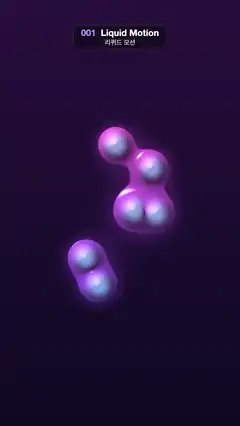

# 001 · Liquid Motion · 리퀴드 모션



★ One of the 20 effects in the original reel (#1) · 원래 릴스 20개 중 하나(1번)

**EN** Six glossy violet-pink liquid blobs drift on looping paths over a dark purple backdrop, melting together and pinching apart.  
**KO** 윤기 나는 보라·분홍 액체 덩어리 여섯 개가 어두운 보라 배경 위를 돌며 녹아 붙었다가 떨어진다.

[Video (mp4)](https://sueun-dev.github.io/motion-effects/videos/001-liquid-motion.mp4) · [Code](../effects/001-liquid-motion.js) · Design styles · 디자인 스타일

## Prompt (English)

```text
Create a "Liquid Motion" motion effect: glossy liquid blobs (metaballs) that flow around, melt together and pull apart.

Look
- Work in units where 1 unit = 540 px: p = (2·pixel − resolution) / width, so x runs −1..1 and y −1.78..1.78 (y up), with (0, 0) at the frame centre.
- Background: a vertical gradient from near-black indigo #0F0A24 at the bottom to dark purple #29123D at the top.
- Six blobs add up to one field f(p) = Σ rᵢ² / |p − cᵢ|², with radius rᵢ = 0.13 + 0.04·sin(3.1·i) (about 65–75 px). The liquid is where f > 1, with a soft edge from f = 0.98 to 1.04, so blobs that come close melt into one shape joined by a smooth neck.
- Colour: mix violet #6B4DFF (lower) to pink #FF5CB8 (upper) by height, factor 0.5 + 0.5·y / 1.6.
- Glossy shading: take the field gradient g by central differences (step 0.004) and use the normal n = normalize(−0.06·g, 1). Light L = normalize(−0.5, 0.7, 0.6), from the upper left. Colour = base·(0.35 + 0.75·diffuse) + 0.9·specular (Phong, exponent 40, viewer straight on) + 0.6·rim·#80E6FF, with rim = (1 − n.z)². The field is steep near each blob's centre, so the centres catch a cool bluish tint and the blobs look plump and dimpled, with pink highlights toward the top.
- Outside the liquid, a soft halo: add base·0.5·0.35·smoothstep(0.35, 1.0, f) to the background.

Motion (0–5 s)
- With a = 2π·t / 5, blob i (i = 0..5) is centred at x = 0.30·cos(a·(1 + i mod 2) + 1.7·i), y = 0.55·sin(a + 2.1·i) + 0.12·sin(2a + i). Odd blobs swing sideways twice as fast, so the blobs keep catching up, merging and pinching apart into different groups.
- Everything stays near the middle: about ±160 px horizontally and ±360 px vertically around the centre.
- Smooth and continuous; nothing jumps.

Technique
- A WebGL2 full-screen fragment shader (one triangle) with time and resolution uniforms. Evaluate the field five times per pixel (once, plus four times for the gradient).

Output and rules
- One self-contained HTML file with no external assets (three.js from a CDN is fine if you use it), drawing on a 1080 × 1920 canvas (9:16) scaled to fit the window.
- Write a function renderFrame(t) that draws the frame for time t in seconds, and preview it with requestAnimationFrame. Everything must be a pure function of t and fixed seeds: no Math.random(), Date or state carried between frames, so frame i = renderFrame(i / 30) can be exported to a 30 fps video.
- Loop seamlessly every 5 seconds: renderFrame(5) must look exactly like renderFrame(0).
- No flicker of any kind: no noise or grain that changes from frame to frame, no strobing or blinking, no z-fighting, no shimmering 1 px lines. Any grain or texture stays fixed to the screen or to the object.
- Keep the top 280 px free of important content (a title label goes there) and fill the whole frame with a designed background.
```

## 프롬프트 (한국어)

```text
"리퀴드 모션" 모션 효과를 만들어 줘: 윤기 나는 액체 덩어리(메타볼)들이 흘러다니며 녹아 붙었다가 떨어지는 효과.

모양
- 단위는 1 = 540px: p = (2·픽셀 − 해상도) / 너비. x는 −1..1, y는 −1.78..1.78(위가 +), (0, 0)이 화면 가운데.
- 배경: 아래쪽 거의 검은 남색 #0F0A24에서 위쪽 어두운 보라 #29123D로 가는 세로 그라디언트.
- 덩어리 여섯 개가 하나의 장 f(p) = Σ rᵢ² / |p − cᵢ|²를 만든다. 반지름 rᵢ = 0.13 + 0.04·sin(3.1·i)(약 65–75px). f > 1인 곳이 액체이고, f = 0.98에서 1.04 사이를 부드러운 경계로 둔다. 그래서 가까워진 덩어리는 매끈한 목으로 이어지며 한 덩어리로 녹아든다.
- 색: 높이에 따라 보라 #6B4DFF(아래)에서 분홍 #FF5CB8(위)로, 비율 0.5 + 0.5·y / 1.6.
- 윤기 나는 셰이딩: 장의 기울기 g를 중앙 차분(간격 0.004)으로 구하고 법선 n = normalize(−0.06·g, 1)을 쓴다. 빛 L = normalize(−0.5, 0.7, 0.6)(왼쪽 위). 색 = base·(0.35 + 0.75·확산광) + 0.9·반사광(퐁, 지수 40, 정면 시점) + 0.6·림·#80E6FF, 림 = (1 − n.z)². 덩어리 중심 근처는 장이 가팔라서 중심이 차가운 푸른빛을 띠고, 덩어리가 통통하면서 살짝 오목하게 보이며 위쪽은 분홍 하이라이트가 된다.
- 액체 바깥에는 은은한 후광: 배경에 base·0.5·0.35·smoothstep(0.35, 1.0, f)를 더한다.

움직임 (0–5초)
- a = 2π·t / 5일 때 덩어리 i(i = 0..5)의 중심은 x = 0.30·cos(a·(1 + i mod 2) + 1.7·i), y = 0.55·sin(a + 2.1·i) + 0.12·sin(2a + i). 홀수 번째 덩어리는 좌우로 두 배 빨리 움직여서, 덩어리들이 계속 따라잡고 합쳐졌다가 다른 무리로 갈라진다.
- 모두 가운데 근처에 머문다: 중심에서 좌우 약 ±160px, 위아래 약 ±360px.
- 부드럽고 끊김 없이. 튀는 순간이 없다.

기법
- WebGL2 전체 화면 프래그먼트 셰이더(삼각형 하나), 시간·해상도 유니폼. 픽셀마다 장을 다섯 번 계산한다(한 번 + 기울기용 네 번).

출력과 규칙
- 외부 파일 없는 HTML 파일 하나(three.js를 쓴다면 CDN은 괜찮다). 1080 × 1920(9:16) 캔버스에 그리고 창 크기에 맞춰 보이게 한다.
- 시간 t(초)의 프레임을 그리는 renderFrame(t) 함수를 만들고, 미리보기는 requestAnimationFrame으로 돌린다. 모든 것은 t와 고정 시드만으로 정해진다: Math.random(), Date, 프레임 사이에 쌓이는 상태 금지. 그래야 i번째 프레임 = renderFrame(i / 30)으로 30fps 영상을 뽑을 수 있다.
- 5초마다 끊김 없이 반복: renderFrame(5)는 renderFrame(0)과 똑같아 보여야 한다.
- 어떤 깜빡임도 금지: 프레임마다 바뀌는 노이즈·그레인, 번쩍임·깜빡임, z-fighting, 반짝이며 떨리는 1px 선 모두 금지. 그레인·질감은 화면이나 물체에 고정한다.
- 위쪽 280px에는 중요한 내용을 두지 않고(제목 라벨 자리), 화면 전체를 디자인된 배경으로 채운다.
```
