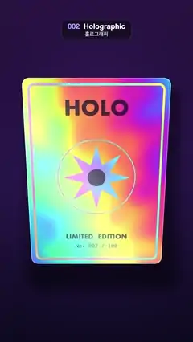

# 002 · Holographic · 홀로그래픽



★ One of the 20 effects in the original reel (#2) · 원래 릴스 20개 중 하나(2번)

**EN** A holographic foil trading card tilts in a slow circle as rainbow thin-film colours, glitter and a glare band slide across it.  
**KO** 홀로그램 포일 카드가 천천히 원을 그리며 기울고, 무지갯빛 박막 색·글리터·반사광 띠가 표면을 따라 흐른다.

[Video (mp4)](https://sueun-dev.github.io/motion-effects/videos/002-holographic.mp4) · [Code](../effects/002-holographic.js) · Design styles · 디자인 스타일

## Prompt (English)

```text
Create a "Holographic" motion effect: a holographic foil card that tilts in a slow circle while rainbow thin-film colour, glitter and a glare band run across its surface.

Look
- Units: p = (2·pixel − resolution) / width (1 unit = 540 px, y up, (0, 0) at the frame centre).
- Background: a vertical gradient from deep violet #0D0A1F (bottom) to #29143D (top), a soft round glow behind the card tinted with the card's current foil colour (strength 0.22, falloff exp(−0.9·|p|²)), and a soft drop shadow behind the card offset about 30 px right and 55 px down that darkens the background by 55 %.
- The card: a rounded rectangle about 780 × 1085 px on screen (aspect 0.9 : 1.257, corner radius about 7 % of its width), centred about 40 px below the frame centre, with a crisp anti-aliased edge and a thin bright cut edge.
- Card artwork, drawn once into a 1080 × 1508 canvas and mapped onto the card face:
  - foil parts (these turn into a brighter, hue-shifted rainbow): a border line (rounded rect inset 46 px, radius 40, 16 px wide), a thin ring of radius 300 around the centre (6 px), and a filled eight-point star (16 vertices, outer radius 260, inner 110);
  - dark printed ink: "HOLO" in bold Futura 150 px near the top (baseline y 270), "LIMITED  EDITION" in Futura 600 54 px and "No. 002 / 100" in Menlo 44 px near the bottom (baselines 230 and 150 px above the bottom edge), and a dot of radius 70 in the centre of the star. Ink is near-black violet #120F29 with a faint 12 % of the foil colour.
- Foil colour: a cosine rainbow palette film(h) = 0.6 + 0.4·cos(2π(h + (0, 0.33, 0.67))). With (cx, cy) the position on the card (the card spans ±0.9 × ±1.257), n the card normal and v the view direction, h = 1.6·(1 − n·v) + 0.35·cx + 0.25·cy + a fixed noise swirl printed into the foil (0.12·noise(1.6·cx, 1.6·cy)) + 1.2·tiltY − 0.8·tiltX. The colour changes with viewing angle and position, like real foil.
- Glitter: divide the card into square cells (26 per unit, about 47 across the card). Each cell tilts its normal by a random ±0.18 and flashes with a sharp specular (exponent 60, light from the upper-left front) in its own random hue offset; cells are soft-edged squares.
- Glare: a broad white diagonal band, +0.35·exp(−3·(cx + 0.6·cy − (2.4·tiltY − 1.6·tiltX))²), that sweeps across as the card tilts.

Motion (0–5 s)
- With a = 2π·t / 5, the card rotates by tiltX = 0.30·cos(a) rad about the horizontal axis and tiltY = 0.42·sin(a) rad about the vertical axis, so its normal traces a circle: one full wobble per loop, with real perspective (near corners grow, far corners shrink).
- Colours, glitter and glare all follow from the tilt, so they roll across the surface continuously; the background glow changes tint with them.

Technique
- A WebGL2 full-screen fragment shader. For each pixel cast a ray from a camera at z = 5 with direction (p, −4) and intersect the rotated card plane through the origin; use the hit point in card space for the texture lookup and for a rounded-box distance, anti-aliased with fwidth.
- Upload the card art canvas as a texture once and use its colour channels as masks (one for foil lines, one for ink).
- The noise swirl and glitter randomness depend only on the card position, so nothing flickers.

Output and rules
- One self-contained HTML file with no external assets (three.js from a CDN is fine if you use it), drawing on a 1080 × 1920 canvas (9:16) scaled to fit the window.
- Write a function renderFrame(t) that draws the frame for time t in seconds, and preview it with requestAnimationFrame. Everything must be a pure function of t and fixed seeds: no Math.random(), Date or state carried between frames, so frame i = renderFrame(i / 30) can be exported to a 30 fps video.
- Loop seamlessly every 5 seconds: renderFrame(5) must look exactly like renderFrame(0).
- No flicker of any kind: no noise or grain that changes from frame to frame, no strobing or blinking, no z-fighting, no shimmering 1 px lines. Any grain or texture stays fixed to the screen or to the object.
- Keep the top 280 px free of important content (a title label goes there) and fill the whole frame with a designed background.
```

## 프롬프트 (한국어)

```text
"홀로그래픽" 모션 효과를 만들어 줘: 홀로그램 포일 카드가 천천히 원을 그리며 기울고, 무지갯빛 박막 색·글리터·반사광 띠가 표면을 따라 흐르는 효과.

모양
- 단위: p = (2·픽셀 − 해상도) / 너비(1 = 540px, 위가 +, (0, 0)이 화면 가운데).
- 배경: 아래 짙은 보라 #0D0A1F에서 위 #29143D로 가는 세로 그라디언트. 카드 뒤에는 카드의 지금 포일 색으로 물든 둥근 빛(세기 0.22, 감쇠 exp(−0.9·|p|²))과, 오른쪽으로 약 30px·아래로 약 55px 비켜 깔려 배경을 55 % 어둡게 하는 부드러운 그림자.
- 카드: 화면에서 약 780 × 1085px인 둥근 직사각형(비율 0.9 : 1.257, 모서리 반지름은 너비의 약 7 %), 중심은 화면 가운데보다 약 40px 아래. 가장자리는 선명하게 안티앨리어싱하고 얇게 밝은 절단면을 넣는다.
- 카드 그림: 1080 × 1508 캔버스에 한 번 그려 카드 면에 입힌다.
  - 포일 부분(더 밝고 색상이 어긋난 무지개색이 된다): 테두리 선(46px 안쪽 둥근 사각형, 반지름 40, 굵기 16px), 가운데 반지름 300의 얇은 원(6px), 채운 8각 별(꼭짓점 16개, 바깥 반지름 260, 안쪽 110).
  - 진한 인쇄 잉크: 위쪽에 굵은 Futura 150px "HOLO"(기준선 y 270), 아래쪽에 Futura 600 54px "LIMITED  EDITION"과 Menlo 44px "No. 002 / 100"(기준선은 아래 가장자리에서 230px, 150px 위), 별 가운데 반지름 70 점. 잉크 색은 거의 검은 보라 #120F29에 포일 색을 12 % 살짝 섞는다.
- 포일 색: 코사인 무지개 팔레트 film(h) = 0.6 + 0.4·cos(2π(h + (0, 0.33, 0.67))). (cx, cy)를 카드 위 좌표(카드 범위 ±0.9 × ±1.257), n을 카드 법선, v를 시선 방향이라 할 때 h = 1.6·(1 − n·v) + 0.35·cx + 0.25·cy + 포일에 찍힌 고정 노이즈 소용돌이(0.12·noise(1.6·cx, 1.6·cy)) + 1.2·tiltY − 0.8·tiltX. 진짜 포일처럼 보는 각도와 위치에 따라 색이 바뀐다.
- 글리터: 카드를 정사각형 칸으로 나눈다(1단위당 26칸, 카드 가로로 약 47칸). 칸마다 법선을 무작위로 ±0.18 기울이고, 왼쪽 위 앞에서 오는 빛을 날카로운 반사(지수 60)로 받을 때 칸마다 다른 색상으로 반짝인다. 칸은 가장자리가 부드러운 정사각형.
- 반사광: 넓은 흰 대각선 띠 +0.35·exp(−3·(cx + 0.6·cy − (2.4·tiltY − 1.6·tiltX))²)가 카드가 기울 때 표면을 가로지른다.

움직임 (0–5초)
- a = 2π·t / 5일 때 카드는 가로축으로 tiltX = 0.30·cos(a) rad, 세로축으로 tiltY = 0.42·sin(a) rad 회전한다. 법선이 원을 그리며 루프마다 한 바퀴 흔들리고, 원근이 있어 가까운 모서리는 커지고 먼 모서리는 작아진다.
- 색·글리터·반사광은 모두 기울기에서 나오므로 표면 위를 끊김 없이 굴러가고, 배경 빛의 색도 함께 바뀐다.

기법
- WebGL2 전체 화면 프래그먼트 셰이더. 픽셀마다 z = 5의 카메라에서 방향 (p, −4)로 광선을 쏘아 원점을 지나는 회전된 카드 평면과 만나게 한다. 만난 점의 카드 좌표로 텍스처를 읽고 둥근 상자 거리를 재며, fwidth로 안티앨리어싱한다.
- 카드 그림 캔버스는 텍스처로 한 번만 올리고, 색 채널을 마스크로 쓴다(하나는 포일 선, 하나는 잉크).
- 노이즈 소용돌이와 글리터 무작위값은 카드 위치에만 의존하므로 아무것도 깜빡이지 않는다.

출력과 규칙
- 외부 파일 없는 HTML 파일 하나(three.js를 쓴다면 CDN은 괜찮다). 1080 × 1920(9:16) 캔버스에 그리고 창 크기에 맞춰 보이게 한다.
- 시간 t(초)의 프레임을 그리는 renderFrame(t) 함수를 만들고, 미리보기는 requestAnimationFrame으로 돌린다. 모든 것은 t와 고정 시드만으로 정해진다: Math.random(), Date, 프레임 사이에 쌓이는 상태 금지. 그래야 i번째 프레임 = renderFrame(i / 30)으로 30fps 영상을 뽑을 수 있다.
- 5초마다 끊김 없이 반복: renderFrame(5)는 renderFrame(0)과 똑같아 보여야 한다.
- 어떤 깜빡임도 금지: 프레임마다 바뀌는 노이즈·그레인, 번쩍임·깜빡임, z-fighting, 반짝이며 떨리는 1px 선 모두 금지. 그레인·질감은 화면이나 물체에 고정한다.
- 위쪽 280px에는 중요한 내용을 두지 않고(제목 라벨 자리), 화면 전체를 디자인된 배경으로 채운다.
```
