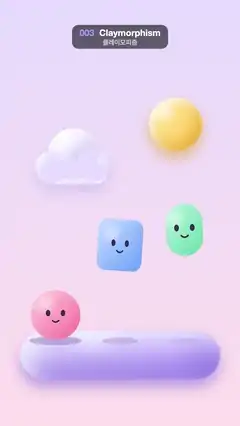

# 003 · Claymorphism · 클레이모피즘



★ One of the 20 effects in the original reel (#3) · 원래 릴스 20개 중 하나(3번)

**EN** Three puffy clay toys with smiley faces bounce with squash and stretch on a soft lilac platform under a clay sun and cloud.  
**KO** 웃는 얼굴의 말랑한 점토 장난감 셋이 연보라 받침 위에서 찌그러졌다 늘어나며 통통 튀고, 위에는 점토 해와 구름이 떠 있다.

[Video (mp4)](../videos/003-claymorphism.mp4) · [Code](../effects/003-claymorphism.js) · Design styles · 디자인 스타일

## Prompt (English)

```text
Create a "Claymorphism" motion effect: puffy clay-like toys that bounce with squash and stretch, shaded with soft inner shadows and highlights.

Look
- Background: a vertical gradient from lavender #E6DDFF (top) to pale pink #FFE0EC (bottom).
- Clay recipe for every shape, with three colours per object (base, light, shade) and r = the object's half size:
  1. optional soft drop shadow in the shade colour at 53 % opacity, blur 60 px, offset 34 px down;
  2. fill with a diagonal linear gradient from light (top-left, at (−r, −r)) to base (bottom-right, at (r, r));
  3. inner shadows: clip to the shape, then fill a big frame around it with the shape cut out as a hole, so only the frame's blurred shadow falls inside. First the shade colour at 80 % with blur 0.5·r and offset −0.16·r on both axes (a dark rim inside the bottom-right edge), then white at 82 % with blur 0.35·r and offset +0.16·r (a light rim inside the top-left edge);
  4. a soft gloss spot: radial gradient white 55 % → 0, radius 0.5·r, centred at (−0.4·r, −0.45·r).
- Scenery (with drop shadow):
  - sun: disc of radius 120 at (790, 560), colours #FFC94D / #FFE9A8 / #E09A1F;
  - cloud at (330, 720): the union of circles (−95, 20) r 75, (90, 10) r 75, (0, −40) r 115 and a rounded bar 300 × 95 (radius 47) from (−150, 0); colours #F6F2FF / #FFFFFF / #C2B3EE;
  - platform: a pill 900 × 220 (radius 110) centred at (540, 1600), colours #B8A3FF / #E1D7FF / #7B62D9. Its top is the ground line y = 1532.
- Three toys (no drop shadow), each with a face in dark plum #3B2B4F: two oval eyes 0.18·r × 0.26·r at (±0.3·r, −0.08·r) and a smile arc of radius 0.16·r around (0, 0.12·r) from 0.2π to 0.8π, 0.06·r thick with round caps:
  - pink ball, r 112, at x 250: #FF7FA8 / #FFC3D6 / #D9467A;
  - blue rounded square, 216 × 216 (corner radius 0.38·r, r 108), at x 540: #6FA6FF / #BFD7FF / #3C6FD6;
  - mint capsule, 165 × 236 (r 118, corner radius 0.7·r), at x 830: #5FD6A8 / #B8F1DB / #2E9E76.
- Under each toy, a contact shadow on the platform: an ellipse at y 1536, colour rgba(90, 60, 160, 0.30 − 0.2·lift), width 2·r·(1.05 − 0.45·lift)·sx, height 40·(1 − 0.5·lift), so it shrinks and fades while the toy is in the air.

Motion (0–5 s)
- Each toy has its own bounce cycle u = fract(t·n / 5 + offset): pink n = 3, offset 0, hop 430 px; blue n = 2, offset 0.3, hop 560 px; mint n = 3, offset 0.55, hop 380 px. The toys never bounce in sync.
- Contact (u < 0.16): squash, sy = 1 − 0.32·sin(π·u / 0.16). Flight: k = (u − 0.16) / 0.84, lift = 4k(1 − k) (a parabola), sy = 1 + 0.16·(1 − 2k)² (stretched at take-off and landing, round at the top). Always sx = 1 / sy, so the volume is kept.
- Position: centre y = 1532 − r·sy − lift·hop, so the bottom stays on the ground while it squashes. In the air each toy tilts by 0.12·sin(a·n + 2π·offset)·lift rad, with a = 2π·t / 5.
- The sun bobs 22 px (sin a); the cloud drifts ±50 px sideways (sin a) and ±14 px up and down (cos 2a).

Technique
- Canvas 2D, fully redrawn each frame: canvas shadows (shadowBlur / shadowOffset) for the soft shadows, the inverted-frame trick for the inner shadows, and translate / rotate / scale for squash and stretch.

Output and rules
- One self-contained HTML file with no external assets (three.js from a CDN is fine if you use it), drawing on a 1080 × 1920 canvas (9:16) scaled to fit the window.
- Write a function renderFrame(t) that draws the frame for time t in seconds, and preview it with requestAnimationFrame. Everything must be a pure function of t and fixed seeds: no Math.random(), Date or state carried between frames, so frame i = renderFrame(i / 30) can be exported to a 30 fps video.
- Loop seamlessly every 5 seconds: renderFrame(5) must look exactly like renderFrame(0).
- No flicker of any kind: no noise or grain that changes from frame to frame, no strobing or blinking, no z-fighting, no shimmering 1 px lines. Any grain or texture stays fixed to the screen or to the object.
- Keep the top 280 px free of important content (a title label goes there) and fill the whole frame with a designed background.
```

## 프롬프트 (한국어)

```text
"클레이모피즘" 모션 효과를 만들어 줘: 말랑한 점토 같은 장난감들이 찌그러졌다 늘어나며 통통 튀고, 부드러운 안쪽 그림자와 하이라이트로 입체감을 내는 효과.

모양
- 배경: 위 라벤더 #E6DDFF에서 아래 연분홍 #FFE0EC로 가는 세로 그라디언트.
- 모든 도형에 쓰는 점토 공식. 물체마다 색 세 개(기본, 밝은색, 그늘색), r = 물체 크기의 절반:
  1. 선택: 그늘색 53 % 불투명도의 부드러운 바깥 그림자, 블러 60px, 아래로 34px;
  2. 밝은색(왼쪽 위, (−r, −r))에서 기본색(오른쪽 아래, (r, r))으로 가는 대각선 선형 그라디언트로 채운다;
  3. 안쪽 그림자: 도형으로 클립한 뒤, 도형 모양으로 구멍을 뚫은 큰 틀을 채워서 그 틀의 흐린 그림자만 안쪽에 떨어지게 한다. 먼저 그늘색 80 %, 블러 0.5·r, 두 축 모두 −0.16·r 오프셋(오른쪽 아래 안쪽 가장자리에 어두운 테), 다음 흰색 82 %, 블러 0.35·r, +0.16·r 오프셋(왼쪽 위 안쪽 가장자리에 밝은 테);
  4. 부드러운 광택 점: 흰색 55 % → 0의 방사형 그라디언트, 반지름 0.5·r, 중심 (−0.4·r, −0.45·r).
- 배경 소품(바깥 그림자 있음):
  - 해: (790, 560)에 반지름 120 원, 색 #FFC94D / #FFE9A8 / #E09A1F;
  - 구름: (330, 720) 기준으로 원 (−95, 20) r 75, (90, 10) r 75, (0, −40) r 115와 (−150, 0)에서 시작하는 300 × 95 둥근 막대(반지름 47)를 합친 모양, 색 #F6F2FF / #FFFFFF / #C2B3EE;
  - 받침: (540, 1600) 중심의 900 × 220 알약(반지름 110), 색 #B8A3FF / #E1D7FF / #7B62D9. 윗면이 바닥선 y = 1532.
- 장난감 셋(바깥 그림자 없음). 모두 진한 자두색 #3B2B4F 얼굴: (±0.3·r, −0.08·r)에 0.18·r × 0.26·r 타원 눈 두 개, (0, 0.12·r)을 중심으로 반지름 0.16·r, 0.2π에서 0.8π까지의 미소 호(굵기 0.06·r, 둥근 끝):
  - 분홍 공, r 112, x 250: #FF7FA8 / #FFC3D6 / #D9467A;
  - 파란 둥근 사각형, 216 × 216(모서리 반지름 0.38·r, r 108), x 540: #6FA6FF / #BFD7FF / #3C6FD6;
  - 민트 캡슐, 165 × 236(r 118, 모서리 반지름 0.7·r), x 830: #5FD6A8 / #B8F1DB / #2E9E76.
- 장난감마다 받침 위 접지 그림자: y 1536의 타원, 색 rgba(90, 60, 160, 0.30 − 0.2·lift), 너비 2·r·(1.05 − 0.45·lift)·sx, 높이 40·(1 − 0.5·lift). 장난감이 떠 있으면 작아지고 옅어진다.

움직임 (0–5초)
- 장난감마다 튀는 주기 u = fract(t·n / 5 + offset): 분홍 n = 3, offset 0, 점프 430px; 파랑 n = 2, offset 0.3, 점프 560px; 민트 n = 3, offset 0.55, 점프 380px. 셋이 박자를 맞추지 않는다.
- 닿아 있을 때(u < 0.16): 찌그러짐 sy = 1 − 0.32·sin(π·u / 0.16). 공중: k = (u − 0.16) / 0.84, lift = 4k(1 − k)(포물선), sy = 1 + 0.16·(1 − 2k)²(뜰 때와 내릴 때 늘어나고 꼭대기에서 둥글다). 항상 sx = 1 / sy로 부피를 지킨다.
- 위치: 중심 y = 1532 − r·sy − lift·hop. 그래서 찌그러질 때도 바닥은 땅에 붙어 있다. 공중에서는 0.12·sin(a·n + 2π·offset)·lift rad만큼 기운다(a = 2π·t / 5).
- 해는 22px 위아래로 흔들리고(sin a), 구름은 좌우 ±50px(sin a), 위아래 ±14px(cos 2a) 떠다닌다.

기법
- Canvas 2D, 매 프레임 전부 다시 그린다. 부드러운 그림자는 캔버스 그림자(shadowBlur / shadowOffset), 안쪽 그림자는 구멍 뚫린 틀 기법, 찌그러짐·늘어남은 translate / rotate / scale.

출력과 규칙
- 외부 파일 없는 HTML 파일 하나(three.js를 쓴다면 CDN은 괜찮다). 1080 × 1920(9:16) 캔버스에 그리고 창 크기에 맞춰 보이게 한다.
- 시간 t(초)의 프레임을 그리는 renderFrame(t) 함수를 만들고, 미리보기는 requestAnimationFrame으로 돌린다. 모든 것은 t와 고정 시드만으로 정해진다: Math.random(), Date, 프레임 사이에 쌓이는 상태 금지. 그래야 i번째 프레임 = renderFrame(i / 30)으로 30fps 영상을 뽑을 수 있다.
- 5초마다 끊김 없이 반복: renderFrame(5)는 renderFrame(0)과 똑같아 보여야 한다.
- 어떤 깜빡임도 금지: 프레임마다 바뀌는 노이즈·그레인, 번쩍임·깜빡임, z-fighting, 반짝이며 떨리는 1px 선 모두 금지. 그레인·질감은 화면이나 물체에 고정한다.
- 위쪽 280px에는 중요한 내용을 두지 않고(제목 라벨 자리), 화면 전체를 디자인된 배경으로 채운다.
```
