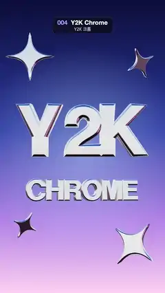

# 004 · Y2K Chrome · Y2K 크롬



★ One of the 20 effects in the original reel (#7) · 원래 릴스 20개 중 하나(7번)

**EN** Mirror-chrome 3D letters "Y2K" and "CHROME" sway as sky and horizon reflections stream across them, with chrome sparkles orbiting.  
**KO** 거울 같은 크롬 3D 글자 "Y2K"·"CHROME"이 흔들리며 하늘·지평선 반사가 표면을 흐르고, 크롬 반짝이 별들이 주위를 돈다.

[Video (mp4)](../videos/004-y2k-chrome.mp4) · [Code](../effects/004-y2k-chrome.js) · Design styles · 디자인 스타일

## Prompt (English)

```text
Create a "Y2K Chrome" motion effect: liquid-chrome 3D letters whose mirror surface reflects a bright sky, horizon and dark floor that keep streaming across them.

Look
- Background (flat, not reflected): a vertical gradient #0B0F3A (top) → #2B3FA8 (45 %) → #B58BEA (75 %) → #FFD6F2 (bottom), plus a soft pale-blue radial glow, rgba(190, 220, 255, 0.45) → 0 from radius 50 to 700 px, centred at 52 % of the height.
- Two words of extruded 3D text in a bold sans typeface (for example the helvetiker bold typeface font that ships with three.js): "Y2K" scaled to 4.5 world units wide at y = +0.55 and "CHROME" scaled to 3.9 units wide at y = −1.5, both centred on x. On screen that is about 855 px and 740 px wide, centred near y 855 px and 1245 px. Text size 1, depth 0.32, bevel thickness 0.14, bevel size 0.06, 12 bevel segments, 20 curve segments, geometry centred.
- Four chrome sparkles: four-point stars with concave sides (quadratic curves pulled in through the centre between the tips), extruded 0.08 deep with a 0.08 / 0.05 bevel (6 segments). At (−1.9, 3.0) scale 0.75, (2.0, 2.6) scale 0.5, (1.8, −3.1) scale 0.8 and (−2.0, −2.8) scale 0.45, all at z = 0.5.
- One material for everything: a white physically based material with metalness 1 and roughness 0.07, i.e. a near-perfect mirror, so all of the look comes from the environment.
- Environment: paint a 1024 × 512 equirectangular canvas with a vertical gradient #0A1E66 (0) → #4C8CF0 (0.3) → #DDF0FF (0.47) → #FFFFFF (0.5, a hot horizon) → #6B5260 (0.53) → #1C1218 (0.72) → #050506 (1, dark floor). Add four white softbox rectangles 70 × 150 px at x = 80, 340, 610, 860, y = 90, a pink #FF7AD9 strip 160 × 60 at (470, 300) and a cyan #62E6FF strip 140 × 50 at (150, 310). Prefilter it with PMREM and use it as the scene environment.
- Renderer: ACES Filmic tone mapping, exposure 1.15. Camera: perspective, 35° vertical field of view, at z = 16 looking at the origin.

Motion (0–5 s)
- With a = 2π·t / 5, turn the environment once per loop: environment rotation = (0.15·sin a, a, 0). This is what makes the sky, horizon and coloured softboxes stream across the letters.
- "Y2K" rotates (0.10·sin 2a, 0.32·sin a, 0.03·sin a); "CHROME" is tipped back to catch the sky: (−0.16 + 0.10·sin(2a + 0.6), 0.32·sin(a + 0.6), 0).
- Each sparkle, with phase k = 0, 2, 4, 1, drifts on a small loop (+0.15·cos(a + k), +0.2·sin(a + k)), tilts (0.3·sin(a + k), 0.5·sin(a + k)) and spins one full turn around z per loop (angle a + k).

Technique
- three.js: TextGeometry with FontLoader, ExtrudeGeometry from a Shape for the sparkles, MeshStandardMaterial, canvas-painted CanvasTextures (sRGB) for the background and for the environment (equirectangular reflection mapping → PMREMGenerator.fromEquirectangular), scene.environmentRotation for the turning reflections. No lights are needed; the environment lights the metal.

Output and rules
- One self-contained HTML file with no external assets (three.js from a CDN is fine if you use it), drawing on a 1080 × 1920 canvas (9:16) scaled to fit the window.
- Write a function renderFrame(t) that draws the frame for time t in seconds, and preview it with requestAnimationFrame. Everything must be a pure function of t and fixed seeds: no Math.random(), Date or state carried between frames, so frame i = renderFrame(i / 30) can be exported to a 30 fps video.
- Loop seamlessly every 5 seconds: renderFrame(5) must look exactly like renderFrame(0).
- No flicker of any kind: no noise or grain that changes from frame to frame, no strobing or blinking, no z-fighting, no shimmering 1 px lines. Any grain or texture stays fixed to the screen or to the object.
- Keep the top 280 px free of important content (a title label goes there) and fill the whole frame with a designed background.
```

## 프롬프트 (한국어)

```text
"Y2K 크롬" 모션 효과를 만들어 줘: 액체 금속 같은 크롬 3D 글자의 거울 표면에 밝은 하늘·지평선·어두운 바닥 반사가 계속 흘러가는 효과.

모양
- 배경(반사에는 안 쓰는 평면 배경): 세로 그라디언트 #0B0F3A(위) → #2B3FA8(45 %) → #B58BEA(75 %) → #FFD6F2(아래). 높이 52 % 지점을 중심으로 연한 하늘빛 방사형 빛 rgba(190, 220, 255, 0.45) → 0(반지름 50 → 700px).
- 굵은 산세리프 글꼴(예: three.js에 들어 있는 helvetiker bold 타입페이스 글꼴)의 돌출 3D 글자 두 단어: "Y2K"는 너비 4.5 월드 단위로 y = +0.55, "CHROME"은 너비 3.9 단위로 y = −1.5, 둘 다 가로 가운데. 화면에서는 각각 약 855px, 740px 너비이고 중심이 약 y 855px, 1245px. 글자 크기 1, 깊이 0.32, 베벨 두께 0.14, 베벨 크기 0.06, 베벨 분할 12, 곡선 분할 20, 지오메트리는 가운데 정렬.
- 크롬 반짝이 넷: 변이 오목한 네 꼭짓점 별(꼭짓점 사이를 중심 쪽으로 당긴 2차 곡선), 깊이 0.08로 돌출하고 베벨 0.08 / 0.05(분할 6). (−1.9, 3.0) 크기 0.75, (2.0, 2.6) 크기 0.5, (1.8, −3.1) 크기 0.8, (−2.0, −2.8) 크기 0.45, 모두 z = 0.5.
- 재질은 하나: 흰색 물리 기반 재질, metalness 1, roughness 0.07. 거의 완벽한 거울이라 모든 모습이 환경에서 나온다.
- 환경: 1024 × 512 등장방형 캔버스에 세로 그라디언트 #0A1E66(0) → #4C8CF0(0.3) → #DDF0FF(0.47) → #FFFFFF(0.5, 아주 밝은 지평선) → #6B5260(0.53) → #1C1218(0.72) → #050506(1, 어두운 바닥)을 칠한다. x = 80, 340, 610, 860, y = 90에 70 × 150px 흰 소프트박스 사각형 넷, (470, 300)에 160 × 60 분홍 #FF7AD9 띠, (150, 310)에 140 × 50 청록 #62E6FF 띠를 더한다. PMREM으로 전처리해 장면 환경으로 쓴다.
- 렌더러: ACES Filmic 톤매핑, 노출 1.15. 카메라: 원근, 세로 시야각 35°, z = 16에서 원점을 본다.

움직임 (0–5초)
- a = 2π·t / 5일 때 환경을 루프마다 한 바퀴 돌린다: 환경 회전 = (0.15·sin a, a, 0). 이것 때문에 하늘·지평선·색 소프트박스가 글자 위를 흘러간다.
- "Y2K" 회전 (0.10·sin 2a, 0.32·sin a, 0.03·sin a). "CHROME"은 하늘을 받도록 뒤로 젖힌다: (−0.16 + 0.10·sin(2a + 0.6), 0.32·sin(a + 0.6), 0).
- 반짝이마다 위상 k = 0, 2, 4, 1로 작은 원을 그리며 떠다니고(+0.15·cos(a + k), +0.2·sin(a + k)), 기울고(0.3·sin(a + k), 0.5·sin(a + k)), z축으로 루프마다 한 바퀴 돈다(각도 a + k).

기법
- three.js: FontLoader와 TextGeometry, Shape으로 만든 ExtrudeGeometry(반짝이), MeshStandardMaterial, 캔버스로 칠한 CanvasTexture(sRGB)를 배경과 환경에 쓴다(등장방형 반사 매핑 → PMREMGenerator.fromEquirectangular). 반사가 도는 것은 scene.environmentRotation. 조명은 필요 없다. 환경이 금속을 비춘다.

출력과 규칙
- 외부 파일 없는 HTML 파일 하나(three.js를 쓴다면 CDN은 괜찮다). 1080 × 1920(9:16) 캔버스에 그리고 창 크기에 맞춰 보이게 한다.
- 시간 t(초)의 프레임을 그리는 renderFrame(t) 함수를 만들고, 미리보기는 requestAnimationFrame으로 돌린다. 모든 것은 t와 고정 시드만으로 정해진다: Math.random(), Date, 프레임 사이에 쌓이는 상태 금지. 그래야 i번째 프레임 = renderFrame(i / 30)으로 30fps 영상을 뽑을 수 있다.
- 5초마다 끊김 없이 반복: renderFrame(5)는 renderFrame(0)과 똑같아 보여야 한다.
- 어떤 깜빡임도 금지: 프레임마다 바뀌는 노이즈·그레인, 번쩍임·깜빡임, z-fighting, 반짝이며 떨리는 1px 선 모두 금지. 그레인·질감은 화면이나 물체에 고정한다.
- 위쪽 280px에는 중요한 내용을 두지 않고(제목 라벨 자리), 화면 전체를 디자인된 배경으로 채운다.
```
