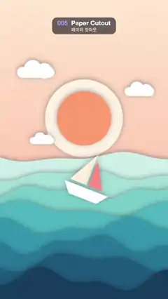

# 005 · Paper Cutout · 페이퍼 컷아웃



★ One of the 20 effects in the original reel (#8) · 원래 릴스 20개 중 하나(8번)

**EN** Eight layers of cut-paper waves roll and cast soft shadows under a paper sun and clouds, with a paper sailboat riding the swell.  
**KO** 종이 해와 구름 아래 여덟 겹의 종이 파도가 부드러운 그림자를 드리우며 출렁이고, 종이 돛단배가 물결을 탄다.

[Video (mp4)](https://sueun-dev.github.io/motion-effects/videos/005-paper-cutout.mp4) · [Code](../effects/005-paper-cutout.js) · Design styles · 디자인 스타일

## Prompt (English)

```text
Create a "Paper Cutout" motion effect: layered cut-paper ocean waves that roll and cast soft shadows on each other, under a paper sun and clouds, with a paper sailboat on the swell.

Look
- Sky: a vertical gradient from peach #FFE7CF (top) to #FFC9B0 (at y 1100 and below).
- Every paper piece is a flat filled shape with the same soft shadow: rgba(25, 30, 50, 0.38), blur 34 px, offset 6 px upward, so each sheet shades the sheet behind it along its top edge.
- Sun: a cream disc #FFF4E4 of radius 250 at (540, 760) with an orange disc #FF9C6E of radius 175 on top of it.
- Three white clouds, each a rounded bar 240s × 70s (radius 35s) with its top edge at the cloud's y, plus two bumps: a circle of radius 55s centred 20s left of the bar's centre and 10s below its top, and one of radius 50s centred 55s right and 25s below. At (230, 430) s = 1, (860, 560) s = 0.8 and (300, 880) s = 0.65 (x = bar centre).
- Eight wave sheets from back to front, light to dark: #CDEDE6, #A3DED6, #76CBC8, #4CB2BE, #3192AC, #247495, #1C567A, #153B5C. Sheet i (0..7) fills everything below the curve
  y = 1010 + 112·i + (34 + 7·i)·(0.65·sin(k·x + d·a + 1.3·i) + 0.35·sin(2.3·k·x − 2·d·a + i)),
  with k = 0.006 + 0.0009·(i mod 3) radians per px, a = 2π·t / 5, and d = −1 for even and +1 for odd sheets, so neighbouring sheets roll in opposite directions. Sample the curve every 12 px from x = −40 to 1120.
- Sailboat on sheet 2 (the third): at x 540, 10 px below that sheet's curve, rotated to the curve's slope (measured over ±30 px), and drawn right after sheet 2 so sheets 3–7 hide its keel. White hull trapezoid (−150, −40), (150, −40), (95, 30), (−95, 30); a tall cream sail #FFF1DA (−6, −60), (−6, −270), (−120, −60); a smaller coral sail #FF8A80 (6, −60), (6, −230), (100, −60). Each piece gets the paper shadow.
- Paper fibre texture over everything: a 256 × 256 tile with 9000 seeded specks and short fibres (each black or white, 5–13 % opacity, 1–3.5 × 1–2.2 px), tiled across the frame with overlay blending. It is generated once and never changes.

Motion (0–5 s)
- The waves roll continuously with the phases above, so the sheets slide past each other in alternating directions and the boat rocks and bobs on its sheet.
- The orange sun disc bobs 8 px (sin a); each cloud drifts ±40 px sideways (sin(a + k), k = 0, 2, 4).
- Gentle and calm; everything loops in 5 s.

Technique
- Canvas 2D, fully redrawn each frame, with canvas shadows for the paper depth and the fibre texture as a repeating pattern made once from a fixed seed.

Output and rules
- One self-contained HTML file with no external assets (three.js from a CDN is fine if you use it), drawing on a 1080 × 1920 canvas (9:16) scaled to fit the window.
- Write a function renderFrame(t) that draws the frame for time t in seconds, and preview it with requestAnimationFrame. Everything must be a pure function of t and fixed seeds: no Math.random(), Date or state carried between frames, so frame i = renderFrame(i / 30) can be exported to a 30 fps video.
- Loop seamlessly every 5 seconds: renderFrame(5) must look exactly like renderFrame(0).
- No flicker of any kind: no noise or grain that changes from frame to frame, no strobing or blinking, no z-fighting, no shimmering 1 px lines. Any grain or texture stays fixed to the screen or to the object.
- Keep the top 280 px free of important content (a title label goes there) and fill the whole frame with a designed background.
```

## 프롬프트 (한국어)

```text
"페이퍼 컷아웃" 모션 효과를 만들어 줘: 오려 붙인 종이 파도가 여러 겹으로 출렁이며 서로에게 부드러운 그림자를 드리우고, 종이 해와 구름 아래 종이 돛단배가 물결을 타는 효과.

모양
- 하늘: 위 복숭아색 #FFE7CF에서 y 1100(그 아래 전부) #FFC9B0으로 가는 세로 그라디언트.
- 모든 종이 조각은 같은 부드러운 그림자를 가진 평평한 채운 도형: rgba(25, 30, 50, 0.38), 블러 34px, 위로 6px. 그래서 각 종이가 뒤에 있는 종이의 윗가장자리를 따라 그늘을 드리운다.
- 해: (540, 760)에 반지름 250 크림색 원 #FFF4E4, 그 위에 반지름 175 주황 원 #FF9C6E.
- 흰 구름 셋: 각각 윗변이 구름의 y에 있는 240s × 70s 둥근 막대(반지름 35s)와 혹 두 개 — 막대 가운데에서 왼쪽 20s·윗변에서 아래 10s에 중심을 둔 반지름 55s 원, 오른쪽 55s·아래 25s에 중심을 둔 반지름 50s 원. (230, 430) s = 1, (860, 560) s = 0.8, (300, 880) s = 0.65(x는 막대 가운데).
- 파도 종이 여덟 장, 뒤에서 앞으로 밝은색에서 어두운색: #CDEDE6, #A3DED6, #76CBC8, #4CB2BE, #3192AC, #247495, #1C567A, #153B5C. i번째 종이(0..7)는 다음 곡선 아래를 전부 채운다:
  y = 1010 + 112·i + (34 + 7·i)·(0.65·sin(k·x + d·a + 1.3·i) + 0.35·sin(2.3·k·x − 2·d·a + i)),
  k = 0.006 + 0.0009·(i mod 3)(px당 라디안), a = 2π·t / 5, d는 짝수 종이 −1, 홀수 종이 +1. 그래서 이웃한 종이가 서로 반대로 굴러간다. 곡선은 x = −40에서 1120까지 12px마다 찍는다.
- 돛단배는 2번(세 번째) 종이 위: x 540, 그 종이 곡선보다 10px 아래, 곡선의 기울기(±30px로 잰)만큼 회전. 2번 종이 바로 다음에 그려서 3–7번 종이가 용골을 가린다. 흰 선체 사다리꼴 (−150, −40), (150, −40), (95, 30), (−95, 30); 큰 크림색 돛 #FFF1DA (−6, −60), (−6, −270), (−120, −60); 작은 산호색 돛 #FF8A80 (6, −60), (6, −230), (100, −60). 조각마다 종이 그림자.
- 맨 위에 종이 섬유 질감: 고정 시드로 점과 짧은 섬유 9000개(각각 검정 또는 흰색, 불투명도 5–13 %, 1–3.5 × 1–2.2px)를 찍은 256 × 256 타일을 overlay 합성으로 화면 전체에 반복한다. 한 번 만들고 절대 바뀌지 않는다.

움직임 (0–5초)
- 파도는 위 위상대로 계속 굴러가서, 종이들이 번갈아 반대 방향으로 미끄러지고 배는 자기 종이 위에서 기우뚱하며 오르내린다.
- 주황 해 원은 8px 오르내리고(sin a), 구름은 각각 좌우 ±40px 떠다닌다(sin(a + k), k = 0, 2, 4).
- 잔잔하고 차분하게, 5초마다 반복.

기법
- Canvas 2D, 매 프레임 전부 다시 그린다. 종이의 깊이는 캔버스 그림자, 섬유 질감은 고정 시드로 한 번 만든 반복 패턴.

출력과 규칙
- 외부 파일 없는 HTML 파일 하나(three.js를 쓴다면 CDN은 괜찮다). 1080 × 1920(9:16) 캔버스에 그리고 창 크기에 맞춰 보이게 한다.
- 시간 t(초)의 프레임을 그리는 renderFrame(t) 함수를 만들고, 미리보기는 requestAnimationFrame으로 돌린다. 모든 것은 t와 고정 시드만으로 정해진다: Math.random(), Date, 프레임 사이에 쌓이는 상태 금지. 그래야 i번째 프레임 = renderFrame(i / 30)으로 30fps 영상을 뽑을 수 있다.
- 5초마다 끊김 없이 반복: renderFrame(5)는 renderFrame(0)과 똑같아 보여야 한다.
- 어떤 깜빡임도 금지: 프레임마다 바뀌는 노이즈·그레인, 번쩍임·깜빡임, z-fighting, 반짝이며 떨리는 1px 선 모두 금지. 그레인·질감은 화면이나 물체에 고정한다.
- 위쪽 280px에는 중요한 내용을 두지 않고(제목 라벨 자리), 화면 전체를 디자인된 배경으로 채운다.
```
