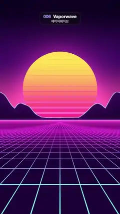

# 006 · Vaporwave · 베이퍼웨이브



★ One of the 20 effects in the original reel (#10) · 원래 릴스 20개 중 하나(10번)

**EN** A striped synthwave sun sits behind neon-rimmed mountains while a magenta-to-cyan neon grid floor scrolls endlessly toward the viewer.  
**KO** 줄무늬 신스웨이브 태양이 네온 테두리 산 뒤에 걸려 있고, 자홍에서 청록으로 빛나는 격자 바닥이 끝없이 다가온다.

[Video (mp4)](../videos/006-vaporwave.mp4) · [Code](../effects/006-vaporwave.js) · Design styles · 디자인 스타일

## Prompt (English)

```text
Create a "Vaporwave" motion effect: a striped synthwave sunset sun behind neon-rimmed mountains, above a neon grid floor that scrolls endlessly toward the viewer.

Look
- Units: p = (2·pixel − resolution) / width (1 unit = 540 px, y up, (0, 0) at the frame centre). The horizon is at y = −0.22, about 1080 px from the top.
- Sky: with k = (y − horizon) / 1.9, mix hot pink #FF5C9E at the horizon to purple #3B0D61 (smoothstep 0 → 0.55 of k), then to near-black #0D0321 toward the top (smoothstep 0.5 → 1). Fixed stars: a grid of 40 cells per unit; 7 % of the cells hold a tiny round dot (radius 0.035 cell) at a random offset, visible only in the upper sky.
- Sun: centre (0, horizon + 0.52), radius 0.62 (about 335 px, centre near y 800 px). Vertical gradient from hot pink #FF2E8C at the bottom to yellow #FFE052 at the top. Horizontal gaps: with s = (y − sun centre y) / radius, cut the disc where |fract(7s − t / 5) − 0.5| < gap, gap = 0.22·(1 − smoothstep(−0.9, 0.25, s)): thick gaps at the bottom thinning to nothing above the middle, about 48 px apart. A pink glow around the disc: + #FF4D99·0.35·exp(−5·distance outside the disc).
- Mountains on both sides, mirrored: ridge height above the horizon = (0.05 + 0.42·smoothstep(0.15, 1, |x|))·(0.55 + 0.45·|sin(7|x| + 1)| + 0.15·noise(4x)) — low in the middle (the sun shows between them), tall at the edges. Rock: gradient from #1A0333 at the base to #380D57 at the ridge, with a thin glowing cyan #66E6FF rim along the ridge line (about 3 px).
- Floor: a perspective plane, depth = 0.32 / (horizon − y), grid coordinates (x·depth·10, depth·10). Lines 0.02 cell wide but never thinner than about 1.3 px, anti-aliased with fwidth, and faded out where the cells shrink to a few pixels near the horizon so the distance never shimmers. Floor colour from #590D66 at the horizon to #1F0538 near the viewer; line colour from magenta #FF40D9 (far) to cyan #4DD9FF (near), getting brighter toward the viewer.
- A pink haze where the floor meets the sky, and a bright thin pink horizon line (+#FF80CC·0.5·exp(−60·|y − horizon|)).

Motion (0–5 s)
- The floor scrolls toward the viewer: add 4·t / 5 to the depth grid coordinate, i.e. exactly four whole cells per loop, so the loop is seamless.
- The sun's gaps drift slowly upward by one stripe spacing per loop, thinning as they rise.
- Sky, stars and mountains stay still.

Technique
- A WebGL2 full-screen fragment shader; every edge (sun, gaps, mountains, grid lines) anti-aliased with fwidth.

Output and rules
- One self-contained HTML file with no external assets (three.js from a CDN is fine if you use it), drawing on a 1080 × 1920 canvas (9:16) scaled to fit the window.
- Write a function renderFrame(t) that draws the frame for time t in seconds, and preview it with requestAnimationFrame. Everything must be a pure function of t and fixed seeds: no Math.random(), Date or state carried between frames, so frame i = renderFrame(i / 30) can be exported to a 30 fps video.
- Loop seamlessly every 5 seconds: renderFrame(5) must look exactly like renderFrame(0).
- No flicker of any kind: no noise or grain that changes from frame to frame, no strobing or blinking, no z-fighting, no shimmering 1 px lines. Any grain or texture stays fixed to the screen or to the object.
- Keep the top 280 px free of important content (a title label goes there) and fill the whole frame with a designed background.
```

## 프롬프트 (한국어)

```text
"베이퍼웨이브" 모션 효과를 만들어 줘: 줄무늬 신스웨이브 노을 태양이 네온 테두리 산 뒤에 걸려 있고, 그 아래 네온 격자 바닥이 끝없이 다가오는 효과.

모양
- 단위: p = (2·픽셀 − 해상도) / 너비(1 = 540px, 위가 +, (0, 0)이 화면 가운데). 지평선은 y = −0.22, 위에서 약 1080px.
- 하늘: k = (y − 지평선) / 1.9로, 지평선의 진분홍 #FF5C9E에서 보라 #3B0D61로(k의 smoothstep 0 → 0.55), 다시 위쪽으로 거의 검은 #0D0321로(smoothstep 0.5 → 1) 섞는다. 고정 별: 1단위당 40칸 격자, 칸의 7 %에 무작위로 비켜 놓은 아주 작은 둥근 점(반지름 0.035칸), 하늘 위쪽에서만 보인다.
- 태양: 중심 (0, 지평선 + 0.52), 반지름 0.62(약 335px, 중심은 대략 y 800px). 아래 진분홍 #FF2E8C에서 위 노랑 #FFE052로 가는 세로 그라디언트. 가로 틈: s = (y − 태양 중심 y) / 반지름일 때 |fract(7s − t / 5) − 0.5| < gap인 곳을 잘라낸다. gap = 0.22·(1 − smoothstep(−0.9, 0.25, s)): 아래쪽은 두꺼운 틈, 가운데 위로는 틈이 사라진다. 틈 간격은 약 48px. 원 둘레에 분홍 빛: + #FF4D99·0.35·exp(−5·원 바깥 거리).
- 양옆의 산(좌우 대칭): 지평선 위 능선 높이 = (0.05 + 0.42·smoothstep(0.15, 1, |x|))·(0.55 + 0.45·|sin(7|x| + 1)| + 0.15·noise(4x)). 가운데는 낮고(그 사이로 태양이 보인다) 가장자리는 높다. 바위: 아래 #1A0333에서 능선 #380D57로 가는 그라디언트, 능선을 따라 얇게 빛나는 청록 #66E6FF 테두리(약 3px).
- 바닥: 원근 평면, depth = 0.32 / (지평선 − y), 격자 좌표 (x·depth·10, depth·10). 선 굵기는 0.02칸이지만 약 1.3px보다 얇아지지 않게 하고, fwidth로 안티앨리어싱한다. 지평선 근처에서 칸이 몇 픽셀로 작아지는 곳은 선을 흐리게 지워서 먼 곳이 반짝이며 떨리지 않게 한다. 바닥 색은 지평선 #590D66에서 앞쪽 #1F0538로, 선 색은 먼 곳 자홍 #FF40D9에서 가까운 곳 청록 #4DD9FF로, 앞으로 올수록 밝게.
- 바닥과 하늘이 만나는 곳에 분홍 안개, 그리고 밝고 가는 분홍 지평선(+#FF80CC·0.5·exp(−60·|y − 지평선|)).

움직임 (0–5초)
- 바닥이 보는 사람 쪽으로 흘러온다: depth 격자 좌표에 4·t / 5를 더한다. 루프마다 정확히 네 칸이므로 끊김 없이 이어진다.
- 태양의 틈은 루프마다 줄 간격 하나만큼 천천히 위로 올라가며 점점 가늘어진다.
- 하늘·별·산은 움직이지 않는다.

기법
- WebGL2 전체 화면 프래그먼트 셰이더. 모든 경계(태양, 틈, 산, 격자선)를 fwidth로 안티앨리어싱한다.

출력과 규칙
- 외부 파일 없는 HTML 파일 하나(three.js를 쓴다면 CDN은 괜찮다). 1080 × 1920(9:16) 캔버스에 그리고 창 크기에 맞춰 보이게 한다.
- 시간 t(초)의 프레임을 그리는 renderFrame(t) 함수를 만들고, 미리보기는 requestAnimationFrame으로 돌린다. 모든 것은 t와 고정 시드만으로 정해진다: Math.random(), Date, 프레임 사이에 쌓이는 상태 금지. 그래야 i번째 프레임 = renderFrame(i / 30)으로 30fps 영상을 뽑을 수 있다.
- 5초마다 끊김 없이 반복: renderFrame(5)는 renderFrame(0)과 똑같아 보여야 한다.
- 어떤 깜빡임도 금지: 프레임마다 바뀌는 노이즈·그레인, 번쩍임·깜빡임, z-fighting, 반짝이며 떨리는 1px 선 모두 금지. 그레인·질감은 화면이나 물체에 고정한다.
- 위쪽 280px에는 중요한 내용을 두지 않고(제목 라벨 자리), 화면 전체를 디자인된 배경으로 채운다.
```
