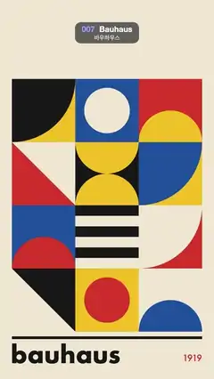

# 007 · Bauhaus · 바우하우스



★ One of the 20 effects in the original reel (#12) · 원래 릴스 20개 중 하나(12번)

**EN** A 3 × 4 grid of primary-colour Bauhaus tiles; on every beat each tile's shape turns a quarter turn in place, rippling diagonally.  
**KO** 원색 바우하우스 타일 3 × 4 격자에서 박자마다 각 타일의 도형이 제자리에서 90도씩 돌고, 그 회전이 대각선으로 물결처럼 번진다.

[Video (mp4)](https://sueun-dev.github.io/motion-effects/videos/007-bauhaus.mp4) · [Code](../effects/007-bauhaus.js) · Design styles · 디자인 스타일

## Prompt (English)

```text
Create a "Bauhaus" motion effect: a poster grid of primary-colour geometric tiles whose shapes turn a quarter turn on every beat, in a ripple across the grid.

Look
- Cream background #EFE6D2. Palette: red #D8392B, yellow #F2BE22, blue #1D4F9C, black #171717, cream #EFE6D2. Flat colour only, no outlines or shading.
- A 3 × 4 grid of 320 px square tiles from (60, 400) to (1020, 1680), no gaps. Each tile is a solid background colour with one flat shape, clipped to the tile. Shapes, in coordinates centred on the tile (h = 160):
  - quarter: a quarter disc of radius 320 centred on the tile's top-left corner;
  - half: a half disc of radius 160 standing on the bottom edge (flat side down);
  - circle: a centred disc of radius 115;
  - tri: a right triangle filling half the tile (corners bottom-left, bottom-right, top-left);
  - halves: two half discs of radius 160, one hanging from the top edge and one standing on the bottom edge, touching in the middle;
  - bars: three horizontal bars 53 px tall, starting at the top and repeating every 107 px.
- Tiles row by row as background / shape colour and shape / turn direction (+ clockwise, − counter-clockwise):
  - row 1: yellow / black quarter (+), blue / cream circle (+), red / yellow half (−);
  - row 2: cream / red tri (−), black / yellow halves (+), yellow / blue quarter (+);
  - row 3: blue / red half (+), cream / black bars (−), red / cream quarter (−);
  - row 4: black / cream tri (+), yellow / red circle (+), cream / blue half (−).
- Below the grid: a black rule 960 × 14 px at y 1704; "bauhaus" in lowercase bold Futura 120 px, left-aligned at x 54, baseline 1840; "1919" in Futura 500 44 px, red, right-aligned at x 1020, baseline 1830.

Motion (0–5 s)
- Four beats, at t = 0, 1.25, 2.5 and 3.75 s. On each beat every tile rotates its shape by a quarter turn (90°) about the tile centre in its own direction, eased in-out (cubic) over 0.62 s. The tiles themselves never move.
- The beat ripples diagonally: tile (column c, row r, from 0) starts 0.09·(c + r) s late, so each turn sweeps from the top-left tile to the bottom-right one.
- Because shapes are clipped to their tiles, a rotating quarter disc or half disc sweeps through its square and the poster settles into a new composition after each beat. After four beats every shape has turned a full 360° (the last turn ends at 4.82 s), so the loop closes exactly.

Technique
- Canvas 2D, fully redrawn each frame: for each tile, clip to its square, fill the background, translate to the tile centre, rotate, and fill the shape path.

Output and rules
- One self-contained HTML file with no external assets (three.js from a CDN is fine if you use it), drawing on a 1080 × 1920 canvas (9:16) scaled to fit the window.
- Write a function renderFrame(t) that draws the frame for time t in seconds, and preview it with requestAnimationFrame. Everything must be a pure function of t and fixed seeds: no Math.random(), Date or state carried between frames, so frame i = renderFrame(i / 30) can be exported to a 30 fps video.
- Loop seamlessly every 5 seconds: renderFrame(5) must look exactly like renderFrame(0).
- No flicker of any kind: no noise or grain that changes from frame to frame, no strobing or blinking, no z-fighting, no shimmering 1 px lines. Any grain or texture stays fixed to the screen or to the object.
- Keep the top 280 px free of important content (a title label goes there) and fill the whole frame with a designed background.
```

## 프롬프트 (한국어)

```text
"바우하우스" 모션 효과를 만들어 줘: 원색 기하 도형 타일로 된 포스터 격자에서, 박자마다 도형들이 90도씩 돌고 그 회전이 격자를 따라 물결처럼 번지는 효과.

모양
- 크림색 배경 #EFE6D2. 팔레트: 빨강 #D8392B, 노랑 #F2BE22, 파랑 #1D4F9C, 검정 #171717, 크림 #EFE6D2. 평평한 색만, 테두리나 음영 없음.
- (60, 400)에서 (1020, 1680)까지 320px 정사각 타일 3 × 4 격자, 틈 없음. 타일마다 단색 배경에 평평한 도형 하나를 타일 안으로 클립해 그린다. 도형(타일 가운데 기준 좌표, h = 160):
  - quarter: 타일 왼쪽 위 모서리를 중심으로 한 반지름 320의 사분원;
  - half: 아래 변 위에 선 반지름 160의 반원(평평한 쪽이 아래);
  - circle: 가운데 반지름 115 원;
  - tri: 타일 절반을 채우는 직각삼각형(꼭짓점: 왼쪽 아래, 오른쪽 아래, 왼쪽 위);
  - halves: 반지름 160 반원 둘, 하나는 위 변에 매달리고 하나는 아래 변에 서서 가운데에서 맞닿는다;
  - bars: 높이 53px 가로 막대 셋, 맨 위에서 시작해 107px마다 반복.
- 타일을 줄마다 배경 / 도형 색과 도형 / 회전 방향(+ 시계 방향, − 반시계 방향)으로 적으면:
  - 1줄: 노랑 / 검정 quarter(+), 파랑 / 크림 circle(+), 빨강 / 노랑 half(−);
  - 2줄: 크림 / 빨강 tri(−), 검정 / 노랑 halves(+), 노랑 / 파랑 quarter(+);
  - 3줄: 파랑 / 빨강 half(+), 크림 / 검정 bars(−), 빨강 / 크림 quarter(−);
  - 4줄: 검정 / 크림 tri(+), 노랑 / 빨강 circle(+), 크림 / 파랑 half(−).
- 격자 아래: y 1704에 960 × 14px 검은 선, 소문자 굵은 Futura 120px "bauhaus"를 x 54 왼쪽 정렬·기준선 1840에, Futura 500 44px 빨간 "1919"를 x 1020 오른쪽 정렬·기준선 1830에.

움직임 (0–5초)
- 박자 네 번: t = 0, 1.25, 2.5, 3.75초. 박자마다 모든 타일이 자기 방향으로 타일 가운데를 축으로 도형을 90도 돌린다. 0.62초 동안 in-out(3차) 이징. 타일 자체는 움직이지 않는다.
- 박자는 대각선으로 번진다: 타일(열 c, 줄 r, 0부터)은 0.09·(c + r)초 늦게 시작해서, 회전이 왼쪽 위 타일에서 오른쪽 아래 타일로 쓸려 간다.
- 도형이 타일 안으로 클립되어 있으니 도는 사분원·반원이 칸 안을 쓸고 지나가며, 박자마다 포스터가 새 구성으로 자리 잡는다. 네 박자가 지나면 모든 도형이 360° 돌아(마지막 회전은 4.82초에 끝남) 루프가 정확히 닫힌다.

기법
- Canvas 2D, 매 프레임 전부 다시 그린다. 타일마다 정사각형으로 클립 → 배경 채우기 → 타일 가운데로 translate → rotate → 도형 경로 채우기.

출력과 규칙
- 외부 파일 없는 HTML 파일 하나(three.js를 쓴다면 CDN은 괜찮다). 1080 × 1920(9:16) 캔버스에 그리고 창 크기에 맞춰 보이게 한다.
- 시간 t(초)의 프레임을 그리는 renderFrame(t) 함수를 만들고, 미리보기는 requestAnimationFrame으로 돌린다. 모든 것은 t와 고정 시드만으로 정해진다: Math.random(), Date, 프레임 사이에 쌓이는 상태 금지. 그래야 i번째 프레임 = renderFrame(i / 30)으로 30fps 영상을 뽑을 수 있다.
- 5초마다 끊김 없이 반복: renderFrame(5)는 renderFrame(0)과 똑같아 보여야 한다.
- 어떤 깜빡임도 금지: 프레임마다 바뀌는 노이즈·그레인, 번쩍임·깜빡임, z-fighting, 반짝이며 떨리는 1px 선 모두 금지. 그레인·질감은 화면이나 물체에 고정한다.
- 위쪽 280px에는 중요한 내용을 두지 않고(제목 라벨 자리), 화면 전체를 디자인된 배경으로 채운다.
```
