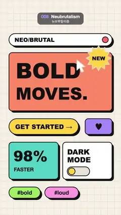

# 008 · Neubrutalism · 뉴브루탈리즘



★ One of the 20 effects in the original reel (#13) · 원래 릴스 20개 중 하나(13번)

**EN** Loud flat UI cards with thick black borders and hard shadows get clicked one by one by a cursor, sinking flat and popping back up.  
**KO** 굵은 검은 테두리와 딱딱한 그림자의 원색 UI 카드들을 커서가 하나씩 누르면, 그림자 위로 꺼졌다가 툭 튀어 오른다.

[Video (mp4)](../videos/008-neubrutalism.mp4) · [Code](../effects/008-neubrutalism.js) · Design styles · 디자인 스타일

## Prompt (English)

```text
Create a "Neubrutalism" motion effect: a loud flat UI with thick black borders and hard offset shadows, where a cursor clicks each block in turn and the block sinks onto its shadow and springs back.

Look
- Background #F6F1E7 with a fixed grid of 3 px lines in #E6DECD every 60 px.
- Every block: a rounded rectangle with a solid fill, a 6 px black #111111 border (round joins) and a hard black shadow, the same rounded rect filled black and offset 16 px right and 16 px down. All text is black #111111; headline type is Arial Black at weight 900, small labels a heavy Helvetica Neue.
- Blocks (top-left x, y; size; corner radius; fill; content in block coordinates):
  1. header pill (80, 300), 920 × 110, r 55, white: "NEO/BRUTAL" 50 px at (50, 74); a red #FF6B6B dot of radius 26 with a black border at (860, 55);
  2. hero card (80, 470), 920 × 520, r 28, coral #FF8A65: "BOLD" 190 px at (60, 230) and "MOVES." 150 px at (60, 420);
  3. button (80, 1060), 620 × 140, r 70, yellow #FFD23F: "GET STARTED →" 56 px, centred, baseline 92;
  4. heart button (760, 1060), 240 × 140, r 28, violet #A78BFA: "♥" 80 px, centred;
  5. stat card (80, 1270), 440 × 330, r 28, teal #4ECDC4: "98%" 130 px at (40, 170), "FASTER" 46 px at (44, 260);
  6. toggle card (560, 1270), 440 × 330, r 28, white: "DARK" and "MODE" 64 px at (40, 110) and (40, 180); a switch track 200 × 80 (r 40) at (40, 220), light #E8E2D4 when off and black when on, with a yellow #FFD23F knob of radius 30 that slides 120 px to the right; both with the black border;
  7. two tag chips, r 50, 50 px text centred: (80, 1670) 280 × 100 green #9BE15D "#bold" and (400, 1670) 300 × 100 pink #FF9DE2 "#loud".
- A "NEW" sticker on the hero card: a 24-point starburst (radii 112 / 78) in yellow #FFD23F with the black border, centred at (880, 520), with "NEW" 46 px Arial Black.
- A cursor: a classic white arrow with a 6 px black outline, points (0, 0), (0, 92), (24, 70), (42, 110), (60, 102), (42, 64), (74, 62), tip at the click point.

Motion (0–5 s)
- Click times: header 0.3 s, hero 1.0, button 1.75, heart 2.4, stat 3.05, toggle 3.7, both tags 4.3.
- A click: in 0.1 s the block slides linearly 16 px down-right onto its shadow (it looks pressed flat), then springs back over 0.5 s with an out-back ease, overshooting slightly past its rest position before settling. The shadow itself never moves.
- The cursor visits the click points (72 % across and 62 % down each of the first seven blocks): it leaves 0.15 s after one click and arrives 0.05 s before the next, eased in-out, and at each click it dips to 86 % size and back over 0.2 s. After the "#bold" tag it glides back up to the header for the next loop.
- The toggle flips on with its click: knob and track switch over 3.75–3.95 s and flip back off over 4.55–4.75 s (in-out ease; the track colour swaps at the halfway point).
- The sticker wobbles continuously: rotation 0.3·sin(a) rad and scale 1 + 0.06·sin(2a), with a = 2π·t / 5.

Technique
- Canvas 2D, fully redrawn each frame. For each block draw its shadow, then translate by the press offset and draw the block, its border and its content inside that transform.

Output and rules
- One self-contained HTML file with no external assets (three.js from a CDN is fine if you use it), drawing on a 1080 × 1920 canvas (9:16) scaled to fit the window.
- Write a function renderFrame(t) that draws the frame for time t in seconds, and preview it with requestAnimationFrame. Everything must be a pure function of t and fixed seeds: no Math.random(), Date or state carried between frames, so frame i = renderFrame(i / 30) can be exported to a 30 fps video.
- Loop seamlessly every 5 seconds: renderFrame(5) must look exactly like renderFrame(0).
- No flicker of any kind: no noise or grain that changes from frame to frame, no strobing or blinking, no z-fighting, no shimmering 1 px lines. Any grain or texture stays fixed to the screen or to the object.
- Keep the top 280 px free of important content (a title label goes there) and fill the whole frame with a designed background.
```

## 프롬프트 (한국어)

```text
"뉴브루탈리즘" 모션 효과를 만들어 줘: 굵은 검은 테두리와 딱딱하게 비켜 깔린 그림자의 원색 평면 UI에서, 커서가 블록을 하나씩 클릭하면 블록이 그림자 위로 꺼졌다가 튕겨 올라오는 효과.

모양
- 배경 #F6F1E7, 60px마다 #E6DECD 3px 선의 고정 격자.
- 모든 블록: 단색으로 채운 둥근 사각형, 6px 검정 #111111 테두리(둥근 이음), 딱딱한 검은 그림자(같은 둥근 사각형을 검게 채워 오른쪽 16px·아래 16px로 비켜 놓은 것). 글자는 모두 검정 #111111. 큰 글자는 굵기 900 Arial Black, 작은 라벨은 굵은 Helvetica Neue.
- 블록(왼쪽 위 x, y; 크기; 모서리 반지름; 채움; 블록 안 좌표의 내용):
  1. 헤더 알약 (80, 300), 920 × 110, r 55, 흰색: (50, 74)에 50px "NEO/BRUTAL", (860, 55)에 검은 테두리를 두른 반지름 26 빨간 점 #FF6B6B;
  2. 메인 카드 (80, 470), 920 × 520, r 28, 코랄 #FF8A65: (60, 230)에 190px "BOLD", (60, 420)에 150px "MOVES.";
  3. 버튼 (80, 1060), 620 × 140, r 70, 노랑 #FFD23F: 56px "GET STARTED →" 가운데 정렬, 기준선 92;
  4. 하트 버튼 (760, 1060), 240 × 140, r 28, 보라 #A78BFA: 80px "♥" 가운데;
  5. 수치 카드 (80, 1270), 440 × 330, r 28, 청록 #4ECDC4: (40, 170)에 130px "98%", (44, 260)에 46px "FASTER";
  6. 토글 카드 (560, 1270), 440 × 330, r 28, 흰색: (40, 110)과 (40, 180)에 64px "DARK", "MODE"; (40, 220)에 200 × 80(r 40) 스위치 트랙 — 꺼지면 밝은 #E8E2D4, 켜지면 검정 — 과 오른쪽으로 120px 미끄러지는 반지름 30 노란 #FFD23F 손잡이, 둘 다 검은 테두리;
  7. 태그 칩 둘, r 50, 50px 글자 가운데: (80, 1670) 280 × 100 초록 #9BE15D "#bold", (400, 1670) 300 × 100 분홍 #FF9DE2 "#loud".
- 메인 카드 위 "NEW" 스티커: (880, 520) 중심, 꼭짓점 24개 별 폭발 모양(반지름 112 / 78), 노랑 #FFD23F에 검은 테두리, 46px Arial Black "NEW".
- 커서: 클래식 흰 화살표에 6px 검은 외곽선, 점 (0, 0), (0, 92), (24, 70), (42, 110), (60, 102), (42, 64), (74, 62), 끝점이 클릭 지점.

움직임 (0–5초)
- 클릭 시각: 헤더 0.3초, 메인 카드 1.0, 버튼 1.75, 하트 2.4, 수치 카드 3.05, 토글 3.7, 태그 둘 4.3.
- 클릭: 0.1초 동안 블록이 오른쪽 아래로 16px 일정하게 미끄러져 그림자 위에 얹힌다(눌려 납작해 보임). 그다음 0.5초 동안 out-back 이징으로 튕겨 돌아오며 제자리를 살짝 넘었다가 자리 잡는다. 그림자는 절대 움직이지 않는다.
- 커서는 클릭 지점(처음 일곱 블록 각각의 가로 72 %, 세로 62 % 지점)을 돈다: 한 클릭 0.15초 뒤 떠나 다음 클릭 0.05초 전에 도착하고(in-out 이징), 클릭할 때마다 0.2초 동안 86 % 크기로 작아졌다 돌아온다. "#bold" 태그 다음에는 다음 루프를 위해 헤더로 미끄러져 올라간다.
- 토글은 클릭과 함께 켜진다: 3.75–3.95초에 손잡이와 트랙이 켜지고 4.55–4.75초에 다시 꺼진다(in-out 이징, 트랙 색은 절반 지점에서 바뀐다).
- 스티커는 계속 흔들린다: 회전 0.3·sin(a) rad, 크기 1 + 0.06·sin(2a), a = 2π·t / 5.

기법
- Canvas 2D, 매 프레임 전부 다시 그린다. 블록마다 그림자를 먼저 그리고, 눌림 오프셋만큼 translate한 뒤 블록·테두리·내용을 그 변환 안에서 그린다.

출력과 규칙
- 외부 파일 없는 HTML 파일 하나(three.js를 쓴다면 CDN은 괜찮다). 1080 × 1920(9:16) 캔버스에 그리고 창 크기에 맞춰 보이게 한다.
- 시간 t(초)의 프레임을 그리는 renderFrame(t) 함수를 만들고, 미리보기는 requestAnimationFrame으로 돌린다. 모든 것은 t와 고정 시드만으로 정해진다: Math.random(), Date, 프레임 사이에 쌓이는 상태 금지. 그래야 i번째 프레임 = renderFrame(i / 30)으로 30fps 영상을 뽑을 수 있다.
- 5초마다 끊김 없이 반복: renderFrame(5)는 renderFrame(0)과 똑같아 보여야 한다.
- 어떤 깜빡임도 금지: 프레임마다 바뀌는 노이즈·그레인, 번쩍임·깜빡임, z-fighting, 반짝이며 떨리는 1px 선 모두 금지. 그레인·질감은 화면이나 물체에 고정한다.
- 위쪽 280px에는 중요한 내용을 두지 않고(제목 라벨 자리), 화면 전체를 디자인된 배경으로 채운다.
```
