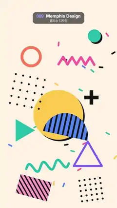

# 009 · Memphis Design · 멤피스 디자인



★ One of the 20 effects in the original reel (#15) · 원래 릴스 20개 중 하나(15번)

**EN** Pastel Memphis shapes, dot grids, zigzags, a squiggle and confetti float on small loops and turn on a cream background.  
**KO** 크림색 배경 위에서 멤피스풍 파스텔 도형·도트 격자·지그재그·스퀴글·색종이 조각이 작은 원을 그리며 떠다니고 돈다.

[Video (mp4)](../videos/009-memphis-design.mp4) · [Code](../effects/009-memphis-design.js) · Design styles · 디자인 스타일

## Prompt (English)

```text
Create a "Memphis Design" motion effect: a playful 1980s Memphis-style composition of flat pastel shapes, dot grids, zigzags, a squiggle and confetti that all float on small loops and turn.

Look
- Background: cream #FFF3E3. Ink: #141414. Flat colours, round line caps and joins everywhere.
- Confetti: 26 small rounded dashes 44 × 14 px (radius 7) at fixed seeded positions (x anywhere, y between 300 and 1880) and random angles, colours cycling pink #FF5FA2, blue #4F86F7, yellow #FFC94A, teal #22B8A7, ink.
- Pieces, drawn in this order (centre x, y; then [loop radius R px, phase q]):
  - big yellow #FFC94A disc, radius 230, at (520, 1060), with a solid ink copy offset (14, 14) behind it as a hard shadow [18, 0];
  - blue #4F86F7 upper half disc, radius 210, at (600, 1230), overlapping the yellow disc, with vertical ink stripes 16 px wide every 44 px clipped inside it [24, 1.5];
  - 5 × 5 grid of ink dots (radius 9, spacing 68 px) at (270, 820) [30, 2.2];
  - pink #FF5FA2 zigzag, 330 px wide, 8 segments of ±34 px, 22 px line, at (740, 560) [34, 3.1];
  - violet #7B5CFA outlined triangle pointing up (circumradius 150, 18 px line) at (830, 1480) [30, 4.0];
  - coral #FF7A59 ring, radius 85, 26 px line, at (260, 500) [36, 0.7];
  - teal #22B8A7 filled triangle pointing right (circumradius 120) at (190, 1230) [30, 5.2];
  - ink plus sign 132 px across with 33 px thick arms at (870, 890) [28, 2.8];
  - pink #FF9EC7 rectangle 300 × 180 with diagonal ink stripes (12 px lines every 46 px, clipped) at (300, 1710) [26, 1.1];
  - small 5 × 5 ink dot grid (spacing 48 px) at (860, 1760) [22, 3.6];
  - small teal #22B8A7 disc, radius 60, with the same ink offset shadow, at (880, 360) [30, 4.4];
  - on top, a teal #19B5A5 squiggle: a 400 px long sine line with 3 waves of amplitude 40 px, 22 px thick, centred at (440, 1530) and tilted about −0.15 rad.

Motion (0–5 s)
- With a = 2π·t / 5, each piece moves on its own small circle: position + R·(cos(a + q), sin(a + q)).
- Rotation: the outlined triangle and the plus sign spin one full turn clockwise per loop and the filled triangle one full turn counter-clockwise; the striped half disc (0.22 rad), big dot grid (0.25), zigzag (0.35), striped rectangle (0.3) and small dot grid (0.3) sway back and forth by sway·sin(a + q); the discs and the ring only drift.
- Confetti: each dash circles 14 px around its spot and sways 0.5·sin(a + its angle) rad.
- The squiggle's wave travels along it by one wavelength per loop (sine phase −a), and the whole squiggle rocks by 0.08·sin(a) rad.

Technique
- Canvas 2D, fully redrawn each frame, with a seeded random generator (fixed seed) for the confetti layout.

Output and rules
- One self-contained HTML file with no external assets (three.js from a CDN is fine if you use it), drawing on a 1080 × 1920 canvas (9:16) scaled to fit the window.
- Write a function renderFrame(t) that draws the frame for time t in seconds, and preview it with requestAnimationFrame. Everything must be a pure function of t and fixed seeds: no Math.random(), Date or state carried between frames, so frame i = renderFrame(i / 30) can be exported to a 30 fps video.
- Loop seamlessly every 5 seconds: renderFrame(5) must look exactly like renderFrame(0).
- No flicker of any kind: no noise or grain that changes from frame to frame, no strobing or blinking, no z-fighting, no shimmering 1 px lines. Any grain or texture stays fixed to the screen or to the object.
- Keep the top 280 px free of important content (a title label goes there) and fill the whole frame with a designed background.
```

## 프롬프트 (한국어)

```text
"멤피스 디자인" 모션 효과를 만들어 줘: 1980년대 멤피스 스타일의 평평한 파스텔 도형·도트 격자·지그재그·스퀴글·색종이 조각이 모두 작은 원을 그리며 떠다니고 도는 경쾌한 구성.

모양
- 배경: 크림색 #FFF3E3. 잉크: #141414. 평평한 색, 모든 선은 둥근 끝·둥근 이음.
- 색종이: 44 × 14px 작은 둥근 막대(반지름 7) 26개. 고정 시드로 정한 위치(x는 아무 데나, y는 300–1880)와 무작위 각도, 색은 분홍 #FF5FA2, 파랑 #4F86F7, 노랑 #FFC94A, 청록 #22B8A7, 잉크 순으로 돌아가며.
- 조각들, 이 순서로 그린다(중심 x, y; 그리고 [원 궤도 반지름 R px, 위상 q]):
  - 큰 노란 #FFC94A 원, 반지름 230, (520, 1060), 뒤에 (14, 14) 비켜 놓은 잉크색 사본으로 딱딱한 그림자 [18, 0];
  - 파란 #4F86F7 위쪽 반원, 반지름 210, (600, 1230), 노란 원과 겹침, 안쪽에 44px마다 16px 너비 세로 잉크 줄무늬(반원 안으로 클립) [24, 1.5];
  - 잉크 점 5 × 5 격자(반지름 9, 간격 68px), (270, 820) [30, 2.2];
  - 분홍 #FF5FA2 지그재그, 너비 330px, ±34px 꺾임 8개, 선 22px, (740, 560) [34, 3.1];
  - 위를 향한 보라 #7B5CFA 외곽선 삼각형(외접원 반지름 150, 선 18px), (830, 1480) [30, 4.0];
  - 코랄 #FF7A59 고리, 반지름 85, 선 26px, (260, 500) [36, 0.7];
  - 오른쪽을 향한 청록 #22B8A7 채운 삼각형(외접원 반지름 120), (190, 1230) [30, 5.2];
  - 잉크색 더하기 기호, 전체 132px, 팔 두께 33px, (870, 890) [28, 2.8];
  - 분홍 #FF9EC7 300 × 180 직사각형에 대각선 잉크 줄무늬(46px마다 12px 선, 클립), (300, 1710) [26, 1.1];
  - 작은 잉크 점 5 × 5 격자(간격 48px), (860, 1760) [22, 3.6];
  - 작은 청록 #22B8A7 원, 반지름 60, 같은 잉크 그림자, (880, 360) [30, 4.4];
  - 맨 위에 청록 #19B5A5 스퀴글: 길이 400px, 진폭 40px 파동 3개인 사인 곡선, 굵기 22px, 중심 (440, 1530), 약 −0.15 rad 기울임.

움직임 (0–5초)
- a = 2π·t / 5일 때 조각마다 자기 작은 원을 돈다: 위치 + R·(cos(a + q), sin(a + q)).
- 회전: 외곽선 삼각형과 더하기 기호는 루프마다 시계 방향으로 한 바퀴, 채운 삼각형은 반시계 방향으로 한 바퀴. 줄무늬 반원(0.22 rad), 큰 점 격자(0.25), 지그재그(0.35), 줄무늬 직사각형(0.3), 작은 점 격자(0.3)는 sway·sin(a + q)로 좌우로 흔들린다. 원과 고리는 떠다니기만 한다.
- 색종이: 막대마다 제자리 둘레를 반지름 14px로 돌고 0.5·sin(a + 자기 각도) rad만큼 흔들린다.
- 스퀴글의 물결은 루프마다 한 파장만큼 곡선을 따라 흘러가고(사인 위상 −a), 스퀴글 전체가 0.08·sin(a) rad로 까딱인다.

기법
- Canvas 2D, 매 프레임 전부 다시 그린다. 색종이 배치는 고정 시드 난수 생성기로.

출력과 규칙
- 외부 파일 없는 HTML 파일 하나(three.js를 쓴다면 CDN은 괜찮다). 1080 × 1920(9:16) 캔버스에 그리고 창 크기에 맞춰 보이게 한다.
- 시간 t(초)의 프레임을 그리는 renderFrame(t) 함수를 만들고, 미리보기는 requestAnimationFrame으로 돌린다. 모든 것은 t와 고정 시드만으로 정해진다: Math.random(), Date, 프레임 사이에 쌓이는 상태 금지. 그래야 i번째 프레임 = renderFrame(i / 30)으로 30fps 영상을 뽑을 수 있다.
- 5초마다 끊김 없이 반복: renderFrame(5)는 renderFrame(0)과 똑같아 보여야 한다.
- 어떤 깜빡임도 금지: 프레임마다 바뀌는 노이즈·그레인, 번쩍임·깜빡임, z-fighting, 반짝이며 떨리는 1px 선 모두 금지. 그레인·질감은 화면이나 물체에 고정한다.
- 위쪽 280px에는 중요한 내용을 두지 않고(제목 라벨 자리), 화면 전체를 디자인된 배경으로 채운다.
```
