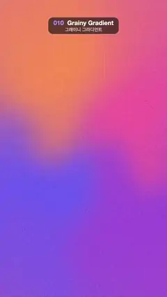

# 010 · Grainy Gradient · 그레이니 그라디언트



★ One of the 20 effects in the original reel (#19) · 원래 릴스 20개 중 하나(19번)

**EN** Four soft colour fields drift and melt into each other under a film grain that never moves.  
**KO** 움직이지 않는 필름 그레인 아래로 네 가지 색이 천천히 흐르며 섞인다.

[Video (mp4)](../videos/010-grainy-gradient.mp4) · [Code](../effects/010-grainy-gradient.js) · Design styles · 디자인 스타일

## Prompt (English)

```text
Create a "Grainy Gradient" motion effect: a full-screen mesh gradient whose colours drift slowly under a fixed film grain.

Look
- Four colour points blended over the whole frame: warm orange #FA8C52 (upper left), hot pink #F2599E (upper right), violet-blue #6B5CF2 (lower left) and purple #9E4DD9 (lower right).
- Blend them by inverse-distance weighting, weight = 1 / (d² + 0.02)^1.6, with distances measured in units of the frame width, so the colour boundaries stay soft and wide.
- Before measuring distances, warp the pixel position by up to 0.18 frame widths with smooth 3D simplex noise (frequency 1.4 per frame width), so the colour edges bend like fabric.
- On top, add film grain: a per-pixel hash on 2 × 2 px cells, ±5.5 % brightness. The grain is a fixed texture.

Motion (0–5 s)
- Each colour point moves on its own small ellipse (radius 0.12–0.25 frame widths) at 1× or 2× the loop speed, each with a different phase, so the colours keep swapping places gently.
- The noise warp moves too: offset its lookup along a circle of radius 0.5 that goes round once per loop.
- Calm, slow and continuous; nothing jumps.

Technique
- A WebGL2 full-screen fragment shader (one triangle), with uniforms for time and resolution.

Output and rules
- One self-contained HTML file with no external assets (three.js from a CDN is fine if you use it), drawing on a 1080 × 1920 canvas (9:16) scaled to fit the window.
- Write a function renderFrame(t) that draws the frame for time t in seconds, and preview it with requestAnimationFrame. Everything must be a pure function of t and fixed seeds: no Math.random(), Date or state carried between frames, so frame i = renderFrame(i / 30) can be exported to a 30 fps video.
- Loop seamlessly every 5 seconds: renderFrame(5) must look exactly like renderFrame(0).
- No flicker of any kind: no noise or grain that changes from frame to frame, no strobing or blinking, no z-fighting, no shimmering 1 px lines. Any grain or texture stays fixed to the screen or to the object.
- Keep the top 280 px free of important content (a title label goes there) and fill the whole frame with a designed background.
```

## 프롬프트 (한국어)

```text
"그레이니 그라디언트" 모션 효과를 만들어 줘: 화면 전체를 덮은 메시 그라디언트의 색이 고정된 필름 그레인 아래에서 천천히 흐르는 효과.

모양
- 화면 전체에 섞이는 색 점 네 개: 따뜻한 주황 #FA8C52(왼쪽 위), 진분홍 #F2599E(오른쪽 위), 보라빛 파랑 #6B5CF2(왼쪽 아래), 보라 #9E4DD9(오른쪽 아래).
- 거리 역수 가중치 weight = 1 / (d² + 0.02)^1.6 로 섞는다(거리는 화면 너비 단위). 그래서 색 경계가 넓고 부드럽다.
- 거리를 재기 전에 부드러운 3D 심플렉스 노이즈(화면 너비당 주파수 1.4)로 픽셀 위치를 최대 화면 너비의 0.18만큼 비틀어, 색 경계가 천처럼 휘게 한다.
- 맨 위에 필름 그레인: 2 × 2 px 칸마다 픽셀 해시로 밝기 ±5.5 %. 그레인은 고정된 질감이다.

움직임 (0–5초)
- 색 점마다 자기만의 작은 타원(반지름 화면 너비의 0.12–0.25)을 루프 속도의 1배 또는 2배로, 서로 다른 위상으로 돈다. 그래서 색이 천천히 자리를 바꾼다.
- 노이즈 비틀기도 움직인다: 노이즈를 읽는 위치를 루프마다 한 바퀴 도는 반지름 0.5 원을 따라 옮긴다.
- 차분하고 느리고 끊김 없이. 튀는 순간이 없다.

기법
- WebGL2 전체 화면 프래그먼트 셰이더(삼각형 하나), 시간·해상도 유니폼.

출력과 규칙
- 외부 파일 없는 HTML 파일 하나(three.js를 쓴다면 CDN은 괜찮다). 1080 × 1920(9:16) 캔버스에 그리고 창 크기에 맞춰 보이게 한다.
- 시간 t(초)의 프레임을 그리는 renderFrame(t) 함수를 만들고, 미리보기는 requestAnimationFrame으로 돌린다. 모든 것은 t와 고정 시드만으로 정해진다: Math.random(), Date, 프레임 사이에 쌓이는 상태 금지. 그래야 i번째 프레임 = renderFrame(i / 30)으로 30fps 영상을 뽑을 수 있다.
- 5초마다 끊김 없이 반복: renderFrame(5)는 renderFrame(0)과 똑같아 보여야 한다.
- 어떤 깜빡임도 금지: 프레임마다 바뀌는 노이즈·그레인, 번쩍임·깜빡임, z-fighting, 반짝이며 떨리는 1px 선 모두 금지. 그레인·질감은 화면이나 물체에 고정한다.
- 위쪽 280px에는 중요한 내용을 두지 않고(제목 라벨 자리), 화면 전체를 디자인된 배경으로 채운다.
```
