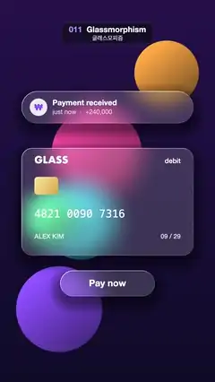

# 011 · Glassmorphism · 글래스모피즘



**EN** Bright colour blobs drift behind three frosted-glass UI panels (notification, payment card, button) and turn soft and milky beneath them.  
**KO** 알림·결제 카드·버튼 세 개의 젖빛 유리 패널 뒤로 밝은 색 블롭이 지나가며, 유리 아래에서는 뿌옇게 흐려 보인다.

[Video (mp4)](../videos/011-glassmorphism.mp4) · [Code](../effects/011-glassmorphism.js) · Design styles · 디자인 스타일

## Prompt (English)

```text
Create a "Glassmorphism" motion effect: bright colour blobs drift behind three frosted-glass UI panels; through the glass they look blurred and milky, outside it they are crisp.

Look
- Units: p = (2·pixel − resolution) / width + (0, 0.2), so the layout sits 108 px below the frame centre (1 unit = 540 px, y up).
- Background: a vertical gradient from #0F0D29 (bottom) to #26144D (top).
- Five discs, drawn in this order, each shaded lighter toward its upper left (colour·(0.8 + 0.35·dot(q / r, (−0.5, 0.6))), q = offset from the disc centre): pink #FF59A6 radius 0.42, cyan #40D9FF 0.34, orange #FFA640 0.30, violet #8C59FF 0.40, mint #4DFFA6 0.22.
- Three glass panels as rounded boxes (centre, half size, corner radius, in units): notification pill (0, 0.98), 0.80 × 0.15, r 0.15; card (0, 0.10), 0.80 × 0.50, r 0.10; button pill (0, −0.66), 0.44 × 0.12, r 0.12. On screen: an 864 × 162 pill centred near y 540 px, an 864 × 540 card centred near y 1015 px, and a 475 × 130 pill centred near y 1425 px.
- Inside a panel, draw the same disc scene but with a very soft edge (a smoothstep over ±0.2 units, about ±108 px): for discs this is an exact blur. Mix it 16 % toward white and add a fixed per-pixel frost grain of ±2.5 %. Outside the panels the discs have crisp 1.5 px anti-aliased edges.
- A soft shadow under the glass: darken the crisp scene by up to 45 % using the panel shape moved 27 px down, smoothstep(−0.02, 0.14) on its distance.
- A thin bright rim (about 2 px) along each panel edge, brighter at the top left: + (0.2 + 0.55·max(dot(edge normal, top-left direction), 0)).
- Crisp white text on top (2D overlay):
  - notification: a 90 % white circle of radius 44 centred at (194, 539) with a purple #7A4DFF "₩" in bold 44 px Helvetica Neue; "Payment received" (600, 38 px) at x 264, y 517 and "just now  ·  +240,000" (400, 32 px, 75 % white) at y 563, both vertically centred on those y values;
  - card: "GLASS" in bold Futura 48 px at (173, 809) and "debit" (500, 34 px) right-aligned at x 907; a gold chip 120 × 90 (radius 16, gradient #FFE7A3 → #D9A441) with its top-left at (173, 889); "4821 0090 7316" in Menlo 54 px at y 1079; "ALEX KIM" and "09 / 29" (500, 32 px, 80 % white, left at 173 and right-aligned at 907) at y 1189;
  - button: "Pay now" (600, 46 px) centred at (540, 1424).

Motion (0–5 s)
- With a = 2π·t / 5, the disc centres follow looping paths (units): pink (−0.55 + 0.45·cos a, 0.55 + 0.35·sin a); cyan (0.6·cos(a + 2), −0.1 + 0.6·sin 2a); orange (0.55 + 0.3·sin a, 0.9 + 0.4·cos a); violet (−0.45·cos 2a, −0.9 + 0.3·sin a); mint (0.7·sin(a + 4), 0.25·cos(a + 1) − 0.2). They slide in and out from behind the panels, so each blob switches between crisp and frosted as it passes.
- The panels and the text stay still.

Technique
- A WebGL2 full-screen fragment shader for the blobs and glass (rounded-box signed distance functions; the edge normal from dFdx / dFdy of the distance), plus a Canvas 2D overlay for the text. The frost grain depends only on the pixel position.

Output and rules
- One self-contained HTML file with no external assets (three.js from a CDN is fine if you use it), drawing on a 1080 × 1920 canvas (9:16) scaled to fit the window.
- Write a function renderFrame(t) that draws the frame for time t in seconds, and preview it with requestAnimationFrame. Everything must be a pure function of t and fixed seeds: no Math.random(), Date or state carried between frames, so frame i = renderFrame(i / 30) can be exported to a 30 fps video.
- Loop seamlessly every 5 seconds: renderFrame(5) must look exactly like renderFrame(0).
- No flicker of any kind: no noise or grain that changes from frame to frame, no strobing or blinking, no z-fighting, no shimmering 1 px lines. Any grain or texture stays fixed to the screen or to the object.
- Keep the top 280 px free of important content (a title label goes there) and fill the whole frame with a designed background.
```

## 프롬프트 (한국어)

```text
"글래스모피즘" 모션 효과를 만들어 줘: 밝은 색 블롭이 젖빛 유리 UI 패널 세 개 뒤로 떠다니고, 유리 너머로는 흐리고 뿌옇게, 유리 바깥에서는 선명하게 보이는 효과.

모양
- 단위: p = (2·픽셀 − 해상도) / 너비 + (0, 0.2). 그래서 배치 전체가 화면 가운데보다 108px 아래에 놓인다(1 = 540px, 위가 +).
- 배경: 아래 #0F0D29에서 위 #26144D로 가는 세로 그라디언트.
- 원 다섯 개를 이 순서로 그린다. 각각 왼쪽 위로 갈수록 밝게(색·(0.8 + 0.35·dot(q / r, (−0.5, 0.6))), q는 원 중심에서의 위치): 분홍 #FF59A6 반지름 0.42, 청록 #40D9FF 0.34, 주황 #FFA640 0.30, 보라 #8C59FF 0.40, 민트 #4DFFA6 0.22.
- 유리 패널 셋은 둥근 상자(중심, 반 크기, 모서리 반지름, 단위 기준): 알림 알약 (0, 0.98), 0.80 × 0.15, r 0.15; 카드 (0, 0.10), 0.80 × 0.50, r 0.10; 버튼 알약 (0, −0.66), 0.44 × 0.12, r 0.12. 화면에서는 y 약 540px 중심의 864 × 162 알약, y 약 1015px 중심의 864 × 540 카드, y 약 1425px 중심의 475 × 130 알약.
- 패널 안에서는 같은 원 장면을 아주 부드러운 경계(±0.2 단위, 약 ±108px의 smoothstep)로 다시 그린다. 원이라서 이것이 정확한 블러가 된다. 여기에 흰색을 16 % 섞고, 픽셀마다 고정된 서리 그레인 ±2.5 %를 더한다. 패널 밖의 원은 1.5px 안티앨리어싱의 선명한 경계.
- 유리 아래 부드러운 그림자: 패널 모양을 27px 아래로 옮긴 거리에 smoothstep(−0.02, 0.14)를 써서 선명한 장면을 최대 45 % 어둡게 한다.
- 패널 가장자리를 따라 얇은 밝은 테(약 2px), 왼쪽 위가 더 밝게: + (0.2 + 0.55·max(dot(가장자리 법선, 왼쪽 위 방향), 0)).
- 위에 선명한 흰 글자(2D 오버레이):
  - 알림: (194, 539) 중심의 90 % 흰 원(반지름 44) 안에 굵은 44px Helvetica Neue의 보라 #7A4DFF "₩"; x 264, y 517에 "Payment received"(600, 38px), y 563에 "just now  ·  +240,000"(400, 32px, 75 % 흰색). 둘 다 그 y에 세로 가운데 정렬;
  - 카드: (173, 809)에 굵은 Futura 48px "GLASS", x 907 오른쪽 정렬로 "debit"(500, 34px); 왼쪽 위가 (173, 889)인 120 × 90 금색 칩(반지름 16, 그라디언트 #FFE7A3 → #D9A441); y 1079에 Menlo 54px "4821 0090 7316"; y 1189에 "ALEX KIM"(왼쪽 173)과 "09 / 29"(907 오른쪽 정렬), 500 32px, 80 % 흰색;
  - 버튼: (540, 1424) 가운데에 "Pay now"(600, 46px).

움직임 (0–5초)
- a = 2π·t / 5일 때 원 중심은 반복 경로를 따른다(단위): 분홍 (−0.55 + 0.45·cos a, 0.55 + 0.35·sin a); 청록 (0.6·cos(a + 2), −0.1 + 0.6·sin 2a); 주황 (0.55 + 0.3·sin a, 0.9 + 0.4·cos a); 보라 (−0.45·cos 2a, −0.9 + 0.3·sin a); 민트 (0.7·sin(a + 4), 0.25·cos(a + 1) − 0.2). 패널 뒤로 들어갔다 나오므로, 지나가는 동안 블롭이 선명함과 뿌연 모습 사이를 오간다.
- 패널과 글자는 움직이지 않는다.

기법
- 블롭과 유리는 WebGL2 전체 화면 프래그먼트 셰이더(둥근 상자 부호 거리 함수, 가장자리 법선은 거리의 dFdx / dFdy), 글자는 그 위 Canvas 2D 오버레이. 서리 그레인은 픽셀 위치에만 의존한다.

출력과 규칙
- 외부 파일 없는 HTML 파일 하나(three.js를 쓴다면 CDN은 괜찮다). 1080 × 1920(9:16) 캔버스에 그리고 창 크기에 맞춰 보이게 한다.
- 시간 t(초)의 프레임을 그리는 renderFrame(t) 함수를 만들고, 미리보기는 requestAnimationFrame으로 돌린다. 모든 것은 t와 고정 시드만으로 정해진다: Math.random(), Date, 프레임 사이에 쌓이는 상태 금지. 그래야 i번째 프레임 = renderFrame(i / 30)으로 30fps 영상을 뽑을 수 있다.
- 5초마다 끊김 없이 반복: renderFrame(5)는 renderFrame(0)과 똑같아 보여야 한다.
- 어떤 깜빡임도 금지: 프레임마다 바뀌는 노이즈·그레인, 번쩍임·깜빡임, z-fighting, 반짝이며 떨리는 1px 선 모두 금지. 그레인·질감은 화면이나 물체에 고정한다.
- 위쪽 280px에는 중요한 내용을 두지 않고(제목 라벨 자리), 화면 전체를 디자인된 배경으로 채운다.
```
