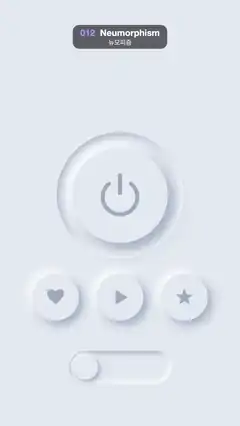

# 012 · Neumorphism · 뉴모피즘



**EN** Background-coloured soft-UI controls (a power button, three icon buttons, a toggle) press in and pop back out using only light and shadow.  
**KO** 배경과 같은 색의 소프트 UI 컨트롤(전원 버튼, 아이콘 버튼 셋, 토글)이 빛과 그림자만으로 오목하게 눌렸다가 볼록하게 돌아온다.

[Video (mp4)](https://sueun-dev.github.io/motion-effects/videos/012-neumorphism.mp4) · [Code](../effects/012-neumorphism.js) · Design styles · 디자인 스타일

## Prompt (English)

```text
Create a "Neumorphism" motion effect: soft-UI controls made of the background colour itself, visible only through light and shadow, that press in (concave) and pop back out (convex).

Look
- Everything is the background colour #E3E8F0. Light shadow: white at 95 %; dark shadow: #8898B4 at 75 % (outer) or 80 % (inner). Light comes from the top left.
- Raised (convex), with shadow distance d: fill the shape twice in the background colour, once with a white shadow offset (−d, −d) and once with a dark shadow offset (+d, +d), both blurred 2·d.
- Pressed (concave): inner shadows. Clip to the shape and fill a large frame around it with the shape cut out as a hole, first with the dark shadow offset (+0.8d, +0.8d), then with the white one offset (−0.8d, −0.8d), both blurred 1.6·d. Pressing by an amount k (0..1) crossfades: the outer shadows' opacity × (1 − k), the inner shadows' × k.
- Power button: a sunken well (always concave, d 24) of radius 285 at (540, 880), holding a button of radius 215 (d 32) that shrinks 6 px when pressed. Power icon: an arc of radius 78 centred 8 px below the button centre with a gap of ±0.7 rad at the top, and a vertical bar from 90 px to 10 px above the centre, both 18 px wide with round caps. The icon is grey-blue #9EAABE when up and blue #5B7CFF when pressed (colour lerps with k), with a blue rgba(91, 124, 255, 0.7·k) glow of blur 30·k.
- Three round buttons of radius 105 (d 20) at y 1340 and x 250, 540, 830, each with a filled icon: a heart (about 90 px wide), a play triangle (54 × 68 px), a five-point star (radii 40 / 17). Same grey → blue colour change; when pressed the icon sinks 3 px and shrinks 6 %.
- A toggle: a sunken track pill 460 × 150 (radius 75, always concave, d 14) at (310, 1580); inside it a blue tint pill 430 × 120 (radius 60) in rgba(91, 124, 255, 0.25·on); a raised knob of radius 56 (d 12) at y 1655 that slides from x 385 to x 695.

Motion (0–5 s)
- Every press eases in-out (cubic): 0.35 s going in, hold, 0.35 s coming back out.
- Power button: pressed at 0.3 s and released at 1.8 s; pressed again at 2.8 s and released at 4.3 s.
- Heart at 1.0 s, play at 1.7 s, star at 2.4 s, each held 1.2 s, so they go down one after another and overlap.
- Toggle: switches on at 3.3 s (knob slides right, track tints blue) and back off at 4.3 s.
- Everything is back up and off by 4.65 s, so the loop closes.

Technique
- Canvas 2D, fully redrawn each frame. Canvas shadows give both the outer shadows and, with the inverted-frame trick, the inner ones; their opacities follow the press amount, so the convex-to-concave change is a smooth crossfade with no popping.

Output and rules
- One self-contained HTML file with no external assets (three.js from a CDN is fine if you use it), drawing on a 1080 × 1920 canvas (9:16) scaled to fit the window.
- Write a function renderFrame(t) that draws the frame for time t in seconds, and preview it with requestAnimationFrame. Everything must be a pure function of t and fixed seeds: no Math.random(), Date or state carried between frames, so frame i = renderFrame(i / 30) can be exported to a 30 fps video.
- Loop seamlessly every 5 seconds: renderFrame(5) must look exactly like renderFrame(0).
- No flicker of any kind: no noise or grain that changes from frame to frame, no strobing or blinking, no z-fighting, no shimmering 1 px lines. Any grain or texture stays fixed to the screen or to the object.
- Keep the top 280 px free of important content (a title label goes there) and fill the whole frame with a designed background.
```

## 프롬프트 (한국어)

```text
"뉴모피즘" 모션 효과를 만들어 줘: 배경색 그대로인 소프트 UI 컨트롤이 빛과 그림자만으로 드러나고, 오목하게 눌렸다가 볼록하게 돌아오는 효과.

모양
- 모든 것이 배경색 #E3E8F0. 밝은 그림자: 흰색 95 %, 어두운 그림자: #8898B4 75 %(바깥) 또는 80 %(안쪽). 빛은 왼쪽 위에서 온다.
- 볼록(올라온 상태), 그림자 거리 d: 도형을 배경색으로 두 번 채운다. 한 번은 (−d, −d) 오프셋 흰 그림자, 한 번은 (+d, +d) 오프셋 어두운 그림자, 둘 다 블러 2·d.
- 오목(눌린 상태): 안쪽 그림자. 도형으로 클립하고, 도형 모양 구멍을 뚫은 큰 틀을 채운다. 먼저 (+0.8d, +0.8d) 오프셋 어두운 그림자, 다음 (−0.8d, −0.8d) 오프셋 흰 그림자, 둘 다 블러 1.6·d. 눌림 정도 k(0..1)에 따라 크로스페이드: 바깥 그림자 불투명도 × (1 − k), 안쪽 그림자 × k.
- 전원 버튼: (540, 880)에 반지름 285의 움푹한 홈(항상 오목, d 24), 그 안에 반지름 215 버튼(d 32), 눌리면 6px 작아진다. 전원 아이콘: 버튼 중심 8px 아래를 중심으로 한 반지름 78 호(위쪽 ±0.7 rad가 비어 있음)와 중심 위 90px에서 10px까지의 세로 막대, 둘 다 굵기 18px 둥근 끝. 아이콘은 올라와 있을 때 회청색 #9EAABE, 눌리면 파랑 #5B7CFF(k에 따라 보간), 파란 빛 rgba(91, 124, 255, 0.7·k), 블러 30·k.
- 둥근 버튼 셋: 반지름 105(d 20), y 1340, x 250, 540, 830. 채운 아이콘 하트(너비 약 90px), 재생 삼각형(54 × 68px), 오각별(반지름 40 / 17). 같은 회색 → 파랑 색 변화, 눌리면 아이콘이 3px 내려가고 6 % 작아진다.
- 토글: (310, 1580)에 460 × 150 움푹한 트랙 알약(반지름 75, 항상 오목, d 14), 그 안에 rgba(91, 124, 255, 0.25·on)의 430 × 120 파란 알약(반지름 60), y 1655에서 x 385에서 695로 미끄러지는 반지름 56의 볼록한 손잡이(d 12).

움직임 (0–5초)
- 모든 눌림은 in-out(3차) 이징: 들어갈 때 0.35초, 유지, 나올 때 0.35초.
- 전원 버튼: 0.3초에 눌리고 1.8초에 풀린다. 2.8초에 다시 눌리고 4.3초에 풀린다.
- 하트 1.0초, 재생 1.7초, 별 2.4초, 각각 1.2초 유지. 차례로 눌리며 서로 겹친다.
- 토글: 3.3초에 켜지고(손잡이가 오른쪽으로, 트랙이 파랗게) 4.3초에 꺼진다.
- 4.65초면 모두 올라오고 꺼져서 루프가 닫힌다.

기법
- Canvas 2D, 매 프레임 전부 다시 그린다. 바깥 그림자도, 구멍 뚫린 틀 기법을 쓴 안쪽 그림자도 캔버스 그림자로 만든다. 불투명도가 눌림 정도를 따르므로 볼록 → 오목 변화가 튀지 않는 부드러운 크로스페이드가 된다.

출력과 규칙
- 외부 파일 없는 HTML 파일 하나(three.js를 쓴다면 CDN은 괜찮다). 1080 × 1920(9:16) 캔버스에 그리고 창 크기에 맞춰 보이게 한다.
- 시간 t(초)의 프레임을 그리는 renderFrame(t) 함수를 만들고, 미리보기는 requestAnimationFrame으로 돌린다. 모든 것은 t와 고정 시드만으로 정해진다: Math.random(), Date, 프레임 사이에 쌓이는 상태 금지. 그래야 i번째 프레임 = renderFrame(i / 30)으로 30fps 영상을 뽑을 수 있다.
- 5초마다 끊김 없이 반복: renderFrame(5)는 renderFrame(0)과 똑같아 보여야 한다.
- 어떤 깜빡임도 금지: 프레임마다 바뀌는 노이즈·그레인, 번쩍임·깜빡임, z-fighting, 반짝이며 떨리는 1px 선 모두 금지. 그레인·질감은 화면이나 물체에 고정한다.
- 위쪽 280px에는 중요한 내용을 두지 않고(제목 라벨 자리), 화면 전체를 디자인된 배경으로 채운다.
```
