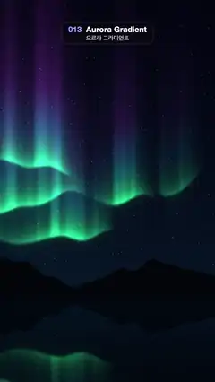

# 013 · Aurora Gradient · 오로라 그라디언트



**EN** Three green-to-violet aurora curtains ripple across a starry night sky above a dark mountain ridge, mirrored in a still lake.  
**KO** 별이 뜬 밤하늘에 초록에서 보라로 물드는 오로라 커튼 세 겹이 일렁이고, 검은 산 능선 아래 잔잔한 호수에 비친다.

[Video (mp4)](../videos/013-aurora-gradient.mp4) · [Code](../effects/013-aurora-gradient.js) · Design styles · 디자인 스타일

## Prompt (English)

```text
Create an "Aurora Gradient" motion effect: curtains of northern lights rippling over a starry night sky above a mountain ridge, mirrored in a still lake.

Look
- Units: p = (2·pixel − resolution) / width (1 unit = 540 px, y up, (0, 0) at the frame centre). The lake shore is at y = −0.98, about 1490 px from the top.
- Sky: from dark teal-blue #081A2E at the shore to near-black #03040F at the top (mix by the square root of (y − shore) / 2.6).
- Fixed stars: a grid of 45 cells per unit (12 px); 6 % of the cells hold a small soft dot at a random offset, brightness 0.4–1.0.
- Three aurora curtains, i = 0, 1, 2, added on top of each other. Each has a wavy lower hem at y = −0.40 + 0.30·i + 0.18·N(1.6x + 7i) + 0.08·sin(2x + 2i), where N is looping noise (see Motion). With dy = y − hem:
  - a crisp lower edge (it fades in over 0.04 units below the hem), with a faint glow 0.35·exp(30·dy) just below it;
  - the hem itself is brightest: 0.7·exp(−14·dy);
  - vertical rays that fade upward, exp(−dy / (0.5 + 0.15i)), multiplied by streaks 0.3 + 0.7·smoothstep(−0.5, 0.8, N(7x′ + 11i)) with x′ = x + 0.15·N(1.7x + 3i). The noise depends only on x, so the streaks become long vertical rays;
  - gaps: multiply everything by smoothstep(−0.2, 0.45, N(0.9x + 5i + 20)), so each curtain thins out in places;
  - colour by height above the hem: green #26FF8C → cyan #33CCFF (dy 0.05–0.4) → violet #CC4DFF (dy 0.3–0.8); strength 0.85, 0.70 and 0.55 for i = 0, 1, 2;
  - a faint green haze #1A9966 (6 %, exp(−4·|dy|)) around each hem.
- Mountains: a black-blue #030510 silhouette with its ridge at y = shore + 0.10 + 0.20·|sin(2.3x + 0.6)| + 0.07·noise(3x), anti-aliased with fwidth.
- Lake: below the shore, show the sky mirrored (y′ = 2·shore − y) with fixed ripples x′ = x + 0.006·sin(90y), at 55 % brightness plus a little blue (+0, +0.02, +0.04), darkening by up to 40 % toward the bottom of the frame.

Motion (0–5 s)
- N is 3D simplex noise whose second and third coordinates move around a circle once per loop: radius 0.45 for the hem, 1.2 × that for the ray warp, 0.7 × for the streaks and 0.6 × for the gaps. So the hems undulate, the rays drift sideways slowly and the gaps open and close, and t = 5 matches t = 0 exactly.
- Stars, mountains and the ripple pattern stay fixed.

Technique
- A WebGL2 full-screen fragment shader; the sky function is evaluated once per pixel (for the lake, at the mirrored point).

Output and rules
- One self-contained HTML file with no external assets (three.js from a CDN is fine if you use it), drawing on a 1080 × 1920 canvas (9:16) scaled to fit the window.
- Write a function renderFrame(t) that draws the frame for time t in seconds, and preview it with requestAnimationFrame. Everything must be a pure function of t and fixed seeds: no Math.random(), Date or state carried between frames, so frame i = renderFrame(i / 30) can be exported to a 30 fps video.
- Loop seamlessly every 5 seconds: renderFrame(5) must look exactly like renderFrame(0).
- No flicker of any kind: no noise or grain that changes from frame to frame, no strobing or blinking, no z-fighting, no shimmering 1 px lines. Any grain or texture stays fixed to the screen or to the object.
- Keep the top 280 px free of important content (a title label goes there) and fill the whole frame with a designed background.
```

## 프롬프트 (한국어)

```text
"오로라 그라디언트" 모션 효과를 만들어 줘: 별이 뜬 밤하늘에 오로라 커튼이 일렁이고, 산 능선 아래 잔잔한 호수에 그 모습이 비치는 효과.

모양
- 단위: p = (2·픽셀 − 해상도) / 너비(1 = 540px, 위가 +, (0, 0)이 화면 가운데). 호숫가는 y = −0.98, 위에서 약 1490px.
- 하늘: 호숫가의 어두운 청록빛 남색 #081A2E에서 꼭대기의 거의 검은 #03040F로((y − 호숫가) / 2.6의 제곱근으로 섞는다).
- 고정 별: 1단위당 45칸(12px) 격자, 칸의 6 %에 무작위로 비켜 놓은 작고 부드러운 점, 밝기 0.4–1.0.
- 오로라 커튼 셋 i = 0, 1, 2를 더해서 겹친다. 각 커튼의 물결치는 아랫단은 y = −0.40 + 0.30·i + 0.18·N(1.6x + 7i) + 0.08·sin(2x + 2i), N은 반복되는 노이즈(움직임 참고). dy = y − 아랫단일 때:
  - 선명한 아래 경계(아랫단 아래 0.04단위에 걸쳐 나타남), 그 바로 아래 은은한 빛 0.35·exp(30·dy);
  - 아랫단이 가장 밝다: 0.7·exp(−14·dy);
  - 위로 갈수록 사라지는 세로 빛줄기 exp(−dy / (0.5 + 0.15i))에 줄무늬 0.3 + 0.7·smoothstep(−0.5, 0.8, N(7x′ + 11i))를 곱한다. x′ = x + 0.15·N(1.7x + 3i). 노이즈가 x에만 의존하므로 줄무늬가 길게 늘어난 세로 빛줄기가 된다;
  - 빈틈: 전체에 smoothstep(−0.2, 0.45, N(0.9x + 5i + 20))를 곱해 커튼이 군데군데 얇아지게 한다;
  - 아랫단 위 높이에 따른 색: 초록 #26FF8C → 청록 #33CCFF(dy 0.05–0.4) → 보라 #CC4DFF(dy 0.3–0.8). 세기는 i = 0, 1, 2에 0.85, 0.70, 0.55;
  - 아랫단 둘레에 옅은 초록 안개 #1A9966(6 %, exp(−4·|dy|)).
- 산: 검푸른 #030510 실루엣, 능선 y = 호숫가 + 0.10 + 0.20·|sin(2.3x + 0.6)| + 0.07·noise(3x), fwidth로 안티앨리어싱.
- 호수: 호숫가 아래에는 하늘을 뒤집어 보여 준다(y′ = 2·호숫가 − y). 고정된 잔물결 x′ = x + 0.006·sin(90y), 밝기 55 %에 파란 기운 조금(+0, +0.02, +0.04), 화면 아래로 갈수록 최대 40 % 더 어둡게.

움직임 (0–5초)
- N은 3D 심플렉스 노이즈이고, 둘째·셋째 좌표가 루프마다 원을 한 바퀴 돈다: 아랫단은 반지름 0.45, 빛줄기 비틀기는 그 1.2배, 줄무늬는 0.7배, 빈틈은 0.6배. 그래서 아랫단이 물결치고, 빛줄기가 천천히 옆으로 흐르고, 빈틈이 열렸다 닫히며, t = 5가 t = 0과 정확히 같다.
- 별·산·잔물결 무늬는 고정.

기법
- WebGL2 전체 화면 프래그먼트 셰이더. 하늘 함수는 픽셀마다 한 번 계산한다(호수는 뒤집힌 지점에서).

출력과 규칙
- 외부 파일 없는 HTML 파일 하나(three.js를 쓴다면 CDN은 괜찮다). 1080 × 1920(9:16) 캔버스에 그리고 창 크기에 맞춰 보이게 한다.
- 시간 t(초)의 프레임을 그리는 renderFrame(t) 함수를 만들고, 미리보기는 requestAnimationFrame으로 돌린다. 모든 것은 t와 고정 시드만으로 정해진다: Math.random(), Date, 프레임 사이에 쌓이는 상태 금지. 그래야 i번째 프레임 = renderFrame(i / 30)으로 30fps 영상을 뽑을 수 있다.
- 5초마다 끊김 없이 반복: renderFrame(5)는 renderFrame(0)과 똑같아 보여야 한다.
- 어떤 깜빡임도 금지: 프레임마다 바뀌는 노이즈·그레인, 번쩍임·깜빡임, z-fighting, 반짝이며 떨리는 1px 선 모두 금지. 그레인·질감은 화면이나 물체에 고정한다.
- 위쪽 280px에는 중요한 내용을 두지 않고(제목 라벨 자리), 화면 전체를 디자인된 배경으로 채운다.
```
