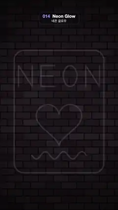

# 014 · Neon Glow · 네온 글로우



**EN** A neon sign on a dark brick wall lights up tube by tube (frame, NEON, heart, wavy line), glows steadily, then fades out smoothly.  
**KO** 어두운 벽돌 벽의 네온사인이 관 하나씩 그려지며 켜지고(테두리, NEON, 하트, 물결선), 깜빡임 없이 빛나다가 부드럽게 꺼진다.

[Video (mp4)](https://sueun-dev.github.io/motion-effects/videos/014-neon-glow.mp4) · [Code](../effects/014-neon-glow.js) · Design styles · 디자인 스타일

## Prompt (English)

```text
Create a "Neon Glow" motion effect: a neon sign on a dark brick wall that lights up tube by tube, glows steadily, then fades off smoothly — no flicker at all.

Look
- Wall, drawn once: fill #0B0A10; bricks 132 × 56 px with 6 px rounded corners in rows 64 px apart (4 px mortar), every other row shifted by 70 px, each brick a seeded dark grey with a slight purple tint (about rgb(28–40, 20–32, 24–36)); then a radial vignette from clear at radius 300 to 75 % black at radius 1200 around the centre.
- Tubes (polylines, round caps and joins):
  - a pink #FF3CAC rounded-rectangle frame from (130, 460), 820 × 1120, corner radius 90;
  - the word NEON in cyan #38F2FF, single-stroke letters 125 × 190 px starting at x 170, y 600, one every 205 px: N as one zigzag stroke (bottom-left → top-left → bottom-right → top-right), E as a C-shaped stroke (top-right → top-left → bottom-left → bottom-right) plus a separate 105 px middle bar, O as an ellipse, then N again;
  - a red-pink #FF4D6D heart from the classic heart curve x = 16·sin³θ, y = −(13·cosθ − 5·cos2θ − 2·cos3θ − cos4θ), scaled 13× and centred at (540, 1110), about 420 px wide;
  - a yellow #FFE45C wavy line from x 290 to 790 at y 1420: 3 waves of ±34 px.
- Unlit glass: every tube is always drawn as a faint 12 px line in rgba(210, 200, 230, 0.16), so you can see the sign before it lights.
- A lit tube is three strokes with additive ("lighter") blending: a 44 px wide haze at 22 % in the tube colour; an 18 px line at 60 % with a 46 px blur glow in the tube colour; a 6 px white-hot core at 95 %.
- Light spilling on the wall: a pink radial gradient at (540, 1000), radius 100 → 1000, alpha 0.22 × the fraction of the sign that is lit.

Motion (0–5 s)
- Each tube is drawn on along its length (a line dash whose visible length grows from 0 to the full tube length, eased in-out) in its own window: frame 0–0.7 s, N 0.5–0.85, E 0.7–1.05, E bar 0.95–1.1, O 0.95–1.35, last N 1.2–1.55, heart 1.4–2.2, wavy line 2.0–2.6 s.
- From 2.6 to 4.2 s the whole sign is lit and perfectly steady.
- Power-off: from 4.2 to 4.8 s every lit stroke and the wall light fade smoothly to zero together (in-out ease), leaving only the unlit glass, so the loop restarts from dark.

Technique
- Canvas 2D: draw the cached wall, the wall glow, the unlit tubes, then the lit strokes with globalCompositeOperation "lighter", canvas shadows (shadowBlur) for the glow and setLineDash for the draw-on. Nothing blinks or buzzes.

Output and rules
- One self-contained HTML file with no external assets (three.js from a CDN is fine if you use it), drawing on a 1080 × 1920 canvas (9:16) scaled to fit the window.
- Write a function renderFrame(t) that draws the frame for time t in seconds, and preview it with requestAnimationFrame. Everything must be a pure function of t and fixed seeds: no Math.random(), Date or state carried between frames, so frame i = renderFrame(i / 30) can be exported to a 30 fps video.
- Loop seamlessly every 5 seconds: renderFrame(5) must look exactly like renderFrame(0).
- No flicker of any kind: no noise or grain that changes from frame to frame, no strobing or blinking, no z-fighting, no shimmering 1 px lines. Any grain or texture stays fixed to the screen or to the object.
- Keep the top 280 px free of important content (a title label goes there) and fill the whole frame with a designed background.
```

## 프롬프트 (한국어)

```text
"네온 글로우" 모션 효과를 만들어 줘: 어두운 벽돌 벽의 네온사인이 관 하나씩 켜지고, 흔들림 없이 빛나다가 부드럽게 꺼지는 효과. 깜빡임은 전혀 없다.

모양
- 벽은 한 번만 그린다: #0B0A10으로 채우고, 64px 간격 줄(줄눈 4px)에 6px 둥근 모서리의 132 × 56px 벽돌, 한 줄 걸러 70px 밀기, 벽돌마다 고정 시드로 정한 살짝 보랏빛 도는 어두운 회색(대략 rgb(28–40, 20–32, 24–36)). 그 위에 가운데에서 반지름 300은 투명, 1200은 검정 75 %인 방사형 비네트.
- 네온관(폴리라인, 둥근 끝·둥근 이음):
  - 분홍 #FF3CAC 둥근 사각형 테두리, (130, 460)에서 820 × 1120, 모서리 반지름 90;
  - 청록 #38F2FF 단어 NEON, 125 × 190px 한 획 글자, x 170·y 600에서 시작해 205px마다 한 글자: N은 지그재그 한 획(왼쪽 아래 → 왼쪽 위 → 오른쪽 아래 → 오른쪽 위), E는 C자 획(오른쪽 위 → 왼쪽 위 → 왼쪽 아래 → 오른쪽 아래)과 따로 그리는 105px 가운데 막대, O는 타원, 다시 N;
  - 빨간 분홍 #FF4D6D 하트: 고전 하트 곡선 x = 16·sin³θ, y = −(13·cosθ − 5·cos2θ − 2·cos3θ − cos4θ)를 13배 키워 (540, 1110)에 둔다(너비 약 420px);
  - 노란 #FFE45C 물결선: y 1420에서 x 290부터 790까지, ±34px 물결 3개.
- 꺼진 유리관: 모든 관을 언제나 rgba(210, 200, 230, 0.16)의 옅은 12px 선으로 그려 둔다. 그래서 켜지기 전에도 간판이 보인다.
- 켜진 관은 가산("lighter") 합성의 세 획: 관 색 22 %의 44px 넓은 안개, 관 색 60 %의 18px 선에 관 색 46px 블러 빛, 95 % 흰색의 6px 뜨거운 심.
- 벽에 번지는 빛: (540, 1000)에서 반지름 100 → 1000의 분홍 방사형 그라디언트, 알파 0.22 × 켜진 비율.

움직임 (0–5초)
- 관마다 자기 시간 창에서 길이를 따라 그려진다(보이는 길이가 0에서 관 전체 길이로 늘어나는 점선, in-out 이징): 테두리 0–0.7초, N 0.5–0.85, E 0.7–1.05, E 가운데 막대 0.95–1.1, O 0.95–1.35, 마지막 N 1.2–1.55, 하트 1.4–2.2, 물결선 2.0–2.6초.
- 2.6–4.2초에는 간판 전체가 켜진 채 완전히 일정하게 빛난다.
- 꺼짐: 4.2–4.8초에 켜진 획과 벽의 빛이 함께 부드럽게 0으로 사라지고(in-out 이징), 꺼진 유리관만 남아 루프가 어둠에서 다시 시작한다.

기법
- Canvas 2D: 미리 그린 벽 → 벽의 빛 → 꺼진 관 → globalCompositeOperation "lighter"로 켜진 획. 빛은 캔버스 그림자(shadowBlur), 그려지는 효과는 setLineDash. 깜빡이거나 떨리는 것은 없다.

출력과 규칙
- 외부 파일 없는 HTML 파일 하나(three.js를 쓴다면 CDN은 괜찮다). 1080 × 1920(9:16) 캔버스에 그리고 창 크기에 맞춰 보이게 한다.
- 시간 t(초)의 프레임을 그리는 renderFrame(t) 함수를 만들고, 미리보기는 requestAnimationFrame으로 돌린다. 모든 것은 t와 고정 시드만으로 정해진다: Math.random(), Date, 프레임 사이에 쌓이는 상태 금지. 그래야 i번째 프레임 = renderFrame(i / 30)으로 30fps 영상을 뽑을 수 있다.
- 5초마다 끊김 없이 반복: renderFrame(5)는 renderFrame(0)과 똑같아 보여야 한다.
- 어떤 깜빡임도 금지: 프레임마다 바뀌는 노이즈·그레인, 번쩍임·깜빡임, z-fighting, 반짝이며 떨리는 1px 선 모두 금지. 그레인·질감은 화면이나 물체에 고정한다.
- 위쪽 280px에는 중요한 내용을 두지 않고(제목 라벨 자리), 화면 전체를 디자인된 배경으로 채운다.
```
