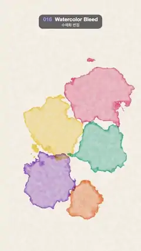

# 016 · Watercolor Bleed · 수채화 번짐



**EN** Six watercolour drops land one after another on textured paper, bloom outward with ragged darker rims, overlap, then fade away.  
**KO** 질감 있는 종이에 수채 물감 여섯 방울이 차례로 떨어져 들쭉날쭉한 짙은 가장자리로 번져 퍼지고, 서로 겹쳤다가 옅어진다.

[Video (mp4)](../videos/016-watercolor-bleed.mp4) · [Code](../effects/016-watercolor-bleed.js) · Design styles · 디자인 스타일

## Prompt (English)

```text
Create a "Watercolor Bleed" motion effect: watercolour drops land one after another on textured paper, bleed outward along ragged edges with darker dried rims, glaze where they overlap, and fade away.

Look
- Units: p = (2·pixel − resolution) / width (1 unit = 540 px, y up, (0, 0) at the frame centre).
- Paper: warm off-white #F9F4E9, modulated ±1.5 % by 5-octave fBm noise at 11 per unit for paper tooth, plus a fixed per-pixel grain of ±1.5 %.
- Six drops (centre in units, colour), a loose zig-zag column down the frame: (−0.35, 0.70) blue #3361D9; (0.38, 0.45) pink #EB527A; (−0.25, −0.05) yellow #FAC738; (0.42, −0.35) teal #269E99; (−0.30, −0.80) violet #8C52CC; (0.20, −1.05) orange #F58038.
- Drop shape: distance d = |p − centre| − R·(1 + rag), with rag = fbm(2.6p + 13i)·(0.35 + 0.25·grow). The ragged noise is fixed to the paper, so the edge does not crawl; only the radius grows. Final radius R = (0.34 + 0.1·fract(1.7i))·grow, about 185–230 px. A sharp edge (±0.004 units).
- Pigment density inside: (0.45 + 0.6·rim + 0.4·(1 − grow)·exp(−8·|p − centre|))·granulation, where
  - rim = smoothstep(−0.06, 0, d) darkens the last ~30 px inside the edge (pigment collecting at the drying edge);
  - the exp term is a dark wet centre right after the drop lands;
  - granulation = 0.8 + 0.35·fbm(14p + i) + 0.25·paper noise (pigment settling into the paper's tooth).
- Colour mixing is multiplicative, like real glazes: colour *= mix(white, ink colour, clamp(density, 0, 1)·inside·alive), so overlapping drops darken into new mixed colours.

Motion (0–5 s)
- Drop i lands at t = 5i / 6 s (every 0.83 s); its age is u = fract(t / 5 − i / 6), so each drop lives once per loop.
- Growth: grow = 1 − (1 − min(u / 0.6, 1))³, a quick bloom that eases out over 3 s; the edge gets a little more ragged as it spreads.
- Fade: alive = 1 − smoothstep(0.80, 0.98, u), so each stain fades away between 4.0 and 4.9 s after landing, just before the same drop lands again.
- At any moment you see one fresh drop blooming, several full stains and one fading.

Technique
- A WebGL2 full-screen fragment shader using fBm of 3D simplex noise. Every noise term depends only on the paper position (never on time), so the paper and granulation never flicker.

Output and rules
- One self-contained HTML file with no external assets (three.js from a CDN is fine if you use it), drawing on a 1080 × 1920 canvas (9:16) scaled to fit the window.
- Write a function renderFrame(t) that draws the frame for time t in seconds, and preview it with requestAnimationFrame. Everything must be a pure function of t and fixed seeds: no Math.random(), Date or state carried between frames, so frame i = renderFrame(i / 30) can be exported to a 30 fps video.
- Loop seamlessly every 5 seconds: renderFrame(5) must look exactly like renderFrame(0).
- No flicker of any kind: no noise or grain that changes from frame to frame, no strobing or blinking, no z-fighting, no shimmering 1 px lines. Any grain or texture stays fixed to the screen or to the object.
- Keep the top 280 px free of important content (a title label goes there) and fill the whole frame with a designed background.
```

## 프롬프트 (한국어)

```text
"수채화 번짐" 모션 효과를 만들어 줘: 질감 있는 종이에 수채 물감 방울이 차례로 떨어져 들쭉날쭉한 가장자리로 번져 나가고, 마르는 가장자리가 짙어지며, 겹친 곳은 색이 포개지고, 다시 옅어지는 효과.

모양
- 단위: p = (2·픽셀 − 해상도) / 너비(1 = 540px, 위가 +, (0, 0)이 화면 가운데).
- 종이: 따뜻한 미색 #F9F4E9. 1단위당 11의 5옥타브 fBm 노이즈로 ±1.5 % 밝기를 흔들어 종이 결을 내고, 픽셀마다 고정된 그레인 ±1.5 %를 더한다.
- 물감 방울 여섯(중심 단위 좌표, 색), 화면 아래로 느슨하게 지그재그로 늘어선다: (−0.35, 0.70) 파랑 #3361D9; (0.38, 0.45) 분홍 #EB527A; (−0.25, −0.05) 노랑 #FAC738; (0.42, −0.35) 청록 #269E99; (−0.30, −0.80) 보라 #8C52CC; (0.20, −1.05) 주황 #F58038.
- 방울 모양: 거리 d = |p − 중심| − R·(1 + rag), rag = fbm(2.6p + 13i)·(0.35 + 0.25·grow). 들쭉날쭉한 노이즈는 종이에 고정되어 있어서 가장자리가 기어다니지 않고 반지름만 커진다. 최종 반지름 R = (0.34 + 0.1·fract(1.7i))·grow, 약 185–230px. 경계는 날카롭게(±0.004단위).
- 안쪽 안료 농도: (0.45 + 0.6·rim + 0.4·(1 − grow)·exp(−8·|p − 중심|))·granulation.
  - rim = smoothstep(−0.06, 0, d): 가장자리 안쪽 약 30px를 짙게(마르는 가장자리에 안료가 모임);
  - exp 항: 방울이 막 떨어졌을 때의 짙고 젖은 가운데;
  - granulation = 0.8 + 0.35·fbm(14p + i) + 0.25·종이 노이즈(안료가 종이 결에 가라앉음).
- 색은 진짜 덧칠처럼 곱해서 섞는다: 색 *= mix(흰색, 물감 색, clamp(농도, 0, 1)·inside·alive). 그래서 겹친 방울은 더 어두운 새 혼합색이 된다.

움직임 (0–5초)
- i번째 방울은 t = 5i / 6초(0.83초마다)에 떨어진다. 나이 u = fract(t / 5 − i / 6), 그래서 방울마다 루프에 한 번 산다.
- 번짐: grow = 1 − (1 − min(u / 0.6, 1))³. 빠르게 피어나 3초에 걸쳐 느려진다. 퍼질수록 가장자리가 조금 더 들쭉날쭉해진다.
- 사라짐: alive = 1 − smoothstep(0.80, 0.98, u). 얼룩마다 떨어지고 4.0–4.9초 뒤에 옅어져 사라지고, 곧바로 같은 방울이 다시 떨어진다.
- 어느 순간에나 막 피어나는 방울 하나, 다 퍼진 얼룩 여럿, 사라지는 얼룩 하나가 보인다.

기법
- 3D 심플렉스 노이즈의 fBm을 쓰는 WebGL2 전체 화면 프래그먼트 셰이더. 모든 노이즈는 종이 위치에만 의존하고 시간에는 의존하지 않으므로, 종이와 입자 질감이 절대 깜빡이지 않는다.

출력과 규칙
- 외부 파일 없는 HTML 파일 하나(three.js를 쓴다면 CDN은 괜찮다). 1080 × 1920(9:16) 캔버스에 그리고 창 크기에 맞춰 보이게 한다.
- 시간 t(초)의 프레임을 그리는 renderFrame(t) 함수를 만들고, 미리보기는 requestAnimationFrame으로 돌린다. 모든 것은 t와 고정 시드만으로 정해진다: Math.random(), Date, 프레임 사이에 쌓이는 상태 금지. 그래야 i번째 프레임 = renderFrame(i / 30)으로 30fps 영상을 뽑을 수 있다.
- 5초마다 끊김 없이 반복: renderFrame(5)는 renderFrame(0)과 똑같아 보여야 한다.
- 어떤 깜빡임도 금지: 프레임마다 바뀌는 노이즈·그레인, 번쩍임·깜빡임, z-fighting, 반짝이며 떨리는 1px 선 모두 금지. 그레인·질감은 화면이나 물체에 고정한다.
- 위쪽 280px에는 중요한 내용을 두지 않고(제목 라벨 자리), 화면 전체를 디자인된 배경으로 채운다.
```
