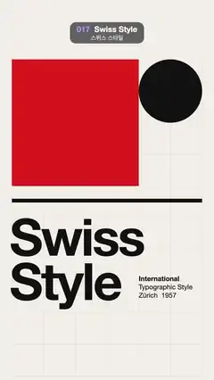

# 017 · Swiss Style · 스위스 스타일



**EN** A red block, black circle, rule and huge "Swiss Style" type slide cell to cell on a faint grid through four poster layouts.  
**KO** 옅은 격자 위에서 빨간 블록·검은 원·막대·큰 "Swiss Style" 글자가 칸 단위로 미끄러지며 네 가지 포스터 배치를 오간다.

[Video (mp4)](../videos/017-swiss-style.mp4) · [Code](../effects/017-swiss-style.js) · Design styles · 디자인 스타일

## Prompt (English)

```text
Create a "Swiss Style" motion effect: an International Typographic Style poster on a strict modular grid, whose red block, black circle, rule and big type slide precisely from grid cell to grid cell through four layouts.

Look
- Background: warm off-white #F1EEE8. Colours: red #E2231A and ink #111111 only.
- Grid: 6 columns × 10 rows of 160 px units from (60, 300) to (1020, 1900), drawn as faint 2 px lines in rgba(0, 0, 0, 0.08).
- Elements, with positions in grid units from the grid's top-left (1 unit = 160 px):
  - a red rectangle;
  - a black circle of diameter 2 units (320 px);
  - a black rule 0.12 units (19 px) thick;
  - "Swiss" and "Style" in bold Helvetica Neue 260 px with −10 px letter spacing, each drawn 12 px left of its cell and with its baseline 192 px below the cell top;
  - a small note in Helvetica Neue 34 px: "International" (bold), then "Typographic Style" and "Zürich  1957" (regular), baselines 40, 82 and 124 px below its cell top.
- Four layouts (x, y, w, h in units):
  - red block: (0, 0, 4, 4) → (2, 0, 4, 4) → (0, 1, 6, 3) → (3, 0, 3, 5)
  - circle (top-left of its 2 × 2 box): (4, 0) → (0, 2) → (4, 3) → (0, 0)
  - rule (x, y, w): (0, 4.4, 6) → (0, 4.4, 3) → (3, 0.4, 3) → (0, 4.4, 2)
  - "Swiss": (0, 5.0) → (1, 5.0) → (0, 5.4) → (0, 5.0)
  - "Style": (0, 6.4) → (0, 6.4) → (1, 6.8) → (2, 6.4)
  - note: (4, 6.75) → (0, 8.4) → (0, 8.6) → (0, 8.4)
- Draw order: red block, circle, rule, then the type, so the circle overlaps the red and the type stays on top.

Motion (0–5 s)
- Moves start at 0.6, 1.8, 3.0 and 4.2 s; the move at 4.2 s goes from the fourth layout back to the first.
- Each move lasts 0.45 s with a cubic in-out ease and interpolates position and size linearly in grid units. The elements start 0.05 s apart in the order red block, circle, rule, "Swiss", "Style", note, giving a crisp cascade.
- Between moves everything holds perfectly still on the grid.

Technique
- Canvas 2D, fully redrawn each frame (the 2D context's letterSpacing for the tight type).

Output and rules
- One self-contained HTML file with no external assets (three.js from a CDN is fine if you use it), drawing on a 1080 × 1920 canvas (9:16) scaled to fit the window.
- Write a function renderFrame(t) that draws the frame for time t in seconds, and preview it with requestAnimationFrame. Everything must be a pure function of t and fixed seeds: no Math.random(), Date or state carried between frames, so frame i = renderFrame(i / 30) can be exported to a 30 fps video.
- Loop seamlessly every 5 seconds: renderFrame(5) must look exactly like renderFrame(0).
- No flicker of any kind: no noise or grain that changes from frame to frame, no strobing or blinking, no z-fighting, no shimmering 1 px lines. Any grain or texture stays fixed to the screen or to the object.
- Keep the top 280 px free of important content (a title label goes there) and fill the whole frame with a designed background.
```

## 프롬프트 (한국어)

```text
"스위스 스타일" 모션 효과를 만들어 줘: 엄격한 모듈 격자 위의 국제 타이포그래피 양식 포스터에서, 빨간 블록·검은 원·막대·큰 글자가 격자 칸에서 칸으로 정확히 미끄러지며 네 가지 배치를 오가는 효과.

모양
- 배경: 따뜻한 미색 #F1EEE8. 색은 빨강 #E2231A와 잉크 #111111뿐.
- 격자: (60, 300)에서 (1020, 1900)까지 160px 단위 6열 × 10행, rgba(0, 0, 0, 0.08)의 옅은 2px 선으로 그린다.
- 요소(위치는 격자 왼쪽 위에서 잰 격자 단위, 1단위 = 160px):
  - 빨간 직사각형;
  - 지름 2단위(320px) 검은 원;
  - 두께 0.12단위(19px) 검은 막대;
  - 굵은 Helvetica Neue 260px, 자간 −10px의 "Swiss"와 "Style". 각각 자기 칸보다 12px 왼쪽에, 기준선은 칸 위에서 192px 아래;
  - Helvetica Neue 34px 작은 메모: "International"(굵게), 이어서 "Typographic Style"과 "Zürich  1957"(보통), 기준선은 칸 위에서 40, 82, 124px 아래.
- 배치 넷(x, y, w, h 단위):
  - 빨간 블록: (0, 0, 4, 4) → (2, 0, 4, 4) → (0, 1, 6, 3) → (3, 0, 3, 5)
  - 원(2 × 2 상자의 왼쪽 위): (4, 0) → (0, 2) → (4, 3) → (0, 0)
  - 막대(x, y, w): (0, 4.4, 6) → (0, 4.4, 3) → (3, 0.4, 3) → (0, 4.4, 2)
  - "Swiss": (0, 5.0) → (1, 5.0) → (0, 5.4) → (0, 5.0)
  - "Style": (0, 6.4) → (0, 6.4) → (1, 6.8) → (2, 6.4)
  - 메모: (4, 6.75) → (0, 8.4) → (0, 8.6) → (0, 8.4)
- 그리는 순서: 빨간 블록, 원, 막대, 그다음 글자. 그래서 원이 빨강 위에 겹치고 글자는 늘 맨 위.

움직임 (0–5초)
- 이동은 0.6, 1.8, 3.0, 4.2초에 시작한다. 4.2초의 이동은 넷째 배치에서 첫째 배치로 돌아간다.
- 이동마다 0.45초, 3차 in-out 이징, 위치와 크기를 격자 단위로 선형 보간한다. 요소들은 빨간 블록, 원, 막대, "Swiss", "Style", 메모 순으로 0.05초씩 늦게 출발해 깔끔한 연쇄를 만든다.
- 이동 사이에는 모든 것이 격자 위에 완전히 멈춰 있다.

기법
- Canvas 2D, 매 프레임 전부 다시 그린다(좁은 자간은 2D 컨텍스트의 letterSpacing).

출력과 규칙
- 외부 파일 없는 HTML 파일 하나(three.js를 쓴다면 CDN은 괜찮다). 1080 × 1920(9:16) 캔버스에 그리고 창 크기에 맞춰 보이게 한다.
- 시간 t(초)의 프레임을 그리는 renderFrame(t) 함수를 만들고, 미리보기는 requestAnimationFrame으로 돌린다. 모든 것은 t와 고정 시드만으로 정해진다: Math.random(), Date, 프레임 사이에 쌓이는 상태 금지. 그래야 i번째 프레임 = renderFrame(i / 30)으로 30fps 영상을 뽑을 수 있다.
- 5초마다 끊김 없이 반복: renderFrame(5)는 renderFrame(0)과 똑같아 보여야 한다.
- 어떤 깜빡임도 금지: 프레임마다 바뀌는 노이즈·그레인, 번쩍임·깜빡임, z-fighting, 반짝이며 떨리는 1px 선 모두 금지. 그레인·질감은 화면이나 물체에 고정한다.
- 위쪽 280px에는 중요한 내용을 두지 않고(제목 라벨 자리), 화면 전체를 디자인된 배경으로 채운다.
```
