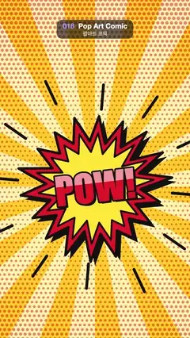

# 018 · Pop Art Comic · 팝아트 코믹



**EN** Comic burst balloons "POW!" and "BAM!" take turns springing out over Ben-Day dots and slowly turning sunburst rays.  
**KO** 벤데이 도트와 천천히 도는 햇살 집중선 위로 "POW!"와 "BAM!" 폭발 말풍선이 번갈아 튀어나온다.

[Video (mp4)](../videos/018-pop-art-comic.mp4) · [Code](../effects/018-pop-art-comic.js) · Design styles · 디자인 스타일

## Prompt (English)

```text
Create a "Pop Art Comic" motion effect: comic-book burst balloons "POW!" and "BAM!" take turns springing out over a Ben-Day dot screen and slowly turning sunburst rays.

Look
- Background: pale yellow #FFF2A8 with 18 sunburst rays in #FFC928 from the centre point (540, 1060), each 10° wide (one every 20°), long enough to reach past the corners.
- Ben-Day dots over the background, drawn once and multiplied on top: pink rgba(232, 32, 90, 0.5) dots on a 26 px grid, every other row shifted 13 px; dot radius 2 px at the centre point, growing linearly to 10 px at 1100 px away and beyond.
- Burst balloon, centred at (540, 1060): a jagged 36-point star whose points alternate between 0.62–0.70 and 0.90–1.12 of the radius (fixed seeded jitter, a different shape for each word). The outer star has radius 400, a 14 px black outline and a solid black hard shadow offset (22, 26); the inner star has radius 305 and a 10 px black outline.
  - POW!: red #E8202A outer, yellow #FFE135 inner, red #E8202A letters, tilted −0.12 rad.
  - BAM!: blue #1E6BFF outer, white inner, hot pink #FF2E7E letters, tilted +0.1 rad.
- Lettering: Impact (fallback Arial Black) 215 px, centred 8 px below the balloon centre; a solid black extrusion (black copies stepping 2 px at a time out to (12, 12) px), an 18 px black outline, the colour fill, and a glossy white 55 % highlight clipped to an 80 px band across the upper half of the letters.
- Action lines: 12 black 16 px strokes radiating outside the balloon at angles 30°·i + 0.2 rad, starting at radius 440, 480 or 520 (cycling) and 80 px long, growing 60 px longer as the balloon pops.
- Black ink #111111 everywhere, round joins and caps.

Motion (0–5 s)
- The rays turn slowly, 40° per loop (exactly two ray spacings, so the loop is seamless).
- Each word lives 2.5 s from its start: POW! starts at 4.0 s (wrapping round, so it is also on screen from 0 to 1.5 s), BAM! starts at 1.5 s.
- Pop: scale 0 → 1 with an out-back overshoot over 0.55 s, plus a small decaying wobble of 0.05·sin(9·age) rad that dies out linearly by 1.2 s; at age 2.25–2.5 s it snaps away (scale to 0 with a cubic ease-in). The action lines are part of the balloon and scale with it.
- So: 0–1.25 s POW! held, 1.25–1.5 snaps away, 1.5 BAM! pops, 3.75–4.0 snaps away, 4.0 POW! pops and holds to the end.

Technique
- Canvas 2D: pre-render the dot screen once into an offscreen canvas and draw it with "multiply" over the rays each frame; draw the balloon in a translated, rotated and scaled context.

Output and rules
- One self-contained HTML file with no external assets (three.js from a CDN is fine if you use it), drawing on a 1080 × 1920 canvas (9:16) scaled to fit the window.
- Write a function renderFrame(t) that draws the frame for time t in seconds, and preview it with requestAnimationFrame. Everything must be a pure function of t and fixed seeds: no Math.random(), Date or state carried between frames, so frame i = renderFrame(i / 30) can be exported to a 30 fps video.
- Loop seamlessly every 5 seconds: renderFrame(5) must look exactly like renderFrame(0).
- No flicker of any kind: no noise or grain that changes from frame to frame, no strobing or blinking, no z-fighting, no shimmering 1 px lines. Any grain or texture stays fixed to the screen or to the object.
- Keep the top 280 px free of important content (a title label goes there) and fill the whole frame with a designed background.
```

## 프롬프트 (한국어)

```text
"팝아트 코믹" 모션 효과를 만들어 줘: 만화책 폭발 말풍선 "POW!"와 "BAM!"이 벤데이 도트와 천천히 도는 햇살 집중선 위로 번갈아 튀어나오는 효과.

모양
- 배경: 연노랑 #FFF2A8 위에 중심점 (540, 1060)에서 뻗는 #FFC928 햇살 18줄. 줄마다 10° 너비(20°마다 하나), 모서리 너머까지 닿을 만큼 길게.
- 배경 위 벤데이 도트: 한 번만 그려서 곱하기(multiply)로 얹는다. 26px 격자, 한 줄 걸러 13px 밀린 분홍 rgba(232, 32, 90, 0.5) 점. 점 반지름은 중심점에서 2px, 1100px 떨어진 곳(과 그 너머)까지 10px로 일정하게 커진다.
- 폭발 말풍선, 중심 (540, 1060): 꼭짓점 36개의 삐죽한 별, 꼭짓점이 반지름의 0.62–0.70과 0.90–1.12를 번갈아 오간다(고정 시드 흔들림, 단어마다 다른 모양). 바깥 별은 반지름 400, 14px 검은 외곽선, (22, 26) 비켜 놓은 꽉 찬 검은 그림자. 안쪽 별은 반지름 305, 10px 검은 외곽선.
  - POW!: 바깥 빨강 #E8202A, 안쪽 노랑 #FFE135, 글자 빨강 #E8202A, −0.12 rad 기울임.
  - BAM!: 바깥 파랑 #1E6BFF, 안쪽 흰색, 글자 핫핑크 #FF2E7E, +0.1 rad 기울임.
- 글자: Impact(없으면 Arial Black) 215px, 말풍선 중심보다 8px 아래 가운데. 꽉 찬 검은 돌출(검은 사본을 2px씩 (12, 12)px까지), 18px 검은 외곽선, 색 채움, 글자 위쪽 절반을 가로지르는 80px 띠로 클립한 55 % 흰 광택.
- 액션 선: 말풍선 바깥에서 30°·i + 0.2 rad 각도로 뻗는 16px 검은 선 12개. 시작 반지름 440, 480, 520(돌아가며), 길이 80px, 말풍선이 튀어나올 때 60px 더 길어진다.
- 모든 잉크는 검정 #111111, 둥근 이음·둥근 끝.

움직임 (0–5초)
- 햇살은 루프마다 40° 천천히 돈다(햇살 간격 정확히 두 칸이라 끊김 없이 반복).
- 단어마다 시작부터 2.5초 산다: POW!는 4.0초 시작(한 바퀴 돌아 0–1.5초에도 화면에 있음), BAM!은 1.5초 시작.
- 튀어나옴: 0.55초 동안 out-back 오버슈트로 크기 0 → 1, 여기에 1.2초까지 선형으로 잦아드는 작은 흔들림 0.05·sin(9·나이) rad. 나이 2.25–2.5초에 휙 사라진다(3차 ease-in으로 크기 0). 액션 선도 말풍선의 일부라 함께 커지고 작아진다.
- 정리하면: 0–1.25초 POW! 유지, 1.25–1.5 사라짐, 1.5 BAM! 튀어나옴, 3.75–4.0 사라짐, 4.0 POW! 튀어나와 끝까지 유지.

기법
- Canvas 2D: 도트 화면은 오프스크린 캔버스에 한 번 그려 두고 매 프레임 햇살 위에 "multiply"로 얹는다. 말풍선은 translate·rotate·scale한 컨텍스트 안에서 그린다.

출력과 규칙
- 외부 파일 없는 HTML 파일 하나(three.js를 쓴다면 CDN은 괜찮다). 1080 × 1920(9:16) 캔버스에 그리고 창 크기에 맞춰 보이게 한다.
- 시간 t(초)의 프레임을 그리는 renderFrame(t) 함수를 만들고, 미리보기는 requestAnimationFrame으로 돌린다. 모든 것은 t와 고정 시드만으로 정해진다: Math.random(), Date, 프레임 사이에 쌓이는 상태 금지. 그래야 i번째 프레임 = renderFrame(i / 30)으로 30fps 영상을 뽑을 수 있다.
- 5초마다 끊김 없이 반복: renderFrame(5)는 renderFrame(0)과 똑같아 보여야 한다.
- 어떤 깜빡임도 금지: 프레임마다 바뀌는 노이즈·그레인, 번쩍임·깜빡임, z-fighting, 반짝이며 떨리는 1px 선 모두 금지. 그레인·질감은 화면이나 물체에 고정한다.
- 위쪽 280px에는 중요한 내용을 두지 않고(제목 라벨 자리), 화면 전체를 디자인된 배경으로 채운다.
```
