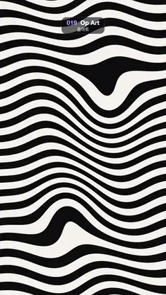

# 019 · Op Art · 옵아트



**EN** Black and white stripes bend around drifting bulges and travelling waves, so the whole field seems to swell and squirm.  
**KO** 흑백 줄무늬가 떠다니는 불룩한 부분과 지나가는 물결에 휘어, 화면 전체가 부풀고 꿈틀거리는 착시를 만든다.

[Video (mp4)](https://sueun-dev.github.io/motion-effects/videos/019-op-art.mp4) · [Code](../effects/019-op-art.js) · Design styles · 디자인 스타일

## Prompt (English)

```text
Create an "Op Art" motion effect: full-screen black and white bands bent by travelling waves and two drifting bulges, so the stripes seem to swell and squirm like an optical illusion.

Look
- Units: p = (2·pixel − resolution) / width (1 unit = 540 px, y up, (0, 0) at the frame centre).
- Two colours only: near-black #0D0D0F and off-white #F5F2EB.
- Compute a phase v per pixel and colour by the sign of sin(π·v). Start from v = 11·y: about 20 black and 20 white horizontal bands, each about 49 px tall. Then bend it (a = 2π·t / 5):
  - + 1.3·sin(3.2x + a)·cos(1.4y − a): a slow wave rolling through the bands;
  - + 0.6·sin(6x − a + 2y): a finer diagonal ripple;
  - + 4.0·exp(−5·|p − c1|²): a bulge that pushes the bands apart, so they bunch up and bend around it;
  - − 3.5·exp(−6·|p − c2|²): a second bulge pushing the other way.
- Anti-aliased edges: ink = smoothstep(−w, w, sin(π·v)) with w = 0.8·fwidth(sin(π·v)). The bands stay wide (never thinner than a few pixels), so nothing shimmers.

Motion (0–5 s)
- Bulge 1 moves on c1 = (0.35·cos a, 0.45 + 0.35·sin a) in the upper half; bulge 2 on c2 = (−0.4·cos(a + 1), −0.7 + 0.3·sin 2a) in the lower half.
- The two wave terms travel with a, so the stripes ripple, swell and squeeze continuously; everything loops in 5 s.

Technique
- A WebGL2 full-screen fragment shader, only a few lines long.

Output and rules
- One self-contained HTML file with no external assets (three.js from a CDN is fine if you use it), drawing on a 1080 × 1920 canvas (9:16) scaled to fit the window.
- Write a function renderFrame(t) that draws the frame for time t in seconds, and preview it with requestAnimationFrame. Everything must be a pure function of t and fixed seeds: no Math.random(), Date or state carried between frames, so frame i = renderFrame(i / 30) can be exported to a 30 fps video.
- Loop seamlessly every 5 seconds: renderFrame(5) must look exactly like renderFrame(0).
- No flicker of any kind: no noise or grain that changes from frame to frame, no strobing or blinking, no z-fighting, no shimmering 1 px lines. Any grain or texture stays fixed to the screen or to the object.
- Keep the top 280 px free of important content (a title label goes there) and fill the whole frame with a designed background.
```

## 프롬프트 (한국어)

```text
"옵아트" 모션 효과를 만들어 줘: 화면 가득한 흑백 줄무늬가 지나가는 물결과 떠다니는 불룩한 부분 두 개에 휘어, 착시처럼 부풀고 꿈틀거리는 효과.

모양
- 단위: p = (2·픽셀 − 해상도) / 너비(1 = 540px, 위가 +, (0, 0)이 화면 가운데).
- 색은 둘뿐: 거의 검정 #0D0D0F와 미색 #F5F2EB.
- 픽셀마다 위상 v를 구하고 sin(π·v)의 부호로 색을 정한다. v = 11·y에서 시작하면 검정 약 20줄, 흰색 약 20줄의 가로 띠가 되고, 띠 하나는 약 49px. 여기에 휘게 하는 항을 더한다(a = 2π·t / 5):
  - + 1.3·sin(3.2x + a)·cos(1.4y − a): 띠를 굴러 지나가는 느린 물결;
  - + 0.6·sin(6x − a + 2y): 더 잘게 비스듬한 잔물결;
  - + 4.0·exp(−5·|p − c1|²): 띠를 밀어내는 불룩한 부분. 띠가 그 둘레로 몰리며 휜다;
  - − 3.5·exp(−6·|p − c2|²): 반대로 미는 두 번째 불룩한 부분.
- 경계 안티앨리어싱: ink = smoothstep(−w, w, sin(π·v)), w = 0.8·fwidth(sin(π·v)). 띠가 넓게 유지되므로(몇 픽셀보다 얇아지지 않음) 반짝이며 떨리지 않는다.

움직임 (0–5초)
- 불룩한 부분 1은 위쪽 절반에서 c1 = (0.35·cos a, 0.45 + 0.35·sin a)를, 불룩한 부분 2는 아래쪽 절반에서 c2 = (−0.4·cos(a + 1), −0.7 + 0.3·sin 2a)를 따라 움직인다.
- 물결 두 항이 a와 함께 흘러가서 줄무늬가 쉬지 않고 출렁이고 부풀고 조여진다. 모든 것이 5초마다 반복된다.

기법
- WebGL2 전체 화면 프래그먼트 셰이더, 몇 줄이면 된다.

출력과 규칙
- 외부 파일 없는 HTML 파일 하나(three.js를 쓴다면 CDN은 괜찮다). 1080 × 1920(9:16) 캔버스에 그리고 창 크기에 맞춰 보이게 한다.
- 시간 t(초)의 프레임을 그리는 renderFrame(t) 함수를 만들고, 미리보기는 requestAnimationFrame으로 돌린다. 모든 것은 t와 고정 시드만으로 정해진다: Math.random(), Date, 프레임 사이에 쌓이는 상태 금지. 그래야 i번째 프레임 = renderFrame(i / 30)으로 30fps 영상을 뽑을 수 있다.
- 5초마다 끊김 없이 반복: renderFrame(5)는 renderFrame(0)과 똑같아 보여야 한다.
- 어떤 깜빡임도 금지: 프레임마다 바뀌는 노이즈·그레인, 번쩍임·깜빡임, z-fighting, 반짝이며 떨리는 1px 선 모두 금지. 그레인·질감은 화면이나 물체에 고정한다.
- 위쪽 280px에는 중요한 내용을 두지 않고(제목 라벨 자리), 화면 전체를 디자인된 배경으로 채운다.
```
