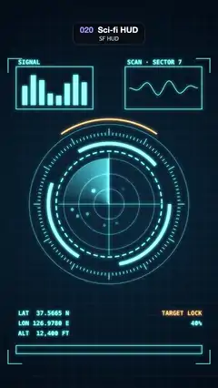

# 020 · Sci-fi HUD · SF HUD



**EN** A glowing cyan sci-fi HUD: counter-rotating rings and ticks around a radar sweep that lights blips, with bar and wave panels and readouts.  
**KO** 빛나는 청록 SF HUD: 서로 반대로 도는 링·눈금 안에서 레이더 스윕이 점들을 밝히고, 막대·파형 패널과 수치가 바뀐다.

[Video (mp4)](https://sueun-dev.github.io/motion-effects/videos/020-sci-fi-hud.mp4) · [Code](../effects/020-sci-fi-hud.js) · Design styles · 디자인 스타일

## Prompt (English)

```text
Create a "Sci-fi HUD" motion effect: a futuristic interface (FUI) of glowing cyan rings, tick scales and arcs counter-rotating around a radar sweep that lights blips, with side panels and slowly changing readouts.

Look
- Background: a radial gradient from #08243A at the centre (540, 1010) to #020812 at the edges (radius 100 → 1200), with a fixed grid of 2 px lines in cyan at 7 % every 60 px.
- Colours: cyan #5CF2FF and orange #FF8A3D. Everything in the HUD is drawn with additive blending and a soft glow (canvas shadow blur 14 px in the element's own colour). Text: Menlo 600 30 px.
- Radar, centred at (540, 1010):
  - three thin rings (2 px, 50 %) of radius 75, 150 and 225, and a 2 px crosshair reaching ±250 px;
  - the sweep: a 3 px beam from the centre to radius 225, with a trailing wedge filled by a conic gradient (transparent for three quarters of the turn, ramping up to 35 % cyan at the beam);
  - 7 blips at fixed seeded angles and radii 50–200 px: each glows when the beam passes and then fades over most of a turn, brightness 0.15 + 0.85·exp(−4f) and radius 6 + 6·exp(−4f) px, where f (0..1) is the fraction of a turn since the beam passed. They fade, never blink.
- Around it, from the inside out: a dashed ring of radius 262 (6 px, dashes 22 on / 14 off); three thick arcs of radius 300 (16 px wide, 1.4 rad long, 120° apart); a tick scale at radius 340 with 120 ticks (3 px, 14 px long, every tenth 34 px long); a thin ring of radius 395 (2 px, 60 %); an orange lock arc of radius 420 (8 px) centred at the top.
- Two panels with 3 px outlines, 380 × 210 at (80, 330) and (620, 330), labelled "SIGNAL" (at 90, 318) and "SCAN · SECTOR 7" (at 630, 318). The left one holds 8 bars, 26 px wide every 42 px from x 110, standing on y 520 at 85 % opacity; the right one a waveform from x 640 to 980 around y 435.
- Readouts at bottom left, x 90: "LAT  37.5665 N" (y 1560), "LON 126.9780 E" (y 1610), "ALT  12,400 FT" (y 1660). Right-aligned at x 1000: "TARGET LOCK" in orange (y 1560) and a percentage, "40%" at the start (y 1610).
- A progress bar: a 920 × 40 outline at (80, 1710) with a fill of up to 904 × 24 at (88, 1718), 80 % opacity.
- Four corner brackets (70 px L-shapes, 5 px, cyan at 80 %, no glow) at (40, 290), (1040, 290), (40, 1800) and (1040, 1800), opening inward.

Motion (0–5 s), with a = 2π·t / 5
- The radar beam turns one full turn clockwise per loop, starting at 12 o'clock.
- The dashed ring crawls forward exactly 6 dash periods (216 px) per loop; the three thick arcs turn backwards by a third of a turn (−a / 3); the tick scale turns forward 30° (a / 12, exactly ten ticks), so every ring loops seamlessly.
- The orange lock arc breathes: half-length 0.6 + 0.4·sin a rad.
- Bars: bar i has height 40 + 110·(0.5 + 0.5·sin(a·(1 + i mod 3) + 1.3i)). Waveform: y = 435 + 60·sin(3·2π·u − 2a)·sin(π·u)·(0.6 + 0.4·sin a), with u = 0..1 across the panel.
- Readouts step slowly, twice a second, never flickering: with step = floor(2t) mod 10, LAT adds 7·step to its last four digits, LON subtracts 5·step, ALT adds 30·step, and the percentage is 40 + 6·step.
- The progress bar fills linearly from empty to full over 0–4.4 s and drains back to empty over 4.4–5 s.

Technique
- Canvas 2D, fully redrawn each frame: globalCompositeOperation "lighter" with shadowBlur for the glow, setLineDash and lineDashOffset for the dashed ring, createConicGradient for the sweep wedge, a seeded random generator for the blips. No random blinking anywhere.

Output and rules
- One self-contained HTML file with no external assets (three.js from a CDN is fine if you use it), drawing on a 1080 × 1920 canvas (9:16) scaled to fit the window.
- Write a function renderFrame(t) that draws the frame for time t in seconds, and preview it with requestAnimationFrame. Everything must be a pure function of t and fixed seeds: no Math.random(), Date or state carried between frames, so frame i = renderFrame(i / 30) can be exported to a 30 fps video.
- Loop seamlessly every 5 seconds: renderFrame(5) must look exactly like renderFrame(0).
- No flicker of any kind: no noise or grain that changes from frame to frame, no strobing or blinking, no z-fighting, no shimmering 1 px lines. Any grain or texture stays fixed to the screen or to the object.
- Keep the top 280 px free of important content (a title label goes there) and fill the whole frame with a designed background.
```

## 프롬프트 (한국어)

```text
"SF HUD" 모션 효과를 만들어 줘: 빛나는 청록 링·눈금·호가 레이더 스윕 둘레에서 서로 반대로 돌고, 스윕이 지나가며 점을 밝히고, 옆 패널과 수치가 천천히 바뀌는 미래형 인터페이스(FUI).

모양
- 배경: 중심 (540, 1010)의 #08243A에서 가장자리 #020812로 가는 방사형 그라디언트(반지름 100 → 1200). 그 위에 60px마다 청록 7 %의 2px 선으로 된 고정 격자.
- 색: 청록 #5CF2FF과 주황 #FF8A3D. HUD의 모든 것은 가산 합성과 부드러운 빛(자기 색의 캔버스 그림자 블러 14px)으로 그린다. 글자: Menlo 600 30px.
- 레이더, 중심 (540, 1010):
  - 반지름 75, 150, 225의 얇은 링 셋(2px, 50 %)과 ±250px까지 뻗는 2px 십자선;
  - 스윕: 중심에서 반지름 225까지의 3px 빔, 뒤에 원뿔 그라디언트로 채운 꼬리 쐐기(한 바퀴의 4분의 3은 투명, 빔 쪽으로 갈수록 청록 35 %까지);
  - 고정 시드로 정한 각도·반지름 50–200px의 점 7개: 빔이 지나갈 때 빛나고 거의 한 바퀴 동안 서서히 어두워진다. 밝기 0.15 + 0.85·exp(−4f), 반지름 6 + 6·exp(−4f) px, f(0..1)는 빔이 지나간 뒤 지난 바퀴 비율. 깜빡이지 않고 서서히 사라진다.
- 그 바깥으로 차례로: 반지름 262 점선 링(6px, 22px 선·14px 빈칸); 반지름 300의 두꺼운 호 셋(너비 16px, 길이 1.4 rad, 120° 간격); 반지름 340의 눈금자, 눈금 120개(3px, 길이 14px, 열 번째마다 34px); 반지름 395 얇은 링(2px, 60 %); 위쪽 가운데에 반지름 420 주황 잠금 호(8px).
- 3px 외곽선 패널 둘: (80, 330)과 (620, 330)의 380 × 210, 라벨 "SIGNAL"(90, 318)과 "SCAN · SECTOR 7"(630, 318). 왼쪽은 x 110부터 42px마다 26px 너비 막대 8개가 y 520에 서 있고(불투명도 85 %), 오른쪽은 x 640에서 980까지 y 435 둘레의 파형.
- 왼쪽 아래 x 90의 수치: "LAT  37.5665 N"(y 1560), "LON 126.9780 E"(y 1610), "ALT  12,400 FT"(y 1660). x 1000 오른쪽 정렬: 주황 "TARGET LOCK"(y 1560)과 처음에 "40%"인 퍼센트(y 1610).
- 진행 막대: (80, 1710)의 920 × 40 외곽선, 안에 (88, 1718)에서 최대 904 × 24까지 차는 채움(불투명도 80 %).
- 네 모서리 괄호(70px L자, 5px, 청록 80 %, 빛 없음): (40, 290), (1040, 290), (40, 1800), (1040, 1800), 안쪽을 향해 열림.

움직임 (0–5초), a = 2π·t / 5
- 레이더 빔은 12시 방향에서 시작해 루프마다 시계 방향으로 한 바퀴 돈다.
- 점선 링은 루프마다 정확히 점선 주기 6개(216px)만큼 앞으로 기어가고, 두꺼운 호 셋은 3분의 1바퀴 거꾸로(−a / 3), 눈금자는 30° 앞으로(a / 12, 정확히 눈금 열 개) 돈다. 그래서 모든 링이 끊김 없이 반복된다.
- 주황 잠금 호가 숨 쉬듯 늘었다 줄었다 한다: 반 길이 0.6 + 0.4·sin a rad.
- 막대: i번째 막대 높이 40 + 110·(0.5 + 0.5·sin(a·(1 + i mod 3) + 1.3i)). 파형: y = 435 + 60·sin(3·2π·u − 2a)·sin(π·u)·(0.6 + 0.4·sin a), u는 패널 가로 0..1.
- 수치는 1초에 두 번 천천히 바뀌고 절대 깜빡이지 않는다: step = floor(2t) mod 10일 때 LAT는 끝 네 자리에 7·step을 더하고, LON은 5·step을 빼고, ALT는 30·step을 더하고, 퍼센트는 40 + 6·step.
- 진행 막대는 0–4.4초에 빈 상태에서 가득 찰 때까지 일정하게 차고, 4.4–5초에 다시 비워진다.

기법
- Canvas 2D, 매 프레임 전부 다시 그린다. 빛은 globalCompositeOperation "lighter"와 shadowBlur, 점선 링은 setLineDash와 lineDashOffset, 스윕 쐐기는 createConicGradient, 점 배치는 고정 시드 난수 생성기. 무작위 깜빡임은 어디에도 없다.

출력과 규칙
- 외부 파일 없는 HTML 파일 하나(three.js를 쓴다면 CDN은 괜찮다). 1080 × 1920(9:16) 캔버스에 그리고 창 크기에 맞춰 보이게 한다.
- 시간 t(초)의 프레임을 그리는 renderFrame(t) 함수를 만들고, 미리보기는 requestAnimationFrame으로 돌린다. 모든 것은 t와 고정 시드만으로 정해진다: Math.random(), Date, 프레임 사이에 쌓이는 상태 금지. 그래야 i번째 프레임 = renderFrame(i / 30)으로 30fps 영상을 뽑을 수 있다.
- 5초마다 끊김 없이 반복: renderFrame(5)는 renderFrame(0)과 똑같아 보여야 한다.
- 어떤 깜빡임도 금지: 프레임마다 바뀌는 노이즈·그레인, 번쩍임·깜빡임, z-fighting, 반짝이며 떨리는 1px 선 모두 금지. 그레인·질감은 화면이나 물체에 고정한다.
- 위쪽 280px에는 중요한 내용을 두지 않고(제목 라벨 자리), 화면 전체를 디자인된 배경으로 채운다.
```
