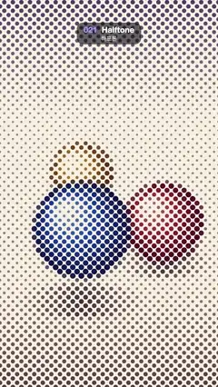

# 021 · Halftone · 하프톤



★ One of the 20 effects in the original reel (#4) · 원래 릴스 20개 중 하나(4번)

**EN** Three shaded balls circle and hop on a cream floor, printed only as a fixed 45° dot screen whose dots swell and shrink.  
**KO** 음영 진 공 세 개가 크림색 바닥 위를 돌며 튀어 오르고, 45도로 고정된 망점으로만 찍혀 점 크기가 명암을 따라 커졌다 작아진다.

[Video (mp4)](https://sueun-dev.github.io/motion-effects/videos/021-halftone.mp4) · [Code](../effects/021-halftone.js) · Print, retro & glitch · 인쇄·레트로·글리치

## Prompt (English)

```text
Create a "Halftone" motion effect: a moving picture of three shaded balls, printed only as a fixed 45° halftone dot screen whose dots grow and shrink with the tones underneath.

Look
- A hidden source picture (drawn into an off-screen 1080 × 1920 canvas, never shown directly): a vertical background gradient #8C7FA8 (top) → #F4EADB (30 %) → #E8D6BF (75 %) → #9A7E6E (bottom), a dusky violet sky fading into a light cream floor.
- Three balls with radial-gradient shading (gradient centre offset up-left by 0.4 r and 0.45 r, stops at 0 / 0.45 / 1): red #FFE1D6 → #FF5A5F → #7A0F2E, blue #D9F0FF → #2F8CFF → #0B2466, yellow #FFF6C9 → #FFC21A → #8A4B00.
- Each ball has a soft floor shadow: a flat ellipse (1.3 r × 0.35 r) centred on its floor point, radial gradient rgba(40, 20, 30, 0.55) → transparent. Draw all shadows first, then the balls from far to near (sorted by floor y).
- The printed result: paper #F7F0E0 with a fixed per-pixel grain of ±2 %. On it, a dot screen of 30 px cells rotated 45° and fixed to the page. Each dot is a disc at its cell centre whose AREA equals the cell's darkness: radius = 30 · sqrt((0.04 + 0.82 · darkness) / π), darkness = 1 − luma (0.299, 0.587, 0.114) of the picture averaged over a 3 × 3 grid of samples spread across the cell (±0.33 cell). Dot edges antialiased over ±1.2 px.
- Ink colour per dot: 60 % of the averaged picture colour raised to the power 1.5, mixed with 40 % dark violet #1F1438. The balls read red, blue and gold, the sky prints as big violet dots, the floor as small brownish dots; even the lightest area keeps tiny dots (the 4 % minimum).

Motion (0–5 s)
- The balls ride one carousel orbit per loop, 120° apart (px, top-left origin): for ball k, u = 2π t/5 + k · 2π/3, depth = 0.5 + 0.5 sin u (0 far, 1 near); centre x = 540 + 270 cos u, floor y = 940 + 330 · depth, radius 150 + 100 · depth (near balls sit lower and are bigger).
- Each ball also hops: it is lifted |sin(2u + k)| · 120 px above its floor point (two hops per orbit) while its shadow stays on the floor.
- The dot grid itself never moves; only the dot sizes and colours change as the picture slides underneath, so nothing shimmers.

Technique
- Canvas 2D draws the source picture every frame; upload it as a texture to a WebGL2 full-screen fragment shader that rotates the pixel position by 45°, snaps it to the cell centre, rotates the sample points back to read the picture, and draws the antialiased dot.

Output and rules
- One self-contained HTML file with no external assets (three.js from a CDN is fine if you use it), drawing on a 1080 × 1920 canvas (9:16) scaled to fit the window.
- Write a function renderFrame(t) that draws the frame for time t in seconds, and preview it with requestAnimationFrame. Everything must be a pure function of t and fixed seeds: no Math.random(), Date or state carried between frames, so frame i = renderFrame(i / 30) can be exported to a 30 fps video.
- Loop seamlessly every 5 seconds: renderFrame(5) must look exactly like renderFrame(0).
- No flicker of any kind: no noise or grain that changes from frame to frame, no strobing or blinking, no z-fighting, no shimmering 1 px lines. Any grain or texture stays fixed to the screen or to the object.
- Keep the top 280 px free of important content (a title label goes there) and fill the whole frame with a designed background.
```

## 프롬프트 (한국어)

```text
"하프톤" 모션 효과를 만들어 줘: 음영 진 공 세 개가 움직이는 그림을, 45도로 고정된 하프톤 망점으로만 찍어서 아래 명암에 따라 점이 커졌다 작아지는 효과.

모양
- 숨은 원본 그림(화면 밖 1080 × 1920 캔버스에 그리고 직접 보여 주지 않는다): 세로 그라디언트 배경 #8C7FA8(위) → #F4EADB(30 %) → #E8D6BF(75 %) → #9A7E6E(아래). 어스름한 보라 하늘이 밝은 크림색 바닥으로 이어진다.
- 방사형 그라디언트로 음영을 준 공 세 개(그라디언트 중심을 왼쪽 위로 0.4 r, 0.45 r 옮기고 색 지점은 0 / 0.45 / 1): 빨강 #FFE1D6 → #FF5A5F → #7A0F2E, 파랑 #D9F0FF → #2F8CFF → #0B2466, 노랑 #FFF6C9 → #FFC21A → #8A4B00.
- 공마다 바닥에 부드러운 그림자: 바닥 지점을 중심으로 한 납작한 타원(1.3 r × 0.35 r), 방사형 그라디언트 rgba(40, 20, 30, 0.55) → 투명. 그림자를 먼저 모두 그리고, 공은 먼 것부터 가까운 것 순서로(바닥 y 기준 정렬) 그린다.
- 찍힌 결과: 종이 #F7F0E0에 픽셀마다 고정된 ±2 % 그레인. 그 위에 45도 돌아간 30 px 칸의 망점 격자가 종이에 고정되어 있다. 칸마다 중심에 원 하나를 찍는데, 원의 넓이가 그 칸의 어두움과 같다: 반지름 = 30 · sqrt((0.04 + 0.82 · 어두움) / π), 어두움 = 1 − 휘도(0.299, 0.587, 0.114). 휘도는 칸 안에 3 × 3으로 퍼진 샘플(±0.33칸)의 평균 색으로 잰다. 점 가장자리는 ±1.2 px로 안티에일리어싱.
- 점의 잉크 색: 평균 색을 1.5제곱한 색 60 %와 어두운 보라 #1F1438 40 %를 섞는다. 그래서 공은 빨강·파랑·금색으로 보이고, 하늘은 큰 보라 점, 바닥은 작은 갈색 점으로 찍힌다. 가장 밝은 곳에도 아주 작은 점이 남는다(최소 4 %).

움직임 (0–5초)
- 공들은 120도 간격으로 루프마다 회전목마처럼 한 바퀴 돈다(px, 왼쪽 위 기준): 공 k에 대해 u = 2π t/5 + k · 2π/3, 깊이 = 0.5 + 0.5 sin u(0 멀리, 1 가까이). 중심 x = 540 + 270 cos u, 바닥 y = 940 + 330 · 깊이, 반지름 150 + 100 · 깊이(가까운 공일수록 아래에 있고 크다).
- 공은 통통 튀기도 한다: 바닥 지점에서 |sin(2u + k)| · 120 px 위로 떠오르고(한 바퀴에 두 번), 그림자는 바닥에 그대로 있다.
- 망점 격자 자체는 절대 움직이지 않는다. 그림이 아래로 지나가면서 점의 크기와 색만 바뀌므로 반짝임이 없다.

기법
- 원본 그림은 매 프레임 Canvas 2D로 그리고, 텍스처로 올려 WebGL2 전체 화면 프래그먼트 셰이더에서 처리한다: 픽셀 위치를 45도 돌려 칸 중심에 맞추고, 샘플 지점을 다시 되돌려 그림을 읽은 뒤 안티에일리어싱된 점을 그린다.

출력과 규칙
- 외부 파일 없는 HTML 파일 하나(three.js를 쓴다면 CDN은 괜찮다). 1080 × 1920(9:16) 캔버스에 그리고 창 크기에 맞춰 보이게 한다.
- 시간 t(초)의 프레임을 그리는 renderFrame(t) 함수를 만들고, 미리보기는 requestAnimationFrame으로 돌린다. 모든 것은 t와 고정 시드만으로 정해진다: Math.random(), Date, 프레임 사이에 쌓이는 상태 금지. 그래야 i번째 프레임 = renderFrame(i / 30)으로 30fps 영상을 뽑을 수 있다.
- 5초마다 끊김 없이 반복: renderFrame(5)는 renderFrame(0)과 똑같아 보여야 한다.
- 어떤 깜빡임도 금지: 프레임마다 바뀌는 노이즈·그레인, 번쩍임·깜빡임, z-fighting, 반짝이며 떨리는 1px 선 모두 금지. 그레인·질감은 화면이나 물체에 고정한다.
- 위쪽 280px에는 중요한 내용을 두지 않고(제목 라벨 자리), 화면 전체를 디자인된 배경으로 채운다.
```
