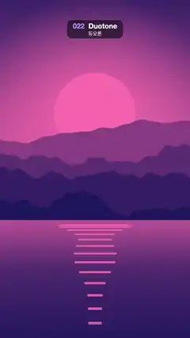

# 022 · Duotone · 듀오톤



**EN** A drifting sunset landscape is printed in just two inks, and the pair melts from navy/pink to green/lime, plum/orange and wine/cream.  
**KO** 천천히 움직이는 노을 풍경이 잉크 두 가지로만 표현되고, 색 쌍이 남색·분홍 → 초록·라임 → 자주·주황 → 와인·크림으로 녹아들듯 바뀐다.

[Video (mp4)](https://sueun-dev.github.io/motion-effects/videos/022-duotone.mp4) · [Code](../effects/022-duotone.js) · Print, retro & glitch · 인쇄·레트로·글리치

## Prompt (English)

```text
Create a "Duotone" motion effect: a sunset landscape whose brightness is mapped onto just two inks (shadow colour → highlight colour), while the ink pair changes four times per loop.

Look
- Source picture (an off-screen 1080 × 1920 canvas), a flat-colour sunset over mountains and a lake:
  - Sky over the top 62 %: vertical gradient #2B1B5A → #E8577A (55 %) → #FFB36B.
  - Sun: a disc of radius 0.17 × width (≈ 184 px) at x = 50 %, y = 37 % of the frame, colour #FFE6A8, with a soft radial glow rgba(255, 220, 150, 0.55) → 0 from 0.8 r out to 3 r.
  - Four mountain layers, back to front #C2507E, #8E3B78, #5A2A68, #2E1A4A, their ridgelines made from smooth 4-octave fractal noise, baselines at 47 / 52 / 57 / 62 % of the height, ridge amplitudes 8–12 % of the height, each layer's noise a little finer than the one behind.
  - Lake below 62 %: gradient #E0748A → #7A3B78 (30 %) → #1E1238, with 14 horizontal sun-reflection bars in rgba(255, 226, 160, 0.7) centred under the sun, their spacing growing downward (y = 63 % of the height + 2.6 i² px), width shrinking with i, height 4 + 0.6 i px.
- Duotone mapping per pixel: lum = luma (0.299, 0.587, 0.114), stretched with smoothstep(0.08, 0.86, lum) so both inks get used; colour = mix(dark ink, light ink, lum), plus a fixed per-pixel grain of ±1.25 %.
- The four ink pairs (dark → light): navy #1A175C → pink #FF73AD; deep green #083329 → lime #CCFF5C; plum #3D0A57 → orange #FFB84D; wine #73051F → cream #FFEBCC.

Motion (0–5 s)
- The pairs take turns, 1.25 s each: x = 4t/5, pair i = floor(x), next j = (i + 1) mod 4, blend k = smoothstep(0.55, 1.0, fract(x)). Each pair holds for ~0.69 s, then cross-fades into the next over ~0.56 s (dark and light inks interpolated separately), and the 4th pair fades back into the 1st at the loop point.
- The picture drifts gently: zoom 1.18 + 0.08 cos(2π t/5) about the centre and a horizontal pan of 40 sin(2π t/5) px; inside it the sun bobs by ±1 % of the height and each reflection bar's width sways by a factor 0.8 + 0.2 sin(2π t/5 + i).

Technique
- Canvas 2D draws the picture every frame; a WebGL2 full-screen fragment shader samples it as a texture and does the duotone mapping.

Output and rules
- One self-contained HTML file with no external assets (three.js from a CDN is fine if you use it), drawing on a 1080 × 1920 canvas (9:16) scaled to fit the window.
- Write a function renderFrame(t) that draws the frame for time t in seconds, and preview it with requestAnimationFrame. Everything must be a pure function of t and fixed seeds: no Math.random(), Date or state carried between frames, so frame i = renderFrame(i / 30) can be exported to a 30 fps video.
- Loop seamlessly every 5 seconds: renderFrame(5) must look exactly like renderFrame(0).
- No flicker of any kind: no noise or grain that changes from frame to frame, no strobing or blinking, no z-fighting, no shimmering 1 px lines. Any grain or texture stays fixed to the screen or to the object.
- Keep the top 280 px free of important content (a title label goes there) and fill the whole frame with a designed background.
```

## 프롬프트 (한국어)

```text
"듀오톤" 모션 효과를 만들어 줘: 노을 풍경의 밝기를 잉크 두 가지(그림자 색 → 하이라이트 색)로만 표현하고, 잉크 쌍이 루프마다 네 번 바뀌는 효과.

모양
- 원본 그림(화면 밖 1080 × 1920 캔버스), 산과 호수 위로 지는 단색 면 노을:
  - 위쪽 62 % 하늘: 세로 그라디언트 #2B1B5A → #E8577A(55 %) → #FFB36B.
  - 해: 반지름 화면 너비 × 0.17(≈ 184 px)의 원, 위치 x = 50 %, y = 화면의 37 %, 색 #FFE6A8. 0.8 r에서 3 r까지 퍼지는 부드러운 방사형 빛 rgba(255, 220, 150, 0.55) → 0.
  - 산 네 겹, 뒤에서 앞으로 #C2507E, #8E3B78, #5A2A68, #2E1A4A. 능선은 부드러운 4옥타브 프랙탈 노이즈로 만들고, 기준선은 높이의 47 / 52 / 57 / 62 %, 능선 진폭은 높이의 8–12 %, 앞 겹일수록 노이즈가 조금 더 잘다.
  - 62 % 아래 호수: 그라디언트 #E0748A → #7A3B78(30 %) → #1E1238. 해 바로 아래 가운데에 rgba(255, 226, 160, 0.7) 가로 반사 막대 14개, 아래로 갈수록 간격이 벌어지고(y = 높이의 63 % + 2.6 i² px), 너비는 i에 따라 줄며, 높이는 4 + 0.6 i px.
- 픽셀마다 듀오톤 매핑: lum = 휘도(0.299, 0.587, 0.114)를 smoothstep(0.08, 0.86, lum)으로 늘려 두 잉크를 다 쓰게 하고, 색 = mix(어두운 잉크, 밝은 잉크, lum). 여기에 픽셀마다 고정된 ±1.25 % 그레인.
- 잉크 쌍 네 개(어두움 → 밝음): 남색 #1A175C → 분홍 #FF73AD; 짙은 초록 #083329 → 라임 #CCFF5C; 자주 #3D0A57 → 주황 #FFB84D; 와인 #73051F → 크림 #FFEBCC.

움직임 (0–5초)
- 잉크 쌍은 1.25초씩 차례로 나온다: x = 4t/5, 쌍 i = floor(x), 다음 j = (i + 1) mod 4, 섞는 정도 k = smoothstep(0.55, 1.0, fract(x)). 쌍마다 약 0.69초 머물고 약 0.56초 동안 다음 쌍으로 넘어가며(어두운 잉크와 밝은 잉크를 따로 보간), 네 번째 쌍은 루프 끝에서 첫 번째 쌍으로 돌아간다.
- 그림은 천천히 움직인다: 가운데 기준 확대 1.18 + 0.08 cos(2π t/5), 가로 이동 40 sin(2π t/5) px. 그림 안에서는 해가 높이의 ±1 %만큼 오르내리고, 반사 막대 너비가 0.8 + 0.2 sin(2π t/5 + i)배로 일렁인다.

기법
- 그림은 매 프레임 Canvas 2D로 그리고, WebGL2 전체 화면 프래그먼트 셰이더가 그것을 텍스처로 읽어 듀오톤으로 바꾼다.

출력과 규칙
- 외부 파일 없는 HTML 파일 하나(three.js를 쓴다면 CDN은 괜찮다). 1080 × 1920(9:16) 캔버스에 그리고 창 크기에 맞춰 보이게 한다.
- 시간 t(초)의 프레임을 그리는 renderFrame(t) 함수를 만들고, 미리보기는 requestAnimationFrame으로 돌린다. 모든 것은 t와 고정 시드만으로 정해진다: Math.random(), Date, 프레임 사이에 쌓이는 상태 금지. 그래야 i번째 프레임 = renderFrame(i / 30)으로 30fps 영상을 뽑을 수 있다.
- 5초마다 끊김 없이 반복: renderFrame(5)는 renderFrame(0)과 똑같아 보여야 한다.
- 어떤 깜빡임도 금지: 프레임마다 바뀌는 노이즈·그레인, 번쩍임·깜빡임, z-fighting, 반짝이며 떨리는 1px 선 모두 금지. 그레인·질감은 화면이나 물체에 고정한다.
- 위쪽 280px에는 중요한 내용을 두지 않고(제목 라벨 자리), 화면 전체를 디자인된 배경으로 채운다.
```
