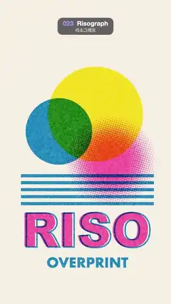

# 023 · Risograph · 리소그래프



**EN** Fluorescent pink, blue and yellow plates overprint a sun, circles, stripes and "RISO" slightly off register, the offsets drifting slowly.  
**KO** 형광 분홍·파랑·노랑 잉크 판 세 장이 해, 원, 줄무늬, "RISO" 글자를 살짝 어긋나게 겹쳐 찍고, 그 어긋남이 천천히 움직인다.

[Video (mp4)](../videos/023-risograph.mp4) · [Code](../effects/023-risograph.js) · Print, retro & glitch · 인쇄·레트로·글리치

## Prompt (English)

```text
Create a "Risograph" motion effect: a poster printed with three fluorescent ink plates (pink, blue, yellow) that overprint each other slightly out of register, the misregistration drifting slowly.

Look
- Paper #F6F1E6 with a fixed per-pixel grain of ±1.75 %. The inks multiply onto it like real overprinting: pink #FF47A8, blue #0080CC, yellow #FFE600. Blue over yellow gives green, pink over yellow orange-red, pink over blue a dark navy.
- Plate art (px, top-left origin, a = 2π t/5):
  - Yellow plate: one big sun, a disc of radius 300 at (540 + 70 cos a, 730 + 40 sin a).
  - Pink plate: a soft glow centred at (700 − 90 sin a, 950 + 60 cos a), solid out to 35 % of its 300 px radius and then fading to nothing (that fade prints as halftone dots); and the word "RISO" in a heavy sans (Arial Black, 300 px), centred at x 540 on baseline 1550.
  - Blue plate: a disc of radius 210 at (360 + 80 sin a, 890 − 70 cos a); horizontal stripes 20 px tall every 44 px, clipped to the box x 120–960, y 1090–1310; the word "OVERPRINT" in a bold geometric sans (Futura bold, 84 px) centred on baseline 1680; and a 9 px outline stroke of the same "RISO", so the pink letters and their blue outline visibly misregister.
- Each plate is screened: a tone between 0 and 1 becomes halftone dots on an 11 px grid. Dot field d = 0.5 + 0.25 (cos qx + cos qy) with q = the rotated pixel position × 2π/11; ink where tone × 1.08 − 0.04 > d, the edge smoothed over fwidth(d). Screen angles: pink 15°, blue 75°, yellow 0°. Solid areas print solid; only the soft fades break into dots.
- Uneven ink, fixed to the paper: multiply each ink's coverage by 0.78 + 0.22 × value noise (7 px scale), and knock out 2 × 2 px specks (−25 %) where a hash of the cell is above 0.93, like spots the drum missed.

Motion (0–5 s)
- The sun, the glow and the blue disc orbit gently on the paths given above (once per loop).
- Each plate's whole image is offset by its own drifting misregistration, in px: pink (13 sin a, 8 cos 2a), blue (−12 cos a, 12 sin(a + 1)), yellow (8 sin(2a + 2), −9 cos a).
- The blue stripes scroll downward by one 44 px period every 2.5 s (two periods per loop).
- The halftone grids, ink blotches and specks stay fixed to the screen; they never move or change.

Technique
- Draw the three plates as masks into the R, G and B channels of one off-screen 1080 × 1920 Canvas 2D (black background, additive "lighter" compositing: pink = red channel, blue = green channel, yellow = blue channel). Upload it as a texture; in a WebGL2 full-screen fragment shader sample each channel at its own offset, screen it at its angle, and multiply the three inks onto the paper.

Output and rules
- One self-contained HTML file with no external assets (three.js from a CDN is fine if you use it), drawing on a 1080 × 1920 canvas (9:16) scaled to fit the window.
- Write a function renderFrame(t) that draws the frame for time t in seconds, and preview it with requestAnimationFrame. Everything must be a pure function of t and fixed seeds: no Math.random(), Date or state carried between frames, so frame i = renderFrame(i / 30) can be exported to a 30 fps video.
- Loop seamlessly every 5 seconds: renderFrame(5) must look exactly like renderFrame(0).
- No flicker of any kind: no noise or grain that changes from frame to frame, no strobing or blinking, no z-fighting, no shimmering 1 px lines. Any grain or texture stays fixed to the screen or to the object.
- Keep the top 280 px free of important content (a title label goes there) and fill the whole frame with a designed background.
```

## 프롬프트 (한국어)

```text
"리소그래프" 모션 효과를 만들어 줘: 형광 잉크 판 세 장(분홍, 파랑, 노랑)이 살짝 어긋나게 겹쳐 찍힌 포스터로, 그 어긋남이 천천히 움직이는 효과.

모양
- 종이 #F6F1E6에 픽셀마다 고정된 ±1.75 % 그레인. 잉크는 실제 겹쳐 찍기처럼 곱하기로 얹힌다: 분홍 #FF47A8, 파랑 #0080CC, 노랑 #FFE600. 파랑과 노랑이 겹치면 초록, 분홍과 노랑은 주황빛 빨강, 분홍과 파랑은 어두운 남색이 된다.
- 판 그림(px, 왼쪽 위 기준, a = 2π t/5):
  - 노랑 판: 큰 해 하나, 반지름 300 원, 위치 (540 + 70 cos a, 730 + 40 sin a).
  - 분홍 판: (700 − 90 sin a, 950 + 60 cos a)을 중심으로 한 부드러운 빛, 반지름 300의 35 %까지는 꽉 찼다가 0으로 흐려진다(흐려지는 부분이 망점으로 찍힌다). 그리고 굵은 산세리프(Arial Black, 300 px) "RISO", x 540 가운데 정렬, 기준선 1550.
  - 파랑 판: 반지름 210 원, 위치 (360 + 80 sin a, 890 − 70 cos a). x 120–960, y 1090–1310 상자 안에 잘린 높이 20 px 가로 줄무늬(44 px 간격). 굵은 기하학 산세리프(Futura bold, 84 px) "OVERPRINT", 기준선 1680 가운데 정렬. 그리고 같은 "RISO"의 9 px 외곽선. 그래서 분홍 글자와 파란 외곽선이 어긋난 게 눈에 띈다.
- 판마다 망점으로 찍는다: 0–1 톤을 11 px 격자의 망점으로 바꾼다. 점 필드 d = 0.5 + 0.25 (cos qx + cos qy), q = 회전한 픽셀 위치 × 2π/11. 톤 × 1.08 − 0.04 > d인 곳에 잉크, 경계는 fwidth(d)만큼 부드럽게. 망점 각도: 분홍 15°, 파랑 75°, 노랑 0°. 꽉 찬 면은 꽉 차게, 부드럽게 흐려지는 곳만 점으로 갈라진다.
- 종이에 고정된 고르지 않은 잉크: 잉크마다 덮임을 0.78 + 0.22 × 밸류 노이즈(7 px 크기)로 곱하고, 칸 해시가 0.93을 넘는 2 × 2 px 자리는 잉크를 25 % 빼서 드럼이 덜 묻힌 얼룩처럼 만든다.

움직임 (0–5초)
- 해, 분홍 빛, 파란 원은 위에 적은 경로를 따라 루프마다 한 바퀴 천천히 돈다.
- 판마다 그림 전체가 자기만의 어긋남(px)만큼 밀리고, 그 값이 천천히 움직인다: 분홍 (13 sin a, 8 cos 2a), 파랑 (−12 cos a, 12 sin(a + 1)), 노랑 (8 sin(2a + 2), −9 cos a).
- 파란 줄무늬는 2.5초마다 한 주기(44 px)씩 아래로 흐른다(루프마다 두 주기).
- 망점 격자, 잉크 얼룩, 빈 점은 화면에 고정되어 절대 움직이거나 바뀌지 않는다.

기법
- 판 세 장을 화면 밖 1080 × 1920 Canvas 2D 하나의 R, G, B 채널에 마스크로 그린다(검은 배경, 더하기 "lighter" 합성: 분홍 = 빨강 채널, 파랑 = 초록 채널, 노랑 = 파랑 채널). 이를 텍스처로 올리고, WebGL2 전체 화면 프래그먼트 셰이더에서 채널마다 자기 어긋남 위치에서 읽어 자기 각도로 망점 처리한 뒤 세 잉크를 종이 위에 곱한다.

출력과 규칙
- 외부 파일 없는 HTML 파일 하나(three.js를 쓴다면 CDN은 괜찮다). 1080 × 1920(9:16) 캔버스에 그리고 창 크기에 맞춰 보이게 한다.
- 시간 t(초)의 프레임을 그리는 renderFrame(t) 함수를 만들고, 미리보기는 requestAnimationFrame으로 돌린다. 모든 것은 t와 고정 시드만으로 정해진다: Math.random(), Date, 프레임 사이에 쌓이는 상태 금지. 그래야 i번째 프레임 = renderFrame(i / 30)으로 30fps 영상을 뽑을 수 있다.
- 5초마다 끊김 없이 반복: renderFrame(5)는 renderFrame(0)과 똑같아 보여야 한다.
- 어떤 깜빡임도 금지: 프레임마다 바뀌는 노이즈·그레인, 번쩍임·깜빡임, z-fighting, 반짝이며 떨리는 1px 선 모두 금지. 그레인·질감은 화면이나 물체에 고정한다.
- 위쪽 280px에는 중요한 내용을 두지 않고(제목 라벨 자리), 화면 전체를 디자인된 배경으로 채운다.
```
