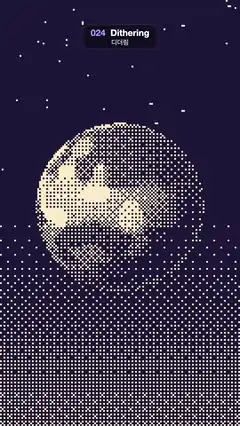

# 024 · Dithering · 디더링



**EN** A banded, lit planet spins under fixed stars, drawn in only two colours with an 8 × 8 Bayer dither on chunky 8 px pixels.  
**KO** 띠무늬 행성이 고정된 별 아래에서 돌고, 8 × 8 베이어 디더로 8px 큰 픽셀 두 가지 색만으로 그려진다.

[Video (mp4)](https://sueun-dev.github.io/motion-effects/videos/024-dithering.mp4) · [Code](../effects/024-dithering.js) · Print, retro & glitch · 인쇄·레트로·글리치

## Prompt (English)

```text
Create a "Dithering" motion effect: a spinning, lit planet rendered in pure 1-bit colour with ordered (Bayer) dithering on chunky 8 px pixels.

Look
- Only two colours: dark ink #1C1738 and warm light #FAEBC7. The frame is a grid of 8 × 8 px "pixels" (135 × 240 cells). Each cell computes one grey level at its centre and is lit when grey > the classic 8 × 8 Bayer threshold for that cell, (index + 0.5) / 64 with the matrix indexed by cell x and y mod 8. Mid-greys become the familiar cross-hatch patterns.
- Scene coordinates: x from −1 to 1 across the width, y pointing up, 1 unit = 540 px, origin at the frame centre.
- Planet: centre (0, 0.05), i.e. screen (540, 933) from the top-left, radius 0.7 (378 px). Treat it as a sphere with normal n = ((p − c) / R, sqrt(1 − |(p − c) / R|²)).
  - Surface pattern, read on the rotated normal q with 3D simplex noise: bands = smoothstep(−0.35, 0.35, sin(6 q.y + snoise(1.5 q))), spots = smoothstep(0.3, 0.42, snoise(1.7 q + 4)); albedo = 0.3 + 0.45 · bands + 0.4 · spots (wavy stripes plus bright continents).
  - Lighting: grey = albedo · (0.03 + 1.1 · max(n · L, 0)) with L = normalize(−0.5, 0.45, 0.75), light from the upper left and front; plus a rim light 0.5 · (1 − n.z)⁴ around the edge. The shadowed side breaks into sparse dots.
- Sky: grey = 0.3 · smoothstep(0.1, −1.9, y): black from just above the planet's centre upward, and a soft dithered glow that thickens toward the bottom (about 29 % grey at the bottom edge), so the lower half is a graded field of dots.
- Stars: in the upper sky (y > 0.3) a cell is fully lit where a hash of the cell is above 0.997 — single fixed 8 px stars.

Motion (0–5 s)
- The surface turns once per loop about a tilted axis: before reading the pattern, rotate the normal by 0.3 rad about the x axis, then by 2π t/5 about the y axis. The light stays fixed, so the day/night edge stays put and only the stripes and continents travel across the sphere.
- Nothing else moves: stars, sky dither and the Bayer grid are fixed to the screen, so the only change is cells flipping as the pattern passes through them — no shimmer.

Technique
- A WebGL2 full-screen fragment shader. Quantise gl_FragCoord to 8 px cells first, evaluate the scene once at each cell centre, and compute the Bayer threshold by integer bit interleaving of the cell coordinates (or an 8 × 8 lookup table).

Output and rules
- One self-contained HTML file with no external assets (three.js from a CDN is fine if you use it), drawing on a 1080 × 1920 canvas (9:16) scaled to fit the window.
- Write a function renderFrame(t) that draws the frame for time t in seconds, and preview it with requestAnimationFrame. Everything must be a pure function of t and fixed seeds: no Math.random(), Date or state carried between frames, so frame i = renderFrame(i / 30) can be exported to a 30 fps video.
- Loop seamlessly every 5 seconds: renderFrame(5) must look exactly like renderFrame(0).
- No flicker of any kind: no noise or grain that changes from frame to frame, no strobing or blinking, no z-fighting, no shimmering 1 px lines. Any grain or texture stays fixed to the screen or to the object.
- Keep the top 280 px free of important content (a title label goes there) and fill the whole frame with a designed background.
```

## 프롬프트 (한국어)

```text
"디더링" 모션 효과를 만들어 줘: 빛을 받으며 도는 행성을 8 px 큰 픽셀 위의 오더드(베이어) 디더링으로, 순수한 1비트 두 색만으로 그리는 효과.

모양
- 색은 두 가지뿐: 어두운 잉크 #1C1738, 따뜻한 밝은 색 #FAEBC7. 화면은 8 × 8 px "픽셀" 격자(135 × 240칸)다. 칸마다 중심에서 회색 값 하나를 계산하고, 그 값이 그 칸의 고전적인 8 × 8 베이어 문턱값 (인덱스 + 0.5) / 64(행렬은 칸 x, y를 8로 나눈 나머지로 찾는다)보다 크면 밝힌다. 중간 회색은 익숙한 격자무늬 패턴이 된다.
- 장면 좌표: 화면 너비에 걸쳐 x는 −1 ~ 1, y는 위쪽이 +, 1 단위 = 540 px, 원점은 화면 가운데.
- 행성: 중심 (0, 0.05), 즉 왼쪽 위 기준 화면 (540, 933), 반지름 0.7(378 px). 구로 보고 법선 n = ((p − c) / R, sqrt(1 − |(p − c) / R|²)).
  - 표면 무늬는 회전한 법선 q 위에서 3D 심플렉스 노이즈로 읽는다: 띠 = smoothstep(−0.35, 0.35, sin(6 q.y + snoise(1.5 q))), 점박이 = smoothstep(0.3, 0.42, snoise(1.7 q + 4)). 알베도 = 0.3 + 0.45 · 띠 + 0.4 · 점박이(물결치는 줄무늬와 밝은 대륙).
  - 조명: 회색 = 알베도 · (0.03 + 1.1 · max(n · L, 0)), L = normalize(−0.5, 0.45, 0.75)(왼쪽 위 앞쪽에서 오는 빛). 가장자리에 림 라이트 0.5 · (1 − n.z)⁴를 더한다. 그늘진 쪽은 성긴 점으로 흩어진다.
- 하늘: 회색 = 0.3 · smoothstep(0.1, −1.9, y). 행성 중심 바로 위부터 위쪽은 검고, 아래로 갈수록 디더 빛이 짙어져(맨 아래에서 약 29 % 회색) 아래쪽 절반이 점이 점점 촘촘해지는 면이 된다.
- 별: 위쪽 하늘(y > 0.3)에서 칸 해시가 0.997을 넘는 칸을 완전히 밝힌다. 하나짜리 고정된 8 px 별.

움직임 (0–5초)
- 표면은 기울어진 축을 중심으로 루프마다 한 바퀴 돈다: 무늬를 읽기 전에 법선을 x축으로 0.3 rad, 그다음 y축으로 2π t/5 돌린다. 빛은 고정이라 낮과 밤의 경계는 그대로이고, 줄무늬와 대륙만 구 위를 지나간다.
- 그 밖에는 아무것도 움직이지 않는다: 별, 하늘 디더, 베이어 격자는 화면에 고정이다. 바뀌는 것은 무늬가 지나가며 뒤집히는 칸뿐이라 반짝임이 없다.

기법
- WebGL2 전체 화면 프래그먼트 셰이더. 먼저 gl_FragCoord를 8 px 칸으로 양자화하고, 칸 중심에서 장면을 한 번 계산한다. 베이어 문턱값은 칸 좌표의 비트를 정수로 교차 배치해서(또는 8 × 8 표로) 구한다.

출력과 규칙
- 외부 파일 없는 HTML 파일 하나(three.js를 쓴다면 CDN은 괜찮다). 1080 × 1920(9:16) 캔버스에 그리고 창 크기에 맞춰 보이게 한다.
- 시간 t(초)의 프레임을 그리는 renderFrame(t) 함수를 만들고, 미리보기는 requestAnimationFrame으로 돌린다. 모든 것은 t와 고정 시드만으로 정해진다: Math.random(), Date, 프레임 사이에 쌓이는 상태 금지. 그래야 i번째 프레임 = renderFrame(i / 30)으로 30fps 영상을 뽑을 수 있다.
- 5초마다 끊김 없이 반복: renderFrame(5)는 renderFrame(0)과 똑같아 보여야 한다.
- 어떤 깜빡임도 금지: 프레임마다 바뀌는 노이즈·그레인, 번쩍임·깜빡임, z-fighting, 반짝이며 떨리는 1px 선 모두 금지. 그레인·질감은 화면이나 물체에 고정한다.
- 위쪽 280px에는 중요한 내용을 두지 않고(제목 라벨 자리), 화면 전체를 디자인된 배경으로 채운다.
```
