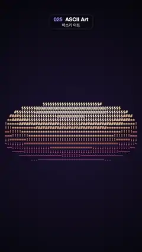

# 025 · ASCII Art · 아스키 아트



**EN** The classic spinning ASCII donut: a torus built from ".,-~:;=!*#$@" in bold monospace, its light shading violet to cream.  
**KO** 고전 아스키 도넛: 굵은 고정폭 문자 ".,-~:;=!*#$@"로 만든 토러스가 돌고, 빛에 따라 보라에서 크림색으로 물든다.

[Video (mp4)](../videos/025-ascii-art.mp4) · [Code](../effects/025-ascii-art.js) · Print, retro & glitch · 인쇄·레트로·글리치

## Prompt (English)

```text
Create an "ASCII Art" motion effect: the classic spinning donut (as in donut.c), drawn only with text characters that go from sparse to dense with the lighting.

Look
- Background: radial gradient centred at (540, 1010), #1A1530 at radius 100 → #07060D at radius 1100.
- A text grid of 60 columns × 64 rows with 18 × 30 px cells, covering the whole 1080 × 1920 frame. Characters in bold Menlo (any bold monospace) at 30 px, drawn from each cell's top-left corner (textBaseline "top").
- Torus: tube radius R1 = 1, ring radius R2 = 2, viewer distance K2 = 8, projection scale K1 = 1240 px, projected centre (540, 1010). Sample the surface densely: tube angle θ in steps of 0.03 rad, ring angle φ in steps of 0.01 rad.
- For every sample, rotate by angle A about the x axis and angle B about the z axis (the standard donut.c formulas), project with ooz = 1 / (K2 + z): column = floor((540 + K1 · ooz · x) / 18), row = floor((1010 − K1 · ooz · y) / 30). Keep only the nearest sample per cell with a depth buffer of ooz.
- Luminance of the kept sample (the donut.c light, range ±√2): L = cosφ cosθ sinB − cosA cosθ sinφ − sinA sinθ + cosB (cosA sinθ − cosθ sinA sinφ). Map k = clamp(L / 2.83 + 0.5, 0, 1)^1.7.
- Character = ".,-~:;=!*#$@"[round(11 k)]. Colour from a 4-stop ramp along k: #462EA0 → #E8577A → #FFB36B → #FFF4D6, so the unlit side is sparse violet-pink dots and dashes and the lit side dense cream "$" and "@". Empty cells show only the background.

Motion (0–5 s)
- A = 2π t/5 (one turn per loop) and B = 2 · 2π t/5 (two turns per loop), so the loop is seamless. At t = 0 the donut is seen edge-on as a flat band, then it tumbles open into a ring, tilts and closes again.
- Characters change only because the surface turns through the cells; there are no random or blinking characters.

Technique
- Canvas 2D. Each frame, fill a 60 × 64 depth buffer and luminance buffer with the double loop over θ and φ, then fillText one coloured character per covered cell.

Output and rules
- One self-contained HTML file with no external assets (three.js from a CDN is fine if you use it), drawing on a 1080 × 1920 canvas (9:16) scaled to fit the window.
- Write a function renderFrame(t) that draws the frame for time t in seconds, and preview it with requestAnimationFrame. Everything must be a pure function of t and fixed seeds: no Math.random(), Date or state carried between frames, so frame i = renderFrame(i / 30) can be exported to a 30 fps video.
- Loop seamlessly every 5 seconds: renderFrame(5) must look exactly like renderFrame(0).
- No flicker of any kind: no noise or grain that changes from frame to frame, no strobing or blinking, no z-fighting, no shimmering 1 px lines. Any grain or texture stays fixed to the screen or to the object.
- Keep the top 280 px free of important content (a title label goes there) and fill the whole frame with a designed background.
```

## 프롬프트 (한국어)

```text
"아스키 아트" 모션 효과를 만들어 줘: 고전 donut.c처럼 도는 도넛을 텍스트 문자만으로 그리고, 빛에 따라 문자가 성긴 것에서 빽빽한 것으로 바뀌는 효과.

모양
- 배경: (540, 1010) 중심의 방사형 그라디언트, 반지름 100에서 #1A1530 → 반지름 1100에서 #07060D.
- 18 × 30 px 칸으로 된 60열 × 64행 텍스트 격자가 1080 × 1920 화면 전체를 덮는다. 문자는 굵은 Menlo(아무 굵은 고정폭 글꼴) 30 px, 각 칸의 왼쪽 위에서부터 그린다(textBaseline "top").
- 토러스: 관 반지름 R1 = 1, 고리 반지름 R2 = 2, 보는 거리 K2 = 8, 투영 배율 K1 = 1240 px, 투영 중심 (540, 1010). 표면을 촘촘히 샘플링한다: 관 각도 θ는 0.03 rad 간격, 고리 각도 φ는 0.01 rad 간격.
- 샘플마다 x축으로 각도 A, z축으로 각도 B만큼 돌리고(표준 donut.c 공식), ooz = 1 / (K2 + z)로 투영한다: 열 = floor((540 + K1 · ooz · x) / 18), 행 = floor((1010 − K1 · ooz · y) / 30). ooz 깊이 버퍼로 칸마다 가장 가까운 샘플만 남긴다.
- 남은 샘플의 밝기(donut.c 조명, 범위 ±√2): L = cosφ cosθ sinB − cosA cosθ sinφ − sinA sinθ + cosB (cosA sinθ − cosθ sinA sinφ). k = clamp(L / 2.83 + 0.5, 0, 1)^1.7.
- 문자 = ".,-~:;=!*#$@"[round(11 k)]. 색은 k를 따라 4단계 램프 #462EA0 → #E8577A → #FFB36B → #FFF4D6. 그래서 빛 안 받는 쪽은 성긴 보라·분홍 점과 줄표, 빛 받는 쪽은 빽빽한 크림색 "$"와 "@"가 된다. 빈 칸은 배경만 보인다.

움직임 (0–5초)
- A = 2π t/5(루프마다 한 바퀴), B = 2 · 2π t/5(루프마다 두 바퀴)라서 끊김 없이 반복된다. t = 0에서는 도넛이 옆에서 본 납작한 띠로 보이고, 굴러가며 고리 모양으로 열렸다가 기울고 다시 닫힌다.
- 문자는 표면이 칸을 지나 돌기 때문에만 바뀐다. 무작위로 바뀌거나 깜빡이는 문자는 없다.

기법
- Canvas 2D. 매 프레임 θ와 φ 이중 반복으로 60 × 64 깊이 버퍼와 밝기 버퍼를 채우고, 덮인 칸마다 색을 입힌 문자 하나를 fillText로 그린다.

출력과 규칙
- 외부 파일 없는 HTML 파일 하나(three.js를 쓴다면 CDN은 괜찮다). 1080 × 1920(9:16) 캔버스에 그리고 창 크기에 맞춰 보이게 한다.
- 시간 t(초)의 프레임을 그리는 renderFrame(t) 함수를 만들고, 미리보기는 requestAnimationFrame으로 돌린다. 모든 것은 t와 고정 시드만으로 정해진다: Math.random(), Date, 프레임 사이에 쌓이는 상태 금지. 그래야 i번째 프레임 = renderFrame(i / 30)으로 30fps 영상을 뽑을 수 있다.
- 5초마다 끊김 없이 반복: renderFrame(5)는 renderFrame(0)과 똑같아 보여야 한다.
- 어떤 깜빡임도 금지: 프레임마다 바뀌는 노이즈·그레인, 번쩍임·깜빡임, z-fighting, 반짝이며 떨리는 1px 선 모두 금지. 그레인·질감은 화면이나 물체에 고정한다.
- 위쪽 280px에는 중요한 내용을 두지 않고(제목 라벨 자리), 화면 전체를 디자인된 배경으로 채운다.
```
