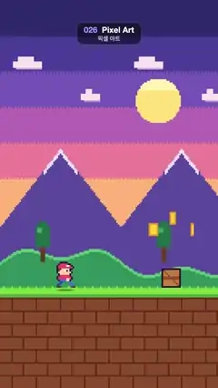

# 026 · Pixel Art · 픽셀 아트



**EN** An 8-bit runner in a red cap dashes through a parallax sunset world, hopping over crates and collecting spinning coins.  
**KO** 빨간 모자를 쓴 8비트 캐릭터가 시차 스크롤되는 노을 세계를 달리며 나무 상자를 뛰어넘고 도는 동전을 모은다.

[Video (mp4)](../videos/026-pixel-art.mp4) · [Code](../effects/026-pixel-art.js) · Print, retro & glitch · 인쇄·레트로·글리치

## Prompt (English)

```text
Create a "Pixel Art" motion effect: a tiny 8-bit side-scroller in which a hero runs through a parallax sunset landscape, jumping crates and collecting coins.

Look
- Draw everything on a 135 × 240 low-res canvas in whole pixels only (round every position), then scale it up 8× to 1080 × 1920 with image smoothing off. Sizes below are low-res pixels, top-left origin; the ground line is at y 178.
- Sky: six horizontal bands 22 px tall, #2E2A6B, #4B3F99, #7656B8, #B566B5, #EE7E9A, #FFB37A (the last runs down to the ground). Along each band boundary every other pixel takes the colour of the band above (a checkered dither row).
- Sun: a pixel circle of radius 14 at (98, 62), its top 8 rows #FFF3B0, the rest #FFE17A.
- Two clouds (y 38, 18 px wide; y 58, 12 px wide): a 4 px tall slab with a narrower 3 px bump on top in #FBE3F0 and a 1 px #D9A8D0 underside.
- Mountains: a triangle-wave silhouette with a 75 px period, peaks 86 px above the ground, slopes falling 1.3 px per column, colour #5B4A9E, with a 3 px thick #E9E1FF snow line along the slope wherever it is within 14 px of the peak.
- Hills: height 16 + 7 sin(2π x/150) + 4 sin(6π x/150) px, #2F8F5B with a 2 px #58C276 top edge. Two pixel trees per 150 px: trunk 3 × 10 #6B3A22, canopy 9 × 13 plus a 5 × 3 top in #1F6E45, a 3 × 3 #3FA463 highlight.
- Ground: #8A4B2C below y 178; a 4 px bright grass strip #7BD63F over 2 px #4FA83A, 1 px grass tufts every 5 px just above it; brick mortar #5E2F1C as a 1 px line every 8 px with vertical joints every 15 px, offset by 7 px on alternate rows.
- Crates (12 × 12): #22163A outline, #C97B3D fill, a 2 px horizontal plank and a diagonal brace in #8E4F24. Two crates per 300 px of ground, 150 px apart. Above each crate float three coins (8 px tall, rim #E89A1E, face #FFD23F) in a small arch at dx −12 / 0 / +12, about 47 px above the ground, the outer two 7 px lower.
- Hero (12 px wide, 16 px tall, left edge at x 34): #22163A outline, red cap and shirt #EF476F with a white cap highlight, brown #6B3A22 hair, skin #FFD0A6 face with a one-pixel eye, a blue #3D6BE6 belt, 2 px wide legs (#2A45A8 back, #3D6BE6 front) with brown shoes, and one skin-coloured fist. A 1 px dark green #3B7F33 shadow lies on the grass under him.

Motion (0–5 s)
- Use the frame number f = round(30 t). Parallax at whole-pixel speeds: ground, bricks, tufts and crates move 2 px per frame (300 px per loop); hills and trees 1 px per frame (150 px period); mountains and clouds 1 px every 2nd frame (75 px period). Every layer repeats a whole number of times in 150 frames, so the loop is seamless.
- Run cycle: 4 poses at 12 poses per second (pose = floor(0.4 f) mod 4): legs spread, passing, legs spread the other way, passing with one foot lifted 2 px; the fist swings against the front leg.
- Jumps: when a crate's centre comes within ±24 px of the hero's, he rises on a parabola, height 38 · (1 − u²) px with u going +1 → −1 as the crate passes underneath; in the air both feet tuck up 2 px and the fist goes up. His shadow narrows while he is up.
- Coins spin by cycling their width 6 → 4 → 2 → 4 px with the run poses (each coin out of step with its neighbours) and disappear as they reach the hero (collected).

Technique
- Canvas 2D: draw into the 135 × 240 off-screen canvas with fillRect only, then drawImage it scaled 8× with imageSmoothingEnabled = false. No sub-pixel positions anywhere, so nothing shimmers.

Output and rules
- One self-contained HTML file with no external assets (three.js from a CDN is fine if you use it), drawing on a 1080 × 1920 canvas (9:16) scaled to fit the window.
- Write a function renderFrame(t) that draws the frame for time t in seconds, and preview it with requestAnimationFrame. Everything must be a pure function of t and fixed seeds: no Math.random(), Date or state carried between frames, so frame i = renderFrame(i / 30) can be exported to a 30 fps video.
- Loop seamlessly every 5 seconds: renderFrame(5) must look exactly like renderFrame(0).
- No flicker of any kind: no noise or grain that changes from frame to frame, no strobing or blinking, no z-fighting, no shimmering 1 px lines. Any grain or texture stays fixed to the screen or to the object.
- Keep the top 280 px free of important content (a title label goes there) and fill the whole frame with a designed background.
```

## 프롬프트 (한국어)

```text
"픽셀 아트" 모션 효과를 만들어 줘: 작은 8비트 횡스크롤 게임 장면으로, 주인공이 시차 스크롤되는 노을 풍경을 달리며 상자를 뛰어넘고 동전을 모으는 효과.

모양
- 모든 것을 135 × 240 저해상도 캔버스에 정수 픽셀로만 그리고(모든 위치를 반올림), 이미지 스무딩을 끈 채 8배로 키워 1080 × 1920에 그린다. 아래 크기는 저해상도 픽셀, 왼쪽 위 기준이고, 땅 선은 y 178이다.
- 하늘: 높이 22 px 가로 띠 여섯 개, #2E2A6B, #4B3F99, #7656B8, #B566B5, #EE7E9A, #FFB37A(마지막 띠는 땅까지 내려간다). 띠 경계마다 한 픽셀 걸러 위 띠 색을 넣어 체크무늬 디더 줄을 만든다.
- 해: (98, 62)에 반지름 14 픽셀 원, 위쪽 8줄은 #FFF3B0, 나머지는 #FFE17A.
- 구름 두 개(y 38, 너비 18 px; y 58, 너비 12 px): 높이 4 px 판 위에 더 좁은 3 px 혹을 #FBE3F0으로, 아래에 1 px #D9A8D0 그늘.
- 산: 주기 75 px의 삼각파 실루엣, 꼭대기는 땅에서 86 px 위, 비탈은 한 열에 1.3 px씩 내려간다. 색 #5B4A9E, 꼭대기에서 14 px 안쪽 비탈에는 3 px 두께의 눈 #E9E1FF.
- 언덕: 높이 16 + 7 sin(2π x/150) + 4 sin(6π x/150) px, #2F8F5B에 위쪽 2 px #58C276. 150 px마다 픽셀 나무 두 그루: 줄기 3 × 10 #6B3A22, 잎 9 × 13과 위쪽 5 × 3 #1F6E45, 3 × 3 #3FA463 하이라이트.
- 땅: y 178 아래 #8A4B2C. 4 px 밝은 잔디 #7BD63F 아래 2 px #4FA83A, 바로 위에 5 px마다 1 px 풀잎. 벽돌 줄눈 #5E2F1C: 8 px마다 1 px 가로줄, 15 px마다 세로 이음매, 줄마다 7 px씩 엇갈린다.
- 상자(12 × 12): #22163A 테두리, #C97B3D 바탕, #8E4F24 2 px 가로 판자와 대각선 버팀목. 땅 300 px마다 두 개, 150 px 간격. 상자마다 위에 동전 세 개(높이 8 px, 테두리 #E89A1E, 면 #FFD23F)가 dx −12 / 0 / +12에 작은 아치 모양으로 떠 있다. 땅에서 약 47 px 위, 바깥 두 개는 7 px 낮다.
- 주인공(너비 12 px, 높이 16 px, 왼쪽 끝 x 34): #22163A 테두리, 빨간 #EF476F 모자와 셔츠(모자에 흰 하이라이트), 갈색 #6B3A22 머리, 살색 #FFD0A6 얼굴에 한 픽셀 눈, 파란 #3D6BE6 벨트, 너비 2 px 다리(뒷다리 #2A45A8, 앞다리 #3D6BE6)와 갈색 신발, 살색 주먹 하나. 발밑 잔디에 1 px 짙은 초록 #3B7F33 그림자.

움직임 (0–5초)
- 프레임 번호 f = round(30 t)를 쓴다. 정수 픽셀 속도의 시차 스크롤: 땅·벽돌·풀잎·상자는 프레임당 2 px(루프당 300 px), 언덕과 나무는 프레임당 1 px(주기 150 px), 산과 구름은 2프레임마다 1 px(주기 75 px). 모든 층이 150프레임 안에 정확히 정수 번 반복되므로 끊김 없이 이어진다.
- 달리기: 초당 12포즈로 4포즈 반복(포즈 = floor(0.4 f) mod 4): 다리 벌림, 교차, 반대로 벌림, 한 발을 2 px 든 교차. 주먹은 앞다리와 반대로 흔든다.
- 점프: 상자 중심이 주인공 중심의 ±24 px 안에 들어오면 포물선으로 뛰어오른다. 높이 38 · (1 − u²) px, u는 상자가 밑을 지나며 +1 → −1. 공중에서는 두 발을 2 px 접고 주먹을 위로 올린다. 떠 있는 동안 그림자가 좁아진다.
- 동전은 달리기 포즈에 맞춰 너비가 6 → 4 → 2 → 4 px로 바뀌며 돌고(이웃과 박자가 어긋남), 주인공에게 닿으면 사라진다(먹음).

기법
- Canvas 2D: 135 × 240 화면 밖 캔버스에 fillRect만으로 그린 뒤 imageSmoothingEnabled = false로 8배 drawImage. 어디에도 픽셀 이하 위치가 없어서 아무것도 반짝이지 않는다.

출력과 규칙
- 외부 파일 없는 HTML 파일 하나(three.js를 쓴다면 CDN은 괜찮다). 1080 × 1920(9:16) 캔버스에 그리고 창 크기에 맞춰 보이게 한다.
- 시간 t(초)의 프레임을 그리는 renderFrame(t) 함수를 만들고, 미리보기는 requestAnimationFrame으로 돌린다. 모든 것은 t와 고정 시드만으로 정해진다: Math.random(), Date, 프레임 사이에 쌓이는 상태 금지. 그래야 i번째 프레임 = renderFrame(i / 30)으로 30fps 영상을 뽑을 수 있다.
- 5초마다 끊김 없이 반복: renderFrame(5)는 renderFrame(0)과 똑같아 보여야 한다.
- 어떤 깜빡임도 금지: 프레임마다 바뀌는 노이즈·그레인, 번쩍임·깜빡임, z-fighting, 반짝이며 떨리는 1px 선 모두 금지. 그레인·질감은 화면이나 물체에 고정한다.
- 위쪽 280px에는 중요한 내용을 두지 않고(제목 라벨 자리), 화면 전체를 디자인된 배경으로 채운다.
```
