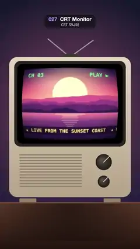

# 027 · CRT Monitor · CRT 모니터



**EN** A retro TV plays a sunset show through a bulging tube with fixed scanlines, RGB phosphor stripes, soft glow and a slow rolling band.  
**KO** 레트로 TV가 볼록한 브라운관으로 노을 방송을 틀고, 고정된 주사선·RGB 형광 줄무늬·은은한 번짐 위로 밝은 띠가 천천히 굴러간다.

[Video (mp4)](../videos/027-crt-monitor.mp4) · [Code](../effects/027-crt-monitor.js) · Print, retro & glitch · 인쇄·레트로·글리치

## Prompt (English)

```text
Create a "CRT Monitor" motion effect: a retro television in a dim room, its curved glass tube showing a sunset broadcast with scanlines, a phosphor mask, glow and one bright band rolling slowly down.

Look
- All positions are in px on the 1080 × 1920 frame, top-left origin.
- Room: wall gradient #15172B (top) → #2A2142 (bottom), with a pink light spill from the screen: radial rgba(255, 130, 160, 0.35) → 0 centred at (540, 800), radius 200 → 900.
- Table from y 1560 down: gradient #5A3828 → #24150F, an 8 px lighter lip #7A4E38 along its top edge, and a soft shadow under the TV (radial rgba(0, 0, 0, 0.45) → 0 at (540, 1575), radius 560).
- TV body: a rounded rectangle x 70–1010, y 440–1520, corner radius 64, gradient #E4D6BE → #B4A288; two feet #8F7F68 (130 × 30 at x 150 and x 800, y 1530); a dark bezel #26221E (corner radius 48) extending 30 px around the tube. Antenna: two round-capped 8 px lines #9A9AA8 from (540, 440) to (370, 300) and to (720, 310), on a dark #3A3530 half-ellipse base (70 × 34).
- Under the screen: a speaker grille of 9 px tall rounded slats #8E7F68, 480 px wide from x 150, every 22 px from y 1190 to 1450; two knobs at x 800 (y 1250, radius 62; y 1400, radius 46), radial gradient #5A524A → #1E1A17, each with a 6 px #D9CBB4 pointer line at 45°.
- Tube picture: 800 × 600 at (140, 500). It shows a flat-colour sunset: sky gradient #2B1B5A → #E8577A → #FFB36B, a pale #FFE6A8 sun with a warm glow, four layered mountain ridges #C2507E / #8E3B78 / #5A2A68 / #2E1A4A, and a pink-to-violet lake with stacked horizontal sun reflections. Over it, in tube coordinates: "CH 03" at (44, 78) and "PLAY ▶" at (560, 78) in bold Menlo 46 px #6CFF8A; a ticker bar rgba(20, 10, 40, 0.8) at y 486–556 with bold Menlo 40 px #FFE17A text " ★ LIVE FROM THE SUNSET COAST  ★ WEATHER: WARM AND GLOWING " on baseline 535.

Motion (0–5 s)
- The sunset inside drifts gently (the sun bobs, the water reflections sway) and the ticker scrolls left by exactly one text width per loop (repeat the text to fill the bar).
- One soft bright band rolls down the tube once per loop: add 0.2 · (0.4 + luma) · exp(−((v − c) / 0.07)²), where v is 0 at the top of the tube and 1 at the bottom, and c = 1.6 · t/5 − 0.3 (it enters above the top and leaves below the bottom, so the loop point is invisible).
- The scanlines, phosphor mask, glass and TV never move: no static, no flicker.

Technique
- Canvas 2D draws the room, the TV and the tube picture flat into an off-screen 1080 × 1920 canvas. A WebGL2 full-screen fragment shader passes it through and applies the tube look only inside a rounded box around the tube centre (540, 800): half size 408 × 308, corner radius 44, edge smoothed over 3 px.
- Barrel warp: q = (p − centre) / (400, 300); d = q · (1 + 0.09 |q|²); sample the picture at centre + d · (400, 300), black wherever |d.x| or |d.y| > 1, so the picture's edges curve away like a bulging tube.
- Glow: add 0.32 × the average of 8 samples on a 9 px ring around the sample point.
- Scanlines fixed to the tube: v = 0.5 d.y + 0.5; scan = mix(0.35 + 0.5 · luma, 1, |cos(120π v)|^1.5) — 120 lines over the tube height, and bright parts bloom across the dark gaps.
- Aperture grille fixed to the screen: by pixel x mod 3, one of R, G, B stays at full strength and the other two are multiplied by 0.8.
- Final colour: picture · scan · mask · 1.2 + glow + band, times a vignette 1 − 0.45 (|d|² / 2)^1.5, plus a faint glass glint (+0.07) in a soft ellipse toward the upper left of the tube.

Output and rules
- One self-contained HTML file with no external assets (three.js from a CDN is fine if you use it), drawing on a 1080 × 1920 canvas (9:16) scaled to fit the window.
- Write a function renderFrame(t) that draws the frame for time t in seconds, and preview it with requestAnimationFrame. Everything must be a pure function of t and fixed seeds: no Math.random(), Date or state carried between frames, so frame i = renderFrame(i / 30) can be exported to a 30 fps video.
- Loop seamlessly every 5 seconds: renderFrame(5) must look exactly like renderFrame(0).
- No flicker of any kind: no noise or grain that changes from frame to frame, no strobing or blinking, no z-fighting, no shimmering 1 px lines. Any grain or texture stays fixed to the screen or to the object.
- Keep the top 280 px free of important content (a title label goes there) and fill the whole frame with a designed background.
```

## 프롬프트 (한국어)

```text
"CRT 모니터" 모션 효과를 만들어 줘: 어두운 방의 레트로 텔레비전, 휘어진 유리 브라운관에 노을 방송이 나오고 주사선, 형광체 마스크, 번짐, 그리고 천천히 아래로 굴러가는 밝은 띠 하나가 있는 효과.

모양
- 모든 위치는 1080 × 1920 화면의 px, 왼쪽 위 기준.
- 방: 벽 그라디언트 #15172B(위) → #2A2142(아래), 화면에서 번지는 분홍 빛: (540, 800) 중심, 반지름 200 → 900의 방사형 rgba(255, 130, 160, 0.35) → 0.
- y 1560부터 아래는 탁자: 그라디언트 #5A3828 → #24150F, 윗모서리에 8 px 밝은 테 #7A4E38, TV 밑의 부드러운 그림자((540, 1575)에서 반지름 560의 방사형 rgba(0, 0, 0, 0.45) → 0).
- TV 몸체: x 70–1010, y 440–1520의 둥근 사각형, 모서리 반지름 64, 그라디언트 #E4D6BE → #B4A288. 다리 두 개 #8F7F68(130 × 30, x 150과 x 800, y 1530). 브라운관 둘레 30 px까지 어두운 베젤 #26221E(모서리 반지름 48). 안테나: (540, 440)에서 (370, 300)과 (720, 310)으로 가는 끝이 둥근 8 px 선 두 개 #9A9AA8, 받침은 어두운 #3A3530 반타원(70 × 34).
- 화면 아래: 높이 9 px 둥근 살 #8E7F68로 된 스피커 그릴, 너비 480 px, x 150부터, y 1190에서 1450까지 22 px 간격. 손잡이 두 개 x 800(y 1250 반지름 62; y 1400 반지름 46), 방사형 그라디언트 #5A524A → #1E1A17, 각각 45° 방향 6 px #D9CBB4 표시선.
- 브라운관 그림: (140, 500)에 800 × 600. 단색 면 노을: 하늘 그라디언트 #2B1B5A → #E8577A → #FFB36B, 따뜻한 빛이 도는 연한 #FFE6A8 해, 겹친 산 능선 네 겹 #C2507E / #8E3B78 / #5A2A68 / #2E1A4A, 분홍에서 보라로 가는 호수와 층층이 쌓인 가로 해 반사. 그 위에 브라운관 좌표로: (44, 78)에 "CH 03", (560, 78)에 "PLAY ▶", 굵은 Menlo 46 px #6CFF8A. y 486–556에 rgba(20, 10, 40, 0.8) 자막 띠, 굵은 Menlo 40 px #FFE17A 글자 " ★ LIVE FROM THE SUNSET COAST  ★ WEATHER: WARM AND GLOWING ", 기준선 535.

움직임 (0–5초)
- 안의 노을은 천천히 움직이고(해가 오르내리고 물 위 반사가 일렁인다), 자막은 루프마다 정확히 글자 폭 하나만큼 왼쪽으로 흐른다(띠를 채우도록 글자를 반복).
- 부드러운 밝은 띠 하나가 루프마다 한 번 브라운관을 따라 내려간다: 0.2 · (0.4 + 휘도) · exp(−((v − c) / 0.07)²)를 더한다. v는 브라운관 위쪽 0, 아래쪽 1이고, c = 1.6 · t/5 − 0.3(위쪽 바깥에서 들어와 아래쪽 바깥으로 나가므로 루프 이음매가 보이지 않는다).
- 주사선, 형광체 마스크, 유리, TV는 절대 움직이지 않는다. 지지직도 깜빡임도 없다.

기법
- 방, TV, 브라운관 그림을 Canvas 2D로 화면 밖 1080 × 1920 캔버스에 평평하게 그린다. WebGL2 전체 화면 프래그먼트 셰이더가 그대로 통과시키고, 브라운관 중심 (540, 800) 둘레의 둥근 상자(반 크기 408 × 308, 모서리 반지름 44, 가장자리 3 px 부드럽게) 안에서만 브라운관 효과를 입힌다.
- 배럴 왜곡: q = (p − 중심) / (400, 300); d = q · (1 + 0.09 |q|²); 그림을 중심 + d · (400, 300)에서 읽고, |d.x|나 |d.y|가 1을 넘으면 검게. 그래서 그림 가장자리가 볼록한 브라운관처럼 휘어 들어간다.
- 번짐: 샘플 지점 둘레 9 px 원 위 8개 샘플의 평균 × 0.32를 더한다.
- 브라운관에 고정된 주사선: v = 0.5 d.y + 0.5; scan = mix(0.35 + 0.5 · 휘도, 1, |cos(120π v)|^1.5). 브라운관 높이에 120줄이고, 밝은 부분은 어두운 틈까지 번진다.
- 화면에 고정된 애퍼처 그릴: 픽셀 x를 3으로 나눈 나머지에 따라 R, G, B 중 하나는 그대로, 나머지 둘은 0.8배.
- 최종 색: 그림 · scan · 마스크 · 1.2 + 번짐 + 띠, 여기에 비네트 1 − 0.45 (|d|² / 2)^1.5를 곱하고, 브라운관 왼쪽 위에 부드러운 타원 모양의 희미한 유리 반사(+0.07).

출력과 규칙
- 외부 파일 없는 HTML 파일 하나(three.js를 쓴다면 CDN은 괜찮다). 1080 × 1920(9:16) 캔버스에 그리고 창 크기에 맞춰 보이게 한다.
- 시간 t(초)의 프레임을 그리는 renderFrame(t) 함수를 만들고, 미리보기는 requestAnimationFrame으로 돌린다. 모든 것은 t와 고정 시드만으로 정해진다: Math.random(), Date, 프레임 사이에 쌓이는 상태 금지. 그래야 i번째 프레임 = renderFrame(i / 30)으로 30fps 영상을 뽑을 수 있다.
- 5초마다 끊김 없이 반복: renderFrame(5)는 renderFrame(0)과 똑같아 보여야 한다.
- 어떤 깜빡임도 금지: 프레임마다 바뀌는 노이즈·그레인, 번쩍임·깜빡임, z-fighting, 반짝이며 떨리는 1px 선 모두 금지. 그레인·질감은 화면이나 물체에 고정한다.
- 위쪽 280px에는 중요한 내용을 두지 않고(제목 라벨 자리), 화면 전체를 디자인된 배경으로 채운다.
```
