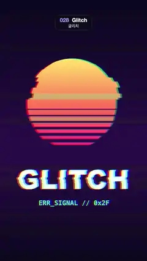

# 028 · Glitch · 글리치



★ One of the 20 effects in the original reel (#20) · 원래 릴스 20개 중 하나(20번)

**EN** A retro striped-sun "GLITCH" poster tears into sliding horizontal bands with RGB split, swelling in two smooth bursts per loop.  
**KO** 줄무늬 해와 "GLITCH" 글자가 있는 레트로 포스터가 가로 띠로 밀리고 RGB 채널이 갈라지며, 루프마다 두 번 부드럽게 심해졌다 잦아든다.

[Video (mp4)](https://sueun-dev.github.io/motion-effects/videos/028-glitch.mp4) · [Code](../effects/028-glitch.js) · Print, retro & glitch · 인쇄·레트로·글리치

## Prompt (English)

```text
Create a "Glitch" motion effect: a still retro poster that tears into sideways-sliding horizontal bands with RGB channel separation, driven entirely by smooth sine motion and fixed per-band hashes, never by per-frame randomness.

Look
- All positions are in px on the 1080 × 1920 frame, top-left origin.
- Poster background: vertical gradient #0B0820 → #2A0F4A (60 %) → #0B0820.
- Sun: a disc of radius 330 at (540, 760) with a vertical gradient over y 430–1090: #FFE66B → #FF7A59 → #FF2E88. Seven horizontal cuts across its lower half in #2A0F4A: at y = 800 + 44 k, height 6 + 4 k px (k = 0…6), thicker toward the bottom.
- "GLITCH" in white #FFFFFF, Arial Black 196 px, centred at x 540 on baseline 1390.
- "ERR_SIGNAL // 0x2F" in cyan #5CF2FF, bold Menlo 48 px, centred on baseline 1510.
- The glitch: horizontal slices of the poster are shifted sideways, colour edges fringe into red / cyan / blue ghosts, and a few thin slices swap channels (green slabs across the sun, grey-green slabs across the dark sky) while a burst peaks.

Motion (0–5 s)
- With a = 2π t/5, glitch strength g = 0.15 + 0.85 · (0.5 + 0.5 sin 2a)³: two bursts per loop peaking at 1.25 s and 3.75 s, calm but never perfectly clean in between.
- Band edges drift slowly: use y' = y + 40 sin a for the band index.
- Wide bands, 150 px tall: each shifts sideways by 70 · (2h₁ − 1) · sin(a + 2π h₂) px, where h₁, h₂ are fixed hashes of the band index.
- Thin bands, 44 px tall: 38 % of them (hash > 0.62) add a further 110 · (2h₃ − 1) · sin(2a + 2π h₄) px.
- Multiply the total shift by g.
- RGB split: sample red at +s, green at 0 and blue at −s, with s = (5 + 26 g, 0.25 · (5 + 26 g)) px, so the fringes widen with each burst and lean slightly vertical.
- Channel swap: half of the jumping thin bands (another fixed hash) replace their colour by (b, r, g) × (0.6, 1.2, 1.3), mixed in by 0.8 g.
- Everything glides: which band does what is fixed by its index, and every offset is a sine of t, so there is no static, no strobing and no frame-to-frame jitter.

Technique
- Canvas 2D draws the poster into an off-screen 1080 × 1920 texture (clamp-to-edge); a WebGL2 full-screen fragment shader computes each pixel's band offsets and samples the three colour channels separately.

Output and rules
- One self-contained HTML file with no external assets (three.js from a CDN is fine if you use it), drawing on a 1080 × 1920 canvas (9:16) scaled to fit the window.
- Write a function renderFrame(t) that draws the frame for time t in seconds, and preview it with requestAnimationFrame. Everything must be a pure function of t and fixed seeds: no Math.random(), Date or state carried between frames, so frame i = renderFrame(i / 30) can be exported to a 30 fps video.
- Loop seamlessly every 5 seconds: renderFrame(5) must look exactly like renderFrame(0).
- No flicker of any kind: no noise or grain that changes from frame to frame, no strobing or blinking, no z-fighting, no shimmering 1 px lines. Any grain or texture stays fixed to the screen or to the object.
- Keep the top 280 px free of important content (a title label goes there) and fill the whole frame with a designed background.
```

## 프롬프트 (한국어)

```text
"글리치" 모션 효과를 만들어 줘: 멈춰 있는 레트로 포스터가 가로 띠로 찢겨 옆으로 밀리고 RGB 채널이 갈라지는 효과. 모든 움직임은 부드러운 사인과 띠마다 고정된 해시로만 정하고, 프레임마다 무작위로 바꾸지 않는다.

모양
- 모든 위치는 1080 × 1920 화면의 px, 왼쪽 위 기준.
- 포스터 배경: 세로 그라디언트 #0B0820 → #2A0F4A(60 %) → #0B0820.
- 해: (540, 760)에 반지름 330 원, y 430–1090에 걸친 세로 그라디언트 #FFE66B → #FF7A59 → #FF2E88. 아래쪽 절반에 #2A0F4A 가로 틈 일곱 개: y = 800 + 44 k, 높이 6 + 4 k px(k = 0…6), 아래로 갈수록 두껍다.
- "GLITCH": 흰색 #FFFFFF, Arial Black 196 px, x 540 가운데, 기준선 1390.
- "ERR_SIGNAL // 0x2F": 청록 #5CF2FF, 굵은 Menlo 48 px, 가운데, 기준선 1510.
- 글리치: 포스터의 가로 조각들이 옆으로 밀리고, 색 경계가 빨강 / 청록 / 파랑 잔상으로 갈라지며, 강도가 정점일 때 몇몇 얇은 조각은 채널이 뒤바뀐다(해 위로 초록 판, 어두운 하늘 위로 회녹색 판).

움직임 (0–5초)
- a = 2π t/5일 때 글리치 강도 g = 0.15 + 0.85 · (0.5 + 0.5 sin 2a)³: 루프마다 1.25초와 3.75초에 정점을 찍는 두 번의 폭발, 그 사이에는 잔잔하지만 완전히 깨끗하지는 않다.
- 띠 경계는 천천히 흐른다: 띠 번호를 y' = y + 40 sin a로 구한다.
- 넓은 띠(높이 150 px): 띠마다 70 · (2h₁ − 1) · sin(a + 2π h₂) px만큼 옆으로 밀린다. h₁, h₂는 띠 번호의 고정 해시.
- 얇은 띠(높이 44 px): 그중 38 %(해시 > 0.62)가 110 · (2h₃ − 1) · sin(2a + 2π h₄) px를 더 밀린다.
- 밀림 전체에 g를 곱한다.
- RGB 분리: 빨강은 +s, 초록은 0, 파랑은 −s 위치에서 읽는다. s = (5 + 26 g, 0.25 · (5 + 26 g)) px라서 폭발 때마다 잔상이 넓어지고 살짝 세로로도 기운다.
- 채널 바꾸기: 밀리는 얇은 띠의 절반(또 다른 고정 해시)은 색을 (b, r, g) × (0.6, 1.2, 1.3)으로 바꾸고, 0.8 g만큼 섞는다.
- 모든 것이 미끄러지듯 움직인다: 어느 띠가 무엇을 할지는 띠 번호로 고정되고 모든 밀림은 t의 사인이라서, 지지직도 번쩍임도 프레임 사이 떨림도 없다.

기법
- 포스터를 Canvas 2D로 화면 밖 1080 × 1920 텍스처(clamp-to-edge)에 그리고, WebGL2 전체 화면 프래그먼트 셰이더가 픽셀마다 띠 밀림을 계산해 세 색 채널을 따로 읽는다.

출력과 규칙
- 외부 파일 없는 HTML 파일 하나(three.js를 쓴다면 CDN은 괜찮다). 1080 × 1920(9:16) 캔버스에 그리고 창 크기에 맞춰 보이게 한다.
- 시간 t(초)의 프레임을 그리는 renderFrame(t) 함수를 만들고, 미리보기는 requestAnimationFrame으로 돌린다. 모든 것은 t와 고정 시드만으로 정해진다: Math.random(), Date, 프레임 사이에 쌓이는 상태 금지. 그래야 i번째 프레임 = renderFrame(i / 30)으로 30fps 영상을 뽑을 수 있다.
- 5초마다 끊김 없이 반복: renderFrame(5)는 renderFrame(0)과 똑같아 보여야 한다.
- 어떤 깜빡임도 금지: 프레임마다 바뀌는 노이즈·그레인, 번쩍임·깜빡임, z-fighting, 반짝이며 떨리는 1px 선 모두 금지. 그레인·질감은 화면이나 물체에 고정한다.
- 위쪽 280px에는 중요한 내용을 두지 않고(제목 라벨 자리), 화면 전체를 디자인된 배경으로 채운다.
```
