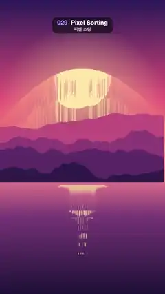

# 029 · Pixel Sorting · 픽셀 소팅



**EN** A sunset landscape melts downward as each column's bright runs are sorted bright-to-dark, the drips swelling and shrinking each loop.  
**KO** 노을 풍경의 세로줄마다 밝은 구간이 밝은 순서로 정렬되어 아래로 녹아내리고, 흘러내리는 길이가 루프에 맞춰 늘었다 줄어든다.

[Video (mp4)](https://sueun-dev.github.io/motion-effects/videos/029-pixel-sorting.mp4) · [Code](../effects/029-pixel-sorting.js) · Print, retro & glitch · 인쇄·레트로·글리치

## Prompt (English)

```text
Create a "Pixel Sorting" motion effect: in every column of a sunset picture, runs of bright pixels are sorted by brightness, so the sky and the sun drip down over the mountains and the lake in streaks whose length swells and shrinks.

Look
- Source picture, drawn at half size (540 × 960): a flat-colour sunset. Sky over the top 62 %: vertical gradient #2B1B5A → #E8577A (55 %) → #FFB36B. A pale #FFE6A8 sun (radius 17 % of the width, centred at 50 % / 37 %) with a warm radial glow rgba(255, 220, 150, 0.55) → 0. Four mountain layers #C2507E, #8E3B78, #5A2A68, #2E1A4A with smooth fractal-noise ridgelines around 47–62 % of the height. A lake below 62 %: gradient #E0748A → #7A3B78 → #1E1238 with 14 stacked horizontal sun-reflection bars rgba(255, 226, 160, 0.7) under the sun.
- Sorting, column by column from top to bottom: brightness = (77 R + 150 G + 29 B) / 256. A run starts at the first pixel brighter than 150 and continues while pixels stay above 150; then extend it further down by the column's drip length, into the darker pixels below. Sort the run by brightness, brightest at the top (ties broken by colour), write it back, and continue scanning after it.
- Result: the glowing sky and the sun keep their shape at the top but smear down in long vertical streaks; the dark mountain and lake pixels they swallow are pushed to the bottom of each run, so the streaks end in ragged dark spikes, and the sun's reflection drips too. The upper sky (darker than the threshold) stays untouched.
- Drip length per column (half-res px): 0.42 · 960 · grow · (0.25 + 0.5 n + 0.25 j), where n is smooth noise along x (frequency 0.025 per half-res px, mapped to 0..1) and j = 0.5 + 0.5 sin(12.9898 x) · sin(4.1414 x) is a fixed per-column jitter, so neighbouring columns differ and the edge is jagged.

Motion (0–5 s)
- grow = 0.3 + 0.7 · (0.5 − 0.5 cos(2π t/5)): short drips at 0 s, longest at 2.5 s (the streaks reach into the lake), short again at 5 s.
- Read the noise n with an extra 2D offset that goes round a circle of radius 0.8 once per loop, so long and short regions wander across the picture and still loop.
- The picture underneath drifts slightly: the sun bobs by ±1 % of the height and the reflection bars' widths sway.

Technique
- Canvas 2D: draw the picture into a 540 × 960 off-screen canvas, getImageData, sort each column's runs in JavaScript (pack brightness into the top byte of a 32-bit key so a plain numeric sort orders by brightness), putImageData, then draw it scaled 2× to 1080 × 1920 with smoothing on.

Output and rules
- One self-contained HTML file with no external assets (three.js from a CDN is fine if you use it), drawing on a 1080 × 1920 canvas (9:16) scaled to fit the window.
- Write a function renderFrame(t) that draws the frame for time t in seconds, and preview it with requestAnimationFrame. Everything must be a pure function of t and fixed seeds: no Math.random(), Date or state carried between frames, so frame i = renderFrame(i / 30) can be exported to a 30 fps video.
- Loop seamlessly every 5 seconds: renderFrame(5) must look exactly like renderFrame(0).
- No flicker of any kind: no noise or grain that changes from frame to frame, no strobing or blinking, no z-fighting, no shimmering 1 px lines. Any grain or texture stays fixed to the screen or to the object.
- Keep the top 280 px free of important content (a title label goes there) and fill the whole frame with a designed background.
```

## 프롬프트 (한국어)

```text
"픽셀 소팅" 모션 효과를 만들어 줘: 노을 그림의 세로줄마다 밝은 픽셀 구간을 밝기순으로 정렬해서, 하늘과 해가 산과 호수 위로 줄줄이 녹아내리고 그 길이가 늘었다 줄어드는 효과.

모양
- 원본 그림은 절반 크기(540 × 960)로 그린 단색 면 노을이다. 위쪽 62 % 하늘: 세로 그라디언트 #2B1B5A → #E8577A(55 %) → #FFB36B. 연한 #FFE6A8 해(반지름은 너비의 17 %, 중심 50 % / 37 %)와 따뜻한 방사형 빛 rgba(255, 220, 150, 0.55) → 0. 부드러운 프랙탈 노이즈 능선을 가진 산 네 겹 #C2507E, #8E3B78, #5A2A68, #2E1A4A(높이의 47–62 % 부근). 62 % 아래 호수: 그라디언트 #E0748A → #7A3B78 → #1E1238, 해 아래에 층층이 쌓인 가로 반사 막대 14개 rgba(255, 226, 160, 0.7).
- 정렬은 세로줄마다 위에서 아래로: 밝기 = (77 R + 150 G + 29 B) / 256. 밝기가 150을 넘는 첫 픽셀에서 구간이 시작되어 150을 넘는 동안 이어지고, 거기서 그 줄의 흘러내림 길이만큼 아래 어두운 픽셀까지 더 늘린다. 구간을 밝기순으로 정렬해(가장 밝은 것이 위, 같으면 색으로) 다시 쓰고, 그 뒤부터 계속 훑는다.
- 결과: 빛나는 하늘과 해는 위쪽에서 모양을 지키지만 길게 세로로 번져 내려오고, 삼켜진 어두운 산·호수 픽셀은 구간 맨 아래로 밀려나 줄 끝이 들쭉날쭉한 어두운 가시가 된다. 해의 반사도 흘러내린다. 문턱보다 어두운 위쪽 하늘은 그대로다.
- 세로줄마다 흘러내림 길이(절반 해상도 px): 0.42 · 960 · grow · (0.25 + 0.5 n + 0.25 j). n은 x를 따라가는 부드러운 노이즈(절반 해상도 px당 주파수 0.025, 0..1로 맞춤), j = 0.5 + 0.5 sin(12.9898 x) · sin(4.1414 x)는 줄마다 고정된 흔들림이라 이웃 줄이 서로 달라 끝이 들쭉날쭉하다.

움직임 (0–5초)
- grow = 0.3 + 0.7 · (0.5 − 0.5 cos(2π t/5)): 0초에 짧고, 2.5초에 가장 길어(줄이 호수까지 닿는다) 5초에 다시 짧아진다.
- 노이즈 n은 루프마다 한 바퀴 도는 반지름 0.8 원을 따라 2D 오프셋을 더해 읽는다. 그래서 긴 곳과 짧은 곳이 그림 위를 떠돌면서도 끊김 없이 반복된다.
- 아래 그림도 살짝 움직인다: 해가 높이의 ±1 %만큼 오르내리고 반사 막대 너비가 일렁인다.

기법
- Canvas 2D: 540 × 960 화면 밖 캔버스에 그림을 그리고 getImageData, 각 세로줄의 구간을 자바스크립트로 정렬한 뒤(밝기를 32비트 키의 맨 위 바이트에 넣으면 숫자 정렬만으로 밝기순이 된다) putImageData, 그다음 스무딩을 켜고 2배로 키워 1080 × 1920에 그린다.

출력과 규칙
- 외부 파일 없는 HTML 파일 하나(three.js를 쓴다면 CDN은 괜찮다). 1080 × 1920(9:16) 캔버스에 그리고 창 크기에 맞춰 보이게 한다.
- 시간 t(초)의 프레임을 그리는 renderFrame(t) 함수를 만들고, 미리보기는 requestAnimationFrame으로 돌린다. 모든 것은 t와 고정 시드만으로 정해진다: Math.random(), Date, 프레임 사이에 쌓이는 상태 금지. 그래야 i번째 프레임 = renderFrame(i / 30)으로 30fps 영상을 뽑을 수 있다.
- 5초마다 끊김 없이 반복: renderFrame(5)는 renderFrame(0)과 똑같아 보여야 한다.
- 어떤 깜빡임도 금지: 프레임마다 바뀌는 노이즈·그레인, 번쩍임·깜빡임, z-fighting, 반짝이며 떨리는 1px 선 모두 금지. 그레인·질감은 화면이나 물체에 고정한다.
- 위쪽 280px에는 중요한 내용을 두지 않고(제목 라벨 자리), 화면 전체를 디자인된 배경으로 채운다.
```
