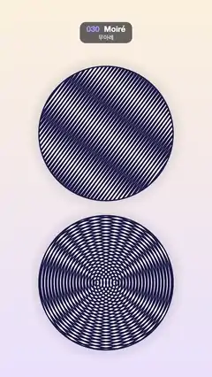

# 030 · Moiré · 무아레



**EN** Two navy line discs: gratings 4° apart and two offset ring sets slide over each other, sweeping big moiré bands across them.  
**KO** 남색 선 원판 두 개: 4도 어긋난 두 선 패턴과 중심이 어긋난 두 동심원 패턴이 서로 미끄러지며 큰 무아레 띠가 흐른다.

[Video (mp4)](../videos/030-moire.mp4) · [Code](../effects/030-moire.js) · Print, retro & glitch · 인쇄·레트로·글리치

## Prompt (English)

```text
Create a "Moiré" motion effect: two discs, each printed with two identical fine patterns laid over each other slightly out of step, so large interference bands sweep across them while the fine lines themselves barely move.

Look
- All positions are in px on the 1080 × 1920 frame, top-left origin.
- Paper: vertical gradient #FCF0DB (top) → #EBE3FC (bottom), darkened by up to 7 % in a soft 70 px shadow around each disc.
- Two discs of radius 340: top centre (540, 680), bottom centre (540, 1440). Inside: off-white #FCF7ED with navy #1A1A47 lines. A navy rim about 4 px wide sits just outside the edge (centred at R + 2), and the disc edge is antialiased over 3 px.
- One line profile for all patterns: spacing P = 16 px; for a distance value s, ink = smoothstep(0.15 − w, 0.15 + w, cos(2π s / 16)) with w = 0.8 · fwidth(cos …), so lines take a little under half of each period and are antialiased by their own screen derivative.
- Top disc: two straight line gratings through its centre, with normals at 0.60 rad and 0.67 rad (4° apart; angles measured clockwise from +x on screen, so the lines run steeply from upper right to lower left), combined as a union: k = 1 − (1 − A)(1 − B). This produces broad diagonal dark and light moiré bands.
- Bottom disc: two sets of concentric rings centred 46 px left and 46 px right of the disc centre, combined the same way, giving the classic fan of hyperbolic moiré lines between two point sources.

Motion (0–5 s)
- Top: the first grating stays still; the second slides perpendicular to its lines by two line spacings per loop (32 px). The moiré bands sweep a long way across the disc.
- Bottom: the left ring set contracts by one spacing per loop (ring radii shrink by 16 · t/5), the right set expands by two spacings (radii grow by 32 · t/5); the fan of bands flows across the disc.
- Each layer moves by whole spacings per loop, so the loop is seamless, and each individual line moves only 3–6 px per second — no shimmer, while the interference bands move fast and far. Nothing rotates.

Technique
- A WebGL2 full-screen fragment shader. Every pattern is a pure function of pixel position and t, antialiased with fwidth so the 16 px lines never alias.

Output and rules
- One self-contained HTML file with no external assets (three.js from a CDN is fine if you use it), drawing on a 1080 × 1920 canvas (9:16) scaled to fit the window.
- Write a function renderFrame(t) that draws the frame for time t in seconds, and preview it with requestAnimationFrame. Everything must be a pure function of t and fixed seeds: no Math.random(), Date or state carried between frames, so frame i = renderFrame(i / 30) can be exported to a 30 fps video.
- Loop seamlessly every 5 seconds: renderFrame(5) must look exactly like renderFrame(0).
- No flicker of any kind: no noise or grain that changes from frame to frame, no strobing or blinking, no z-fighting, no shimmering 1 px lines. Any grain or texture stays fixed to the screen or to the object.
- Keep the top 280 px free of important content (a title label goes there) and fill the whole frame with a designed background.
```

## 프롬프트 (한국어)

```text
"무아레" 모션 효과를 만들어 줘: 원판 두 개에 똑같은 가는 패턴 두 장을 살짝 어긋나게 겹쳐 찍어서, 가는 선 자체는 거의 안 움직이는데 큰 간섭무늬 띠가 원판을 가로질러 쓸고 지나가는 효과.

모양
- 모든 위치는 1080 × 1920 화면의 px, 왼쪽 위 기준.
- 종이: 세로 그라디언트 #FCF0DB(위) → #EBE3FC(아래). 원판 둘레 70 px에는 최대 7 % 어두운 부드러운 그림자.
- 반지름 340 원판 두 개: 위 중심 (540, 680), 아래 중심 (540, 1440). 안쪽은 미색 #FCF7ED 바탕에 남색 #1A1A47 선. 가장자리 바로 바깥(R + 2 중심)에 약 4 px 남색 테두리, 원판 경계는 3 px로 안티에일리어싱.
- 모든 패턴이 같은 선 모양을 쓴다: 간격 P = 16 px, 거리 값 s에 대해 잉크 = smoothstep(0.15 − w, 0.15 + w, cos(2π s / 16)), w = 0.8 · fwidth(cos …). 그래서 선이 한 주기의 절반보다 조금 덜 차지하고, 자기 화면 미분으로 안티에일리어싱된다.
- 위 원판: 중심을 지나는 직선 격자 두 장, 법선 방향 0.60 rad와 0.67 rad(4도 차이, 화면에서 +x로부터 시계 방향으로 잰 각도라 선은 오른쪽 위에서 왼쪽 아래로 가파르게 지나간다), 합집합으로 합친다: k = 1 − (1 − A)(1 − B). 넓은 대각선 방향의 어둡고 밝은 무아레 띠가 생긴다.
- 아래 원판: 원판 중심에서 왼쪽 46 px, 오른쪽 46 px에 중심을 둔 동심원 두 묶음을 같은 방식으로 합친다. 두 점에서 퍼지는 고전적인 쌍곡선 무아레 부채꼴이 생긴다.

움직임 (0–5초)
- 위: 첫 번째 격자는 가만히 있고, 두 번째 격자가 선과 수직 방향으로 루프마다 선 간격 두 개(32 px)만큼 미끄러진다. 무아레 띠는 원판을 길게 가로지른다.
- 아래: 왼쪽 동심원은 루프마다 간격 하나만큼 안으로 줄어들고(반지름이 16 · t/5 감소), 오른쪽 동심원은 간격 두 개만큼 바깥으로 퍼진다(32 · t/5 증가). 부채꼴 띠가 원판 위를 흘러간다.
- 층마다 루프당 정수 개의 간격만큼 움직이므로 끊김 없이 반복되고, 선 하나하나는 초당 3–6 px밖에 안 움직여 반짝임이 없다. 반면 간섭 띠는 빠르고 멀리 움직인다. 아무것도 회전하지 않는다.

기법
- WebGL2 전체 화면 프래그먼트 셰이더. 모든 패턴은 픽셀 위치와 t만의 순수 함수이고, fwidth로 안티에일리어싱해서 16 px 선이 계단지지 않는다.

출력과 규칙
- 외부 파일 없는 HTML 파일 하나(three.js를 쓴다면 CDN은 괜찮다). 1080 × 1920(9:16) 캔버스에 그리고 창 크기에 맞춰 보이게 한다.
- 시간 t(초)의 프레임을 그리는 renderFrame(t) 함수를 만들고, 미리보기는 requestAnimationFrame으로 돌린다. 모든 것은 t와 고정 시드만으로 정해진다: Math.random(), Date, 프레임 사이에 쌓이는 상태 금지. 그래야 i번째 프레임 = renderFrame(i / 30)으로 30fps 영상을 뽑을 수 있다.
- 5초마다 끊김 없이 반복: renderFrame(5)는 renderFrame(0)과 똑같아 보여야 한다.
- 어떤 깜빡임도 금지: 프레임마다 바뀌는 노이즈·그레인, 번쩍임·깜빡임, z-fighting, 반짝이며 떨리는 1px 선 모두 금지. 그레인·질감은 화면이나 물체에 고정한다.
- 위쪽 280px에는 중요한 내용을 두지 않고(제목 라벨 자리), 화면 전체를 디자인된 배경으로 채운다.
```
