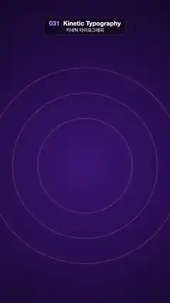

# 031 · Kinetic Typography · 키네틱 타이포그래피



★ One of the 20 effects in the original reel (#6) · 원래 릴스 20개 중 하나(6번)

**EN** "MAKE EVERY WORD MOVE" lands word by word (drop, slide, spin, slam), pulses at 120 BPM, then each word flies off in turn.  
**KO** "MAKE EVERY WORD MOVE"가 떨어지고, 밀려오고, 돌고, 쾅 내려앉으며 한 단어씩 들어와 120BPM으로 들썩이다가 차례로 날아간다.

[Video (mp4)](../videos/031-kinetic-typography.mp4) · [Code](../effects/031-kinetic-typography.js) · Typography · 타이포그래피

## Prompt (English)

```text
Create a "Kinetic Typography" motion effect: four words enter on the beat one by one (drop, slide, spin, slam), bounce in time at 120 BPM while the stack sways, then leave one by one so the loop starts empty again.

Look
- All positions are in px on the 1080 × 1920 frame, top-left origin.
- Background: radial gradient centred at (540, 1050), #3B1D74 at radius 50 → #120826 at radius 1300. Three concentric rings at the same centre, radii 300 / 460 / 620, 6 px wide, in rgba(255, 120, 150, α) with α = 0.10 + 0.14 · beat, so they glow on every beat.
- Words in a heavy sans (Arial Black, weight 900), centred horizontally and middle-aligned vertically: "MAKE" at y 700, "EVERY" at y 910, "WORD" at y 1120 (all 190 px, cream #FFF2DE) and "MOVE" at y 1400 (270 px, vertical gradient #FFD36E at the top → #FF4F7B at the bottom). Every word has a hard shadow: the same text in #0B0518, offset (+10, +12) px, drawn under it with the same transform.

Motion (0–5 s)
- beat = (0.5 + 0.5 cos(2π t / 0.5))⁴: a short smooth pulse every 0.5 s (120 BPM).
- Entrances, 0.4 s each (progress k = 0 → 1); alpha fades in over the first 40 % of k:
  - MAKE at 0.10 s drops from 420 px above with an overshoot (easeOutBack), rotation −0.4 rad → 0.
  - EVERY at 0.60 s slides in from 520 px to the right (ease-out cubic).
  - WORD at 1.10 s spins in from 0.6π rad while growing from scale 0, both with easeOutBack, so it pops slightly past full size.
  - MOVE at 1.60 s slams down from 1.7× to 1× (ease-out cubic) while fading in.
- Impact: as MOVE lands (1.85–2.25 s) the three upper words dip 36 px and come back up (one half-sine).
- Hold (ramps in over 1.95–2.20 s, out over 3.75–3.95 s): each word bumps up to +6 % in scale on every beat with pulse (0.5 + 0.5 cos(2π (t − 0.08 i) / 0.5))³, staggered 0.08 s per word i; the stack sways ±0.07 rad with a 2 s period (4 beats), alternate words tilting opposite ways.
- Exits, 0.45 s each, ease-in cubic, alpha gone after the first ~60 %: MAKE at 3.95 s flies 380 px up; EVERY at 4.10 s slides 460 px left; WORD at 4.25 s slides 420 px right and tips 0.5 rad; MOVE at 4.40 s blows up to 2.2× as it fades. From about 4.7 s only the rings remain, matching the empty frame at t = 0.

Technique
- Canvas 2D. Each word is a keyframed transform (translate, rotate, scale, alpha) computed from t with easing functions: easeOutBack(k) = 1 + 2.70158 (k − 1)³ + 1.70158 (k − 1)², ease-out = 1 − (1 − k)³, ease-in = k³. Draw the shadow and then the fill inside save / translate / rotate / scale / restore.

Output and rules
- One self-contained HTML file with no external assets (three.js from a CDN is fine if you use it), drawing on a 1080 × 1920 canvas (9:16) scaled to fit the window.
- Write a function renderFrame(t) that draws the frame for time t in seconds, and preview it with requestAnimationFrame. Everything must be a pure function of t and fixed seeds: no Math.random(), Date or state carried between frames, so frame i = renderFrame(i / 30) can be exported to a 30 fps video.
- Loop seamlessly every 5 seconds: renderFrame(5) must look exactly like renderFrame(0).
- No flicker of any kind: no noise or grain that changes from frame to frame, no strobing or blinking, no z-fighting, no shimmering 1 px lines. Any grain or texture stays fixed to the screen or to the object.
- Keep the top 280 px free of important content (a title label goes there) and fill the whole frame with a designed background.
```

## 프롬프트 (한국어)

```text
"키네틱 타이포그래피" 모션 효과를 만들어 줘: 네 단어가 박자에 맞춰 하나씩 들어오고(떨어지기, 밀려오기, 돌기, 쾅 내려앉기), 120 BPM에 맞춰 들썩이며 단어 묶음이 흔들리다가, 하나씩 빠져나가 루프가 다시 빈 화면에서 시작되는 효과.

모양
- 모든 위치는 1080 × 1920 화면의 px, 왼쪽 위 기준.
- 배경: (540, 1050) 중심의 방사형 그라디언트, 반지름 50에서 #3B1D74 → 반지름 1300에서 #120826. 같은 중심에 반지름 300 / 460 / 620, 굵기 6 px의 동심원 세 개, 색 rgba(255, 120, 150, α), α = 0.10 + 0.14 · beat라서 박자마다 빛난다.
- 단어는 굵은 산세리프(Arial Black, 굵기 900), 가로 가운데, 세로 중앙 정렬: "MAKE" y 700, "EVERY" y 910, "WORD" y 1120(모두 190 px, 크림색 #FFF2DE), "MOVE" y 1400(270 px, 위 #FFD36E → 아래 #FF4F7B 세로 그라디언트). 모든 단어에 딱딱한 그림자: 같은 글자를 #0B0518로 (+10, +12) px 옮겨 같은 변환으로 밑에 그린다.

움직임 (0–5초)
- beat = (0.5 + 0.5 cos(2π t / 0.5))⁴: 0.5초마다 오는 짧고 부드러운 맥박(120 BPM).
- 등장, 각 0.4초(진행 k = 0 → 1). 투명도는 k의 처음 40 % 동안 나타난다:
  - MAKE는 0.10초에 420 px 위에서 살짝 지나쳤다 돌아오며(easeOutBack) 떨어지고, 회전은 −0.4 rad → 0.
  - EVERY는 0.60초에 오른쪽 520 px에서 밀려 들어온다(ease-out cubic).
  - WORD는 1.10초에 0.6π rad에서 돌며 크기 0에서 커진다. 둘 다 easeOutBack이라 제 크기를 살짝 넘었다가 자리 잡는다.
  - MOVE는 1.60초에 1.7배에서 1배로 쾅 내려앉으며(ease-out cubic) 나타난다.
- 충격: MOVE가 내려앉을 때(1.85–2.25초) 위의 세 단어가 36 px 내려갔다 돌아온다(반 사인 한 번).
- 유지 구간(1.95–2.20초에 들어오고 3.75–3.95초에 빠짐): 단어마다 박자에 맞춰 크기가 최대 +6 % 커진다. 맥박은 (0.5 + 0.5 cos(2π (t − 0.08 i) / 0.5))³, 단어 i마다 0.08초씩 늦다. 단어 묶음은 주기 2초(4박)로 ±0.07 rad 흔들리고, 단어마다 번갈아 반대로 기운다.
- 퇴장, 각 0.45초, ease-in cubic, 처음 약 60 % 안에 투명해진다: MAKE는 3.95초에 위로 380 px 날아가고, EVERY는 4.10초에 왼쪽으로 460 px, WORD는 4.25초에 오른쪽으로 420 px 가며 0.5 rad 기울고, MOVE는 4.40초에 2.2배로 부풀며 사라진다. 약 4.7초부터는 동심원만 남아 t = 0의 빈 화면과 이어진다.

기법
- Canvas 2D. 단어마다 t로 계산한 키프레임 변환(이동, 회전, 크기, 투명도)과 이징 함수: easeOutBack(k) = 1 + 2.70158 (k − 1)³ + 1.70158 (k − 1)², ease-out = 1 − (1 − k)³, ease-in = k³. save / translate / rotate / scale / restore 안에서 그림자를 먼저, 그다음 글자를 그린다.

출력과 규칙
- 외부 파일 없는 HTML 파일 하나(three.js를 쓴다면 CDN은 괜찮다). 1080 × 1920(9:16) 캔버스에 그리고 창 크기에 맞춰 보이게 한다.
- 시간 t(초)의 프레임을 그리는 renderFrame(t) 함수를 만들고, 미리보기는 requestAnimationFrame으로 돌린다. 모든 것은 t와 고정 시드만으로 정해진다: Math.random(), Date, 프레임 사이에 쌓이는 상태 금지. 그래야 i번째 프레임 = renderFrame(i / 30)으로 30fps 영상을 뽑을 수 있다.
- 5초마다 끊김 없이 반복: renderFrame(5)는 renderFrame(0)과 똑같아 보여야 한다.
- 어떤 깜빡임도 금지: 프레임마다 바뀌는 노이즈·그레인, 번쩍임·깜빡임, z-fighting, 반짝이며 떨리는 1px 선 모두 금지. 그레인·질감은 화면이나 물체에 고정한다.
- 위쪽 280px에는 중요한 내용을 두지 않고(제목 라벨 자리), 화면 전체를 디자인된 배경으로 채운다.
```
