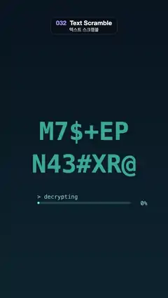

# 032 · Text Scramble · 텍스트 스크램블



★ One of the 20 effects in the original reel (#11) · 원래 릴스 20개 중 하나(11번)

**EN** "SIGNAL / DECODED" cycles through random glyphs, locks in letter by letter with a cyan glow and a progress bar, then scrambles away.  
**KO** "SIGNAL / DECODED"가 무작위 문자로 돌다가 청록 빛과 진행 막대와 함께 한 글자씩 제 글자로 맞춰지고, 다시 뒤섞여 사라진다.

[Video (mp4)](https://sueun-dev.github.io/motion-effects/videos/032-text-scramble.mp4) · [Code](../effects/032-text-scramble.js) · Typography · 타이포그래피

## Prompt (English)

```text
Create a "Text Scramble" motion effect (decode text): two lines of monospace letters cycle through random characters, lock onto the real words one letter at a time with a short glow, hold, and scramble back so the loop restarts.

Look
- All positions are in px on the 1080 × 1920 frame, top-left origin.
- Background: vertical gradient #07131F → #0C2230, with a faint dot grid of 4 × 4 px squares every 48 px (x from 24, y from 300) in rgba(90, 240, 220, 0.07).
- Text: "SIGNAL" and "DECODED" in bold Menlo 160 px (monospace, 0.602 em ≈ 96.3 px per letter), each line centred from its letter count, vertically middle-aligned at y 860 and y 1070. Every letter sits in a fixed monospace slot, so nothing shifts when characters change.
- Scrambled letters: a random character from "ABCDEFGHIJKLMNOPQRSTUVWXYZ0123456789#%&*@$<>/+=?" in muted teal rgba(60, 200, 190, 0.75), no glow.
- Locked letters: near-white #F2FFFC with a cyan glow (shadow colour rgba(90, 255, 220, 0.9), blur 10 px plus a landing flash of 40 px that decays as e^(−8 s) in the s seconds after the letter locks).
- Progress UI: a track 600 × 14 px (corner radius 7) at (240, 1300) in rgba(90, 240, 220, 0.18) with a fill in #5AF0DC, width max(14, 600 × progress); above it at (240, 1280) the status "> decrypting", which becomes "> verified" at 100 %; a percentage right of the bar at (860, 1322) such as "30%"; both in Menlo 36 px, rgba(160, 255, 240, 0.7).

Motion (0–5 s)
- Number the 13 letters n = 0…12 across both lines. Letter n locks at 0.5 + 0.12 n s (the last at 1.94 s) and unlocks at 3.4 + 0.08 n s (the last at 4.36 s); outside that window it scrambles, so 0–0.5 s and 4.36–5 s show only random letters.
- Scrambled characters change only every 3rd frame: step = floor(round(30 t) / 3) mod 50, i.e. 10 changes per second and 50 steps per loop. Pick each one with a small seeded random generator keyed on (letter, step), e.g. mulberry32 seeded with n · 7919 + step · 104729, so the same frame always shows the same characters and nothing flickers at 30 fps.
- Progress = (sum over letters of their lock state) / 13, where each letter ramps up over 0.12 s when it locks and down over 0.08 s when it unlocks, so the bar fills smoothly to 100 %, holds, and empties again before the loop point.

Technique
- Canvas 2D with fillText per letter, shadowBlur for the glow (reset to 0 after each locked letter), and roundRect for the bar.

Output and rules
- One self-contained HTML file with no external assets (three.js from a CDN is fine if you use it), drawing on a 1080 × 1920 canvas (9:16) scaled to fit the window.
- Write a function renderFrame(t) that draws the frame for time t in seconds, and preview it with requestAnimationFrame. Everything must be a pure function of t and fixed seeds: no Math.random(), Date or state carried between frames, so frame i = renderFrame(i / 30) can be exported to a 30 fps video.
- Loop seamlessly every 5 seconds: renderFrame(5) must look exactly like renderFrame(0).
- No flicker of any kind: no noise or grain that changes from frame to frame, no strobing or blinking, no z-fighting, no shimmering 1 px lines. Any grain or texture stays fixed to the screen or to the object.
- Keep the top 280 px free of important content (a title label goes there) and fill the whole frame with a designed background.
```

## 프롬프트 (한국어)

```text
"텍스트 스크램블" 모션 효과(디코드 텍스트)를 만들어 줘: 고정폭 글자 두 줄이 무작위 문자로 돌다가, 한 글자씩 짧게 빛나며 진짜 단어로 맞춰지고, 머문 뒤 다시 뒤섞여 루프가 처음으로 돌아가는 효과.

모양
- 모든 위치는 1080 × 1920 화면의 px, 왼쪽 위 기준.
- 배경: 세로 그라디언트 #07131F → #0C2230, 그 위에 48 px 간격(x는 24부터, y는 300부터)의 4 × 4 px 사각형으로 된 희미한 점 격자 rgba(90, 240, 220, 0.07).
- 글자: "SIGNAL"과 "DECODED", 굵은 Menlo 160 px(고정폭, 글자당 0.602 em ≈ 96.3 px), 줄마다 글자 수로 가운데 정렬, 세로 중앙 정렬로 y 860과 y 1070. 글자마다 고정된 칸에 있어서 문자가 바뀌어도 아무것도 밀리지 않는다.
- 뒤섞인 글자: "ABCDEFGHIJKLMNOPQRSTUVWXYZ0123456789#%&*@$<>/+=?" 중 무작위 문자, 차분한 청록 rgba(60, 200, 190, 0.75), 빛 없음.
- 맞춰진 글자: 거의 흰색 #F2FFFC에 청록 빛(그림자 색 rgba(90, 255, 220, 0.9), 흐림 10 px에 글자가 맞춰진 뒤 s초 동안 e^(−8 s)로 줄어드는 40 px 착지 번쩍임을 더한다).
- 진행 표시: (240, 1300)에 600 × 14 px 막대 틀(모서리 반지름 7) rgba(90, 240, 220, 0.18), 채움은 #5AF0DC, 너비 max(14, 600 × 진행률). 그 위 (240, 1280)에 상태 "> decrypting", 100 %가 되면 "> verified". 막대 오른쪽 (860, 1322)에 "30%" 같은 퍼센트. 둘 다 Menlo 36 px, rgba(160, 255, 240, 0.7).

움직임 (0–5초)
- 두 줄에 걸쳐 13글자에 n = 0…12 번호를 매긴다. 글자 n은 0.5 + 0.12 n초에 맞춰지고(마지막 1.94초), 3.4 + 0.08 n초에 다시 풀린다(마지막 4.36초). 그 밖의 시간에는 뒤섞이므로 0–0.5초와 4.36–5초에는 무작위 글자만 보인다.
- 뒤섞인 문자는 3프레임마다 한 번만 바뀐다: step = floor(round(30 t) / 3) mod 50, 즉 초당 10번, 루프마다 50단계. 문자는 (글자, step)을 키로 한 작은 시드 난수 생성기로 고른다. 예: n · 7919 + step · 104729를 시드로 한 mulberry32. 그래서 같은 프레임은 언제나 같은 문자를 보이고, 30fps에서 깜빡이지 않는다.
- 진행률 = (글자별 맞춤 상태의 합) / 13. 글자마다 맞춰질 때 0.12초, 풀릴 때 0.08초에 걸쳐 오르내리므로 막대가 부드럽게 100 %까지 차고, 머물렀다가, 루프 끝 전에 다시 빈다.

기법
- Canvas 2D: 글자마다 fillText, 빛은 shadowBlur(맞춰진 글자를 그린 뒤 0으로 되돌림), 막대는 roundRect.

출력과 규칙
- 외부 파일 없는 HTML 파일 하나(three.js를 쓴다면 CDN은 괜찮다). 1080 × 1920(9:16) 캔버스에 그리고 창 크기에 맞춰 보이게 한다.
- 시간 t(초)의 프레임을 그리는 renderFrame(t) 함수를 만들고, 미리보기는 requestAnimationFrame으로 돌린다. 모든 것은 t와 고정 시드만으로 정해진다: Math.random(), Date, 프레임 사이에 쌓이는 상태 금지. 그래야 i번째 프레임 = renderFrame(i / 30)으로 30fps 영상을 뽑을 수 있다.
- 5초마다 끊김 없이 반복: renderFrame(5)는 renderFrame(0)과 똑같아 보여야 한다.
- 어떤 깜빡임도 금지: 프레임마다 바뀌는 노이즈·그레인, 번쩍임·깜빡임, z-fighting, 반짝이며 떨리는 1px 선 모두 금지. 그레인·질감은 화면이나 물체에 고정한다.
- 위쪽 280px에는 중요한 내용을 두지 않고(제목 라벨 자리), 화면 전체를 디자인된 배경으로 채운다.
```
