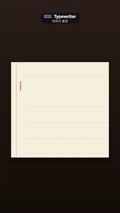

# 033 · Typewriter · 타자기 효과



**EN** Four lines are typed letter by letter onto lined paper with slight human jitter while a red cursor follows, then breathes and the page clears.  
**KO** 줄 친 종이에 네 줄이 사람처럼 살짝 불규칙하게 한 자씩 찍히고, 빨간 커서가 따라가다 숨 쉬듯 흐려졌다 밝아진 뒤 종이가 비워진다.

[Video (mp4)](https://sueun-dev.github.io/motion-effects/videos/033-typewriter.mp4) · [Code](../effects/033-typewriter.js) · Typography · 타이포그래피

## Prompt (English)

```text
Create a "Typewriter" motion effect: four lines of text are struck onto a sheet of paper one letter at a time, with slightly human timing and an uneven baseline, while a cursor follows; when typing pauses the cursor breathes instead of blinking.

Look
- All positions are in px on the 1080 × 1920 frame, top-left origin.
- Desk: vertical gradient #2B1E17 → #140D09.
- Paper: a #F6EEDC rectangle x 100–980, y 560–1420 with a soft drop shadow (rgba(0, 0, 0, 0.5), blur 60, offset 24 px down). Faint blue rules rgba(70, 110, 170, 0.16), 2 px tall, across the sheet at y 686, 826, 966, 1106, 1246 and 1386; a red margin line rgba(220, 70, 70, 0.45), 3 px wide at x 146, the full height of the sheet.
- Text: "Hello, world." / "Every story" / "starts with" / "one letter." in American Typewriter (fallback Courier New), regular 94 px, left edge x 175, baselines 800, 940, 1080, 1220. Ink rgba(28, 22, 40, α), each letter with its own α between 0.75 and 1.0. Place each letter at the measured width of the text before it on its line.
- Each letter gets a fixed, seeded imperfection: baseline offset ±2.5 px and rotation ±0.02 rad.
- Cursor: a red bar rgba(230, 80, 60, α), 7 px wide and 81 px tall (top at baseline − 68), 6 px after the last typed letter.

Motion (0–5 s)
- Typing starts at 0.35 s. After each keystroke the clock advances 0.055 s (0.04 s after a space) plus a seeded random 0–0.03 s, and each new line adds a 0.12 s carriage-return pause. The 46th and last letter lands at about 3.8 s.
- Each letter lands with a strike: drawn at scale 1 + 0.3 · e^(−30 (t − strike time)) about its baseline-left corner, so it settles from 1.3× within about 0.1 s.
- Cursor: solid while typing; between 0.25 and 0.5 s after the last keystroke it eases into a breath, α = 0.55 + 0.45 cos(2π t), one smooth breath per second, never a hard on/off blink. Before the first letter it breathes at the start of line 1.
- 4.30–4.75 s: the text and the cursor fade out together (smoothstep). After 4.75 s the cursor sits at the start of line 1 again and fades back in by 5 s, so the loop continues seamlessly into the empty page at t = 0.

Technique
- Canvas 2D. Precompute every letter's strike time, offset, rotation and ink once with a fixed-seed random generator; each frame draw every letter whose strike time has passed (save / translate / rotate / scale / fillText / restore).

Output and rules
- One self-contained HTML file with no external assets (three.js from a CDN is fine if you use it), drawing on a 1080 × 1920 canvas (9:16) scaled to fit the window.
- Write a function renderFrame(t) that draws the frame for time t in seconds, and preview it with requestAnimationFrame. Everything must be a pure function of t and fixed seeds: no Math.random(), Date or state carried between frames, so frame i = renderFrame(i / 30) can be exported to a 30 fps video.
- Loop seamlessly every 5 seconds: renderFrame(5) must look exactly like renderFrame(0).
- No flicker of any kind: no noise or grain that changes from frame to frame, no strobing or blinking, no z-fighting, no shimmering 1 px lines. Any grain or texture stays fixed to the screen or to the object.
- Keep the top 280 px free of important content (a title label goes there) and fill the whole frame with a designed background.
```

## 프롬프트 (한국어)

```text
"타자기 효과" 모션 효과를 만들어 줘: 종이에 글자 네 줄이 한 자씩 찍히는데, 타이밍이 사람처럼 살짝 불규칙하고 기준선도 조금씩 들쭉날쭉하며, 커서가 따라간다. 타자가 멈추면 커서는 깜빡이는 대신 숨 쉬듯 흐려졌다 밝아진다.

모양
- 모든 위치는 1080 × 1920 화면의 px, 왼쪽 위 기준.
- 책상: 세로 그라디언트 #2B1E17 → #140D09.
- 종이: x 100–980, y 560–1420의 #F6EEDC 사각형, 부드러운 그림자(rgba(0, 0, 0, 0.5), 흐림 60, 아래로 24 px). 종이를 가로지르는 희미한 파란 줄 rgba(70, 110, 170, 0.16), 높이 2 px, y 686, 826, 966, 1106, 1246, 1386. x 146에 너비 3 px 빨간 여백선 rgba(220, 70, 70, 0.45), 종이 높이 전체.
- 글자: "Hello, world." / "Every story" / "starts with" / "one letter.", American Typewriter(없으면 Courier New) 보통 굵기 94 px, 왼쪽 x 175, 기준선 800, 940, 1080, 1220. 잉크 rgba(28, 22, 40, α), 글자마다 α가 0.75–1.0 사이로 다르다. 각 글자는 그 줄에서 앞 글자들의 측정 너비만큼 떨어진 곳에 놓는다.
- 글자마다 시드로 고정된 흠: 기준선 ±2.5 px 어긋남, 회전 ±0.02 rad.
- 커서: 빨간 막대 rgba(230, 80, 60, α), 너비 7 px, 높이 81 px(위쪽은 기준선 − 68), 마지막으로 찍힌 글자 뒤 6 px.

움직임 (0–5초)
- 타자는 0.35초에 시작한다. 한 번 칠 때마다 시계가 0.055초(공백 뒤는 0.04초)에 시드 난수 0–0.03초를 더해 나아가고, 새 줄마다 0.12초 줄바꿈 쉼이 들어간다. 46번째 마지막 글자는 약 3.8초에 찍힌다.
- 글자마다 찍히는 순간이 있다: 기준선 왼쪽 끝을 기준으로 1 + 0.3 · e^(−30 (t − 찍힌 시각))배로 그려서, 1.3배에서 약 0.1초 만에 제 크기로 자리 잡는다.
- 커서: 치는 동안은 꽉 차 있고, 마지막 타자 후 0.25–0.5초 사이에 숨쉬기로 부드럽게 넘어간다. α = 0.55 + 0.45 cos(2π t), 초당 한 번의 부드러운 숨, 절대 딱딱하게 켜졌다 꺼지는 깜빡임이 아니다. 첫 글자 전에는 첫 줄 시작에서 숨 쉰다.
- 4.30–4.75초: 글자와 커서가 함께 사라진다(smoothstep). 4.75초 뒤 커서는 다시 첫 줄 시작에 놓이고 5초까지 나타나서, t = 0의 빈 종이로 끊김 없이 이어진다.

기법
- Canvas 2D. 모든 글자의 찍힐 시각, 어긋남, 회전, 잉크를 고정 시드 난수로 한 번만 미리 계산하고, 매 프레임 찍힐 시각이 지난 글자를 모두 그린다(save / translate / rotate / scale / fillText / restore).

출력과 규칙
- 외부 파일 없는 HTML 파일 하나(three.js를 쓴다면 CDN은 괜찮다). 1080 × 1920(9:16) 캔버스에 그리고 창 크기에 맞춰 보이게 한다.
- 시간 t(초)의 프레임을 그리는 renderFrame(t) 함수를 만들고, 미리보기는 requestAnimationFrame으로 돌린다. 모든 것은 t와 고정 시드만으로 정해진다: Math.random(), Date, 프레임 사이에 쌓이는 상태 금지. 그래야 i번째 프레임 = renderFrame(i / 30)으로 30fps 영상을 뽑을 수 있다.
- 5초마다 끊김 없이 반복: renderFrame(5)는 renderFrame(0)과 똑같아 보여야 한다.
- 어떤 깜빡임도 금지: 프레임마다 바뀌는 노이즈·그레인, 번쩍임·깜빡임, z-fighting, 반짝이며 떨리는 1px 선 모두 금지. 그레인·질감은 화면이나 물체에 고정한다.
- 위쪽 280px에는 중요한 내용을 두지 않고(제목 라벨 자리), 화면 전체를 디자인된 배경으로 채운다.
```
