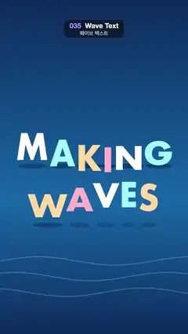

# 035 · Wave Text · 웨이브 텍스트



**EN** The pastel letters of "MAKING WAVES" bob up and down one after another, so a wave runs through the words above swaying sea lines.  
**KO** "MAKING WAVES"의 파스텔 글자들이 차례로 시간차를 두고 오르내려 단어 속으로 파도가 지나가고, 아래에서는 물결 선이 일렁인다.

[Video (mp4)](https://sueun-dev.github.io/motion-effects/videos/035-wave-text.mp4) · [Code](../effects/035-wave-text.js) · Typography · 타이포그래피

## Prompt (English)

```text
Create a "Wave Text" motion effect: every letter rides the same sine wave a little later than the one before it (per-letter stagger), so a wave travels through the words; letters stretch slightly on the way up and their shadows shrink as they lift.

Look
- All positions are in px on the 1080 × 1920 frame, top-left origin.
- Background: vertical gradient #0B2A5B → #1565A8 (60 %) → #0B2A5B.
- Three swell lines behind the type: round-capped 6 px strokes in rgba(160, 230, 255, 0.25) across the full width, y = 1500 + 90 k + 24 sin(2a − x / 140 − k) for k = 0, 1, 2, with a = 2π t/5.
- Text: "MAKING" (baseline 920) and "WAVES" (baseline 1260) in Futura Bold 190 px (or another bold geometric sans), drawn one letter at a time, each line centred from the sum of its measured letter widths. Letter colours cycle across both lines in order: #FFFFFF, #9FF3FF, #FFD9A0, #FFB3C8.
- Under each letter a soft contact shadow on its baseline: an ellipse at (letter centre, baseline + 34) with half-width (0.42 − 0.10 · lift) × the letter's width and half-height 14, in rgba(4, 20, 50, 0.35 − 0.15 · lift).

Motion (0–5 s)
- Letter n (counting 0…10 across both lines) has phase u = 2a − 0.55 n: two full waves per loop, each letter 0.55 rad behind the previous one, so the crest runs left to right through "MAKING" and on into "WAVES".
- lift = sin u; the letter is drawn 70 · lift px above its baseline.
- Squash and stretch about the letter's baseline centre: scale (1 − 0.04 cos u) horizontally and (1 + 0.08 cos u) vertically, so letters are taller and thinner while rising and squashed while falling.
- The shadows narrow and fade as their letters rise, and the swell lines roll with the same two-waves-per-loop rhythm.

Technique
- Canvas 2D: measure every letter, then for each one draw its shadow ellipse, translate to (centre x, baseline − 70 · lift), scale, and fillText with textAlign center and the alphabetic baseline.

Output and rules
- One self-contained HTML file with no external assets (three.js from a CDN is fine if you use it), drawing on a 1080 × 1920 canvas (9:16) scaled to fit the window.
- Write a function renderFrame(t) that draws the frame for time t in seconds, and preview it with requestAnimationFrame. Everything must be a pure function of t and fixed seeds: no Math.random(), Date or state carried between frames, so frame i = renderFrame(i / 30) can be exported to a 30 fps video.
- Loop seamlessly every 5 seconds: renderFrame(5) must look exactly like renderFrame(0).
- No flicker of any kind: no noise or grain that changes from frame to frame, no strobing or blinking, no z-fighting, no shimmering 1 px lines. Any grain or texture stays fixed to the screen or to the object.
- Keep the top 280 px free of important content (a title label goes there) and fill the whole frame with a designed background.
```

## 프롬프트 (한국어)

```text
"웨이브 텍스트" 모션 효과를 만들어 줘: 글자마다 같은 사인 파도를 앞 글자보다 조금씩 늦게 타서(글자별 시간차) 파도가 단어 속을 지나가고, 글자는 올라갈 때 살짝 늘어나며, 떠오를수록 그림자가 작아지는 효과.

모양
- 모든 위치는 1080 × 1920 화면의 px, 왼쪽 위 기준.
- 배경: 세로 그라디언트 #0B2A5B → #1565A8(60 %) → #0B2A5B.
- 글자 뒤 물결 선 세 개: 화면 너비 전체를 가로지르는 끝이 둥근 6 px 선, 색 rgba(160, 230, 255, 0.25), y = 1500 + 90 k + 24 sin(2a − x / 140 − k), k = 0, 1, 2, a = 2π t/5.
- 글자: "MAKING"(기준선 920)과 "WAVES"(기준선 1260), Futura Bold 190 px(또는 다른 굵은 기하학 산세리프). 한 글자씩 그리고, 줄마다 글자 측정 너비의 합으로 가운데 정렬한다. 글자 색은 두 줄에 걸쳐 차례로 반복: #FFFFFF, #9FF3FF, #FFD9A0, #FFB3C8.
- 글자마다 기준선 위에 부드러운 접지 그림자: (글자 중심, 기준선 + 34)의 타원, 가로 반지름 (0.42 − 0.10 · lift) × 글자 너비, 세로 반지름 14, 색 rgba(4, 20, 50, 0.35 − 0.15 · lift).

움직임 (0–5초)
- 글자 n(두 줄에 걸쳐 0…10)의 위상 u = 2a − 0.55 n: 루프마다 파도 두 번, 글자마다 앞 글자보다 0.55 rad 늦다. 그래서 물마루가 "MAKING"을 왼쪽에서 오른쪽으로 지나 "WAVES"로 이어진다.
- lift = sin u, 글자는 기준선보다 70 · lift px 위에 그린다.
- 글자의 기준선 가운데를 기준으로 늘이고 누르기: 가로 (1 − 0.04 cos u), 세로 (1 + 0.08 cos u)배. 올라갈 때는 길고 가늘게, 내려올 때는 납작하게.
- 그림자는 글자가 떠오를수록 좁아지고 옅어지며, 물결 선도 같은 루프당 두 번의 박자로 굽이친다.

기법
- Canvas 2D: 글자마다 너비를 재고, 그림자 타원을 그린 뒤 (중심 x, 기준선 − 70 · lift)로 translate, scale, textAlign center와 알파벳 기준선으로 fillText.

출력과 규칙
- 외부 파일 없는 HTML 파일 하나(three.js를 쓴다면 CDN은 괜찮다). 1080 × 1920(9:16) 캔버스에 그리고 창 크기에 맞춰 보이게 한다.
- 시간 t(초)의 프레임을 그리는 renderFrame(t) 함수를 만들고, 미리보기는 requestAnimationFrame으로 돌린다. 모든 것은 t와 고정 시드만으로 정해진다: Math.random(), Date, 프레임 사이에 쌓이는 상태 금지. 그래야 i번째 프레임 = renderFrame(i / 30)으로 30fps 영상을 뽑을 수 있다.
- 5초마다 끊김 없이 반복: renderFrame(5)는 renderFrame(0)과 똑같아 보여야 한다.
- 어떤 깜빡임도 금지: 프레임마다 바뀌는 노이즈·그레인, 번쩍임·깜빡임, z-fighting, 반짝이며 떨리는 1px 선 모두 금지. 그레인·질감은 화면이나 물체에 고정한다.
- 위쪽 280px에는 중요한 내용을 두지 않고(제목 라벨 자리), 화면 전체를 디자인된 배경으로 채운다.
```
