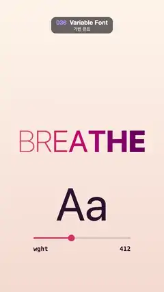

# 036 · Variable Font · 가변 폰트



**EN** Each letter of "BREATHE" swells from thin to black weight just after its neighbour, so the word widens and narrows; a slider reads the weight.  
**KO** "BREATHE"의 글자들이 이웃보다 조금씩 늦게 가장 가는 굵기에서 가장 두꺼운 굵기로 숨 쉬듯 변해 단어가 넓어졌다 좁아지고, 슬라이더가 굵기 값을 보여 준다.

[Video (mp4)](https://sueun-dev.github.io/motion-effects/videos/036-variable-font.mp4) · [Code](../effects/036-variable-font.js) · Typography · 타이포그래피

## Prompt (English)

```text
Create a "Variable Font" motion effect: with a font that has a continuous weight axis, each letter of a word breathes between thin and black a little after its neighbour; heavier letters are wider, so the word itself swells and narrows. A big "Aa" and a slider show the weight value.

Look
- All positions are in px on the 1080 × 1920 frame, top-left origin.
- Background: vertical gradient #FFF4EA → #F6DCD0.
- Font: a variable sans with a weight axis from 100 to 900, set with fractional weights such as "437.5 200px system-ui" (on macOS "system-ui" is the system sans, which has this axis; elsewhere load any variable sans with a wght axis).
- The word "BREATHE" at 200 px on alphabetic baseline y 1000, centred from the sum of the letters' widths, re-measured every frame at their current weights.
- Each letter's colour follows its weight, k = (w − 100) / 800: hsl(350 − 40 k, 75 %, 62 − 38 k %) — a light rose pink when thin, a deep plum-magenta when black.
- Below it "Aa" in #2A1630, 300 px, centred at x 540 on baseline 1450, drawn at the weight of the 4th letter (the "A").
- Slider: a track 640 × 10 px (corner radius 5) at (220, 1560) in rgba(42, 22, 48, 0.15); a fill in #E2456B from the left edge to 640 k + 5 px; a round knob of radius 22 in #E2456B at x = 220 + 640 k, y 1565. Labels in Menlo weight 600, 40 px, #2A1630: "wght" left-aligned at (220, 1650) and the rounded weight value right-aligned at (860, 1650).

Motion (0–5 s)
- Weight of letter i (0…6): w = 500 − 400 cos(2 · 2π t/5 − 0.45 i), two breaths per loop (100 → 900 → 100), each letter 0.45 rad behind the previous one, so a heavy wave runs from left to right through the word. At t = 0 the first letters are thin and the last ones heavy.
- The word's total width changes continuously with the weights, so it gently expands and contracts about its centre; the "Aa", the slider knob and the number all track the 4th letter.

Technique
- Canvas 2D with fillText and fractional font-weight values. Check that every weight renders smoothly: some browsers draw a slice of a system font's weights in one jump (Chrome draws system-ui weights 501–538 far too bold). If so, draw the glyph at 500 inside that slice and lay the 539 glyph over it with opacity (w − 500) / 39, so the weight never pops.

Output and rules
- One self-contained HTML file with no external assets (three.js from a CDN is fine if you use it), drawing on a 1080 × 1920 canvas (9:16) scaled to fit the window.
- Write a function renderFrame(t) that draws the frame for time t in seconds, and preview it with requestAnimationFrame. Everything must be a pure function of t and fixed seeds: no Math.random(), Date or state carried between frames, so frame i = renderFrame(i / 30) can be exported to a 30 fps video.
- Loop seamlessly every 5 seconds: renderFrame(5) must look exactly like renderFrame(0).
- No flicker of any kind: no noise or grain that changes from frame to frame, no strobing or blinking, no z-fighting, no shimmering 1 px lines. Any grain or texture stays fixed to the screen or to the object.
- Keep the top 280 px free of important content (a title label goes there) and fill the whole frame with a designed background.
```

## 프롬프트 (한국어)

```text
"가변 폰트" 모션 효과를 만들어 줘: 굵기 축이 연속인 글꼴로, 단어의 글자마다 이웃보다 조금 늦게 가는 굵기와 가장 두꺼운 굵기 사이를 숨 쉬듯 오간다. 두꺼운 글자일수록 넓어서 단어 자체가 넓어졌다 좁아진다. 큰 "Aa"와 슬라이더가 굵기 값을 보여 준다.

모양
- 모든 위치는 1080 × 1920 화면의 px, 왼쪽 위 기준.
- 배경: 세로 그라디언트 #FFF4EA → #F6DCD0.
- 글꼴: 굵기 축이 100–900인 가변 산세리프, "437.5 200px system-ui"처럼 소수 굵기로 지정한다(macOS에서는 "system-ui" 시스템 산세리프에 이 축이 있다. 다른 곳에서는 wght 축이 있는 가변 산세리프를 불러온다).
- 단어 "BREATHE", 200 px, 알파벳 기준선 y 1000. 글자 너비의 합으로 가운데 정렬하고, 너비는 매 프레임 지금 굵기로 다시 잰다.
- 글자 색은 굵기를 따른다. k = (w − 100) / 800일 때 hsl(350 − 40 k, 75 %, 62 − 38 k %): 가늘 때는 밝은 장밋빛 분홍, 가장 두꺼울 때는 짙은 자두빛 자홍.
- 그 아래 "Aa", #2A1630, 300 px, x 540 가운데, 기준선 1450, 네 번째 글자("A")의 굵기로 그린다.
- 슬라이더: (220, 1560)에 640 × 10 px 막대 틀(모서리 반지름 5) rgba(42, 22, 48, 0.15), 왼쪽 끝부터 640 k + 5 px까지 #E2456B 채움, x = 220 + 640 k, y 1565에 반지름 22 #E2456B 둥근 손잡이. 글자는 Menlo 굵기 600, 40 px, #2A1630: (220, 1650)에 왼쪽 정렬 "wght", (860, 1650)에 오른쪽 정렬로 반올림한 굵기 값.

움직임 (0–5초)
- 글자 i(0…6)의 굵기: w = 500 − 400 cos(2 · 2π t/5 − 0.45 i). 루프마다 두 번 숨 쉬고(100 → 900 → 100), 글자마다 앞 글자보다 0.45 rad 늦어서 두꺼운 물결이 단어를 왼쪽에서 오른쪽으로 지나간다. t = 0에서는 앞 글자들이 가늘고 뒤 글자들이 두껍다.
- 단어 전체 너비가 굵기에 따라 끊김 없이 바뀌어 가운데를 중심으로 부드럽게 넓어졌다 좁아진다. "Aa", 슬라이더 손잡이, 숫자는 모두 네 번째 글자를 따른다.

기법
- Canvas 2D, fillText와 소수 font-weight 값. 모든 굵기가 부드럽게 그려지는지 확인한다: 어떤 브라우저는 시스템 글꼴 굵기의 한 구간을 한 번에 건너뛰어 그린다(Chrome은 system-ui 굵기 501–538을 지나치게 두껍게 그린다). 그렇다면 그 구간 안에서는 굵기 500으로 그리고 그 위에 539 글자를 불투명도 (w − 500) / 39로 겹쳐, 굵기가 절대 튀지 않게 한다.

출력과 규칙
- 외부 파일 없는 HTML 파일 하나(three.js를 쓴다면 CDN은 괜찮다). 1080 × 1920(9:16) 캔버스에 그리고 창 크기에 맞춰 보이게 한다.
- 시간 t(초)의 프레임을 그리는 renderFrame(t) 함수를 만들고, 미리보기는 requestAnimationFrame으로 돌린다. 모든 것은 t와 고정 시드만으로 정해진다: Math.random(), Date, 프레임 사이에 쌓이는 상태 금지. 그래야 i번째 프레임 = renderFrame(i / 30)으로 30fps 영상을 뽑을 수 있다.
- 5초마다 끊김 없이 반복: renderFrame(5)는 renderFrame(0)과 똑같아 보여야 한다.
- 어떤 깜빡임도 금지: 프레임마다 바뀌는 노이즈·그레인, 번쩍임·깜빡임, z-fighting, 반짝이며 떨리는 1px 선 모두 금지. 그레인·질감은 화면이나 물체에 고정한다.
- 위쪽 280px에는 중요한 내용을 두지 않고(제목 라벨 자리), 화면 전체를 디자인된 배경으로 채운다.
```
