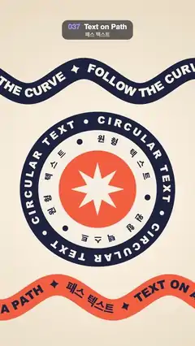

# 037 · Text on Path · 패스 텍스트



**EN** Words stream along two rolling wavy ribbons while a badge of two counter-rotating circular texts turns around a spinning star.  
**KO** 물결치는 리본 두 개 위로 글자가 흘러가고, 가운데 배지에서는 원형 텍스트 두 줄이 서로 반대로 돌고 별이 회전한다.

[Video (mp4)](../videos/037-text-on-path.mp4) · [Code](../effects/037-text-on-path.js) · Typography · 타이포그래피

## Prompt (English)

```text
Create a "Text on Path" motion effect: lettering that follows curves — two wavy ribbons whose words stream along the wave, and a round badge with two counter-rotating circles of text.

Look
- Background: radial gradient centred at (540, 1040), #FFF7EA at radius 100 to #EAD9C0 at radius 1200.
- Two ribbons. Each is a sine wave y = y0 + 70 · sin(2π · x / 620 + phase), stroked as a 118 px wide band with round joins, from x = −300 to 1380 so both ends are off screen:
  - top: y0 = 450, navy band #1D2340, cream text #F6EEDF "FOLLOW THE CURVE  ✦  " repeated;
  - bottom: y0 = 1650, orange band #FF6B3D, navy text "TEXT ON A PATH  ✦  패스 텍스트  ✦  " repeated.
  - Ribbon type: Arial Black, weight 900, 64 px, each glyph centred on the wave line (textAlign center, textBaseline middle) and turned to the wave's direction.
- Badge centred at (540, 1050), back to front: navy disc radius 430, cream disc radius 328, orange disc radius 215, and a cream eight-point star (16 vertices alternating radius 150 and 62).
  - Outer ring in the navy band: "CIRCULAR TEXT ● " three times, Arial Black 900 54 px, cream, on radius 380.
  - Inner ring on the cream band: "원형 텍스트 ● " three times, Apple SD Gothic Neo 800 46 px, navy, on radius 275.
  - Ring glyphs are spread evenly: measure every glyph, share the leftover circumference equally between them, and turn each glyph so its top points outward.

Motion (0–5 s), a = 2π · t / 5
- Top ribbon: wave phase −a (the crests roll to the right) and its words move forward by exactly one repeat of the string per loop.
- Bottom ribbon: wave phase a + 1.5 (the crests roll to the left) and its words move backward by one repeat per loop.
- The outer ring turns clockwise a third of a turn per loop and the inner ring anticlockwise a third of a turn (each ring holds its words three times, so a third of a turn lands back on the start). The star turns clockwise a quarter turn per loop.
- All motion is linear and constant speed.

Technique
- Canvas 2D. For a ribbon, sample the wave as a polyline every 5 px and store the running arc length. Place glyphs by arc length: binary-search the segment containing length s, interpolate the point, translate there, rotate by the segment angle, draw the glyph, then advance s by its width.
- Start the text one repeat before the beginning of the path (s0 = (flow · repeatWidth mod repeatWidth) − repeatWidth) so the left end is never empty.
- Ring glyph i sits at angle rotation + (arc so far + width / 2) / radius, measured clockwise from the top: position (cx + r sin θ, cy − r cos θ), rotated by θ.

Output and rules
- One self-contained HTML file with no external assets (three.js from a CDN is fine if you use it), drawing on a 1080 × 1920 canvas (9:16) scaled to fit the window.
- Write a function renderFrame(t) that draws the frame for time t in seconds, and preview it with requestAnimationFrame. Everything must be a pure function of t and fixed seeds: no Math.random(), Date or state carried between frames, so frame i = renderFrame(i / 30) can be exported to a 30 fps video.
- Loop seamlessly every 5 seconds: renderFrame(5) must look exactly like renderFrame(0).
- No flicker of any kind: no noise or grain that changes from frame to frame, no strobing or blinking, no z-fighting, no shimmering 1 px lines. Any grain or texture stays fixed to the screen or to the object.
- Keep the top 280 px free of important content (a title label goes there) and fill the whole frame with a designed background.
```

## 프롬프트 (한국어)

```text
"패스 텍스트" 모션 효과를 만들어 줘: 글자가 곡선을 따라가는 효과. 물결 리본 두 개 위로 단어가 물결을 타고 흐르고, 가운데 둥근 배지에는 서로 반대로 도는 원형 텍스트 두 줄이 있다.

모양
- 배경: (540, 1040)이 중심인 방사형 그라디언트, 반지름 100에서 #FFF7EA, 반지름 1200에서 #EAD9C0.
- 리본 두 개. 각각 사인파 y = y0 + 70 · sin(2π · x / 620 + 위상)을 폭 118 px 띠로 그은 것(이음새는 둥글게). x = −300부터 1380까지 그려 양 끝이 화면 밖에 있게 한다:
  - 위: y0 = 450, 남색 띠 #1D2340, 크림색 글자 #F6EEDF "FOLLOW THE CURVE  ✦  " 반복;
  - 아래: y0 = 1650, 주황 띠 #FF6B3D, 남색 글자 "TEXT ON A PATH  ✦  패스 텍스트  ✦  " 반복.
  - 리본 글꼴: Arial Black, 굵기 900, 64 px. 글자마다 물결선 위에 가운데 맞춤(textAlign center, textBaseline middle)하고 물결 방향으로 돌린다.
- 배지 중심 (540, 1050), 뒤에서 앞으로: 남색 원 반지름 430, 크림색 원 반지름 328, 주황 원 반지름 215, 크림색 팔각별(꼭짓점 16개, 반지름 150과 62를 번갈아).
  - 남색 띠 위의 바깥 고리: "CIRCULAR TEXT ● " 세 번, Arial Black 900 54 px, 크림색, 반지름 380.
  - 크림색 띠 위의 안쪽 고리: "원형 텍스트 ● " 세 번, Apple SD Gothic Neo 800 46 px, 남색, 반지름 275.
  - 고리 글자는 고르게 퍼뜨린다: 글자마다 폭을 재고 남는 둘레를 글자 사이에 똑같이 나눈 뒤, 글자 윗부분이 바깥을 향하게 돌린다.

움직임 (0–5초), a = 2π · t / 5
- 위 리본: 물결 위상 −a(물마루가 오른쪽으로 굴러감), 단어는 루프마다 문자열 한 번 길이만큼 정확히 앞으로 간다.
- 아래 리본: 물결 위상 a + 1.5(물마루가 왼쪽으로 굴러감), 단어는 루프마다 한 번 길이만큼 뒤로 간다.
- 바깥 고리는 루프마다 시계 방향으로 1/3바퀴, 안쪽 고리는 반시계 방향으로 1/3바퀴 돈다(고리마다 단어가 세 번 들어 있어 1/3바퀴면 처음 모습으로 돌아온다). 별은 루프마다 시계 방향으로 1/4바퀴 돈다.
- 모든 움직임은 일정한 속도의 선형 운동이다.

기법
- Canvas 2D. 리본은 물결을 5 px마다 점을 찍은 꺾은선으로 만들고 누적 호의 길이를 저장한다. 글자는 호의 길이로 배치한다: 길이 s가 들어 있는 구간을 이진 탐색해 점을 보간하고, 그 점으로 옮겨 구간 각도만큼 돌린 뒤 글자를 그리고, s를 글자 폭만큼 늘린다.
- 텍스트는 경로 시작보다 한 번 길이 앞에서 시작한다(s0 = (흐름 · 반복폭 mod 반복폭) − 반복폭). 그래야 왼쪽 끝이 비지 않는다.
- 고리의 i번째 글자는 각도 θ = 회전 + (지금까지의 호 + 폭 / 2) / 반지름(위쪽에서 시계 방향)에 놓는다: 위치 (cx + r sin θ, cy − r cos θ), θ만큼 회전.

출력과 규칙
- 외부 파일 없는 HTML 파일 하나(three.js를 쓴다면 CDN은 괜찮다). 1080 × 1920(9:16) 캔버스에 그리고 창 크기에 맞춰 보이게 한다.
- 시간 t(초)의 프레임을 그리는 renderFrame(t) 함수를 만들고, 미리보기는 requestAnimationFrame으로 돌린다. 모든 것은 t와 고정 시드만으로 정해진다: Math.random(), Date, 프레임 사이에 쌓이는 상태 금지. 그래야 i번째 프레임 = renderFrame(i / 30)으로 30fps 영상을 뽑을 수 있다.
- 5초마다 끊김 없이 반복: renderFrame(5)는 renderFrame(0)과 똑같아 보여야 한다.
- 어떤 깜빡임도 금지: 프레임마다 바뀌는 노이즈·그레인, 번쩍임·깜빡임, z-fighting, 반짝이며 떨리는 1px 선 모두 금지. 그레인·질감은 화면이나 물체에 고정한다.
- 위쪽 280px에는 중요한 내용을 두지 않고(제목 라벨 자리), 화면 전체를 디자인된 배경으로 채운다.
```
