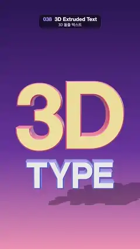

# 038 · 3D Extruded Text · 3D 돌출 텍스트



**EN** Glossy extruded "3D TYPE" letters with coloured sides swing side to side and nod, casting a soft shadow under a purple-pink sky.  
**KO** 옆면 색이 다른 광택 입체 글자 "3D TYPE"이 좌우로 흔들리며 고개를 끄덕이고, 보라·분홍 하늘 아래 부드러운 그림자를 드리운다.

[Video (mp4)](../videos/038-extruded-3d-text.mp4) · [Code](../effects/038-extruded-3d-text.js) · Typography · 타이포그래피

## Prompt (English)

```text
Create a "3D Extruded Text" motion effect: thick, glossy 3D letters with differently coloured sides that swing from side to side under studio light.

Look
- Two words, stacked and centred:
  - "3D": size 2.9, depth 1.3, yellow face #FFD166, pink-red sides #E2557A, at y = 0.9;
  - "TYPE" below it: size 1.15, depth 0.55, white face #FFFFFF, blue sides #5B6CFF, at y = −1.8.
  - Both with a rounded bevel (thickness 0.14, size 0.06, 6 segments), 18 curve segments, each geometry centred on its own bounding box.
- Face material: physical, roughness 0.22, metalness 0.1, clearcoat 1, clearcoat roughness 0.15. Side material: standard, roughness 0.35, metalness 0.25.
- Background: a vertical gradient, deep indigo #2A1B55 at the top, purple #6B3FA0 at 60 %, pink #F29BB3 at the bottom.
- Lighting: a neutral room environment map (prefiltered, intensity 0.7) for the reflections; a warm key light #FFE6C8, intensity 3.2, from (−6, 9, 8), casting a soft shadow; a cyan rim light #7FD8FF, intensity 2.2, from (7, 2, −6), behind on the right.
- A shadow-only floor at y = −3.4 (shadow opacity 0.28): only the soft shadow of the letters shows, so the gradient stays clean.
- Camera: perspective, 32° vertical field of view, at (0, 1.8, 20) looking at (0, 0.5, 0). The words sit in the middle of the frame (roughly y 600–1500 px) with the shadow below them.

Motion (0–5 s), a = 2π · t / 5
- Both words move together as one group:
  - turn about the vertical axis: 0.75 · sin(a) rad (about ±43°);
  - a gentle nod about the horizontal axis: 0.12 · sin(2a) rad;
  - a small bob up and down: 0.15 · sin(2a) units.
- It is a side-to-side swing, never a full turn, so the words never read backwards; the sine motion slows naturally at each end. At 0 s and 5 s it faces the camera.

Technique
- three.js with TextGeometry and the helvetiker bold typeface (FontLoader), and a material array [face, side] so the fronts and the extruded sides get different materials.
- ACES Filmic tone mapping, antialiasing on, a PCF soft shadow map 2048 × 2048 from the key light (shadow camera ±6, radius 6); the letters cast shadows, a ShadowMaterial floor receives them.
- The background is a small canvas gradient used as an sRGB texture for scene.background; the environment comes from a room environment scene through a PMREM generator.

Output and rules
- One self-contained HTML file with no external assets (three.js from a CDN is fine if you use it), drawing on a 1080 × 1920 canvas (9:16) scaled to fit the window.
- Write a function renderFrame(t) that draws the frame for time t in seconds, and preview it with requestAnimationFrame. Everything must be a pure function of t and fixed seeds: no Math.random(), Date or state carried between frames, so frame i = renderFrame(i / 30) can be exported to a 30 fps video.
- Loop seamlessly every 5 seconds: renderFrame(5) must look exactly like renderFrame(0).
- No flicker of any kind: no noise or grain that changes from frame to frame, no strobing or blinking, no z-fighting, no shimmering 1 px lines. Any grain or texture stays fixed to the screen or to the object.
- Keep the top 280 px free of important content (a title label goes there) and fill the whole frame with a designed background.
```

## 프롬프트 (한국어)

```text
"3D 돌출 텍스트" 모션 효과를 만들어 줘: 앞면과 옆면 색이 다른 두툼하고 광택 있는 입체 글자가 스튜디오 조명 아래에서 좌우로 흔들리는 효과.

모양
- 위아래로 쌓아 가운데 맞춘 단어 두 개:
  - "3D": 크기 2.9, 두께 1.3, 앞면 노랑 #FFD166, 옆면 분홍빛 빨강 #E2557A, y = 0.9;
  - 그 아래 "TYPE": 크기 1.15, 두께 0.55, 앞면 흰색 #FFFFFF, 옆면 파랑 #5B6CFF, y = −1.8.
  - 둘 다 둥근 베벨(두께 0.14, 크기 0.06, 6분할), 곡선 분할 18, 지오메트리는 각자 자기 경계 상자 중심에 맞춘다.
- 앞면 재질: 물리 기반, 거칠기 0.22, 금속성 0.1, 클리어코트 1, 클리어코트 거칠기 0.15. 옆면 재질: 표준, 거칠기 0.35, 금속성 0.25.
- 배경: 세로 그라디언트, 위는 짙은 남보라 #2A1B55, 60 %에서 보라 #6B3FA0, 아래는 분홍 #F29BB3.
- 조명: 반사용 중성 룸 환경맵(프리필터, 세기 0.7); 따뜻한 키 라이트 #FFE6C8, 세기 3.2, 위치 (−6, 9, 8), 부드러운 그림자를 드리운다; 하늘색 림 라이트 #7FD8FF, 세기 2.2, 위치 (7, 2, −6)(오른쪽 뒤).
- y = −3.4에 그림자만 보이는 바닥(그림자 불투명도 0.28): 글자의 부드러운 그림자만 보이고 그라디언트는 깨끗하게 남는다.
- 카메라: 원근, 세로 시야각 32°, 위치 (0, 1.8, 20)에서 (0, 0.5, 0)을 본다. 단어는 화면 가운데(대략 y 600–1500 px)에 있고 그 아래에 그림자가 진다.

움직임 (0–5초), a = 2π · t / 5
- 두 단어가 한 그룹으로 함께 움직인다:
  - 세로축 회전: 0.75 · sin(a) rad(약 ±43°);
  - 가로축으로 살짝 끄덕임: 0.12 · sin(2a) rad;
  - 위아래로 살짝 떠오름: 0.15 · sin(2a).
- 한 바퀴 도는 것이 아니라 좌우로 흔드는 움직임이라 글자가 뒤집혀 보이는 순간이 없다. 사인 운동이라 양 끝에서 자연스럽게 느려진다. 0초와 5초에는 카메라를 정면으로 본다.

기법
- three.js의 TextGeometry와 helvetiker bold 서체(FontLoader). 재질 배열 [앞면, 옆면]으로 앞면과 돌출된 옆면에 다른 재질을 준다.
- ACES Filmic 톤 매핑, 안티에일리어싱 켬, 키 라이트의 PCF 소프트 그림자 맵 2048 × 2048(그림자 카메라 ±6, 반지름 6). 글자는 그림자를 드리우고, ShadowMaterial 바닥이 그림자를 받는다.
- 배경은 작은 캔버스 그라디언트를 sRGB 텍스처로 만들어 scene.background에 넣는다. 환경광은 룸 환경 장면을 PMREM 생성기로 거쳐 만든다.

출력과 규칙
- 외부 파일 없는 HTML 파일 하나(three.js를 쓴다면 CDN은 괜찮다). 1080 × 1920(9:16) 캔버스에 그리고 창 크기에 맞춰 보이게 한다.
- 시간 t(초)의 프레임을 그리는 renderFrame(t) 함수를 만들고, 미리보기는 requestAnimationFrame으로 돌린다. 모든 것은 t와 고정 시드만으로 정해진다: Math.random(), Date, 프레임 사이에 쌓이는 상태 금지. 그래야 i번째 프레임 = renderFrame(i / 30)으로 30fps 영상을 뽑을 수 있다.
- 5초마다 끊김 없이 반복: renderFrame(5)는 renderFrame(0)과 똑같아 보여야 한다.
- 어떤 깜빡임도 금지: 프레임마다 바뀌는 노이즈·그레인, 번쩍임·깜빡임, z-fighting, 반짝이며 떨리는 1px 선 모두 금지. 그레인·질감은 화면이나 물체에 고정한다.
- 위쪽 280px에는 중요한 내용을 두지 않고(제목 라벨 자리), 화면 전체를 디자인된 배경으로 채운다.
```
