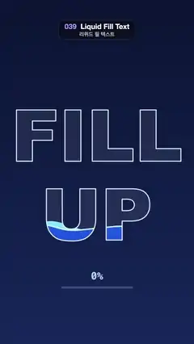

# 039 · Liquid Fill Text · 리퀴드 필 텍스트



**EN** Blue liquid with sloshing waves and rising bubbles fills the outlined words FILL UP to the brim and drains again, with a % meter.  
**KO** 외곽선만 있는 FILL UP 글자 안에 물결과 기포가 있는 파란 액체가 가득 차올랐다 다시 빠지고, 아래 퍼센트 게이지가 따라 움직인다.

[Video (mp4)](https://sueun-dev.github.io/motion-effects/videos/039-liquid-fill-text.mp4) · [Code](../effects/039-liquid-fill-text.js) · Typography · 타이포그래피

## Prompt (English)

```text
Create a "Liquid Fill Text" motion effect: big outlined words that fill up with wavy blue liquid and bubbles, then drain again.

Look
- Background: vertical gradient #0B1433 (top) to #16275A (bottom).
- Two lines in Arial Black 900, 400 px, centred at x = 540: "FILL" with its baseline at y = 900 and "UP" with its baseline at y = 1340.
- The empty glass: the letters filled with rgba(255, 255, 255, 0.07). On top of everything, a 6 px outline rgba(235, 248, 255, 0.9) with round joins.
- Inside the letters, two liquid layers (W = 1080, L = liquid level, A = wave amplitude):
  - back layer, light cyan #7FE3FF: surface y = L − 10 + A · sin(2π · 2x / W + a + 1.3) + 0.5A · sin(2π · 3x / W − 2a);
  - front layer, vertical gradient #2EC4FF (y 590) to #1D4FE0 (y 1350): surface y = L + 0.8A · sin(2π · 3x / W − a) + 0.4A · sin(2π · 4x / W + 2a), with an 8 px foam line rgba(210, 248, 255, 0.9) along it.
- 26 bubbles (fixed seed): x 140–940, radius 6–18 px, white at alpha 0.45, visible only where there is liquid.
- Below the words: a readout "NN%" in Menlo 600 56 px, rgba(200, 235, 255, 0.85), centred at y = 1560, and a 400 × 10 px bar at (340, 1600): track rgba(200, 235, 255, 0.25), fill #2EC4FF.

Motion (0–5 s), a = 2π · t / 5
- fill = 0.5 − 0.5 · cos(a): empty at 0 s, full at 2.5 s, empty again at 5 s, with soft turns at both ends.
- Level L = 1350 − 760 · (0.1 + 0.94 · fill): from y 1274 (a little liquid in the bottom of "UP") up to y 560 (just above the top of "FILL"), so it reaches the brim.
- Amplitude A = 20 + 22 · sin²(π · t / 5) px; the two layers' waves travel in opposite directions.
- Each bubble rises from y 1370 to y 530 once or twice per loop (a whole number, so it loops), wobbles ±10 px sideways, and fades in over the first sixth of its rise.
- The readout shows round(fill · 100) and the bar is 400 · fill wide.

Technique
- Canvas 2D with an off-screen canvas for the liquid: draw the back layer, then the front layer and its foam line, then the bubbles with 'source-atop' (only over liquid), then cut it to the letter shapes with 'destination-in' using a mask canvas of both words drawn once at setup.
- Each surface is a polyline sampled every 8 px and closed down to the bottom of the frame.
- Per frame: background, faint letter fill, the liquid canvas, the outlines, the readout and bar.

Output and rules
- One self-contained HTML file with no external assets (three.js from a CDN is fine if you use it), drawing on a 1080 × 1920 canvas (9:16) scaled to fit the window.
- Write a function renderFrame(t) that draws the frame for time t in seconds, and preview it with requestAnimationFrame. Everything must be a pure function of t and fixed seeds: no Math.random(), Date or state carried between frames, so frame i = renderFrame(i / 30) can be exported to a 30 fps video.
- Loop seamlessly every 5 seconds: renderFrame(5) must look exactly like renderFrame(0).
- No flicker of any kind: no noise or grain that changes from frame to frame, no strobing or blinking, no z-fighting, no shimmering 1 px lines. Any grain or texture stays fixed to the screen or to the object.
- Keep the top 280 px free of important content (a title label goes there) and fill the whole frame with a designed background.
```

## 프롬프트 (한국어)

```text
"리퀴드 필 텍스트" 모션 효과를 만들어 줘: 외곽선만 있는 큰 글자 안에 물결치는 파란 액체와 기포가 차올랐다가 다시 빠지는 효과.

모양
- 배경: 세로 그라디언트 #0B1433(위) → #16275A(아래).
- Arial Black 900, 400 px 두 줄, x = 540 가운데 맞춤: "FILL"은 기준선 y = 900, "UP"은 기준선 y = 1340.
- 빈 유리잔: 글자를 rgba(255, 255, 255, 0.07)로 채운다. 맨 위에는 둥근 이음새의 6 px 외곽선 rgba(235, 248, 255, 0.9).
- 글자 안의 액체 두 층(W = 1080, L = 수위, A = 물결 진폭):
  - 뒤층, 밝은 하늘색 #7FE3FF: 수면 y = L − 10 + A · sin(2π · 2x / W + a + 1.3) + 0.5A · sin(2π · 3x / W − 2a);
  - 앞층, 세로 그라디언트 #2EC4FF(y 590) → #1D4FE0(y 1350): 수면 y = L + 0.8A · sin(2π · 3x / W − a) + 0.4A · sin(2π · 4x / W + 2a), 수면을 따라 8 px 거품선 rgba(210, 248, 255, 0.9).
- 기포 26개(고정 시드): x 140–940, 반지름 6–18 px, 흰색 알파 0.45, 액체가 있는 곳에서만 보인다.
- 글자 아래: "NN%" 표시, Menlo 600 56 px, rgba(200, 235, 255, 0.85), y = 1560 가운데. 그리고 (340, 1600)에 400 × 10 px 막대: 바탕 rgba(200, 235, 255, 0.25), 채움 #2EC4FF.

움직임 (0–5초), a = 2π · t / 5
- fill = 0.5 − 0.5 · cos(a): 0초에 비어 있고, 2.5초에 가득 차고, 5초에 다시 빈다. 양 끝에서 부드럽게 방향을 바꾼다.
- 수위 L = 1350 − 760 · (0.1 + 0.94 · fill): y 1274("UP" 바닥에 액체가 조금)에서 y 560("FILL" 꼭대기 바로 위)까지 올라가 가장자리까지 꽉 찬다.
- 진폭 A = 20 + 22 · sin²(π · t / 5) px. 두 층의 물결은 서로 반대 방향으로 흐른다.
- 기포는 루프마다 한 번 또는 두 번(정수라서 반복된다) y 1370에서 y 530까지 올라가고, 옆으로 ±10 px 흔들리며, 올라가는 처음 1/6 동안 서서히 나타난다.
- 숫자는 round(fill · 100), 막대 폭은 400 · fill.

기법
- Canvas 2D와 액체용 화면 밖 캔버스: 뒤층, 앞층과 거품선, 'source-atop'으로 기포(액체 위에만)를 그린 뒤, 시작할 때 한 번 그려 둔 두 단어 마스크 캔버스로 'destination-in'을 해서 글자 모양으로 잘라 낸다.
- 수면은 8 px마다 점을 찍은 꺾은선이고, 화면 아래까지 닫아서 채운다.
- 프레임마다: 배경, 옅은 글자 채움, 액체 캔버스, 외곽선, 숫자와 막대 순서.

출력과 규칙
- 외부 파일 없는 HTML 파일 하나(three.js를 쓴다면 CDN은 괜찮다). 1080 × 1920(9:16) 캔버스에 그리고 창 크기에 맞춰 보이게 한다.
- 시간 t(초)의 프레임을 그리는 renderFrame(t) 함수를 만들고, 미리보기는 requestAnimationFrame으로 돌린다. 모든 것은 t와 고정 시드만으로 정해진다: Math.random(), Date, 프레임 사이에 쌓이는 상태 금지. 그래야 i번째 프레임 = renderFrame(i / 30)으로 30fps 영상을 뽑을 수 있다.
- 5초마다 끊김 없이 반복: renderFrame(5)는 renderFrame(0)과 똑같아 보여야 한다.
- 어떤 깜빡임도 금지: 프레임마다 바뀌는 노이즈·그레인, 번쩍임·깜빡임, z-fighting, 반짝이며 떨리는 1px 선 모두 금지. 그레인·질감은 화면이나 물체에 고정한다.
- 위쪽 280px에는 중요한 내용을 두지 않고(제목 라벨 자리), 화면 전체를 디자인된 배경으로 채운다.
```
