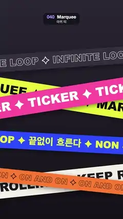

# 040 · Marquee · 마퀴 띠



**EN** Six tilted ribbons of bold type, two pairs crossing in an X, scroll endlessly in alternating directions over a dark background.  
**KO** 기울어진 굵은 글자 띠 여섯 개(두 쌍은 X자로 교차)가 어두운 배경 위에서 번갈아 반대 방향으로 끝없이 흘러간다.

[Video (mp4)](../videos/040-marquee.mp4) · [Code](../effects/040-marquee.js) · Typography · 타이포그래피

## Prompt (English)

```text
Create a "Marquee" motion effect: tilted ribbons of bold repeating type that scroll endlessly in alternating directions, with two pairs crossing in an X.

Look
- Background: vertical gradient #2A2633 (top) to #141218 (bottom).
- Six bands. Each is an 1800 px long rectangle centred at x = 540 and rotated about its own centre, so its ends are always off screen. Drawn in this order (later bands on top); "rising" means the right end is higher:
  1. y 520, rising 4°, 150 px tall, band #34303F, text "INFINITE LOOP ✦ " as a 3 px outline only (no fill) in #F4F0E6, scrolls right.
  2. y 860, falling 9°, 190 px, acid-yellow band #E8FF3A, text "MARQUEE ✦ 마퀴 띠 ✦ " filled #111111, scrolls left.
  3. y 860, rising 9°, 190 px, hot-pink band #FF4FA3, text "TICKER ✦ " filled #FFFFFF, scrolls right. It crosses band 2 in an X.
  4. y 1250, falling 3°, 150 px, blue band #2B4BFF, text "NON STOP ✦ 끝없이 흐른다 ✦ " filled #E8FF3A, scrolls left.
  5. y 1590, rising 6°, 190 px, cream band #F4F0E6, text "KEEP ROLLING ✦ " filled #1C1C22, scrolls right.
  6. y 1590, falling 6°, 120 px, orange band #FF7A30, text "ON AND ON ✦ " as a 3 px outline in #1C1C22, scrolls left. It crosses band 5.
- Type: Arial Black 900 at 0.56 × the band height (84, 106 or 67 px); Korean falls back to Apple SD Gothic Neo. Vertically centred on the band (textBaseline middle, nudged down by 3 % of the band height), the string repeated end to end along the whole band. Outlines use round joins.
- Each band casts a soft drop shadow: rgba(0, 0, 0, 0.45), blur 40, offset 14 px down.

Motion (0–5 s)
- Each band's text moves along the band by exactly one repeat (the measured width of its string) per loop, in the direction listed, at constant speed. Because it shifts by a whole repeat, 5 s looks exactly like 0 s.
- The bands themselves stay still; only the type flows, neighbouring bands in opposite directions.

Technique
- Canvas 2D. For each band: translate to (540, y), rotate by the tilt, fill the band with the shadow on, switch the shadow off, then draw copies of the string from x = −900 − repeat + offset up to 900 in steps of the repeat width, where offset = (t / 5 · direction · repeat) mod repeat (kept positive).

Output and rules
- One self-contained HTML file with no external assets (three.js from a CDN is fine if you use it), drawing on a 1080 × 1920 canvas (9:16) scaled to fit the window.
- Write a function renderFrame(t) that draws the frame for time t in seconds, and preview it with requestAnimationFrame. Everything must be a pure function of t and fixed seeds: no Math.random(), Date or state carried between frames, so frame i = renderFrame(i / 30) can be exported to a 30 fps video.
- Loop seamlessly every 5 seconds: renderFrame(5) must look exactly like renderFrame(0).
- No flicker of any kind: no noise or grain that changes from frame to frame, no strobing or blinking, no z-fighting, no shimmering 1 px lines. Any grain or texture stays fixed to the screen or to the object.
- Keep the top 280 px free of important content (a title label goes there) and fill the whole frame with a designed background.
```

## 프롬프트 (한국어)

```text
"마퀴 띠" 모션 효과를 만들어 줘: 굵은 글자가 반복되는 기울어진 띠들이 번갈아 반대 방향으로 끝없이 흐르고, 그중 두 쌍은 X자로 교차하는 효과.

모양
- 배경: 세로 그라디언트 #2A2633(위) → #141218(아래).
- 띠 여섯 개. 각각 길이 1800 px 직사각형을 x = 540에 가운데 두고 자기 중심으로 돌린 것이라 양 끝은 늘 화면 밖에 있다. 이 순서로 그린다(나중 것이 위). "올라감"은 오른쪽 끝이 더 높다는 뜻:
  1. y 520, 4° 올라감, 높이 150 px, 띠 #34303F, 글자 "INFINITE LOOP ✦ "는 3 px 외곽선만(채움 없음) #F4F0E6, 오른쪽으로 흐른다.
  2. y 860, 9° 내려감, 190 px, 형광 노랑 띠 #E8FF3A, 글자 "MARQUEE ✦ 마퀴 띠 ✦ " 채움 #111111, 왼쪽으로 흐른다.
  3. y 860, 9° 올라감, 190 px, 핫핑크 띠 #FF4FA3, 글자 "TICKER ✦ " 채움 #FFFFFF, 오른쪽으로 흐른다. 2번 띠와 X자로 교차한다.
  4. y 1250, 3° 내려감, 150 px, 파란 띠 #2B4BFF, 글자 "NON STOP ✦ 끝없이 흐른다 ✦ " 채움 #E8FF3A, 왼쪽으로 흐른다.
  5. y 1590, 6° 올라감, 190 px, 크림색 띠 #F4F0E6, 글자 "KEEP ROLLING ✦ " 채움 #1C1C22, 오른쪽으로 흐른다.
  6. y 1590, 6° 내려감, 120 px, 주황 띠 #FF7A30, 글자 "ON AND ON ✦ "는 3 px 외곽선 #1C1C22, 왼쪽으로 흐른다. 5번 띠와 교차한다.
- 글꼴: Arial Black 900, 크기는 띠 높이 × 0.56(84, 106, 67 px). 한글은 Apple SD Gothic Neo로 대체된다. 띠 세로 가운데(textBaseline middle, 띠 높이의 3 %만큼 아래로)에 놓고 문자열을 띠 전체에 이어 붙여 반복한다. 외곽선 이음새는 둥글게.
- 띠마다 부드러운 그림자: rgba(0, 0, 0, 0.45), 흐림 40, 아래로 14 px.

움직임 (0–5초)
- 띠마다 글자가 루프당 정확히 반복 한 번 길이(문자열을 잰 폭)만큼, 위에 적은 방향으로 일정한 속도로 띠를 따라 움직인다. 반복 한 번 길이만큼 밀리므로 5초 모습이 0초와 똑같다.
- 띠 자체는 가만히 있고 글자만 흐른다. 이웃한 띠는 서로 반대 방향.

기법
- Canvas 2D. 띠마다: (540, y)로 옮기고 기울기만큼 돌린 뒤, 그림자를 켜고 띠를 채우고, 그림자를 끈 다음, x = −900 − 반복폭 + offset부터 900까지 반복폭 간격으로 문자열을 그린다. offset = (t / 5 · 방향 · 반복폭) mod 반복폭(양수로 유지).

출력과 규칙
- 외부 파일 없는 HTML 파일 하나(three.js를 쓴다면 CDN은 괜찮다). 1080 × 1920(9:16) 캔버스에 그리고 창 크기에 맞춰 보이게 한다.
- 시간 t(초)의 프레임을 그리는 renderFrame(t) 함수를 만들고, 미리보기는 requestAnimationFrame으로 돌린다. 모든 것은 t와 고정 시드만으로 정해진다: Math.random(), Date, 프레임 사이에 쌓이는 상태 금지. 그래야 i번째 프레임 = renderFrame(i / 30)으로 30fps 영상을 뽑을 수 있다.
- 5초마다 끊김 없이 반복: renderFrame(5)는 renderFrame(0)과 똑같아 보여야 한다.
- 어떤 깜빡임도 금지: 프레임마다 바뀌는 노이즈·그레인, 번쩍임·깜빡임, z-fighting, 반짝이며 떨리는 1px 선 모두 금지. 그레인·질감은 화면이나 물체에 고정한다.
- 위쪽 280px에는 중요한 내용을 두지 않고(제목 라벨 자리), 화면 전체를 디자인된 배경으로 채운다.
```
