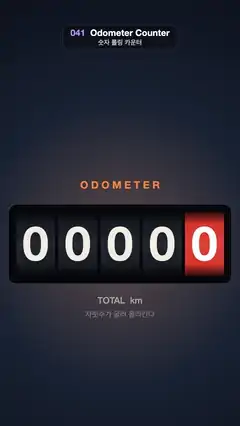

# 041 · Odometer Counter · 숫자 롤링 카운터



**EN** Five motion-blurred odometer wheels roll upward from 00000 to 25713, 68259 and 99999, then roll over back to 00000.  
**KO** 모션 블러가 걸린 주행거리계 다섯 자리가 위로 굴러 00000 → 25713 → 68259 → 99999로 오른 뒤 00000으로 넘어간다.

[Video (mp4)](https://sueun-dev.github.io/motion-effects/videos/041-odometer-counter.mp4) · [Code](../effects/041-odometer-counter.js) · Typography · 타이포그래피

## Prompt (English)

```text
Create an "Odometer Counter" motion effect: five mechanical digit wheels that roll upward through every digit in between, with real motion blur.

Look
- Background: radial gradient centred at (540, 1100), #24324A at radius 50 to #0A0F1A at radius 1300, plus a warm dashboard glow rgba(255, 138, 61, 0.22) fading to 0 between radius 100 and 640.
- Five wheel windows, each 176 × 290 px, 14 px apart, in a row centred on the frame (x 72–1008, y 955–1245). The first four are dark #191D26 with digits #F2EEE4; the rightmost is red #E8452C with white digits.
- Digits: Helvetica Neue bold 214 px, centred, 6 px below the window centre. On each wheel the digits are stacked 290 px apart (one window height), so the next digit scrolls in from below.
- Cylinder shading over each window: a vertical gradient, black 0.8 at the top, clear at 20 %, a faint white 0.06 at 50 %, clear at 80 %, black 0.8 at the bottom.
- Bezel: a #05070C rounded rectangle 34 px around the row (1004 × 358, radius 36) with a 3 px rgba(255, 255, 255, 0.14) edge.
- Labels: "O D O M E T E R" (spaced letters) Helvetica Neue bold 46 px #FF8A3D centred at y 835; "TOTAL  km" weight 500, 40 px, rgba(242, 238, 228, 0.6) at y 1355; "자릿수가 굴러 올라간다" Apple SD Gothic Neo 500 34 px at alpha 0.35, y 1420.

Motion (0–5 s)
- The display steps 00000 → 25713 → 68259 → 99999 → 00000, one step every 1.25 s (rolls begin at 0.05, 1.3, 2.55 and 3.8 s).
- The wheels only ever roll forward (digits move up): a wheel rolls (new − old + 10) mod 10 digits, so 9 rolls on to 0, and the last step is the classic roll-over where every 9 rolls one notch to 0.
- Each roll takes 0.75 s with a cosine ease-in-out (0.5 − 0.5 · cos(πk)). The rightmost wheel starts first and each wheel to its left starts 0.06 s later, like a carry.
- Over the loop every wheel rolls a multiple of 10 digits, so the loop is seamless.

Technique
- Canvas 2D. A wheel's position p (in digits) is the sum of its eased rolls. Draw digits n = floor(p) − 1 … floor(p) + 2 (shown as n mod 10) at y = window centre + 6 + (n − p) · 290, clipped to the window.
- Motion blur: render the wheel into an opaque 176 × 290 off-screen canvas at 6 moments across a 1/60 s shutter (time t − j / 300 for j = 0 … 5) and composite them with alpha 1 / (j + 1), which is an exact running average because each copy is opaque. Then add the shading gradient.

Output and rules
- One self-contained HTML file with no external assets (three.js from a CDN is fine if you use it), drawing on a 1080 × 1920 canvas (9:16) scaled to fit the window.
- Write a function renderFrame(t) that draws the frame for time t in seconds, and preview it with requestAnimationFrame. Everything must be a pure function of t and fixed seeds: no Math.random(), Date or state carried between frames, so frame i = renderFrame(i / 30) can be exported to a 30 fps video.
- Loop seamlessly every 5 seconds: renderFrame(5) must look exactly like renderFrame(0).
- No flicker of any kind: no noise or grain that changes from frame to frame, no strobing or blinking, no z-fighting, no shimmering 1 px lines. Any grain or texture stays fixed to the screen or to the object.
- Keep the top 280 px free of important content (a title label goes there) and fill the whole frame with a designed background.
```

## 프롬프트 (한국어)

```text
"숫자 롤링 카운터" 모션 효과를 만들어 줘: 기계식 숫자 바퀴 다섯 개가 사이의 숫자를 모두 거치며 위로 굴러 올라가고, 진짜 모션 블러가 걸리는 효과.

모양
- 배경: (540, 1100) 중심 방사형 그라디언트, 반지름 50에서 #24324A, 반지름 1300에서 #0A0F1A. 그 위에 따뜻한 계기판 빛 rgba(255, 138, 61, 0.22)이 반지름 100에서 640 사이에서 0으로 옅어진다.
- 바퀴 창 다섯 개, 각각 176 × 290 px, 간격 14 px, 화면 가운데 한 줄(x 72–1008, y 955–1245). 앞의 네 개는 어두운 #191D26에 숫자 #F2EEE4, 맨 오른쪽은 빨강 #E8452C에 흰 숫자.
- 숫자: Helvetica Neue bold 214 px, 가운데 맞춤, 창 중심보다 6 px 아래. 바퀴마다 숫자가 290 px(창 높이 하나) 간격으로 쌓여 있어 다음 숫자가 아래에서 올라온다.
- 창마다 원통 음영: 세로 그라디언트, 위 검정 0.8, 20 %에서 투명, 50 %에서 옅은 흰색 0.06, 80 %에서 투명, 아래 검정 0.8.
- 베젤: 줄 둘레 34 px 바깥의 #05070C 둥근 사각형(1004 × 358, 반지름 36), 가장자리 3 px rgba(255, 255, 255, 0.14).
- 글자: "O D O M E T E R"(띄어 쓴 글자) Helvetica Neue bold 46 px #FF8A3D, y 835 가운데; "TOTAL  km" 굵기 500, 40 px, rgba(242, 238, 228, 0.6), y 1355; "자릿수가 굴러 올라간다" Apple SD Gothic Neo 500 34 px 알파 0.35, y 1420.

움직임 (0–5초)
- 표시가 00000 → 25713 → 68259 → 99999 → 00000으로 1.25초마다 한 단계씩 바뀐다(구르기 시작 0.05, 1.3, 2.55, 3.8초).
- 바퀴는 앞으로만 구른다(숫자가 위로 올라감): 바퀴마다 (새 숫자 − 이전 숫자 + 10) mod 10칸 구르므로 9 다음에는 0으로 넘어가고, 마지막 단계는 모든 9가 한 칸씩 굴러 0이 되는 고전적인 자리 넘김이다.
- 한 번 구르는 데 0.75초, 코사인 이즈인아웃(0.5 − 0.5 · cos(πk)). 맨 오른쪽 바퀴가 먼저 움직이고 왼쪽으로 갈수록 0.06초씩 늦게 시작한다(받아올림처럼).
- 루프 동안 바퀴마다 10의 배수 칸을 구르므로 끊김 없이 반복된다.

기법
- Canvas 2D. 바퀴 위치 p(숫자 단위)는 이징된 구르기의 합이다. 숫자 n = floor(p) − 1 … floor(p) + 2(표시는 n mod 10)를 y = 창 중심 + 6 + (n − p) · 290에 그리고 창 안으로 자른다.
- 모션 블러: 불투명한 176 × 290 화면 밖 캔버스에 바퀴를 1/60초 셔터 동안의 6순간(시간 t − j / 300, j = 0 … 5)으로 그려 알파 1 / (j + 1)로 겹친다. 사본이 모두 불투명해서 정확한 누적 평균이 된다. 그다음 음영 그라디언트를 얹는다.

출력과 규칙
- 외부 파일 없는 HTML 파일 하나(three.js를 쓴다면 CDN은 괜찮다). 1080 × 1920(9:16) 캔버스에 그리고 창 크기에 맞춰 보이게 한다.
- 시간 t(초)의 프레임을 그리는 renderFrame(t) 함수를 만들고, 미리보기는 requestAnimationFrame으로 돌린다. 모든 것은 t와 고정 시드만으로 정해진다: Math.random(), Date, 프레임 사이에 쌓이는 상태 금지. 그래야 i번째 프레임 = renderFrame(i / 30)으로 30fps 영상을 뽑을 수 있다.
- 5초마다 끊김 없이 반복: renderFrame(5)는 renderFrame(0)과 똑같아 보여야 한다.
- 어떤 깜빡임도 금지: 프레임마다 바뀌는 노이즈·그레인, 번쩍임·깜빡임, z-fighting, 반짝이며 떨리는 1px 선 모두 금지. 그레인·질감은 화면이나 물체에 고정한다.
- 위쪽 280px에는 중요한 내용을 두지 않고(제목 라벨 자리), 화면 전체를 디자인된 배경으로 채운다.
```
