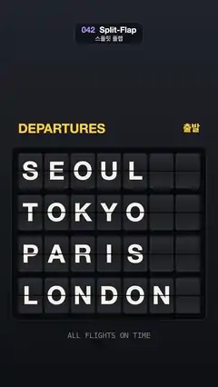

# 042 · Split-Flap · 스플릿 플랩



**EN** A departures board flips its tiles in a diagonal wave through random letters, from SEOUL, TOKYO, PARIS, LONDON to four new cities and back.  
**KO** 출발 안내판의 글자판이 대각선 물결처럼 차례로 접히며 무작위 글자를 거쳐 SEOUL·TOKYO·PARIS·LONDON에서 새 도시 네 곳으로, 다시 처음으로 바뀐다.

[Video (mp4)](https://sueun-dev.github.io/motion-effects/videos/042-split-flap.mp4) · [Code](../effects/042-split-flap.js) · Typography · 타이포그래피

## Prompt (English)

```text
Create a "Split-Flap" motion effect: an airport departures board whose tiles fold in half on their hinge, flipping through letters to change the city names, and then back.

Look
- Background: vertical gradient #20232B (top) to #0E1014 (bottom).
- Board: 7 columns × 4 rows of tiles, each 120 × 176 px, 10 px apart, rows 30 px apart, top-left tile at (90, 760). Behind them a #08090C rounded panel (radius 28) with 32 px padding (964 × 858) and a 3 px rgba(255, 255, 255, 0.1) edge.
- Each tile is two halves (top and bottom) with 12 px rounded outer corners and a 2 px gap at the middle hinge, filled with a vertical gradient #2A2B31 → #1C1D22 (middle) → #2A2B31. The letter is #F5F1E6, Helvetica Neue bold 124 px, centred 4 px below the hinge, and each half is clipped so it shows only its half of the letter. A 4 px rgba(0, 0, 0, 0.6) hinge line runs across every row.
- Header: "DEPARTURES" in #FFC93C, Helvetica Neue 800 64 px, left-aligned at (90, 640); "출발" in Apple SD Gothic Neo 700 48 px, same colour, right-aligned at x 990 on the same line.
- Footer: "ALL FLIGHTS ON TIME" in Menlo 500 36 px, rgba(245, 241, 230, 0.45), centred at y 1668.
- At the start the rows read SEOUL, TOKYO, PARIS, LONDON (padded with blank tiles to 7).

Motion (0–5 s)
- At 0.35 s the board changes to BERLIN, SYDNEY, MADRID, BUSAN; at 2.85 s it changes back. Each tile starts row · 0.16 + column · 0.05 s after the change, so a diagonal wave sweeps the board.
- A changing tile flips through 2–6 random letters A–Z (fixed per tile and per change by a seeded random, blank tiles too) before landing on its new letter. Each flip takes 0.13 s. The waves finish at about 2.0 s and 4.5 s, then the board holds.
- One flip from old to new, progress u from 0 to 1: behind it, the new top half and the old bottom half. For u < 0.5 the old top half folds down towards the hinge, scaled vertically by cos(πu) and darkened by 0.55 · (1 − cos(πu)). For u ≥ 0.5 the new bottom half falls from the hinge into place, scaled by −cos(πu) and darkened by 0.45 · (1 + cos(πu)), which fades to 0 as it lands.

Technique
- Canvas 2D. Draw a half by translating to the hinge line, scaling Y, translating back, clipping to the half's rounded rectangle, then painting the gradient, the letter and a black shade rectangle with the darkening alpha.
- Which letters, which half and the flip progress all come from t; the random letter sequences are precomputed once from fixed seeds.

Output and rules
- One self-contained HTML file with no external assets (three.js from a CDN is fine if you use it), drawing on a 1080 × 1920 canvas (9:16) scaled to fit the window.
- Write a function renderFrame(t) that draws the frame for time t in seconds, and preview it with requestAnimationFrame. Everything must be a pure function of t and fixed seeds: no Math.random(), Date or state carried between frames, so frame i = renderFrame(i / 30) can be exported to a 30 fps video.
- Loop seamlessly every 5 seconds: renderFrame(5) must look exactly like renderFrame(0).
- No flicker of any kind: no noise or grain that changes from frame to frame, no strobing or blinking, no z-fighting, no shimmering 1 px lines. Any grain or texture stays fixed to the screen or to the object.
- Keep the top 280 px free of important content (a title label goes there) and fill the whole frame with a designed background.
```

## 프롬프트 (한국어)

```text
"스플릿 플랩" 모션 효과를 만들어 줘: 공항 출발 안내판의 글자판이 경첩에서 반으로 접히며 글자를 넘겨 도시 이름을 바꾸고, 다시 처음으로 돌아오는 효과.

모양
- 배경: 세로 그라디언트 #20232B(위) → #0E1014(아래).
- 안내판: 7열 × 4행 글자판, 각각 120 × 176 px, 간격 10 px, 행 간격 30 px, 왼쪽 위 글자판은 (90, 760). 뒤에는 패딩 32 px의 #08090C 둥근 판(반지름 28, 964 × 858)과 3 px rgba(255, 255, 255, 0.1) 가장자리.
- 글자판은 위·아래 두 쪽으로 되어 있고, 바깥 모서리는 12 px로 둥글며, 가운데 경첩에 2 px 틈이 있다. 세로 그라디언트 #2A2B31 → #1C1D22(가운데) → #2A2B31로 채운다. 글자는 #F5F1E6, Helvetica Neue bold 124 px, 경첩보다 4 px 아래에 가운데 맞춤하고, 각 쪽은 자기 쪽 절반의 글자만 보이게 잘라 낸다. 행마다 4 px rgba(0, 0, 0, 0.6) 경첩선이 가로지른다.
- 머리글: "DEPARTURES" #FFC93C, Helvetica Neue 800 64 px, (90, 640) 왼쪽 맞춤; "출발" Apple SD Gothic Neo 700 48 px, 같은 색, 같은 줄의 x 990에 오른쪽 맞춤.
- 아래 글: "ALL FLIGHTS ON TIME" Menlo 500 36 px, rgba(245, 241, 230, 0.45), y 1668 가운데.
- 처음에는 행마다 SEOUL, TOKYO, PARIS, LONDON(빈 글자판으로 7칸을 채움).

움직임 (0–5초)
- 0.35초에 BERLIN, SYDNEY, MADRID, BUSAN으로 바뀌고, 2.85초에 다시 처음으로 바뀐다. 글자판마다 바뀌는 순간보다 행 · 0.16 + 열 · 0.05초 늦게 시작해 대각선 물결이 판을 쓸고 지나간다.
- 바뀌는 글자판은 새 글자에 닿기 전에 A–Z 무작위 글자 2–6개를 거친다(글자판·변화마다 시드 난수로 고정, 빈 칸도 마찬가지). 한 번 넘기는 데 0.13초. 물결은 약 2.0초와 4.5초에 끝나고 그 뒤 판은 멈춰 있다.
- 이전 글자에서 새 글자로 한 번 넘기기, 진행도 u는 0 → 1: 뒤에는 새 위쪽과 이전 아래쪽이 있다. u < 0.5이면 이전 위쪽이 경첩 쪽으로 접혀 내려온다: 세로로 cos(πu)배, 어둡기 0.55 · (1 − cos(πu)). u ≥ 0.5이면 새 아래쪽이 경첩에서 떨어져 자리 잡는다: 세로로 −cos(πu)배, 어둡기 0.45 · (1 + cos(πu))로, 내려앉으면서 0이 된다.

기법
- Canvas 2D. 한 쪽을 그릴 때 경첩선으로 옮기고 Y로 늘이거나 줄인 뒤 되돌려 옮기고, 그 쪽의 둥근 사각형으로 잘라 그라디언트, 글자, 어둡기 알파의 검은 사각형을 칠한다.
- 어떤 글자, 어느 쪽, 넘김 진행도는 모두 t로 정해진다. 무작위 글자 순서는 고정 시드로 한 번 미리 계산한다.

출력과 규칙
- 외부 파일 없는 HTML 파일 하나(three.js를 쓴다면 CDN은 괜찮다). 1080 × 1920(9:16) 캔버스에 그리고 창 크기에 맞춰 보이게 한다.
- 시간 t(초)의 프레임을 그리는 renderFrame(t) 함수를 만들고, 미리보기는 requestAnimationFrame으로 돌린다. 모든 것은 t와 고정 시드만으로 정해진다: Math.random(), Date, 프레임 사이에 쌓이는 상태 금지. 그래야 i번째 프레임 = renderFrame(i / 30)으로 30fps 영상을 뽑을 수 있다.
- 5초마다 끊김 없이 반복: renderFrame(5)는 renderFrame(0)과 똑같아 보여야 한다.
- 어떤 깜빡임도 금지: 프레임마다 바뀌는 노이즈·그레인, 번쩍임·깜빡임, z-fighting, 반짝이며 떨리는 1px 선 모두 금지. 그레인·질감은 화면이나 물체에 고정한다.
- 위쪽 280px에는 중요한 내용을 두지 않고(제목 라벨 자리), 화면 전체를 디자인된 배경으로 채운다.
```
