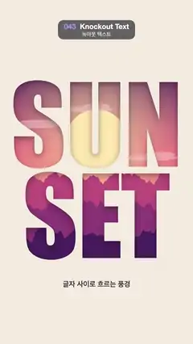

# 043 · Knockout Text · 녹아웃 텍스트



**EN** A sunset with a bobbing sun, drifting clouds and parallax mountain ridges moves behind the words SUN SET cut out of a cream panel.  
**KO** 크림색 판에 뚫린 SUN SET 글자 구멍 뒤로, 살짝 오르내리는 해와 흘러가는 구름, 시차를 두고 미끄러지는 산 능선의 노을 풍경이 지나간다.

[Video (mp4)](../videos/043-knockout-text.mp4) · [Code](../effects/043-knockout-text.js) · Typography · 타이포그래피

## Prompt (English)

```text
Create a "Knockout Text" motion effect: a cream paper panel with the words SUN SET cut out of it, and a moving sunset scene that is seen only through the letters.

Look
- Panel: cream #F3ECE1 over the whole frame, with "SUN" (baseline y 930) and "SET" (baseline y 1440) cut out as holes, centred, in Impact (fallback Arial Black), sized so the wider word is 960 px wide (letters about 480 px tall). Printed on the panel below the words: "글자 사이로 흐르는 풍경" in Apple SD Gothic Neo 600 40 px, #3B2A3A, centred at y 1600.
- The panel casts a drop shadow rgba(40, 10, 30, 0.45), blur 36, offset 14 px down. The shadow falls into the holes, so the cut edges look deep.
- The scene behind, back to front:
  - sky: vertical gradient from y 300 to y 1300, #2B1B5A → #E8577A (55 %) → #FFB36B;
  - sun: a disc of radius 170, #FFE8AE, at x 540, inside a radial glow rgba(255, 225, 160, 0.7) that fades out from radius 120 to 620;
  - five long thin clouds rgba(255, 214, 220, 0.45), each an ellipse (150–230 px long × 16 px) plus a smaller one (half as long × 14 px) shifted right by 40 % of its length and up 18 px, at y 520, 610, 700, 880 and 960;
  - three mountain ridges filled down to the bottom, far to near: base y 1080 / 1230 / 1380, height 170 / 150 / 130 px, colours #C2507E / #8E3B78 / #4A2160. Ridge line y = base − height · (0.6 + fbm), using 4-octave noise.
- So "SUN" shows the sky, the sun and the clouds, and "SET" shows the layered mountains.

Motion (0–5 s), a = 2π · t / 5
- The sun bobs: y = 780 + 30 · sin(a).
- The clouds drift right 1700 px per loop, wrapping over the range x −320 to 1380, so the wrap happens off screen.
- Parallax: each ridge is a tile exactly one period wide (1080, 2160 and 3240 px) and slides left by one full period per loop, so nearer ridges move faster (216, 432 and 648 px/s). Draw each tile twice, side by side.

Technique
- Canvas 2D. Pre-render the panel once: fill cream, switch to 'destination-out' and draw the words, switch back to 'source-over' and add the caption.
- Pre-render each ridge tile once. To make a tile wrap seamlessly, read the noise around a circle: fbm(R · cos θ, R · sin θ, seed) with θ = 2π · x / period and R = 2.2 · period / 1080 (so all ridges have the same detail per pixel).
- Per frame: sky, glow, sun, clouds, ridge tiles, then the panel with its shadow on top.

Output and rules
- One self-contained HTML file with no external assets (three.js from a CDN is fine if you use it), drawing on a 1080 × 1920 canvas (9:16) scaled to fit the window.
- Write a function renderFrame(t) that draws the frame for time t in seconds, and preview it with requestAnimationFrame. Everything must be a pure function of t and fixed seeds: no Math.random(), Date or state carried between frames, so frame i = renderFrame(i / 30) can be exported to a 30 fps video.
- Loop seamlessly every 5 seconds: renderFrame(5) must look exactly like renderFrame(0).
- No flicker of any kind: no noise or grain that changes from frame to frame, no strobing or blinking, no z-fighting, no shimmering 1 px lines. Any grain or texture stays fixed to the screen or to the object.
- Keep the top 280 px free of important content (a title label goes there) and fill the whole frame with a designed background.
```

## 프롬프트 (한국어)

```text
"녹아웃 텍스트" 모션 효과를 만들어 줘: 크림색 종이판에 SUN SET 글자가 뚫려 있고, 움직이는 노을 풍경이 그 글자 구멍으로만 보이는 효과.

모양
- 판: 화면 전체를 덮는 크림색 #F3ECE1. "SUN"(기준선 y 930)과 "SET"(기준선 y 1440)을 가운데 맞춤으로 구멍 내어 뚫는다. 글꼴은 Impact(없으면 Arial Black), 더 넓은 단어의 폭이 960 px가 되도록 크기를 정한다(글자 높이 약 480 px). 단어 아래 판 위에 "글자 사이로 흐르는 풍경"을 Apple SD Gothic Neo 600 40 px, #3B2A3A로 y 1600 가운데에 인쇄한다.
- 판은 그림자 rgba(40, 10, 30, 0.45), 흐림 36, 아래로 14 px를 드리운다. 그림자가 구멍 안으로 떨어져 잘린 가장자리가 깊어 보인다.
- 뒤의 풍경, 뒤에서 앞으로:
  - 하늘: y 300에서 y 1300까지 세로 그라디언트 #2B1B5A → #E8577A(55 %) → #FFB36B;
  - 해: x 540의 반지름 170 원, #FFE8AE. 반지름 120에서 620 사이에서 옅어지는 방사형 빛 rgba(255, 225, 160, 0.7) 안에 있다;
  - 길고 가는 구름 다섯 개 rgba(255, 214, 220, 0.45). 각각 타원(길이 150–230 px × 16 px) 하나와, 길이의 40 %만큼 오른쪽·18 px 위로 옮긴 작은 타원(길이 절반 × 14 px) 하나. y 520, 610, 700, 880, 960;
  - 화면 아래까지 채운 산 능선 세 겹, 먼 것부터: 기준 y 1080 / 1230 / 1380, 높이 170 / 150 / 130 px, 색 #C2507E / #8E3B78 / #4A2160. 능선 y = 기준 − 높이 · (0.6 + fbm), 4옥타브 노이즈.
- 그래서 "SUN"에는 하늘·해·구름이, "SET"에는 겹겹의 산이 보인다.

움직임 (0–5초), a = 2π · t / 5
- 해가 오르내린다: y = 780 + 30 · sin(a).
- 구름은 루프마다 오른쪽으로 1700 px 흘러가고 x −320부터 1380까지의 범위에서 되감긴다. 되감기는 화면 밖에서 일어난다.
- 시차: 능선마다 폭이 정확히 한 주기(1080, 2160, 3240 px)인 타일이고, 루프마다 한 주기만큼 왼쪽으로 미끄러진다. 그래서 가까운 능선일수록 빠르다(216, 432, 648 px/s). 타일은 두 장을 나란히 그린다.

기법
- Canvas 2D. 판은 한 번 미리 그린다: 크림색을 채우고 'destination-out'으로 단어를 그린 뒤 'source-over'로 돌아가 캡션을 넣는다.
- 능선 타일도 한 번 미리 그린다. 타일 양 끝이 이어지도록 노이즈를 원 위에서 읽는다: fbm(R · cos θ, R · sin θ, 시드), θ = 2π · x / 주기, R = 2.2 · 주기 / 1080(그래서 모든 능선의 픽셀당 디테일이 같다).
- 프레임마다: 하늘, 빛, 해, 구름, 능선 타일, 마지막으로 그림자를 켠 판.

출력과 규칙
- 외부 파일 없는 HTML 파일 하나(three.js를 쓴다면 CDN은 괜찮다). 1080 × 1920(9:16) 캔버스에 그리고 창 크기에 맞춰 보이게 한다.
- 시간 t(초)의 프레임을 그리는 renderFrame(t) 함수를 만들고, 미리보기는 requestAnimationFrame으로 돌린다. 모든 것은 t와 고정 시드만으로 정해진다: Math.random(), Date, 프레임 사이에 쌓이는 상태 금지. 그래야 i번째 프레임 = renderFrame(i / 30)으로 30fps 영상을 뽑을 수 있다.
- 5초마다 끊김 없이 반복: renderFrame(5)는 renderFrame(0)과 똑같아 보여야 한다.
- 어떤 깜빡임도 금지: 프레임마다 바뀌는 노이즈·그레인, 번쩍임·깜빡임, z-fighting, 반짝이며 떨리는 1px 선 모두 금지. 그레인·질감은 화면이나 물체에 고정한다.
- 위쪽 280px에는 중요한 내용을 두지 않고(제목 라벨 자리), 화면 전체를 디자인된 배경으로 채운다.
```
