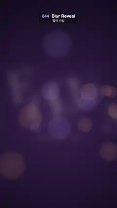

# 044 · Blur Reveal · 블러 리빌



**EN** Scattered, blurred letters of FOCUS slide home one by one and snap into sharp focus over soft bokeh, then drift out of focus again.  
**KO** 흩어져 흐릿한 FOCUS 글자가 은은한 보케 위에서 하나씩 제자리로 오며 또렷해졌다가, 끝에서 다시 초점이 풀린다.

[Video (mp4)](../videos/044-blur-reveal.mp4) · [Code](../effects/044-blur-reveal.js) · Typography · 타이포그래피

## Prompt (English)

```text
Create a "Blur Reveal" motion effect: scattered, blurred letters slide home one after another and pull into sharp focus, then drift back out of focus.

Look
- Background: radial gradient centred at (540, 1050), #3A2550 at radius 60 to #100A1C at radius 1250.
- 14 soft bokeh discs (fixed seed): x 0–1080, y 300–1900, radius 40–150 px, either warm rgb(255, 170, 120) or lilac rgb(160, 150, 255); each a radial gradient with alpha 0.16 at the centre, 0.10 at 75 % and 0 at the edge.
- The word "FOCUS" in Didot, regular weight, 250 px, colour #FFF4E6, letters 14 px apart, centred on x 540 with the baseline at y 1080.
- Subtitle "초점이 맞는 순간" in Apple SD Gothic Neo 600 64 px, #FFB98A, centred, baseline y 1250. Between them a 3 px rule rgba(255, 244, 230, 0.55) at y 1145 that grows out from the centre to 400 px wide.

Motion (0–5 s)
- Each letter has a focus value k (0 = lost, 1 = sharp); u = 1 − k. Out of focus, a letter is offset by u · (dx, dy) (dx within ±130 px, dy within ±210 px, fixed random per letter), rotated by u · (a fixed angle within ±0.25 rad), scaled 1 + 0.6u, blurred 36u px, and drawn at alpha 0.3 + 0.7k.
- k(t) = easeOutCubic over [0.3 + d, 1.7 + d] s × (1 − easeInOutCubic over [3.7 + d / 2, 4.8] s), with delay d = 0.14 · i for letter i. So F comes into focus over 0.3–1.7 s and S over 0.86–2.26 s; all are sharp until 3.7 s, then the letters blur out again, slightly staggered, and are fully lost by 4.8 s, matching the start.
- The subtitle uses d = 0.75 (in focus over 1.05–2.45 s): blur 20u px, alpha 0.15 + 0.85k, and it rises into place from 40u px lower. The rule is 400k px wide.
- Each bokeh disc drifts round a 30 px circle once per loop, each with its own phase.

Technique
- Canvas 2D. Per letter: save, translate to its home position plus the offset, rotate, scale, set ctx.filter = blur(…px) and globalAlpha, fillText, restore. The blur radius changes continuously (no stepping), so the focus pull is smooth.

Output and rules
- One self-contained HTML file with no external assets (three.js from a CDN is fine if you use it), drawing on a 1080 × 1920 canvas (9:16) scaled to fit the window.
- Write a function renderFrame(t) that draws the frame for time t in seconds, and preview it with requestAnimationFrame. Everything must be a pure function of t and fixed seeds: no Math.random(), Date or state carried between frames, so frame i = renderFrame(i / 30) can be exported to a 30 fps video.
- Loop seamlessly every 5 seconds: renderFrame(5) must look exactly like renderFrame(0).
- No flicker of any kind: no noise or grain that changes from frame to frame, no strobing or blinking, no z-fighting, no shimmering 1 px lines. Any grain or texture stays fixed to the screen or to the object.
- Keep the top 280 px free of important content (a title label goes there) and fill the whole frame with a designed background.
```

## 프롬프트 (한국어)

```text
"블러 리빌" 모션 효과를 만들어 줘: 흩어져 흐릿한 글자들이 차례로 제자리로 미끄러져 오며 초점이 또렷하게 맞았다가, 다시 초점이 풀리는 효과.

모양
- 배경: (540, 1050) 중심 방사형 그라디언트, 반지름 60에서 #3A2550, 반지름 1250에서 #100A1C.
- 부드러운 보케 원 14개(고정 시드): x 0–1080, y 300–1900, 반지름 40–150 px, 따뜻한 rgb(255, 170, 120) 또는 라일락 rgb(160, 150, 255). 각각 방사형 그라디언트로 알파가 중심 0.16, 75 %에서 0.10, 가장자리 0.
- 단어 "FOCUS": Didot 보통 굵기 250 px, 색 #FFF4E6, 글자 간격 14 px, x 540 가운데, 기준선 y 1080.
- 부제 "초점이 맞는 순간": Apple SD Gothic Neo 600 64 px, #FFB98A, 가운데, 기준선 y 1250. 그 사이 y 1145에 3 px 선 rgba(255, 244, 230, 0.55)이 가운데에서 양옆으로 400 px까지 자란다.

움직임 (0–5초)
- 글자마다 초점값 k(0 = 흐림, 1 = 또렷)가 있고 u = 1 − k. 초점이 나간 글자는 u · (dx, dy)만큼 밀려 있고(dx ±130 px, dy ±210 px 안, 글자마다 고정 난수), u · (±0.25 rad 안의 고정 각도)만큼 돌아가 있고, 1 + 0.6u배 커지고, 36u px 흐려지고, 알파 0.3 + 0.7k로 그린다.
- k(t) = [0.3 + d, 1.7 + d]초 동안의 easeOutCubic × (1 − [3.7 + d / 2, 4.8]초 동안의 easeInOutCubic), 글자 i의 지연 d = 0.14 · i. 그래서 F는 0.3–1.7초, S는 0.86–2.26초에 초점이 맞는다. 3.7초까지 모두 또렷하다가 조금씩 엇갈려 다시 흐려지고, 4.8초에 완전히 흐려져 처음과 같아진다.
- 부제는 d = 0.75(1.05–2.45초에 초점): 흐림 20u px, 알파 0.15 + 0.85k, 40u px 아래에서 제자리로 올라온다. 선 폭은 400k px.
- 보케 원은 저마다 다른 위상으로 루프마다 반지름 30 px 원을 한 바퀴 돈다.

기법
- Canvas 2D. 글자마다: save, 제자리 + 오프셋으로 옮기고, 돌리고, 키우고, ctx.filter = blur(…px)와 globalAlpha를 정한 뒤 fillText, restore. 흐림 반지름이 계단 없이 연속으로 바뀌어 초점 이동이 부드럽다.

출력과 규칙
- 외부 파일 없는 HTML 파일 하나(three.js를 쓴다면 CDN은 괜찮다). 1080 × 1920(9:16) 캔버스에 그리고 창 크기에 맞춰 보이게 한다.
- 시간 t(초)의 프레임을 그리는 renderFrame(t) 함수를 만들고, 미리보기는 requestAnimationFrame으로 돌린다. 모든 것은 t와 고정 시드만으로 정해진다: Math.random(), Date, 프레임 사이에 쌓이는 상태 금지. 그래야 i번째 프레임 = renderFrame(i / 30)으로 30fps 영상을 뽑을 수 있다.
- 5초마다 끊김 없이 반복: renderFrame(5)는 renderFrame(0)과 똑같아 보여야 한다.
- 어떤 깜빡임도 금지: 프레임마다 바뀌는 노이즈·그레인, 번쩍임·깜빡임, z-fighting, 반짝이며 떨리는 1px 선 모두 금지. 그레인·질감은 화면이나 물체에 고정한다.
- 위쪽 280px에는 중요한 내용을 두지 않고(제목 라벨 자리), 화면 전체를 디자인된 배경으로 채운다.
```
