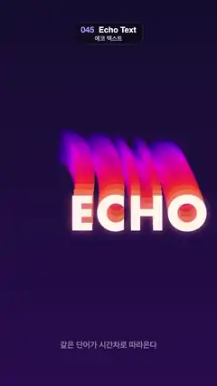

# 045 · Echo Text · 에코 텍스트



**EN** The word ECHO glides around an oval while fourteen time-delayed copies trail behind it, fading from orange through pink to violet.  
**KO** ECHO 단어가 타원을 그리며 움직이고, 시간차를 둔 복사본 열네 개가 주황에서 분홍, 보라로 옅어지며 뒤따른다.

[Video (mp4)](../videos/045-echo-text.mp4) · [Code](../effects/045-echo-text.js) · Typography · 타이포그래피

## Prompt (English)

```text
Create an "Echo Text" motion effect: a word glides around an oval and a stack of coloured copies, each one showing the word a moment earlier, trails behind it like an echo.

Look
- Background: vertical gradient #140F30 (top) to #2A1250 (bottom).
- The word "ECHO" in Futura bold 230 px, centred on its position (textAlign center, textBaseline middle).
- The lead copy is cream #FFF6EA with a pink glow (shadow colour rgba(255, 120, 170, 0.8), blur 40).
- 14 trailing copies, drawn from the oldest to the newest so the lead ends up on top. For copy k (1 … 14), with f = k / 14: colour hsl((390 − 130f) mod 360, 95 %, 62 − 18f %) at alpha 1 − 0.7f. So the copies right behind the lead are orange, the middle ones pink, the far ones violet and more transparent.
- Caption: "같은 단어가 시간차로 따라온다" in Apple SD Gothic Neo 600 40 px, rgba(255, 246, 234, 0.5), centred at y 1720.

Motion (0–5 s), a = 2π · t / 5
- The word's pose at time t: x = 540 + 150 · cos(a), y = 1090 + 330 · sin(a) (a tall oval, travelled clockwise on screen), scale 1 + 0.12 · sin(2a), rotation −0.1 · sin(a) rad.
- Copy k is drawn with the pose at time t − 0.07 · k, so the copies lie along the path the word has just travelled (about one second of history) and fan out on the curves.
- The pose is periodic, so at the start of the loop the trail already exists (it simply uses times before 0) and the loop is seamless.

Technique
- Canvas 2D. For each copy: save, translate, rotate, scale, set the colour (and the glow for the lead only), fillText, restore.

Output and rules
- One self-contained HTML file with no external assets (three.js from a CDN is fine if you use it), drawing on a 1080 × 1920 canvas (9:16) scaled to fit the window.
- Write a function renderFrame(t) that draws the frame for time t in seconds, and preview it with requestAnimationFrame. Everything must be a pure function of t and fixed seeds: no Math.random(), Date or state carried between frames, so frame i = renderFrame(i / 30) can be exported to a 30 fps video.
- Loop seamlessly every 5 seconds: renderFrame(5) must look exactly like renderFrame(0).
- No flicker of any kind: no noise or grain that changes from frame to frame, no strobing or blinking, no z-fighting, no shimmering 1 px lines. Any grain or texture stays fixed to the screen or to the object.
- Keep the top 280 px free of important content (a title label goes there) and fill the whole frame with a designed background.
```

## 프롬프트 (한국어)

```text
"에코 텍스트" 모션 효과를 만들어 줘: 단어 하나가 타원을 그리며 움직이고, 조금씩 이전 순간의 모습을 한 색색의 복사본이 메아리처럼 겹겹이 뒤따르는 효과.

모양
- 배경: 세로 그라디언트 #140F30(위) → #2A1250(아래).
- 단어 "ECHO": Futura bold 230 px, 자기 위치에 가운데 맞춤(textAlign center, textBaseline middle).
- 맨 앞 단어는 크림색 #FFF6EA에 분홍 빛(그림자 색 rgba(255, 120, 170, 0.8), 흐림 40).
- 뒤따르는 복사본 14개를 가장 오래된 것부터 최신 순으로 그려 맨 앞 단어가 맨 위에 오게 한다. 복사본 k(1 … 14), f = k / 14: 색 hsl((390 − 130f) mod 360, 95 %, 62 − 18f %), 알파 1 − 0.7f. 그래서 맨 앞 바로 뒤는 주황, 중간은 분홍, 멀리 있는 것은 보라색이며 더 투명하다.
- 캡션: "같은 단어가 시간차로 따라온다", Apple SD Gothic Neo 600 40 px, rgba(255, 246, 234, 0.5), y 1720 가운데.

움직임 (0–5초), a = 2π · t / 5
- 시간 t의 단어 자세: x = 540 + 150 · cos(a), y = 1090 + 330 · sin(a)(세로로 긴 타원, 화면에서 시계 방향), 크기 1 + 0.12 · sin(2a), 회전 −0.1 · sin(a) rad.
- 복사본 k는 시간 t − 0.07 · k의 자세로 그린다. 그래서 복사본들이 단어가 방금 지나온 길(약 1초 분량)을 따라 늘어서고, 곡선에서 부채처럼 펼쳐진다.
- 자세가 주기 함수라서 루프 시작에도 꼬리가 이미 있고(0초 이전 시간을 그대로 쓴다) 끊김 없이 반복된다.

기법
- Canvas 2D. 복사본마다: save, 옮기기, 돌리기, 크기 조절, 색 지정(빛은 맨 앞 단어만), fillText, restore.

출력과 규칙
- 외부 파일 없는 HTML 파일 하나(three.js를 쓴다면 CDN은 괜찮다). 1080 × 1920(9:16) 캔버스에 그리고 창 크기에 맞춰 보이게 한다.
- 시간 t(초)의 프레임을 그리는 renderFrame(t) 함수를 만들고, 미리보기는 requestAnimationFrame으로 돌린다. 모든 것은 t와 고정 시드만으로 정해진다: Math.random(), Date, 프레임 사이에 쌓이는 상태 금지. 그래야 i번째 프레임 = renderFrame(i / 30)으로 30fps 영상을 뽑을 수 있다.
- 5초마다 끊김 없이 반복: renderFrame(5)는 renderFrame(0)과 똑같아 보여야 한다.
- 어떤 깜빡임도 금지: 프레임마다 바뀌는 노이즈·그레인, 번쩍임·깜빡임, z-fighting, 반짝이며 떨리는 1px 선 모두 금지. 그레인·질감은 화면이나 물체에 고정한다.
- 위쪽 280px에는 중요한 내용을 두지 않고(제목 라벨 자리), 화면 전체를 디자인된 배경으로 채운다.
```
