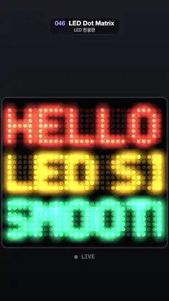

# 046 · LED Dot Matrix · LED 전광판



**EN** Three glowing messages in red, amber and green scroll smoothly across a panel of round LEDs that fade in and out softly.  
**KO** 둥근 LED 점 판 위로 빨강·주황·초록으로 빛나는 세 줄 문구가 부드럽게 흐르고, LED는 툭 켜지지 않고 서서히 밝아지고 어두워진다.

[Video (mp4)](../videos/046-led-dot-matrix.mp4) · [Code](../effects/046-led-dot-matrix.js) · Typography · 타이포그래피

## Prompt (English)

```text
Create an "LED Dot Matrix" motion effect: three messages in a 5 × 7 pixel font scroll across a sign of round LEDs, and every LED fades in and out smoothly instead of popping.

Look
- Background: vertical gradient #1A1C22 (top) to #08090C (bottom).
- Panel: a #050506 rounded rectangle (radius 30) with an 8 px #2C2F38 border, 1057 × 958 px with its top-left corner at (11.5, 621).
- LED grid: 30 columns, pitch 33 px, LED radius 12.5 px, first column at x 61.5. Three lines of 7 rows each; row centres at y = 671 + (9 · line + 1 + row) · 33 (line 0: y 704–902, line 1: 1001–1199, line 2: 1298–1496).
- Messages and colours (lit / unlit):
  - "HELLO ♥ " red #FF4A2E / #3A1410
  - "LED SIGN " amber #FFB020 / #3A2A10
  - "SMOOTH ♥ " green #38F59A / #0F3324
- Font: a classic 5 × 7 bitmap font (each glyph 7 rows of 5 bits) plus a heart (rows 01010 11111 11111 11111 01110 00100 00000). Each glyph is 5 columns followed by 1 blank column; a space is 3 blank columns.
- Each LED: an unlit disc in the unlit colour, then a disc in the lit colour at alpha = brightness v. Then, with additive blending ('lighter'), a 120 px glow sprite (radial gradient from the lit colour at alpha 0.67 at radius 8 to transparent at radius 60) at alpha v, and a small white hot spot (alpha 0.3, radius 5.6 px, offset 3 px up and left).
- "● LIVE" in Menlo 600 36 px, rgba(255, 255, 255, 0.4), centred at y 1649.

Motion (0–5 s)
- Each line scrolls left by its whole message length per loop (42, 48 and 48 columns), only about 0.3 LED per frame. The three lines are offset by 0, 1/3 and 2/3 of a column, so their LEDs do not all change on the same frame.
- Smooth scrolling on a fixed grid: the scroll position s (in columns) is fractional. For LED column c take m = c + s, i = floor(m), k = 0.5 − 0.5 · cos(π · (m − i)), and brightness v = column[i] · (1 − k) + column[i + 1] · k (columns wrap round the message). LEDs dim in and out over several frames.

Technique
- Canvas 2D. Pre-render one glow sprite per colour. First pass: all unlit and lit discs. Second pass with 'lighter': glows and hot spots for every LED with v > 0.01.

Output and rules
- One self-contained HTML file with no external assets (three.js from a CDN is fine if you use it), drawing on a 1080 × 1920 canvas (9:16) scaled to fit the window.
- Write a function renderFrame(t) that draws the frame for time t in seconds, and preview it with requestAnimationFrame. Everything must be a pure function of t and fixed seeds: no Math.random(), Date or state carried between frames, so frame i = renderFrame(i / 30) can be exported to a 30 fps video.
- Loop seamlessly every 5 seconds: renderFrame(5) must look exactly like renderFrame(0).
- No flicker of any kind: no noise or grain that changes from frame to frame, no strobing or blinking, no z-fighting, no shimmering 1 px lines. Any grain or texture stays fixed to the screen or to the object.
- Keep the top 280 px free of important content (a title label goes there) and fill the whole frame with a designed background.
```

## 프롬프트 (한국어)

```text
"LED 전광판" 모션 효과를 만들어 줘: 5 × 7 도트 글꼴로 된 문구 세 줄이 둥근 LED 판 위를 흐르고, LED는 하나하나 툭 켜지지 않고 부드럽게 밝아지고 어두워지는 효과.

모양
- 배경: 세로 그라디언트 #1A1C22(위) → #08090C(아래).
- 판: #050506 둥근 사각형(반지름 30), 8 px #2C2F38 테두리, 1057 × 958 px, 왼쪽 위 모서리 (11.5, 621).
- LED 격자: 30열, 간격 33 px, LED 반지름 12.5 px, 첫 열 x 61.5. 줄마다 7행씩 세 줄. 행 중심 y = 671 + (9 · 줄 + 1 + 행) · 33(0번 줄 y 704–902, 1번 줄 1001–1199, 2번 줄 1298–1496).
- 문구와 색(켜짐 / 꺼짐):
  - "HELLO ♥ " 빨강 #FF4A2E / #3A1410
  - "LED SIGN " 호박색 #FFB020 / #3A2A10
  - "SMOOTH ♥ " 초록 #38F59A / #0F3324
- 글꼴: 고전적인 5 × 7 비트맵 글꼴(글자마다 5비트 7행)과 하트(행 01010 11111 11111 11111 01110 00100 00000). 글자는 5열 다음에 빈 열 1개, 공백은 빈 열 3개.
- LED 하나: 꺼진 색 원을 그리고, 그 위에 켜진 색 원을 알파 = 밝기 v로 그린다. 그다음 가산 혼합('lighter')으로 120 px 빛 스프라이트(켜진 색 알파 0.67, 반지름 8 → 반지름 60에서 투명인 방사형 그라디언트)를 알파 v로, 그리고 작은 흰 반사점(알파 0.3, 반지름 5.6 px, 왼쪽 위로 3 px)을 얹는다.
- "● LIVE": Menlo 600 36 px, rgba(255, 255, 255, 0.4), y 1649 가운데.

움직임 (0–5초)
- 줄마다 루프당 문구 전체 길이(42, 48, 48열)만큼 왼쪽으로 흐른다. 프레임당 LED 약 0.3칸뿐이다. 세 줄은 0, 1/3, 2/3열씩 어긋나 있어 LED가 모두 같은 프레임에 바뀌지 않는다.
- 고정 격자 위의 부드러운 스크롤: 스크롤 위치 s(열 단위)는 소수다. LED 열 c에 대해 m = c + s, i = floor(m), k = 0.5 − 0.5 · cos(π · (m − i)), 밝기 v = 열[i] · (1 − k) + 열[i + 1] · k(열은 문구 끝에서 처음으로 이어진다). LED가 여러 프레임에 걸쳐 밝아지고 어두워진다.

기법
- Canvas 2D. 색마다 빛 스프라이트를 미리 그려 둔다. 첫 번째 패스: 꺼진 원과 켜진 원 전부. 두 번째 패스는 'lighter'로 v > 0.01인 LED마다 빛과 반사점.

출력과 규칙
- 외부 파일 없는 HTML 파일 하나(three.js를 쓴다면 CDN은 괜찮다). 1080 × 1920(9:16) 캔버스에 그리고 창 크기에 맞춰 보이게 한다.
- 시간 t(초)의 프레임을 그리는 renderFrame(t) 함수를 만들고, 미리보기는 requestAnimationFrame으로 돌린다. 모든 것은 t와 고정 시드만으로 정해진다: Math.random(), Date, 프레임 사이에 쌓이는 상태 금지. 그래야 i번째 프레임 = renderFrame(i / 30)으로 30fps 영상을 뽑을 수 있다.
- 5초마다 끊김 없이 반복: renderFrame(5)는 renderFrame(0)과 똑같아 보여야 한다.
- 어떤 깜빡임도 금지: 프레임마다 바뀌는 노이즈·그레인, 번쩍임·깜빡임, z-fighting, 반짝이며 떨리는 1px 선 모두 금지. 그레인·질감은 화면이나 물체에 고정한다.
- 위쪽 280px에는 중요한 내용을 두지 않고(제목 라벨 자리), 화면 전체를 디자인된 배경으로 채운다.
```
