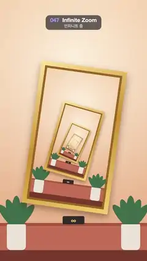

# 047 · Infinite Zoom · 인피니트 줌



★ One of the 20 effects in the original reel (#9) · 원래 릴스 20개 중 하나(9번)

**EN** The view zooms and turns endlessly into a framed painting on a gallery wall that holds the same wall and painting again.  
**KO** 갤러리 벽의 액자 속에 같은 벽과 액자가 또 들어 있고, 화면이 천천히 돌며 그 속으로 끝없이 확대해 들어간다.

[Video (mp4)](https://sueun-dev.github.io/motion-effects/videos/047-infinite-zoom.mp4) · [Code](../effects/047-infinite-zoom.js) · Shaders & generative · 셰이더·제너러티브

## Prompt (English)

```text
Create an "Infinite Zoom" motion effect (Droste effect): a gallery wall with a framed painting that is the same picture again, and the view zooms and turns into it forever.

Look — the picture, in its own 1080 × 1920 coordinates
- Wall: vertical gradient #F6D2AE (top) to #E8AE84 (bottom), with a soft light from above (radial gradient from (540, 420) radius 40 to (540, 700) radius 900, rgba(255, 250, 235, 0.75) to 0).
- Wainscot #C46E55 from y 1640 down, with a 22 px #A9563F trim on top; floor #7A3B2C from y 1840.
- A potted plant on each side, at x 120 and 960: five dark green #3E6B4A leaf ellipses (34 × 120 px) fanned out (for i = −2 … 2: 26 · i px apart, tilted 0.35 · i rad, centred at y 1560 + 20 · |i|), in a cream #E9E2D6 pot (140 × 190 px, top at y 1650, bottom corners rounded 30).
- A small dark plaque #2E2A28 (160 × 60, radius 10) at (460, 1590) with a gold "∞" #F2C66D in Helvetica Neue bold 46 px.
- The frame: its opening is the rectangle x 270–810, y 530–1490, which is the whole picture scaled by R = 0.5 about the fixed point P = (540, 1060); the frame is turned 8° clockwise about P. Gold border 48 px wide (diagonal gradient #FFE39A → #C98F2E → #F5CF6E), a 16 px #9A6420 inner lip, and a drop shadow rgba(70, 30, 10, 0.45) with blur 50 · s and offset 24 · s px, where s is that copy's scale on screen. The opening is filled by the next copy of the picture.

Motion (0–5 s), p = t / 5
- Nesting transform N (about P): rotate 8°, scale 0.5. Copy k of the picture is drawn with V · N^k, where the view V(p) (about P) = rotate −8° · p, scale 2^p.
- Why it loops: at p = 1 the view is "rotate −8°, scale 2", which is exactly N⁻¹, so every copy lands exactly where the next larger copy was at p = 0. The zoom per loop (2×) equals the nesting ratio (1 / R), and the turn per loop (−8°) undoes the nesting turn, so the frame at 5 s is identical to the frame at 0 s.
- The scale is exponential (2^p), so the zoom feels like one constant speed; the turn is linear in time.

Technique
- Canvas 2D with setTransform and matrices (DOMMatrix). Fill the frame with #2A1A10, then draw copies from k = −1 (twice as large, so its picture covers the corners exposed by the rotation) inward until the copy is less than 4 px wide.
- No popping: give each copy alpha smoothstep(0.004, 0.014, s) with s = 0.5^(k − p), so the tiniest copies fade in; scale shadow blur and offset with s.
- Hide the vanishing point under a glow of fixed size: radial gradient of radius 70 at P, rgba(255, 236, 190, 0.9) to 0.

Output and rules
- One self-contained HTML file with no external assets (three.js from a CDN is fine if you use it), drawing on a 1080 × 1920 canvas (9:16) scaled to fit the window.
- Write a function renderFrame(t) that draws the frame for time t in seconds, and preview it with requestAnimationFrame. Everything must be a pure function of t and fixed seeds: no Math.random(), Date or state carried between frames, so frame i = renderFrame(i / 30) can be exported to a 30 fps video.
- Loop seamlessly every 5 seconds: renderFrame(5) must look exactly like renderFrame(0).
- No flicker of any kind: no noise or grain that changes from frame to frame, no strobing or blinking, no z-fighting, no shimmering 1 px lines. Any grain or texture stays fixed to the screen or to the object.
- Keep the top 280 px free of important content (a title label goes there) and fill the whole frame with a designed background.
```

## 프롬프트 (한국어)

```text
"인피니트 줌" 모션 효과(드로스테 효과)를 만들어 줘: 갤러리 벽의 액자 속 그림이 바로 그 그림 자체이고, 화면이 그 속으로 돌면서 끝없이 확대해 들어가는 효과.

모양 — 그림 자체, 그림 고유의 1080 × 1920 좌표
- 벽: 세로 그라디언트 #F6D2AE(위) → #E8AE84(아래). 위에서 내려오는 은은한 빛(방사형 그라디언트, (540, 420) 반지름 40 → (540, 700) 반지름 900, rgba(255, 250, 235, 0.75) → 0).
- 징두리 벽판 #C46E55는 y 1640부터 아래로, 위에 22 px #A9563F 몰딩. 바닥 #7A3B2C는 y 1840부터.
- 양옆 x 120과 960에 화분 하나씩: 짙은 초록 #3E6B4A 잎 타원(34 × 120 px) 다섯 개를 부채처럼(i = −2 … 2: 가로 26 · i px 간격, 0.35 · i rad 기울기, 중심 y 1560 + 20 · |i|), 크림색 #E9E2D6 화분(140 × 190 px, 위쪽 y 1650, 아래 모서리 30 둥글게).
- (460, 1590)에 작은 어두운 명판 #2E2A28(160 × 60, 반지름 10)과 금색 "∞" #F2C66D, Helvetica Neue bold 46 px.
- 액자: 안쪽 구멍은 x 270–810, y 530–1490 사각형으로, 그림 전체를 고정점 P = (540, 1060) 기준으로 R = 0.5배 줄인 자리다. 액자는 P를 중심으로 시계 방향 8° 돌아가 있다. 금색 테두리 48 px(대각선 그라디언트 #FFE39A → #C98F2E → #F5CF6E), 안쪽 16 px #9A6420 턱, 그림자 rgba(70, 30, 10, 0.45), 흐림 50 · s, 오프셋 24 · s px(s = 그 사본의 화면상 배율). 구멍은 그림의 다음 사본이 채운다.

움직임 (0–5초), p = t / 5
- 중첩 변환 N(P 기준): 8° 회전, 0.5배. 그림의 k번째 사본은 V · N^k로 그리고, 화면 변환 V(p)(P 기준) = −8° · p 회전, 2^p배.
- 반복되는 이유: p = 1에서 화면 변환은 "−8° 회전, 2배"로 정확히 N⁻¹이다. 그래서 모든 사본이 p = 0일 때 한 단계 큰 사본이 있던 자리에 정확히 놓인다. 루프당 확대(2배)가 중첩 비율(1 / R)과 같고, 루프당 회전(−8°)이 중첩 회전을 되돌리므로 5초 화면이 0초 화면과 똑같다.
- 배율이 지수(2^p)라서 확대 속도가 일정하게 느껴지고, 회전은 시간에 대해 선형이다.

기법
- Canvas 2D의 setTransform과 행렬(DOMMatrix). 화면을 #2A1A10으로 채운 뒤 k = −1(두 배 크기라 회전으로 드러나는 모서리를 덮는다)부터 안쪽으로, 사본 폭이 4 px보다 작아질 때까지 그린다.
- 툭 튀어나오지 않게: 사본마다 알파 smoothstep(0.004, 0.014, s), s = 0.5^(k − p). 가장 작은 사본은 서서히 나타난다. 그림자 흐림과 오프셋도 s에 맞춰 줄인다.
- 소실점은 크기가 고정된 빛으로 가린다: P에 반지름 70 방사형 그라디언트, rgba(255, 236, 190, 0.9) → 0.

출력과 규칙
- 외부 파일 없는 HTML 파일 하나(three.js를 쓴다면 CDN은 괜찮다). 1080 × 1920(9:16) 캔버스에 그리고 창 크기에 맞춰 보이게 한다.
- 시간 t(초)의 프레임을 그리는 renderFrame(t) 함수를 만들고, 미리보기는 requestAnimationFrame으로 돌린다. 모든 것은 t와 고정 시드만으로 정해진다: Math.random(), Date, 프레임 사이에 쌓이는 상태 금지. 그래야 i번째 프레임 = renderFrame(i / 30)으로 30fps 영상을 뽑을 수 있다.
- 5초마다 끊김 없이 반복: renderFrame(5)는 renderFrame(0)과 똑같아 보여야 한다.
- 어떤 깜빡임도 금지: 프레임마다 바뀌는 노이즈·그레인, 번쩍임·깜빡임, z-fighting, 반짝이며 떨리는 1px 선 모두 금지. 그레인·질감은 화면이나 물체에 고정한다.
- 위쪽 280px에는 중요한 내용을 두지 않고(제목 라벨 자리), 화면 전체를 디자인된 배경으로 채운다.
```
