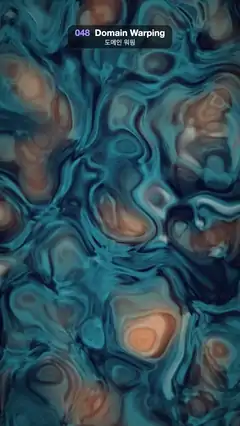

# 048 · Domain Warping · 도메인 워핑



**EN** Layers of noise bend each other's coordinates into slowly churning marble swirls of ink blue, teal, amber and cream.  
**KO** 노이즈가 겹겹이 서로의 좌표를 비틀어, 남색·청록·주황·크림빛 대리석 무늬가 천천히 소용돌이친다.

[Video (mp4)](https://sueun-dev.github.io/motion-effects/videos/048-domain-warping.mp4) · [Code](../effects/048-domain-warping.js) · Shaders & generative · 셰이더·제너러티브

## Prompt (English)

```text
Create a "Domain Warping" motion effect: noise that bends the coordinates of more noise, giving slowly churning marble and smoke swirls in ink blue, teal, amber and cream.

Look
- Coordinates: p = (2 · fragCoord − resolution) / width × 0.9, so x runs −0.9 … 0.9 and y about −1.6 … 1.6.
- fbmₙ(v) = fractal noise from 3D simplex noise with n octaves: amplitude starts at 0.5 and halves, and each octave the position is multiplied by 2.03 and shifted by (1.7, 9.2, 3.1).
- Three nested layers (domain warping in the style of Inigo Quilez), L = the loop point below:
  - q = (fbm₂(p + 0.07 · L, z = 0), fbm₂(p + (5.2, 1.3) − 0.07 · (L.y, L.x), z = 1.7))
  - r = (fbm₃(p + 1.6 · q + (1.7, 9.2), z = 0.04 · L.x), fbm₃(p + 1.6 · q + (8.3, 2.8), z = 0.04 · L.y))
  - f = 0.5 + 0.5 · fbm₄(p + 1.6 · r, z = 2.4)
  (z is the third noise coordinate.)
- Colour:
  - base: mix ink #0A0F2E to teal #1F7A94 by smoothstep(0.25, 0.75, f);
  - warm amber veins: mix towards #FA9457 by 0.8 · smoothstep(0.2, 0.75, |q|);
  - creamy marble: mix towards #FCF0D9 by 0.75 · smoothstep(0.3, 0.75, |r.x|);
  - multiply by 0.6 + 0.7 · f, then a vignette × (1 − 0.4 · |p · (0.8, 0.45)|²).
  - Write the values straight to the output (no extra gamma step).

Motion (0–5 s)
- L = (cos(2π · t / 5), sin(2π · t / 5)): a point that goes once round a unit circle per loop.
- Only the inner layers move, and only on tiny loops: q's lookup moves on a circle of radius 0.07 and r's noise z moves by 0.04 · L. The warp multiplies any motion of the inner layers many times over, so these small loops already make the whole pattern churn and fold; larger values would make it boil and shimmer. The outermost layer has no time term at all.
- The result is a slow, continuous swirl that comes back exactly to its start at 5 s.

Technique
- A WebGL2 full-screen fragment shader (one triangle) with 3D simplex noise, and uniforms for time and resolution.

Output and rules
- One self-contained HTML file with no external assets (three.js from a CDN is fine if you use it), drawing on a 1080 × 1920 canvas (9:16) scaled to fit the window.
- Write a function renderFrame(t) that draws the frame for time t in seconds, and preview it with requestAnimationFrame. Everything must be a pure function of t and fixed seeds: no Math.random(), Date or state carried between frames, so frame i = renderFrame(i / 30) can be exported to a 30 fps video.
- Loop seamlessly every 5 seconds: renderFrame(5) must look exactly like renderFrame(0).
- No flicker of any kind: no noise or grain that changes from frame to frame, no strobing or blinking, no z-fighting, no shimmering 1 px lines. Any grain or texture stays fixed to the screen or to the object.
- Keep the top 280 px free of important content (a title label goes there) and fill the whole frame with a designed background.
```

## 프롬프트 (한국어)

```text
"도메인 워핑" 모션 효과를 만들어 줘: 노이즈가 또 다른 노이즈의 좌표를 비틀어, 남색·청록·주황·크림색 대리석과 연기 같은 소용돌이가 천천히 일렁이는 효과.

모양
- 좌표: p = (2 · fragCoord − 해상도) / 너비 × 0.9. x는 −0.9 … 0.9, y는 약 −1.6 … 1.6.
- fbmₙ(v) = 3D 심플렉스 노이즈로 만든 n옥타브 프랙털 노이즈: 진폭은 0.5에서 시작해 절반씩, 옥타브마다 위치에 2.03을 곱하고 (1.7, 9.2, 3.1)만큼 옮긴다.
- 겹친 세 층(Inigo Quilez 방식의 도메인 워핑), L = 아래의 루프 점:
  - q = (fbm₂(p + 0.07 · L, z = 0), fbm₂(p + (5.2, 1.3) − 0.07 · (L.y, L.x), z = 1.7))
  - r = (fbm₃(p + 1.6 · q + (1.7, 9.2), z = 0.04 · L.x), fbm₃(p + 1.6 · q + (8.3, 2.8), z = 0.04 · L.y))
  - f = 0.5 + 0.5 · fbm₄(p + 1.6 · r, z = 2.4)
  (z는 노이즈의 세 번째 좌표.)
- 색:
  - 바탕: smoothstep(0.25, 0.75, f)로 먹색 #0A0F2E → 청록 #1F7A94;
  - 따뜻한 주황 결: 0.8 · smoothstep(0.2, 0.75, |q|)만큼 #FA9457 쪽으로;
  - 크림색 대리석: 0.75 · smoothstep(0.3, 0.75, |r.x|)만큼 #FCF0D9 쪽으로;
  - 0.6 + 0.7 · f를 곱하고, 비네트 × (1 − 0.4 · |p · (0.8, 0.45)|²).
  - 값은 그대로 출력한다(감마 변환을 따로 하지 않는다).

움직임 (0–5초)
- L = (cos(2π · t / 5), sin(2π · t / 5)): 루프마다 단위원을 한 바퀴 도는 점.
- 안쪽 층만, 그것도 아주 작은 고리로만 움직인다: q를 읽는 위치는 반지름 0.07 원 위를, r의 노이즈 z는 0.04 · L만큼 움직인다. 워핑은 안쪽 층의 움직임을 몇 배로 키우기 때문에 이 작은 고리만으로도 무늬 전체가 일렁이며 접힌다. 값이 더 크면 들끓고 반짝인다. 가장 바깥 층에는 시간 항이 아예 없다.
- 결과는 느리고 끊김 없는 소용돌이이고, 5초에 정확히 처음 모습으로 돌아온다.

기법
- WebGL2 전체 화면 프래그먼트 셰이더(삼각형 하나), 3D 심플렉스 노이즈, 시간·해상도 유니폼.

출력과 규칙
- 외부 파일 없는 HTML 파일 하나(three.js를 쓴다면 CDN은 괜찮다). 1080 × 1920(9:16) 캔버스에 그리고 창 크기에 맞춰 보이게 한다.
- 시간 t(초)의 프레임을 그리는 renderFrame(t) 함수를 만들고, 미리보기는 requestAnimationFrame으로 돌린다. 모든 것은 t와 고정 시드만으로 정해진다: Math.random(), Date, 프레임 사이에 쌓이는 상태 금지. 그래야 i번째 프레임 = renderFrame(i / 30)으로 30fps 영상을 뽑을 수 있다.
- 5초마다 끊김 없이 반복: renderFrame(5)는 renderFrame(0)과 똑같아 보여야 한다.
- 어떤 깜빡임도 금지: 프레임마다 바뀌는 노이즈·그레인, 번쩍임·깜빡임, z-fighting, 반짝이며 떨리는 1px 선 모두 금지. 그레인·질감은 화면이나 물체에 고정한다.
- 위쪽 280px에는 중요한 내용을 두지 않고(제목 라벨 자리), 화면 전체를 디자인된 배경으로 채운다.
```
