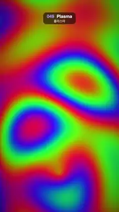

# 049 · Plasma · 플라스마



**EN** Four summed sine fields run through a cycling rainbow palette, so psychedelic colour bands and rings flow across the screen.  
**KO** 사인파 네 개를 더한 값을 계속 도는 무지개 팔레트에 넣어, 사이키델릭한 색 띠와 고리가 화면 가득 흐른다.

[Video (mp4)](../videos/049-plasma.mp4) · [Code](../effects/049-plasma.js) · Shaders & generative · 셰이더·제너러티브

## Prompt (English)

```text
Create a "Plasma" motion effect: the classic demoscene rainbow plasma, four sine fields summed and pushed through a cycling colour palette.

Look
- Coordinates: p = (2 · fragCoord − resolution) / width × 3.2, so x runs −3.2 … 3.2 and y about −5.7 … 5.7.
- With a = 2π · t / 5, sum four sine fields (two straight waves, a diagonal one, and rings around a moving centre):
  v = sin(1.1 · x + a) + sin(0.9 · y − a) + sin(0.7 · (x + y) + a) + sin(1.6 · |p + (2.4 · sin a, 3.6 · cos a)| − a)
- Colour: rgb = 0.5 + 0.5 · cos(π · v / 2 + (0, 2.1, 4.2) + a), a full-saturation rainbow (red, yellow-green, cyan-blue, violet-magenta); then mix(rgb, rgb², 0.35) for richer, deeper colour; then a soft vignette × (1 − 0.25 · |p / (3.2, 5.7)|²).
- The result fills the whole frame with wide, soft, psychedelic colour bands and blobby rings; there are no hard edges anywhere.

Motion (0–5 s)
- Every time term is a whole multiple of the loop angle a: the straight and diagonal waves slide, the ring centre goes once round an ellipse (2.4 × 3.6 units) per loop, and the palette itself cycles once per loop (the + a inside the cosine). The colours keep flowing through each other, and the frame at 5 s equals the frame at 0 s.

Technique
- A WebGL2 full-screen fragment shader (one triangle), with uniforms for time and resolution.

Output and rules
- One self-contained HTML file with no external assets (three.js from a CDN is fine if you use it), drawing on a 1080 × 1920 canvas (9:16) scaled to fit the window.
- Write a function renderFrame(t) that draws the frame for time t in seconds, and preview it with requestAnimationFrame. Everything must be a pure function of t and fixed seeds: no Math.random(), Date or state carried between frames, so frame i = renderFrame(i / 30) can be exported to a 30 fps video.
- Loop seamlessly every 5 seconds: renderFrame(5) must look exactly like renderFrame(0).
- No flicker of any kind: no noise or grain that changes from frame to frame, no strobing or blinking, no z-fighting, no shimmering 1 px lines. Any grain or texture stays fixed to the screen or to the object.
- Keep the top 280 px free of important content (a title label goes there) and fill the whole frame with a designed background.
```

## 프롬프트 (한국어)

```text
"플라스마" 모션 효과를 만들어 줘: 데모신의 고전 무지개 플라스마. 사인파 네 개를 더해 계속 도는 색 팔레트에 넣는다.

모양
- 좌표: p = (2 · fragCoord − 해상도) / 너비 × 3.2. x는 −3.2 … 3.2, y는 약 −5.7 … 5.7.
- a = 2π · t / 5일 때, 사인파 네 개를 더한다(곧은 물결 두 개, 대각선 물결 하나, 움직이는 중심을 둘러싼 고리):
  v = sin(1.1 · x + a) + sin(0.9 · y − a) + sin(0.7 · (x + y) + a) + sin(1.6 · |p + (2.4 · sin a, 3.6 · cos a)| − a)
- 색: rgb = 0.5 + 0.5 · cos(π · v / 2 + (0, 2.1, 4.2) + a). 채도가 꽉 찬 무지개(빨강, 연두, 청록·파랑, 보라·자홍)다. 그다음 mix(rgb, rgb², 0.35)로 더 진하고 깊게, 마지막으로 부드러운 비네트 × (1 − 0.25 · |p / (3.2, 5.7)|²).
- 화면 전체가 넓고 부드러운 사이키델릭 색 띠와 몽글몽글한 고리로 채워진다. 딱딱한 경계는 어디에도 없다.

움직임 (0–5초)
- 모든 시간 항이 루프 각도 a의 정수 배다: 곧은 물결과 대각선 물결이 미끄러지고, 고리 중심은 루프마다 타원(2.4 × 3.6)을 한 바퀴 돌고, 팔레트 자체도 루프마다 한 바퀴 돈다(코사인 안의 + a). 색이 끊임없이 서로를 지나 흐르고, 5초 화면이 0초 화면과 같다.

기법
- WebGL2 전체 화면 프래그먼트 셰이더(삼각형 하나), 시간·해상도 유니폼.

출력과 규칙
- 외부 파일 없는 HTML 파일 하나(three.js를 쓴다면 CDN은 괜찮다). 1080 × 1920(9:16) 캔버스에 그리고 창 크기에 맞춰 보이게 한다.
- 시간 t(초)의 프레임을 그리는 renderFrame(t) 함수를 만들고, 미리보기는 requestAnimationFrame으로 돌린다. 모든 것은 t와 고정 시드만으로 정해진다: Math.random(), Date, 프레임 사이에 쌓이는 상태 금지. 그래야 i번째 프레임 = renderFrame(i / 30)으로 30fps 영상을 뽑을 수 있다.
- 5초마다 끊김 없이 반복: renderFrame(5)는 renderFrame(0)과 똑같아 보여야 한다.
- 어떤 깜빡임도 금지: 프레임마다 바뀌는 노이즈·그레인, 번쩍임·깜빡임, z-fighting, 반짝이며 떨리는 1px 선 모두 금지. 그레인·질감은 화면이나 물체에 고정한다.
- 위쪽 280px에는 중요한 내용을 두지 않고(제목 라벨 자리), 화면 전체를 디자인된 배경으로 채운다.
```
