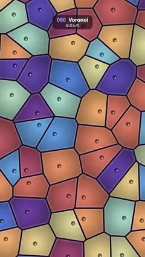

# 050 · Voronoi · 보로노이



**EN** Dusty-coloured Voronoi cells with dark membranes and a glossy nucleus each reshape as their centre points wander on small loops.  
**KO** 어두운 막과 반짝이는 핵을 가진 차분한 색의 보로노이 세포들이, 중심점이 작은 고리를 그리며 떠돌 때마다 모양을 바꾼다.

[Video (mp4)](../videos/050-voronoi.mp4) · [Code](../effects/050-voronoi.js) · Shaders & generative · 셰이더·제너러티브

## Prompt (English)

```text
Create a "Voronoi" motion effect: wandering points divide the screen into colourful cells with dark membranes of even width, and the borders shift as the points move.

Look
- Cell space: x = fragCoord / width × 5 + (0.3, 0.2), so 5 cells across the width (about 216 px each) and about 9 down the height.
- One site in every unit grid square n: site = n + 0.5 + 0.32 · (sin(±a + 2π · h.x), cos(±a + 2π · h.y)), where h is a 2D hash of n and the sign (the direction round) is chosen by another hash of n.
- Cell colour from a cosine palette indexed by a hash of the cell id: c = A + B · cos(2π · (hash + D)), A = (0.62, 0.55, 0.62), B = (0.32, 0.28, 0.25), D = (0, 0.18, 0.40). This gives dusty coral, orange, sand, teal, blue and purple cells.
- Each cell is brighter towards its site: × (1.08 − 0.55 · distance to the site).
- A soft inner rim: mix towards cream #FFF7EB by 0.35 · smoothstep(0.09, 0, edge), where edge = the exact distance to the cell border.
- Membrane: dark #1A0F29 where edge < 0.025 (lines about 11 px wide).
- Nucleus: a disc of radius 0.075 (about 16 px) on each site, in 0.45 × the cell colour, with a small white highlight (radius 0.03, 60 % strength) slightly to the right of and below its centre.

Motion (0–5 s), a = 2π · t / 5
- Every site travels its own small loop once per loop, clockwise or anticlockwise, so the cells swell, shrink and trade neighbours continuously, and the frame at 5 s equals the frame at 0 s.

Technique
- A WebGL2 full-screen fragment shader. Two passes, following Inigo Quilez: first a 3 × 3 neighbour search finds the nearest site (vector mr from the pixel to it); then a 5 × 5 search around that cell gives the exact border distance, edge = min over the other sites of dot(0.5 · (mr + r), normalize(r − mr)). This keeps the membranes an even width, unlike the F2 − F1 distance.
- Antialias every edge (membrane, nucleus, highlight) with a smoothstep over ±1 pixel (1 px = 5 / 1080 cell units), so the moving borders stay clean.

Output and rules
- One self-contained HTML file with no external assets (three.js from a CDN is fine if you use it), drawing on a 1080 × 1920 canvas (9:16) scaled to fit the window.
- Write a function renderFrame(t) that draws the frame for time t in seconds, and preview it with requestAnimationFrame. Everything must be a pure function of t and fixed seeds: no Math.random(), Date or state carried between frames, so frame i = renderFrame(i / 30) can be exported to a 30 fps video.
- Loop seamlessly every 5 seconds: renderFrame(5) must look exactly like renderFrame(0).
- No flicker of any kind: no noise or grain that changes from frame to frame, no strobing or blinking, no z-fighting, no shimmering 1 px lines. Any grain or texture stays fixed to the screen or to the object.
- Keep the top 280 px free of important content (a title label goes there) and fill the whole frame with a designed background.
```

## 프롬프트 (한국어)

```text
"보로노이" 모션 효과를 만들어 줘: 떠도는 점들이 화면을 색색의 세포로 나누고, 고른 두께의 어두운 막으로 된 경계가 점이 움직일 때마다 함께 움직이는 효과.

모양
- 세포 공간: x = fragCoord / 너비 × 5 + (0.3, 0.2). 가로로 세포 5개(각각 약 216 px), 세로로 약 9개.
- 단위 격자 칸 n마다 점(사이트) 하나: 사이트 = n + 0.5 + 0.32 · (sin(±a + 2π · h.x), cos(±a + 2π · h.y)). h는 n의 2D 해시이고, 부호(도는 방향)는 n의 다른 해시로 고른다.
- 세포 색은 세포 id의 해시로 고르는 코사인 팔레트: c = A + B · cos(2π · (해시 + D)), A = (0.62, 0.55, 0.62), B = (0.32, 0.28, 0.25), D = (0, 0.18, 0.40). 차분한 산호·주황·모래·청록·파랑·보라 세포가 나온다.
- 세포는 사이트에 가까울수록 밝다: × (1.08 − 0.55 · 사이트까지의 거리).
- 안쪽의 부드러운 테두리 빛: 0.35 · smoothstep(0.09, 0, edge)만큼 크림색 #FFF7EB 쪽으로 섞는다. edge = 세포 경계까지의 정확한 거리.
- 막: edge < 0.025인 곳은 어두운 #1A0F29(선 두께 약 11 px).
- 핵: 사이트마다 반지름 0.075(약 16 px) 원, 색은 세포 색 × 0.45. 중심에서 살짝 오른쪽 아래에 작은 흰 반사점(반지름 0.03, 세기 60 %).

움직임 (0–5초), a = 2π · t / 5
- 사이트마다 루프당 한 번씩 시계 또는 반시계 방향으로 자기만의 작은 고리를 돈다. 그래서 세포들이 끊임없이 부풀고 줄어들며 이웃을 바꾸고, 5초 화면이 0초 화면과 같다.

기법
- WebGL2 전체 화면 프래그먼트 셰이더. Inigo Quilez 방식의 두 단계: 먼저 3 × 3 이웃을 뒤져 가장 가까운 사이트(픽셀에서 그 사이트로 가는 벡터 mr)를 찾고, 그 칸 둘레 5 × 5를 다시 뒤져 경계까지의 정확한 거리 edge = 다른 사이트들에 대한 dot(0.5 · (mr + r), normalize(r − mr))의 최솟값을 구한다. F2 − F1 거리와 달리 막 두께가 고르게 유지된다.
- 모든 경계(막, 핵, 반사점)를 ±1픽셀 smoothstep으로 안티에일리어싱한다(1 px = 5 / 1080 세포 단위). 그래야 움직이는 경계가 깔끔하다.

출력과 규칙
- 외부 파일 없는 HTML 파일 하나(three.js를 쓴다면 CDN은 괜찮다). 1080 × 1920(9:16) 캔버스에 그리고 창 크기에 맞춰 보이게 한다.
- 시간 t(초)의 프레임을 그리는 renderFrame(t) 함수를 만들고, 미리보기는 requestAnimationFrame으로 돌린다. 모든 것은 t와 고정 시드만으로 정해진다: Math.random(), Date, 프레임 사이에 쌓이는 상태 금지. 그래야 i번째 프레임 = renderFrame(i / 30)으로 30fps 영상을 뽑을 수 있다.
- 5초마다 끊김 없이 반복: renderFrame(5)는 renderFrame(0)과 똑같아 보여야 한다.
- 어떤 깜빡임도 금지: 프레임마다 바뀌는 노이즈·그레인, 번쩍임·깜빡임, z-fighting, 반짝이며 떨리는 1px 선 모두 금지. 그레인·질감은 화면이나 물체에 고정한다.
- 위쪽 280px에는 중요한 내용을 두지 않고(제목 라벨 자리), 화면 전체를 디자인된 배경으로 채운다.
```
