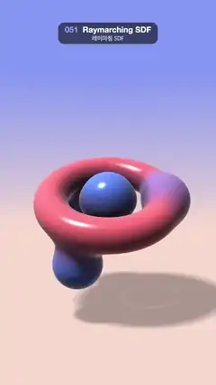

# 051 · Raymarching SDF · 레이마칭 SDF



**EN** A coral torus, a pulsing core and three blue spheres melt into each other as the group spins above a softly shadowed floor.  
**KO** 산호색 도넛, 맥동하는 핵, 파란 구 세 개가 부드럽게 녹아 붙으며 회전하고, 아래 바닥에 부드러운 그림자가 진다.

[Video (mp4)](../videos/051-raymarching-sdf.mp4) · [Code](../effects/051-raymarching-sdf.js) · Shaders & generative · 셰이더·제너러티브

## Prompt (English)

```text
Create a "Raymarching SDF" motion effect: a torus, a pulsing core and three orbiting spheres, all made from signed distance functions, melting into one another as the group spins above a softly shadowed floor.

Look
- Shapes, in object space, with a = 2π · t / 5:
  - a torus lying in the xz plane: major radius 1.15, tube radius 0.32;
  - a core sphere at the centre, radius 0.55 + 0.15 · sin(2a);
  - three spheres (k = 0, 1, 2) of radius 0.42, 0.48 and 0.54 at (1.15 · cos b, 0.9 · sin(2b + k), 1.15 · sin b), with b = a · (1, −2, 1)[k] + k · 120°. They ride round the ring while bobbing up and down through it; the middle one goes the other way, twice as fast.
- Union the spheres and the core with min, then join them to the torus with a polynomial smooth minimum (k = 0.45), so they melt together wherever they meet.
- Colour: coral #FF6B75 on the torus and blue #5C85FF on the spheres, blended across the joins by m = clamp(0.5 + 0.5 · (dTorus − dSpheres) / 0.45, 0, 1).
- Camera: ray origin (0, 0.6, 7.2), direction normalize(uv · 0.78, −2.6) tilted 0.1 rad downward, uv = (2 · fragCoord − resolution) / width + (0, 0.12). The group sits in the middle of the frame with its shadow below it.
- Sky: mix peach #FFDBC7 (low) to periwinkle #8094F5 (high) by clamp(2.2 · dir.y + 0.45, 0, 1).
- Floor: the plane y = −2.3, hit analytically, colour #F7D6CC × (0.68 + 0.32 · soft shadow), fading into the sky between distance 8 and 40.
- Light direction normalize(−0.4, 0.9, 0.35). Shading: base × (0.25 + 0.95 · diffuse · shadow) × (0.55 + 0.45 · AO) + white specular (power 48, × 0.8), then mix towards 1.05 × sky by 0.55 · (1 − n·v)³ for a fresnel rim.

Motion (0–5 s)
- The whole group spins once per loop about its own axis while its tilt towards the camera rocks: 0.5 + 0.25 · sin(a) rad. The spheres orbit and the core pulses as above. Everything is periodic in a, so the loop is seamless.

Technique
- A WebGL2 fragment-shader raymarcher: up to 110 steps, hit when the distance < 0.0008, far limit 14. Normals by central differences (e = 0.0015). Soft shadows with a 40-step march (res = min(res, 8h / t), step clamped to 0.02–0.3). Ambient occlusion = clamp(map(p + 0.25 · n) / 0.25, 0, 1).
- 2 × 2 supersampling per pixel (offsets ±0.25 px) keeps the silhouettes and highlights clean; finish with a slight gamma pow(colour, 0.95).

Output and rules
- One self-contained HTML file with no external assets (three.js from a CDN is fine if you use it), drawing on a 1080 × 1920 canvas (9:16) scaled to fit the window.
- Write a function renderFrame(t) that draws the frame for time t in seconds, and preview it with requestAnimationFrame. Everything must be a pure function of t and fixed seeds: no Math.random(), Date or state carried between frames, so frame i = renderFrame(i / 30) can be exported to a 30 fps video.
- Loop seamlessly every 5 seconds: renderFrame(5) must look exactly like renderFrame(0).
- No flicker of any kind: no noise or grain that changes from frame to frame, no strobing or blinking, no z-fighting, no shimmering 1 px lines. Any grain or texture stays fixed to the screen or to the object.
- Keep the top 280 px free of important content (a title label goes there) and fill the whole frame with a designed background.
```

## 프롬프트 (한국어)

```text
"레이마칭 SDF" 모션 효과를 만들어 줘: 부호 있는 거리 함수로 만든 도넛(토러스), 맥동하는 핵, 궤도를 도는 구 세 개가 서로 녹아 붙으며, 그룹 전체가 부드러운 그림자가 진 바닥 위에서 회전하는 효과.

모양
- 물체 공간의 도형들, a = 2π · t / 5:
  - xz 평면에 누운 토러스: 큰 반지름 1.15, 관 반지름 0.32;
  - 가운데 핵 구, 반지름 0.55 + 0.15 · sin(2a);
  - 구 세 개(k = 0, 1, 2), 반지름 0.42, 0.48, 0.54, 위치 (1.15 · cos b, 0.9 · sin(2b + k), 1.15 · sin b), b = a · (1, −2, 1)[k] + k · 120°. 고리를 따라 돌면서 고리를 위아래로 뚫고 오르내린다. 가운데 것은 반대 방향으로 두 배 빠르게.
- 구와 핵은 min으로 합치고, 토러스와는 다항식 스무스 최솟값(k = 0.45)으로 이어 붙여 만나는 곳마다 녹아 붙게 한다.
- 색: 토러스는 산호색 #FF6B75, 구는 파랑 #5C85FF. 이음새에서는 m = clamp(0.5 + 0.5 · (d토러스 − d구) / 0.45, 0, 1)로 섞는다.
- 카메라: 광선 시작점 (0, 0.6, 7.2), 방향 normalize(uv · 0.78, −2.6)을 아래로 0.1 rad 기울인 것, uv = (2 · fragCoord − 해상도) / 너비 + (0, 0.12). 그룹은 화면 가운데에 있고 그 아래에 그림자가 진다.
- 하늘: clamp(2.2 · 방향.y + 0.45, 0, 1)로 복숭아색 #FFDBC7(낮은 곳) → 연보라빛 파랑 #8094F5(높은 곳).
- 바닥: 평면 y = −2.3, 해석적으로 교차 계산, 색 #F7D6CC × (0.68 + 0.32 · 소프트 섀도). 거리 8에서 40 사이에서 하늘색으로 녹아든다.
- 빛 방향 normalize(−0.4, 0.9, 0.35). 셰이딩: 기본색 × (0.25 + 0.95 · 난반사 · 그림자) × (0.55 + 0.45 · AO) + 흰 정반사(지수 48, × 0.8). 그다음 0.55 · (1 − n·v)³만큼 하늘색 × 1.05 쪽으로 섞어 프레넬 테두리를 준다.

움직임 (0–5초)
- 그룹 전체가 루프마다 자기 축으로 한 바퀴 돌고, 카메라 쪽으로 기운 각도가 0.5 + 0.25 · sin(a) rad로 흔들린다. 구는 위처럼 궤도를 돌고 핵은 맥동한다. 모두 a의 주기 함수라 끊김 없이 반복된다.

기법
- WebGL2 프래그먼트 셰이더 레이마처: 최대 110걸음, 거리 < 0.0008이면 충돌, 최대 거리 14. 법선은 중앙 차분(e = 0.0015). 소프트 섀도는 40걸음 행진(res = min(res, 8h / t), 걸음은 0.02–0.3으로 제한). 앰비언트 오클루전 = clamp(map(p + 0.25 · n) / 0.25, 0, 1).
- 픽셀마다 2 × 2 슈퍼샘플링(오프셋 ±0.25 px)으로 윤곽과 하이라이트를 깔끔하게 하고, 마지막에 살짝 감마 pow(색, 0.95).

출력과 규칙
- 외부 파일 없는 HTML 파일 하나(three.js를 쓴다면 CDN은 괜찮다). 1080 × 1920(9:16) 캔버스에 그리고 창 크기에 맞춰 보이게 한다.
- 시간 t(초)의 프레임을 그리는 renderFrame(t) 함수를 만들고, 미리보기는 requestAnimationFrame으로 돌린다. 모든 것은 t와 고정 시드만으로 정해진다: Math.random(), Date, 프레임 사이에 쌓이는 상태 금지. 그래야 i번째 프레임 = renderFrame(i / 30)으로 30fps 영상을 뽑을 수 있다.
- 5초마다 끊김 없이 반복: renderFrame(5)는 renderFrame(0)과 똑같아 보여야 한다.
- 어떤 깜빡임도 금지: 프레임마다 바뀌는 노이즈·그레인, 번쩍임·깜빡임, z-fighting, 반짝이며 떨리는 1px 선 모두 금지. 그레인·질감은 화면이나 물체에 고정한다.
- 위쪽 280px에는 중요한 내용을 두지 않고(제목 라벨 자리), 화면 전체를 디자인된 배경으로 채운다.
```
